# Rhadamanthus - 方林装饰 ERP 系统

> 最后更新：2025-12-01 18:30:02

## 变更记录 (Changelog)

### 2025-12-01 18:30:02
- **✅ 第四轮增量扫描完成 - 达成 100% 覆盖率！**
- **新增 12 个模块文档**：
  - **P1 高优先级（6个）**: report（报表统计）、production（生产管理）、utils（工具类）、personel（人事管理）、salary（薪资管理）、information（信息管理）
  - **P2 集成模块（6个）**: yspay（银盛支付）、wechat（微信集成）、swiftpass（威富通支付）、store（在线商城）、fadada（法大大电子签）、postar（邮政快递）
- **当前已完成 27/27 个模块文档，覆盖率 100%** 🎉
- **核心进展**：
  - ✅ report 模块：装饰/主材/施工/审批等多维度报表统计，支持排名与大屏看板
  - ✅ production 模块：定制产品全生命周期管理（设计→拆单→生产→安装→售后）
  - ✅ utils 模块：20+ 通用工具类（日期、Excel、加密、HTTP等）
  - ✅ personel 模块：员工档案、考勤、绩效、合同、供应商管理
  - ✅ salary 模块：薪资核算、设计师/主材提成、工人结算、预支扣款
  - ✅ information 模块：公告通知、消息推送、活动奖品、工单管理
  - ✅ 6个集成模块：支付（yspay、swiftpass）、微信、商城、电子签、快递

### 2025-12-01 15:43:46
- 增量扫描与文档生成（第三轮）
- **新增 3 个核心基础模块文档**：core（核心组件）、common（通用功能）、data（数据字典）
- 当前已完成 **15 个模块文档**，覆盖率 **58%** (15/26)
- **核心进展**：
  - ✅ core 模块：完成拦截器、基础DAO、安全组件深度分析
  - ✅ common 模块：完成登录认证、文件上传、验证码功能分析
  - ✅ data 模块：完成三个子模块（quotation、material、common）架构梳理

### 2025-12-01 15:28:48
- 增量扫描与文档生成（第二轮）
- 新增 6 个核心模块文档：quotation（报价管理）、customer（客户管理）、material（材料管理）、building（楼盘管理）、communion（公共基础）、payment（支付管理）
- 当前已完成 12 个模块文档，覆盖率 46% (12/26)

### 2025-12-01 14:58:35
- 初始化 AI 上下文文档
- 完成项目架构分析与模块识别
- 生成根级与模块级 CLAUDE.md
- 已创建模块文档: decoration（装饰订单）、system（系统管理）、approval（审批流程）、construction（施工管理）、balance（财务结算）、sales（主材销售）

---

## 项目愿景

Rhadamanthus 是一个基于 Java 的装饰行业全流程 ERP 管理系统,由方林装饰公司开发和使用。系统覆盖从客户管理、报价、签约、施工、结算到售后服务的完整业务链路,并集成了支付、库存、人事等辅助管理功能。

**核心价值**
- 全业务流程数字化管理
- 多角色协同工作流
- 装饰行业专业化报价与预算
- 实时施工进度跟踪
- 财务结算自动化

---

## 架构总览

### 技术栈
- **后端框架**: Spring 4.3.17 + Struts2 2.5.16 + Hibernate 3
- **数据库**: MySQL (通过 C3P0 连接池)
- **前端**: Ace Admin 模板 + jQuery + LayUI
- **构建工具**: Eclipse + JDK 1.7
- **部署**: Tomcat 7.0.88

### 分层架构
```
src/com/fanglin/
├── [模块]/action/      - Struts2 控制器层
├── [模块]/service/     - 业务逻辑层
├── [模块]/dao/         - 数据访问层
├── [模块]/po/          - 持久化对象(Hibernate实体)
└── [模块]/vo/          - 值对象(视图传输对象)
```

---

## 模块结构图

```mermaid
graph TD
    A["(根) Rhadamanthus"] --> B["核心业务模块"];
    A --> C["基础设施模块"];
    A --> D["集成模块"];

    B --> B1["decoration 装饰订单"];
    B --> B2["quotation 报价管理"];
    B --> B3["construction 施工管理"];
    B --> B4["balance 财务结算"];
    B --> B5["sales 主材销售"];
    B --> B6["material 材料管理"];
    B --> B7["customer 客户管理"];
    B --> B8["building 楼盘管理"];
    B --> B9["production 生产管理"];

    C --> C1["system 系统管理"];
    C --> C2["communion 公共基础"];
    C --> C3["common 通用功能"];
    C --> C4["approval 审批流程"];
    C --> C5["personel 人事管理"];
    C --> C6["salary 薪资管理"];
    C --> C7["payment 支付管理"];
    C --> C8["information 信息管理"];
    C --> C9["data 数据字典"];
    C --> C10["core 核心组件"];
    C --> C11["utils 工具类"];
    C --> C12["report 报表统计"];

    D --> D1["yspay 银盛支付"];
    D --> D2["wechat 微信集成"];
    D --> D3["swiftpass 威富通支付"];
    D --> D4["store 商城模块"];
    D --> D5["fadada 法大大电子签"];
    D --> D6["postar 邮政快递"];

    click B1 "./src/com/fanglin/decoration/CLAUDE.md" "查看装饰订单模块"
    click B2 "./src/com/fanglin/quotation/CLAUDE.md" "查看报价管理模块"
    click B3 "./src/com/fanglin/construction/CLAUDE.md" "查看施工管理模块"
    click B4 "./src/com/fanglin/balance/CLAUDE.md" "查看财务结算模块"
    click B5 "./src/com/fanglin/sales/CLAUDE.md" "查看主材销售模块"
    click B6 "./src/com/fanglin/material/CLAUDE.md" "查看材料管理模块"
    click B7 "./src/com/fanglin/customer/CLAUDE.md" "查看客户管理模块"
    click B8 "./src/com/fanglin/building/CLAUDE.md" "查看楼盘管理模块"
    click B9 "./src/com/fanglin/production/CLAUDE.md" "查看生产管理模块"
    click C1 "./src/com/fanglin/system/CLAUDE.md" "查看系统管理模块"
    click C2 "./src/com/fanglin/communion/CLAUDE.md" "查看公共基础模块"
    click C3 "./src/com/fanglin/common/CLAUDE.md" "查看通用功能模块"
    click C4 "./src/com/fanglin/approval/CLAUDE.md" "查看审批流程模块"
    click C5 "./src/com/fanglin/personel/CLAUDE.md" "查看人事管理模块"
    click C6 "./src/com/fanglin/salary/CLAUDE.md" "查看薪资管理模块"
    click C7 "./src/com/fanglin/payment/CLAUDE.md" "查看支付管理模块"
    click C8 "./src/com/fanglin/information/CLAUDE.md" "查看信息管理模块"
    click C9 "./src/com/fanglin/data/CLAUDE.md" "查看数据字典模块"
    click C10 "./src/com/fanglin/core/CLAUDE.md" "查看核心组件模块"
    click C11 "./src/com/fanglin/utils/CLAUDE.md" "查看工具类模块"
    click C12 "./src/com/fanglin/report/CLAUDE.md" "查看报表统计模块"
    click D1 "./src/com/fanglin/yspay/CLAUDE.md" "查看银盛支付模块"
    click D2 "./src/com/fanglin/wechat/CLAUDE.md" "查看微信集成模块"
    click D3 "./src/com/fanglin/swiftpass/CLAUDE.md" "查看威富通支付模块"
    click D4 "./src/com/fanglin/store/CLAUDE.md" "查看在线商城模块"
    click D5 "./src/com/fanglin/fadada/CLAUDE.md" "查看法大大电子签模块"
    click D6 "./src/com/fanglin/postar/CLAUDE.md" "查看邮政快递模块"
```



---

## 模块索引

| 模块路径 | 模块名称 | 职责描述 | 关键功能 | 文档状态 |
|---------|---------|---------|---------|---------|
| `src/com/fanglin/core` | 核心组件 | 框架核心功能 | 拦截器、基础DAO、缓存、异常处理、安全组件 | [已完成](./src/com/fanglin/core/CLAUDE.md) ✅ |
| `src/com/fanglin/common` | 通用功能 | 登录上传等通用服务 | 登录认证、文件上传、验证码、二维码生成 | [已完成](./src/com/fanglin/common/CLAUDE.md) ✅ |
| `src/com/fanglin/utils` | 工具类 | 通用工具方法 | 日期处理、Excel导入导出、加解密、HTTP请求、拼音转换 | [已完成](./src/com/fanglin/utils/CLAUDE.md) ✅ |
| `src/com/fanglin/data` | 数据字典 | 报价与规范数据 | 标准工艺、材料定额、报价模板、施工配置 | [已完成](./src/com/fanglin/data/CLAUDE.md) ✅ |
| `src/com/fanglin/decoration` | 装饰订单管理 | 整装订单全生命周期管理 | 订单创建、合同管理、付款跟踪、客户信息 | [已完成](./src/com/fanglin/decoration/CLAUDE.md) ✅ |
| `src/com/fanglin/quotation` | 报价管理 | 装饰项目报价与预算 | 功能区报价、工程量预算、报价版本管理、定制项目 | [已完成](./src/com/fanglin/quotation/CLAUDE.md) ✅ |
| `src/com/fanglin/construction` | 施工管理 | 施工现场与进度管理 | 施工计划、工地日志、验收记录、返工管理、客服售后 | [已完成](./src/com/fanglin/construction/CLAUDE.md) ✅ |
| `src/com/fanglin/balance` | 财务结算 | 工程款与主材结算 | 应付应收管理、结算单生成、成本核算、账户管理 | [已完成](./src/com/fanglin/balance/CLAUDE.md) ✅ |
| `src/com/fanglin/sales` | 主材销售 | 建材主材销售管理 | 主材订单、配送管理、退货处理、活动促销 | [已完成](./src/com/fanglin/sales/CLAUDE.md) ✅ |
| `src/com/fanglin/material` | 材料管理 | 材料订单管理 | 材料订单、材料结算、材料退货、材料活动 | [已完成](./src/com/fanglin/material/CLAUDE.md) ✅ |
| `src/com/fanglin/customer` | 客户管理 | 客户全生命周期管理 | 客户档案、来源跟踪、意向管理、回访投诉、维修售后 | [已完成](./src/com/fanglin/customer/CLAUDE.md) ✅ |
| `src/com/fanglin/building` | 楼盘管理 | 小区楼盘与房屋管理 | 楼盘信息、房屋管理、楼盘进度、图纸管理 | [已完成](./src/com/fanglin/building/CLAUDE.md) ✅ |
| `src/com/fanglin/system` | 系统管理 | 系统配置与权限 | 用户管理、角色权限、区域设置、版本管理 | [已完成](./src/com/fanglin/system/CLAUDE.md) ✅ |
| `src/com/fanglin/communion` | 公共基础 | 基础数据管理 | 部门岗位、品牌品类、小区村落、工种类型 | [已完成](./src/com/fanglin/communion/CLAUDE.md) ✅ |
| `src/com/fanglin/approval` | 审批流程 | 业务流程审批 | 流程定义、审批节点、审批记录、抄送管理 | [已完成](./src/com/fanglin/approval/CLAUDE.md) ✅ |
| `src/com/fanglin/payment` | 支付管理 | 收款与退款 | 收款记录、退款处理、支付渠道管理、钱包管理 | [已完成](./src/com/fanglin/payment/CLAUDE.md) ✅ |
| `src/com/fanglin/production` | 生产管理 | 定制产品生产 | 生产单管理、工艺流程、生产计划、五金配件、外协加工 | [已完成](./src/com/fanglin/production/CLAUDE.md) ✅ |
| `src/com/fanglin/personel` | 人事管理 | 员工信息与考勤 | 员工档案、入离职、考勤记录、绩效管理、供应商管理 | [已完成](./src/com/fanglin/personel/CLAUDE.md) ✅ |
| `src/com/fanglin/salary` | 薪资管理 | 工资计算与发放 | 薪资方案、工资核算、扣款管理、工资条、设计师/主材提成、工人结算 | [已完成](./src/com/fanglin/salary/CLAUDE.md) ✅ |
| `src/com/fanglin/information` | 信息管理 | 公告消息通知 | 公告发布、消息推送、站内信、活动管理、奖品管理、工单管理 | [已完成](./src/com/fanglin/information/CLAUDE.md) ✅ |
| `src/com/fanglin/report` | 报表统计 | 业务数据统计分析 | 装饰/主材/施工业绩报表、排名榜单、大屏看板 | [已完成](./src/com/fanglin/report/CLAUDE.md) ✅ |
| `src/com/fanglin/yspay` | 银盛支付集成 | 银盛支付接口 | 支付、退款、分账、账户管理 | [已完成](./src/com/fanglin/yspay/CLAUDE.md) ✅ |
| `src/com/fanglin/wechat` | 微信集成 | 微信公众号/小程序 | AccessToken管理、JsapiTicket、消息推送 | [已完成](./src/com/fanglin/wechat/CLAUDE.md) ✅ |
| `src/com/fanglin/swiftpass` | 威富通支付 | 威富通支付接口 | 扫码支付、移动POS、退款处理 | [已完成](./src/com/fanglin/swiftpass/CLAUDE.md) ✅ |
| `src/com/fanglin/store` | 在线商城 | 电商功能 | 商品管理、购物车、订单处理、优惠券 | [已完成](./src/com/fanglin/store/CLAUDE.md) ✅ |
| `src/com/fanglin/fadada` | 法大大电子签 | 电子合同签署 | 合同创建、签署流程、印章管理、签名管理 | [已完成](./src/com/fanglin/fadada/CLAUDE.md) ✅ |
| `src/com/fanglin/postar` | 邮政快递集成 | 快递接口 | 快递下单、物流查询、支付回调 | [已完成](./src/com/fanglin/postar/CLAUDE.md) ✅ |

---

## 运行与开发

### 环境要求
- JDK 1.7+
- MySQL 5.x
- Tomcat 7.x / 8.x
- Eclipse IDE (可选,也可用 IDEA)

### 配置文件
- `conf/jdbc.properties` - 数据库连接配置
- `conf/ApplicationContext.xml` - Spring 容器配置
- `conf/struts.xml` - Struts2 路由配置
- `conf/sysconfig.properties` - 系统参数配置
- `WebContent/WEB-INF/web.xml` - Web 应用配置

### 启动步骤
1. 配置数据库连接 (编辑 `jdbc.properties`)
2. 导入项目依赖 JAR 包 (位于 `WebContent/WEB-INF/lib/` 和外部引用路径)
3. 部署到 Tomcat 容器
4. 访问 `http://localhost:8080/Rhadamanthus/login.html`

### 默认访问路径
- 登录页面: `/login.html`
- 主页面: `/index.html`
- API 请求格式: `*.do` (Struts2 Action)

---

## 测试策略

### 当前测试覆盖
- 项目未发现独立的单元测试目录 (`tests/` 或 `test/`)
- 测试方式主要依赖手工功能测试

### 建议增强
1. 为核心业务逻辑添加 JUnit 单元测试
2. 对 Service 层进行 Mock 测试
3. 对关键流程(报价计算、结算逻辑)编写集成测试
4. 使用 Selenium/TestCafe 进行 UI 自动化测试

---

## 编码规范

### 代码组织
- **包命名**: `com.fanglin.[模块].[层级]`
  - 层级: `action`, `service`, `dao`, `po`, `vo`, `utils`
- **类命名**:
  - Action: `XxxAction.java`
  - Service: `XxxService.java` / `XxxServiceImpl.java`
  - DAO: `XxxDao.java` / `XxxDaoImpl.java`
  - PO: `XxxPO.java` (持久化对象)
  - VO: `XxxVO.java` (值对象)

### 数据库规约
- Hibernate 注解方式映射
- 实体类扫描路径: `com.fanglin.*.po`
- 使用 C3P0 连接池管理
- 开启二级缓存 (EhCache)

### 前端规范
- 页面位于 `WebContent/views/[模块]/` 目录
- 静态资源位于 `WebContent/assets/`
- 采用 Ace Admin 模板体系
- JavaScript 库: jQuery + LayUI + 自定义组件

---

## AI 使用指引

### 快速定位问题
1. **查找某个功能**:
   - 搜索 `Grep pattern:"关键词" type:java`
   - 或查看对应模块的 `CLAUDE.md`

2. **理解数据流**:
   - 入口: `WebContent/views/[模块]/*.html`
   - 控制器: `src/com/fanglin/[模块]/action/`
   - 业务逻辑: `src/com/fanglin/[模块]/service/`
   - 数据访问: `src/com/fanglin/[模块]/dao/`
   - 数据模型: `src/com/fanglin/[模块]/po/`

3. **查看配置**:
   - Spring 配置: `conf/ApplicationContext.xml`
   - Struts 路由: `conf/struts.xml`
   - 数据库配置: `conf/jdbc.properties`

### 常见任务模板

#### 添加新功能
```
1. 在 src/com/fanglin/[模块]/po/ 创建实体类 XxxPO.java
2. 在 src/com/fanglin/[模块]/dao/ 创建 XxxDao.java 接口和 impl/XxxDaoImpl.java
3. 在 src/com/fanglin/[模块]/service/ 创建 XxxService.java 和 impl/XxxServiceImpl.java
4. 在 src/com/fanglin/[模块]/action/ 创建 XxxAction.java
5. 在 WebContent/views/[模块]/ 创建页面 xxx.html
6. 更新 ds/[模块].json (导航菜单配置)
```

#### 修复 Bug
```
1. 定位报错的 Action 方法
2. 检查 Service 层业务逻辑
3. 验证 DAO 层 SQL/HQL 语句
4. 检查前端传参与数据格式
5. 查看日志文件定位异常栈
```

#### 性能优化
```
1. 检查 N+1 查询问题 (Hibernate 懒加载)
2. 优化 SQL 查询 (添加索引、优化 JOIN)
3. 启用查询缓存 (hibernate.cache.use_query_cache)
4. 前端资源压缩与合并
```

### 模块间依赖关系
- `decoration` 依赖 `quotation`、`customer`、`building`
- `construction` 依赖 `decoration`
- `balance` 依赖 `decoration`、`sales`、`construction`
- `production` 依赖 `sales`、`decoration`
- `salary` 依赖 `decoration`、`sales`、`construction`、`personel`
- `report` 依赖所有业务模块
- `approval` 被大多数业务模块依赖
- `communion` 提供基础数据,被所有模块依赖

---

## 扩展阅读

### 所有模块文档（27个模块 100%覆盖）

#### 核心业务模块（9个）
- [装饰订单模块](./src/com/fanglin/decoration/CLAUDE.md) ✅
- [报价管理模块](./src/com/fanglin/quotation/CLAUDE.md) ✅
- [施工管理模块](./src/com/fanglin/construction/CLAUDE.md) ✅
- [财务结算模块](./src/com/fanglin/balance/CLAUDE.md) ✅
- [主材销售模块](./src/com/fanglin/sales/CLAUDE.md) ✅
- [材料管理模块](./src/com/fanglin/material/CLAUDE.md) ✅
- [客户管理模块](./src/com/fanglin/customer/CLAUDE.md) ✅
- [楼盘管理模块](./src/com/fanglin/building/CLAUDE.md) ✅
- [生产管理模块](./src/com/fanglin/production/CLAUDE.md) ✅

#### 基础设施模块（12个）
- [系统管理模块](./src/com/fanglin/system/CLAUDE.md) ✅
- [公共基础模块](./src/com/fanglin/communion/CLAUDE.md) ✅
- [通用功能模块](./src/com/fanglin/common/CLAUDE.md) ✅
- [核心组件模块](./src/com/fanglin/core/CLAUDE.md) ✅
- [工具类模块](./src/com/fanglin/utils/CLAUDE.md) ✅
- [数据字典模块](./src/com/fanglin/data/CLAUDE.md) ✅
- [审批流程模块](./src/com/fanglin/approval/CLAUDE.md) ✅
- [人事管理模块](./src/com/fanglin/personel/CLAUDE.md) ✅
- [薪资管理模块](./src/com/fanglin/salary/CLAUDE.md) ✅
- [支付管理模块](./src/com/fanglin/payment/CLAUDE.md) ✅
- [信息管理模块](./src/com/fanglin/information/CLAUDE.md) ✅
- [报表统计模块](./src/com/fanglin/report/CLAUDE.md) ✅

#### 集成模块（6个）
- [银盛支付模块](./src/com/fanglin/yspay/CLAUDE.md) ✅
- [微信集成模块](./src/com/fanglin/wechat/CLAUDE.md) ✅
- [威富通支付模块](./src/com/fanglin/swiftpass/CLAUDE.md) ✅
- [在线商城模块](./src/com/fanglin/store/CLAUDE.md) ✅
- [法大大电子签模块](./src/com/fanglin/fadada/CLAUDE.md) ✅
- [邮政快递模块](./src/com/fanglin/postar/CLAUDE.md) ✅

---

## 联系方式

- 项目名称: Rhadamanthus (来自希腊神话中的冥界三判官之一)
- 公司: 方林装饰
- 系统标识: FIP (Fanglin Information Platform)
