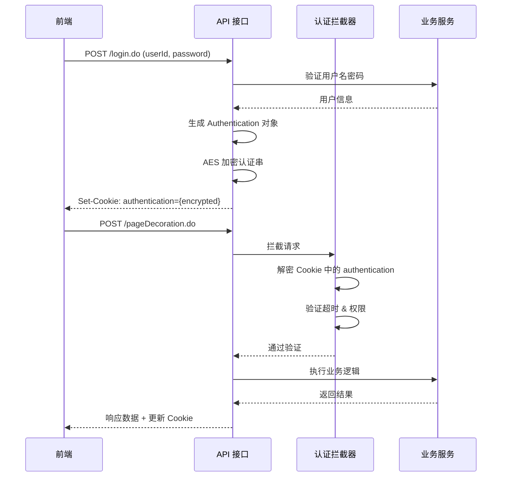

# Rhadamanthus ERP - API 接口文档

> 最后更新：2025-12-02 自动生成
> API 版本：8.3.x

---

## 目录

- [概述](#概述)
- [接口规范](#接口规范)
- [认证与授权](#认证与授权)
- [通用响应格式](#通用响应格式)
- [错误码说明](#错误码说明)
- [分页查询规范](#分页查询规范)
- [数值字段精度转换规则](#数值字段精度转换规则) ⭐ **重要**
- [模块接口清单](#模块接口清单)
- [接口示例](#接口示例)

---

## 概述

Rhadamanthus ERP 系统采用 **Struts2 + REST** 风格的 API 架构，所有接口以 `.do` 后缀结尾。系统支持多模块、多角色、多公司的业务隔离，通过 AES 加密的认证串保证接口安全。

### 技术架构

- **后端框架**: Struts2 2.5.16 + Spring 4.3.17 + Hibernate 3
- **数据格式**: JSON (UTF-8)
- **传输协议**: HTTP/HTTPS
- **认证方式**: Cookie + AES 加密认证串
- **字符编码**: UTF-8

### API 基本信息

| 项目 | 说明 |
|------|------|
| **Base URL** | `http://{server_host}/` |
| **请求方式** | POST (推荐) / GET (仅查询接口) |
| **Content-Type** | `application/json; charset=UTF-8` |
| **超时时间** | 默认 30 分钟（可配置） |
| **限流策略** | 同一接口 5 秒内防重复提交 |

---

## 接口规范

### 1. 请求规范

#### 请求 URL 格式

```
POST {Base URL}{ActionName}.do
```

**示例**:
```
POST http://192.168.5.21/pageDecoration.do
POST http://192.168.5.21/createDecoration.do
```

#### 请求头 (Headers)

```http
Content-Type: application/x-www-form-urlencoded; charset=UTF-8
Cookie: authentication={encrypted_token}; loginTime={timestamp}
```

#### 请求参数格式

**方式 1: 表单参数** (推荐)

```http
POST /pageDecoration.do HTTP/1.1
Content-Type: application/x-www-form-urlencoded

authentication=xxx&paging.page=1&paging.rows=20&filters[0].field=status&filters[0].op=eq&filters[0].data=1
```

**方式 2: JSON Body** (部分接口支持)

```http
POST /createDecoration.do HTTP/1.1
Content-Type: application/json

{
  "authentication": "xxx",
  "decoration": {
    "customerId": "C001",
    "houseId": "H001",
    "totalAmount": 180000
  }
}
```

---

### 2. 响应规范

#### 响应头 (Headers)

```http
HTTP/1.1 200 OK
Content-Type: application/json; charset=UTF-8
Set-Cookie: authentication={updated_token}; Path=/; HttpOnly
```

#### 响应体格式

**成功响应** (`errorCode == 0`):

```json
{
  "errorCode": 0,
  "errorMsg": "",
  "data": {
    "key1": "value1",
    "key2": "value2"
  },
  "paging": {
    "page": 1,
    "rows": 20,
    "records": 150,
    "total": 8
  }
}
```

**失败响应** (`errorCode != 0`):

```json
{
  "errorCode": 110005,
  "errorMsg": "登陆超时,请重新登陆",
  "data": null
}
```

---

## 认证与授权

### 1. 认证流程



### 2. Authentication 对象结构

```java
{
  "userId": "U001",          // 用户 ID
  "userName": "张三",        // 用户名
  "roleId": 5,              // 角色 ID
  "updateTime": 1733126400, // 认证生成时间戳（秒）
  "company": 1,             // 公司编号
  "timeout": 0,             // 是否允许超时 (0=否, 1=是)
  "rollcall": 0             // 是否需要点名验证 (0=否, 1=是)
}
```

**序列化格式** (加密前):
```
userId=U001,roleId=5,userName=张三,updateTime=1733126400,company=1,timeout=0,rollcall=0
```

**加密算法**: AES-128-CBC (密钥和 IV 在 `conf/sysconfig.properties` 中配置)

### 3. 认证传递方式

**方式 1: Cookie** (推荐)

```http
Cookie: authentication={encrypted_token}; loginTime={timestamp}
```

**方式 2: 请求参数** (备用)

```http
POST /pageDecoration.do?authentication={encrypted_token}
```

### 4. 权限级别

| 级别 | 配置值 | 说明 | 示例接口 |
|------|--------|------|---------|
| **完全放行** | `THROUGH_PASS (0)` | 无需认证 | `login.do`, `getVerifyCode.do` |
| **仅验证认证串** | `THROUGH_COMMON (1)` | 认证串存在即可 | 公共查询接口 |
| **钉钉签名** | `THROUGH_DINGTALK (2)` | 钉钉回调专用 | 钉钉消息推送 |
| **完整权限验证** | 其他 | 需验证用户权限 | 大部分业务接口 |

---

## 通用响应格式

### 1. 响应字段说明

| 字段 | 类型 | 必填 | 说明 |
|------|------|------|------|
| `errorCode` | Integer | 是 | 错误码，0 表示成功 |
| `errorMsg` | String | 是 | 错误信息，成功时为空字符串 |
| `data` | Object | 否 | 业务数据对象 |
| `paging` | Object | 否 | 分页信息（仅分页接口） |

### 2. 分页信息 (paging)

| 字段 | 类型 | 说明 |
|------|------|------|
| `page` | Integer | 当前页码（从 1 开始） |
| `rows` | Integer | 每页记录数 |
| `records` | Integer | 总记录数 |
| `total` | Integer | 总页数 |

**示例**:
```json
{
  "errorCode": 0,
  "errorMsg": "",
  "decorations": [
    { "decorationOrderId": "D202512010001", "customerName": "张三" }
  ],
  "paging": {
    "page": 1,
    "rows": 20,
    "records": 150,
    "total": 8
  }
}
```

---

## 错误码说明

### 系统级错误码

| 错误码 | 错误信息 | 说明 | 处理建议 |
|--------|---------|------|---------|
| `0` | 操作成功 | 请求成功 | 正常处理响应数据 |
| `-1` | 系统异常 | 未捕获的异常 | 联系技术支持 |
| `-2` | 权限不足 | 无操作权限 | 检查用户角色权限 |
| `-3` | 参数错误 | 必填参数缺失或格式错误 | 检查请求参数 |
| `-4` | 数据不存在 | 查询的记录不存在 | 检查 ID 是否正确 |
| `-5` | 数据重复 | 唯一约束冲突 | 检查重复数据 |

### 认证相关错误码

| 错误码 | 错误信息 | 说明 | 处理建议 |
|--------|---------|------|---------|
| `110001` | 用户名或密码错误 | 登录失败 | 提示用户重新输入 |
| `110002` | 用户已被禁用 | 账号被封禁 | 联系管理员 |
| `110003` | 验证码错误 | 验证码输入错误 | 刷新验证码重试 |
| `110004` | 验证码过期 | 验证码超时 | 刷新验证码 |
| `110005` | 登陆超时,请重新登陆 | 认证超时 | 跳转登录页 |
| `110006` | 认证串解密失败 | 认证串被篡改或密钥错误 | 清除 Cookie 重新登录 |

### 业务级错误码（示例）

| 错误码 | 错误信息 | 说明 |
|--------|---------|------|
| `200001` | 客户信息不存在 | 关联客户不存在 |
| `200002` | 房屋信息不存在 | 关联房屋不存在 |
| `200003` | 订单状态不允许此操作 | 状态流转限制 |
| `200004` | 付款金额超过应付金额 | 付款金额校验失败 |
| `200005` | 订单已结算，不允许修改 | 结算后锁定 |

---

## 分页查询规范

### 1. 分页参数

**请求参数**:

| 参数 | 类型 | 必填 | 默认值 | 说明 |
|------|------|------|--------|------|
| `paging.page` | Integer | 否 | 1 | 页码（从 1 开始） |
| `paging.rows` | Integer | 否 | 20 | 每页记录数 |
| `filters` | Array | 否 | [] | 查询条件数组 |
| `statuses` | Array | 否 | null | 状态过滤（多选） |

### 2. 过滤条件 (filters)

**Filter 对象结构**:

| 字段 | 类型 | 必填 | 说明 |
|------|------|------|------|
| `field` | String | 是 | 字段名（如 `customerName`） |
| `op` | String | 是 | 操作符（见下表） |
| `data` | String | 是 | 值 |
| `range` | Array | 否 | 范围值（IN 查询） |

**支持的操作符**:

| 操作符 | 含义 | SQL 等价 | 示例 |
|--------|------|----------|------|
| `eq` | 等于 | `= value` | `status = 1` |
| `ne` | 不等于 | `!= value` | `status != 0` |
| `lt` | 小于 | `< value` | `amount < 10000` |
| `le` | 小于等于 | `<= value` | `amount <= 10000` |
| `gt` | 大于 | `> value` | `amount > 10000` |
| `ge` | 大于等于 | `>= value` | `amount >= 10000` |
| `cn` | 包含（模糊匹配） | `LIKE '%value%'` | `customerName LIKE '%张三%'` |
| `nc` | 不包含 | `NOT LIKE '%value%'` | `customerName NOT LIKE '%张三%'` |
| `bw` | 开头匹配 | `LIKE 'value%'` | `orderNo LIKE 'D2025%'` |
| `ew` | 结尾匹配 | `LIKE '%value'` | `phone LIKE '%0001'` |
| `in` | 在列表中 | `IN (...)` | `status IN (1,2,3)` |
| `ni` | 不在列表中 | `NOT IN (...)` | `status NOT IN (0,9)` |

### 3. 分页请求示例

```http
POST /pageDecoration.do HTTP/1.1
Content-Type: application/x-www-form-urlencoded

authentication=xxx
&paging.page=2
&paging.rows=20
&filters[0].field=customerName
&filters[0].op=cn
&filters[0].data=张三
&filters[1].field=status
&filters[1].op=in
&filters[1].range=1,2,3
&statuses=1,2,3
```

**等价的 JavaScript 代码**:

```javascript
com.post(api.decoration.pageDecoration, {
    "paging.page": 2,
    "paging.rows": 20,
    "filters": [
        { field: "customerName", op: "cn", data: "张三" },
        { field: "status", op: "in", range: [1, 2, 3] }
    ],
    "statuses": [1, 2, 3]
}, function(res) {
    console.log('总记录数:', res.paging.records);
    console.log('订单列表:', res.decorations);
});
```

### 4. 分页降级策略

为保护数据库性能，系统对深度分页进行了降级：

| 条件 | 结果 |
|------|------|
| **第 30 页之后 且 每页 > 10 条** | 返回空结果 |
| **第 60 页之后** | 返回空结果（无论每页多少条） |

**建议**:
1. 添加精确的查询条件，减少总记录数
2. 使用时间范围或 ID 范围过滤
3. 考虑使用游标分页代替页码分页

---

## 数值字段精度转换规则

### ⚠️ 重要：后台数值存储规范

本系统后台存储**金额**、**数量**等数值类型字段时，采用**整数存储**方式，精度为 **3 位小数**（即乘以 1000）。

#### 存储规则

| 前台显示值 | 后台存储值 | 转换倍数 | 说明 |
|-----------|-----------|---------|------|
| `1` | `1000` | × 1000 | 1 元 = 1000 分（数据库存储） |
| `99.5` | `99500` | × 1000 | 99.5 元 = 99500 分 |
| `0.001` | `1` | × 1000 | 0.001 元 = 1 分 |
| `180000.00` | `180000000` | × 1000 | 18万元 = 180000000 分 |

**核心原因**：
- ✅ 避免浮点数精度丢失（如 `0.1 + 0.2 = 0.30000000000000004`）
- ✅ 保证财务计算的精确性
- ✅ 支持高精度的小数运算（精确到 0.001）

---

### 前端 API 配置规范

#### 1. 在 API 定义中标记数值字段

在 `js/api/[模块].js` 文件中定义接口时，需要通过 `convert` 参数标记需要转换的数值字段：

```javascript
// js/api/decoration.js
$.extend(api, {
    decoration: {
        // 创建装饰订单
        createDecoration: {
            url: "createDecoration.do",
            validate: {
                "decoration.customerId": { required: true },
                "decoration.totalAmount": { required: true }
            },
            convert: {
                // 标记需要乘以 1000 的字段
                "decoration.totalAmount": "multiply",      // 总金额
                "decoration.paidAmount": "multiply",       // 已付金额
                "decoration.unpaidAmount": "multiply",     // 未付金额
                "decorationInfo.buildingArea": "multiply", // 建筑面积
                "decorationInfo.useArea": "multiply"       // 使用面积
            }
        },

        // 查询装饰订单（返回时需要除以 1000）
        queryDecorationByOrderId: {
            url: "queryDecorationByOrderId.do",
            convert: {
                // 标记需要除以 1000 的字段
                "decoration.totalAmount": "divide",
                "decoration.paidAmount": "divide",
                "decoration.unpaidAmount": "divide"
            }
        }
    }
});
```

#### 2. 转换类型说明

| 转换类型 | 说明 | 使用场景 | 公式 |
|---------|------|---------|------|
| `multiply` | 乘以 1000 | **请求时**（前端 → 后端） | `value × 1000` |
| `divide` | 除以 1000 | **响应时**（后端 → 前端） | `value ÷ 1000` |

#### 3. com.post 自动转换机制

`com.post` 方法在发送请求和接收响应时，会自动根据 API 配置进行数值转换：

```javascript
// 前端调用示例
com.post(api.decoration.createDecoration, {
    "decoration.customerId": "C001",
    "decoration.totalAmount": 180000.00,  // 前端输入：18万元
    "decoration.paidAmount": 54000.00,    // 前端输入：5.4万元
    "decorationInfo.buildingArea": 120.5  // 前端输入：120.5 平米
}, function(res) {
    console.log('订单创建成功');
});

// com.post 自动转换后实际发送的参数：
// {
//   "decoration.customerId": "C001",
//   "decoration.totalAmount": 180000000,  // 自动 × 1000
//   "decoration.paidAmount": 54000000,    // 自动 × 1000
//   "decorationInfo.buildingArea": 120500 // 自动 × 1000
// }
```

#### 4. 响应数据自动转换

查询接口返回的数据也会自动转换：

```javascript
com.post(api.decoration.queryDecorationByOrderId, {
    "decorationOrderId": "D202512010001"
}, function(res) {
    // 后端返回的原始数据：
    // {
    //   "decoration": {
    //     "totalAmount": 180000000,
    //     "paidAmount": 54000000
    //   }
    // }

    // com.post 自动除以 1000 后的数据：
    console.log(res.decoration.totalAmount);  // 180000.00
    console.log(res.decoration.paidAmount);   // 54000.00
});
```

---

### 需要转换的字段类型

以下字段类型**必须**在 API 配置中标记转换：

#### 1. 金额类字段（单位：元）

| 字段名模式 | 说明 | 示例 |
|-----------|------|------|
| `*Amount` | 金额 | `totalAmount`, `paidAmount`, `unpaidAmount` |
| `*Price` | 价格 | `unitPrice`, `totalPrice`, `discountPrice` |
| `*Money` | 费用 | `managementMoney`, `serviceMoney` |
| `*Fee` | 费用 | `designFee`, `constructionFee` |
| `*Cost` | 成本 | `materialCost`, `laborCost` |

#### 2. 数量类字段

| 字段名模式 | 说明 | 示例 |
|-----------|------|------|
| `*Num` | 数量 | `orderNum`, `deliveryNum`, `refundNum` |
| `*Quantity` | 数量 | `totalQuantity`, `availableQuantity` |
| `*Count` | 计数 | `productCount`, `itemCount` |

#### 3. 面积类字段（单位：平方米）

| 字段名模式 | 说明 | 示例 |
|-----------|------|------|
| `*Area` | 面积 | `buildingArea`, `useArea`, `constructionArea` |

#### 4. 长度类字段（单位：米）

| 字段名模式 | 说明 | 示例 |
|-----------|------|------|
| `*Length` | 长度 | `roomLength`, `wallLength` |
| `*Width` | 宽度 | `roomWidth`, `doorWidth` |
| `*Height` | 高度 | `floorHeight`, `ceilingHeight` |

---

### 完整示例

#### 示例 1: 创建主材销售订单

**API 配置** (`js/api/sales.js`):
```javascript
$.extend(api, {
    sales: {
        createSales: {
            url: "createSales.do",
            convert: {
                // 销售订单金额字段
                "sales.totalAmount": "multiply",
                "sales.discountAmount": "multiply",
                "sales.actualAmount": "multiply",

                // 销售项明细（数组）
                "salesItems[*].quantity": "multiply",      // 数量
                "salesItems[*].unitPrice": "multiply",     // 单价
                "salesItems[*].totalPrice": "multiply",    // 小计
                "salesItems[*].discountPrice": "multiply"  // 折扣金额
            }
        },

        querySalesByOrderId: {
            url: "querySalesByOrderId.do",
            convert: {
                "sales.totalAmount": "divide",
                "sales.actualAmount": "divide",
                "salesItems[*].quantity": "divide",
                "salesItems[*].unitPrice": "divide",
                "salesItems[*].totalPrice": "divide"
            }
        }
    }
});
```

**前端调用**:
```javascript
// 创建订单
com.post(api.sales.createSales, {
    "sales.totalAmount": 12000.50,      // 前端输入
    "sales.discountAmount": 500.00,
    "sales.actualAmount": 11500.50,
    "salesItems[0].quantity": 10,       // 10 件
    "salesItems[0].unitPrice": 1200.05, // 单价 1200.05 元
    "salesItems[0].totalPrice": 12000.50
}, function(res) {
    console.log('订单创建成功:', res.sales.salesOrderId);
});

// 实际发送到后端：
// {
//   "sales.totalAmount": 12000500,
//   "sales.discountAmount": 500000,
//   "sales.actualAmount": 11500500,
//   "salesItems[0].quantity": 10000,
//   "salesItems[0].unitPrice": 1200050,
//   "salesItems[0].totalPrice": 12000500
// }
```

#### 示例 2: 批量更新配送数量

**API 配置** (`js/api/sales.js`):
```javascript
$.extend(api, {
    sales: {
        tranSalesDeliveryItem: {
            url: "tranSalesDeliveryItem.do",
            convert: {
                "salesDeliveryItems[*].trnum": "multiply"  // 到货量
            }
        }
    }
});
```

**前端调用**:
```javascript
com.post(api.sales.tranSalesDeliveryItem, {
    "salesDeliveryItems[0].sdiid": 12345,
    "salesDeliveryItems[0].trnum": 100.5  // 前端输入 100.5 件
}, function(res) {
    com.showAlert(com.info, '配送成功，到货量已更新');
});

// 实际发送到后端：
// {
//   "salesDeliveryItems[0].sdiid": 12345,
//   "salesDeliveryItems[0].trnum": 100500  // 自动 × 1000
// }
```

---

### 特殊情况处理

#### 1. 数组字段转换

使用 `[*]` 通配符匹配数组中的所有元素：

```javascript
convert: {
    "items[*].amount": "multiply",      // 转换数组中所有元素的 amount
    "items[*].details[*].price": "multiply"  // 嵌套数组也支持
}
```

#### 2. 嵌套对象转换

支持多层嵌套对象的字段转换：

```javascript
convert: {
    "decoration.quotation.totalAmount": "multiply",
    "decoration.quotation.items[*].price": "multiply"
}
```

#### 3. 条件转换（暂不支持）

如果某个字段只在特定条件下需要转换，请在业务代码中手动处理：

```javascript
var amount = $("#amount").val();
if (needConvert) {
    amount = amount * 1000;
}
```

---

### 调试技巧

#### 1. 查看转换后的实际请求参数

在浏览器控制台查看 Network 请求，或在 `com.post` 前后添加日志：

```javascript
var params = {
    "decoration.totalAmount": 180000.00
};

console.log('转换前:', params);

com.post(api.decoration.createDecoration, params, function(res) {
    console.log('响应数据:', res);
});
```

#### 2. 临时禁用转换（调试用）

在 API 配置中注释掉 `convert` 字段：

```javascript
createDecoration: {
    url: "createDecoration.do",
    // convert: {  // 临时注释，调试用
    //     "decoration.totalAmount": "multiply"
    // }
}
```

#### 3. 验证转换正确性

```javascript
// 测试用例
var testAmount = 180000.00;
var converted = testAmount * 1000;  // 180000000
var restored = converted / 1000;    // 180000.00

console.assert(restored === testAmount, '转换错误');
```

---

### 常见错误

#### ❌ 错误 1: 忘记配置 convert

```javascript
// 错误示例
createDecoration: {
    url: "createDecoration.do"
    // 缺少 convert 配置，金额不会转换！
}

// 调用时会发送错误的值：
com.post(api.decoration.createDecoration, {
    "decoration.totalAmount": 180000.00  // 后端收到 180000，而非 180000000
});
```

**后果**: 数据库存储 180000，实际应该是 180000000，导致金额错误 1000 倍！

#### ❌ 错误 2: 转换方向错误

```javascript
// 错误示例：查询接口使用了 multiply
queryDecoration: {
    url: "queryDecoration.do",
    convert: {
        "decoration.totalAmount": "multiply"  // ❌ 应该用 "divide"
    }
}
```

**后果**: 后端返回 180000000，前端又乘以 1000 = 180000000000，显示错误！

#### ❌ 错误 3: 字段路径错误

```javascript
convert: {
    "totalAmount": "multiply"  // ❌ 缺少对象前缀
}

// 正确写法：
convert: {
    "decoration.totalAmount": "multiply"  // ✅ 完整路径
}
```

---

### 最佳实践

#### ✅ 1. 统一配置规范

在每个模块的 API 文件顶部添加注释，标记哪些字段需要转换：

```javascript
/**
 * 装饰订单模块 API
 *
 * 需要转换的字段（精度 × 1000）：
 * - totalAmount: 总金额
 * - paidAmount: 已付金额
 * - unpaidAmount: 未付金额
 * - buildingArea: 建筑面积
 * - useArea: 使用面积
 */
$.extend(api, {
    decoration: {
        // ...
    }
});
```

#### ✅ 2. 代码审查清单

在提交代码前检查：
- [ ] 所有金额字段都配置了 `convert`
- [ ] 转换方向正确（请求用 `multiply`，响应用 `divide`）
- [ ] 字段路径完整（包含对象前缀）
- [ ] 数组字段使用了 `[*]` 通配符

#### ✅ 3. 单元测试

为关键接口编写测试用例：

```javascript
// 测试金额转换
QUnit.test('创建订单 - 金额转换', function(assert) {
    var params = {
        "decoration.totalAmount": 180000.00
    };

    var converted = applyConvert(params, api.decoration.createDecoration.convert);

    assert.equal(converted["decoration.totalAmount"], 180000000, '金额转换正确');
});
```

---

## 模块接口清单

### 装饰订单模块 (decoration)

#### 1. 查询接口

| 接口名称 | 路径 | 功能 | 权限 |
|---------|------|------|------|
| **分页查询订单** | `/pageDecoration.do` | 分页查询装饰订单列表 | 通用 |
| **综合查询** | `/pageDecorationForGeneral.do` | 支持多条件综合查询 | 通用 |
| **按公司查询** | `/pageDecorationForCompany.do` | 按公司筛选订单 | 管理员 |
| **按客户查询** | `/pageDecorationForCustomer.do` | 查询客户的所有订单 | 通用 |
| **按设计师查询** | `/pageDecorationForDesigner.do` | 查询设计师负责的订单 | 设计师 |
| **按业务员查询** | `/pageDecorationForSalesman.do` | 查询业务员跟进的订单 | 业务员 |
| **查询单个订单** | `/queryDecorationByOrderId.do` | 根据订单 ID 查询详情 | 通用 |

**查询示例**: `pageDecoration.do`

**请求参数**:
```json
{
  "paging.page": 1,
  "paging.rows": 20,
  "filters": [
    { "field": "status", "op": "eq", "data": "2" }
  ],
  "statuses": [1, 2, 3],
  "companyType": 1
}
```

**响应数据**:
```json
{
  "errorCode": 0,
  "errorMsg": "",
  "decorations": [
    {
      "decorationOrderId": "D202512010001",
      "customerName": "张三",
      "customerPhone": "13800138000",
      "villageName": "阳光小区",
      "decorationType": 1,
      "totalAmount": 180000.00,
      "paidAmount": 54000.00,
      "unpaidAmount": 126000.00,
      "status": 2,
      "designerName": "李设计",
      "salesmanName": "王业务",
      "contractTime": 1701388800000,
      "createTime": 1701302400000
    }
  ],
  "paging": {
    "page": 1,
    "rows": 20,
    "records": 150,
    "total": 8
  }
}
```

#### 2. 创建/更新接口

| 接口名称 | 路径 | 功能 | 权限 |
|---------|------|------|------|
| **创建订单** | `/createDecoration.do` | 创建新装饰订单 | 业务员/设计师 |
| **更新订单** | `/changeDecorationForAdvance.do` | 更新订单信息 | 订单负责人 |
| **修改客户** | `/changeDecorationForCustomer.do` | 更换订单关联客户 | 管理员 |
| **删除订单** | `/deleteDecoration.do` | 删除订单（软删除） | 管理员 |

**创建示例**: `createDecoration.do`

**请求参数**:
```json
{
  "decoration": {
    "customerId": "C001",
    "customerName": "张三",
    "customerPhone": "13800138000",
    "houseId": "H001",
    "villageName": "阳光小区",
    "decorationType": 1,
    "decorationGrade": 2,
    "totalAmount": 180000.00,
    "designerId": "U010",
    "designerName": "李设计",
    "salesmanId": "U015",
    "salesmanName": "王业务"
  },
  "decorationInfo": {
    "buildingArea": 120.5,
    "useArea": 95.0,
    "roomCount": 3,
    "hallCount": 2,
    "toiletCount": 2
  }
}
```

**响应数据**:
```json
{
  "errorCode": 0,
  "errorMsg": "创建成功",
  "decoration": {
    "decorationOrderId": "D202512020003",
    "status": 0,
    "createTime": 1733184000000
  }
}
```

#### 3. 合同管理接口

| 接口名称 | 路径 | 功能 |
|---------|------|------|
| **查询合同** | `/queryDecorationContractByOrderId.do` | 查询订单关联合同 |
| **发送合同** | `/sendDecorationContract.do` | 发送合同给客户 |
| **转发合同** | `/redirectDecorationContract.do` | 转发合同 |

#### 4. 回访管理接口

| 接口名称 | 路径 | 功能 |
|---------|------|------|
| **分页查询回访** | `/pageBackVisitByOrderId.do` | 查询订单回访记录 |
| **查询回访详情** | `/queryBackVisitByOrderId.do` | 查询回访详情 |
| **添加回访** | `/addBackVisit.do` | 添加回访记录 |

---

### 报价管理模块 (quotation)

| 接口名称 | 路径 | 功能 |
|---------|------|------|
| **分页查询报价** | `/pageQuotation.do` | 查询报价单列表 |
| **查询报价详情** | `/queryQuotationByQuotationId.do` | 查询报价单详情 |
| **创建报价** | `/createQuotation.do` | 创建新报价单 |
| **更新报价** | `/updateQuotation.do` | 更新报价单 |
| **复制报价** | `/copyQuotation.do` | 复制报价单 |
| **删除报价** | `/deleteQuotation.do` | 删除报价单 |

---

### 施工管理模块 (construction)

| 接口名称 | 路径 | 功能 |
|---------|------|------|
| **分页查询施工** | `/pageConstruction.do` | 查询施工订单列表 |
| **查询施工详情** | `/queryConstructionByOrderId.do` | 查询施工详情 |
| **开工** | `/startConstruction.do` | 订单开工 |
| **完工** | `/finishConstruction.do` | 订单完工 |
| **施工日志** | `/pageConstructionDiary.do` | 查询施工日志 |
| **验收记录** | `/pageAcceptance.do` | 查询验收记录 |

---

### 客户管理模块 (customer)

| 接口名称 | 路径 | 功能 |
|---------|------|------|
| **分页查询客户** | `/pageCustomer.do` | 查询客户列表 |
| **查询客户详情** | `/queryCustomerByCustomerId.do` | 查询客户详情 |
| **创建客户** | `/createCustomer.do` | 创建新客户 |
| **更新客户** | `/updateCustomer.do` | 更新客户信息 |
| **客户回访** | `/pageRevisit.do` | 查询回访记录 |
| **客户投诉** | `/pageComplaint.do` | 查询投诉记录 |

---

### 系统管理模块 (system)

| 接口名称 | 路径 | 功能 |
|---------|------|------|
| **登录** | `/login.do` | 用户登录 |
| **登出** | `/logout.do` | 用户登出 |
| **查询用户** | `/pageUser.do` | 查询用户列表 |
| **查询角色** | `/pageRole.do` | 查询角色列表 |
| **查询公司** | `/pageCompany.do` | 查询公司列表 |
| **查询模块** | `/queryModuleForLogin.do` | 查询用户权限菜单 |

---

## 接口示例

### 示例 1: 用户登录

**接口**: `POST /login.do`

**请求参数**:
```http
POST /login.do HTTP/1.1
Content-Type: application/x-www-form-urlencoded

userId=admin&password=123456&verifyCode=A5B7&codeKey=xxx
```

**响应数据**:
```json
{
  "errorCode": 0,
  "errorMsg": "登录成功",
  "userInfo": {
    "user": {
      "userId": "U001",
      "currentName": "管理员",
      "roleId": 1,
      "companys": 1,
      "extranet": 31,
      "userPhoto": "/upload/user/avatar.jpg"
    }
  }
}
```

**响应头**:
```http
Set-Cookie: authentication={encrypted_token}; Path=/; HttpOnly; Max-Age=1800
Set-Cookie: loginTime=1733184000000; Path=/
```

---

### 示例 2: 分页查询订单

**接口**: `POST /pageDecoration.do`

**请求参数**:
```javascript
{
  "paging": {
    "page": 2,
    "rows": 20
  },
  "filters": [
    { "field": "customerName", "op": "cn", "data": "张" },
    { "field": "status", "op": "in", "range": [1, 2, 3] },
    { "field": "createTime", "op": "ge", "data": "2025-01-01" }
  ],
  "statuses": [1, 2, 3],
  "companyType": 1
}
```

**响应数据**:
```json
{
  "errorCode": 0,
  "errorMsg": "",
  "decorations": [
    {
      "decorationOrderId": "D202512010001",
      "customerName": "张三",
      "customerPhone": "13800138000",
      "villageName": "阳光小区",
      "houseAddress": "1栋2单元301",
      "decorationType": 1,
      "decorationGrade": 2,
      "totalAmount": 180000.00,
      "paidAmount": 54000.00,
      "unpaidAmount": 126000.00,
      "status": 2,
      "designerId": "U010",
      "designerName": "李设计",
      "salesmanId": "U015",
      "salesmanName": "王业务",
      "contractTime": 1701388800000,
      "createTime": 1701302400000,
      "updateTime": 1701475200000
    }
  ],
  "paging": {
    "page": 2,
    "rows": 20,
    "records": 150,
    "total": 8
  }
}
```

---

### 示例 3: 创建装饰订单

**接口**: `POST /createDecoration.do`

**请求参数**:
```json
{
  "decoration": {
    "customerId": "C100",
    "customerName": "李四",
    "customerPhone": "13900139000",
    "houseId": "H205",
    "villageName": "幸福花园",
    "houseAddress": "5栋1单元502",
    "decorationType": 1,
    "decorationGrade": 3,
    "totalAmount": 250000.00,
    "designerId": "U012",
    "designerName": "赵设计",
    "salesmanId": "U016",
    "salesmanName": "钱业务",
    "contractTime": "2025-12-05 10:00:00",
    "expectStartTime": "2025-12-20",
    "expectEndTime": "2026-03-20"
  },
  "decorationInfo": {
    "buildingArea": 145.8,
    "useArea": 118.0,
    "roomCount": 4,
    "hallCount": 2,
    "toiletCount": 2,
    "kitchenCount": 1,
    "balconyCount": 2,
    "remark": "现代简约风格，客户要求全屋定制"
  }
}
```

**响应数据**:
```json
{
  "errorCode": 0,
  "errorMsg": "订单创建成功",
  "decoration": {
    "decorationOrderId": "D202512050012",
    "status": 0,
    "createTime": 1733443200000,
    "createUser": "U016",
    "createUserName": "钱业务"
  }
}
```

---

### 示例 4: 查询订单详情

**接口**: `POST /queryDecorationByOrderId.do`

**请求参数**:
```http
POST /queryDecorationByOrderId.do HTTP/1.1
Content-Type: application/x-www-form-urlencoded

decorationOrderId=D202512010001&authentication=xxx
```

**响应数据**:
```json
{
  "errorCode": 0,
  "errorMsg": "",
  "decoration": {
    "decorationOrderId": "D202512010001",
    "customerInfo": {
      "customerId": "C001",
      "customerName": "张三",
      "customerPhone": "13800138000",
      "customerGender": "男",
      "customerAge": 35
    },
    "houseInfo": {
      "houseId": "H001",
      "villageName": "阳光小区",
      "houseAddress": "1栋2单元301",
      "buildingArea": 120.5,
      "useArea": 95.0,
      "roomCount": 3,
      "hallCount": 2,
      "toiletCount": 2
    },
    "orderInfo": {
      "decorationType": 1,
      "decorationGrade": 2,
      "totalAmount": 180000.00,
      "paidAmount": 54000.00,
      "unpaidAmount": 126000.00,
      "status": 2,
      "statusText": "已签约"
    },
    "teamInfo": {
      "designerId": "U010",
      "designerName": "李设计",
      "salesmanId": "U015",
      "salesmanName": "王业务",
      "managerId": "U020",
      "managerName": "刘经理"
    },
    "timeInfo": {
      "contractTime": 1701388800000,
      "expectStartTime": 1702598400000,
      "expectEndTime": 1710374400000,
      "actualStartTime": null,
      "actualEndTime": null
    },
    "payments": [
      {
        "paymentId": "P001",
        "paymentType": "首付款",
        "paymentAmount": 54000.00,
        "paymentTime": 1701388800000,
        "paymentMethod": "转账"
      }
    ]
  }
}
```

---

### 示例 5: 批量更新订单状态

**接口**: `POST /batchUpdateDecorationStatus.do`

**请求参数**:
```json
{
  "decorationOrderIds": ["D202512010001", "D202512010002", "D202512010003"],
  "status": 3,
  "remark": "批量开工"
}
```

**响应数据**:
```json
{
  "errorCode": 0,
  "errorMsg": "批量更新成功",
  "successCount": 3,
  "failCount": 0,
  "failDetails": []
}
```

---

## 高级特性

### 1. 文件上传接口

**接口**: `POST /uploadFile.do`

**请求格式**: `multipart/form-data`

**请求参数**:
```http
POST /uploadFile.do HTTP/1.1
Content-Type: multipart/form-data; boundary=----WebKitFormBoundary

------WebKitFormBoundary
Content-Disposition: form-data; name="file"; filename="contract.pdf"
Content-Type: application/pdf

[binary data]
------WebKitFormBoundary
Content-Disposition: form-data; name="fileType"

contract
------WebKitFormBoundary--
```

**响应数据**:
```json
{
  "errorCode": 0,
  "errorMsg": "上传成功",
  "fileInfo": {
    "fileId": "F001",
    "fileName": "contract.pdf",
    "filePath": "/upload/2025/12/contract_20251202.pdf",
    "fileSize": 1024000,
    "uploadTime": 1733184000000
  }
}
```

---

### 2. 导出接口

**接口**: `GET /exportDecorationList.do`

**请求参数**:
```http
GET /exportDecorationList.do?authentication=xxx&status=2&startTime=2025-01-01&endTime=2025-12-31
```

**响应**:
- Content-Type: `application/vnd.ms-excel`
- Content-Disposition: `attachment; filename="decoration_list_20251202.xlsx"`
- Body: Excel 文件流

**前端调用方式**:
```javascript
var url = config.server + 'exportDecorationList.do?';
url += $.param({
    "status": 2,
    "startTime": "2025-01-01",
    "endTime": "2025-12-31"
});
url += '&authentication=' + params.authentication;
window.location.href = url;
```

---

### 3. 批量操作接口

**接口**: `POST /batchDeleteDecoration.do`

**请求参数**:
```json
{
  "decorationOrderIds": ["D202512010001", "D202512010002"]
}
```

**响应数据**:
```json
{
  "errorCode": 0,
  "errorMsg": "批量删除成功",
  "successCount": 2,
  "failCount": 0
}
```

---

## 最佳实践

### 1. 错误处理

```javascript
com.post(api.decoration.createDecoration, params, function(res) {
    if (res.errorCode === 0) {
        com.showAlert(com.info, '创建成功');
        com.switchPage(api.index.decorationIndex.url);
    } else {
        com.showAlert(com.error, res.errorMsg);
    }
}, function(error) {
    com.showAlert(com.error, '网络异常，请稍后重试');
});
```

### 2. 认证超时处理

```javascript
// 前端拦截器自动处理
if (res.errorCode === 110005) {
    com.deleteCookie('authentication');
    window.location.href = '/login.html';
}
```

### 3. 分页加载

```javascript
var page = { pageNo: 1, pageSize: 20 };

function loadList() {
    com.post(api.decoration.pageDecoration, {
        "paging.page": page.pageNo,
        "paging.rows": page.pageSize,
        "filters": getFilters()
    }, function(res) {
        renderList(res.decorations);
        page.total = res.paging.records;
        renderPagination();
    });
}
```

---

## 附录

### A. 数据字典

#### 订单状态 (status)

| 值 | 说明 | 颜色 | 可操作 |
|----|------|------|--------|
| 0 | 草稿 | 灰色 | 编辑、删除、提交 |
| 1 | 待审核 | 黄色 | 审核、取消 |
| 2 | 已签约 | 蓝色 | 开工、取消 |
| 3 | 施工中 | 绿色 | 完工、暂停 |
| 4 | 已完工 | 紫色 | 验收、返工 |
| 5 | 已结算 | 青色 | 查看 |
| 9 | 已取消 | 红色 | 查看 |

#### 装饰类型 (decorationType)

| 值 | 说明 | 包含内容 |
|----|------|---------|
| 1 | 整装 | 全包（设计+施工+主材+软装） |
| 2 | 半包 | 施工+辅材 |
| 3 | 大包 | 施工+主材 |
| 4 | 局改 | 局部改造 |

#### 付款方式 (paymentMethod)

| 值 | 说明 |
|----|------|
| 0 | 现金 |
| 1 | 刷卡 |
| 2 | 转账 |
| 3 | 支付宝 |
| 4 | 微信 |

---

### B. 常见问题

**Q1: 如何调试接口？**

A: 使用浏览器开发者工具查看 Network 标签页，或在前端 console 中查看：
```javascript
console.log(api);  // 查看所有 API 定义
console.log(params.authentication);  // 查看当前认证串
```

**Q2: 接口响应慢怎么办？**

A:
1. 优化查询条件，减少数据量
2. 检查是否有深度分页问题（超过 30 页）
3. 联系后端开发查看数据库索引

**Q3: 如何测试接口权限？**

A: 使用不同角色的用户登录，测试接口是否正确返回 `-2` 错误码。

---

## 版本历史

### v8.3.020 (2025-12-02)
- ✅ 初始化 API 接口文档
- ✅ 整理核心模块接口规范
- ✅ 完善认证与分页机制说明

---

**维护者**: AI 自动生成 & 人工审核
**联系方式**: 参考根目录 CLAUDE.md
