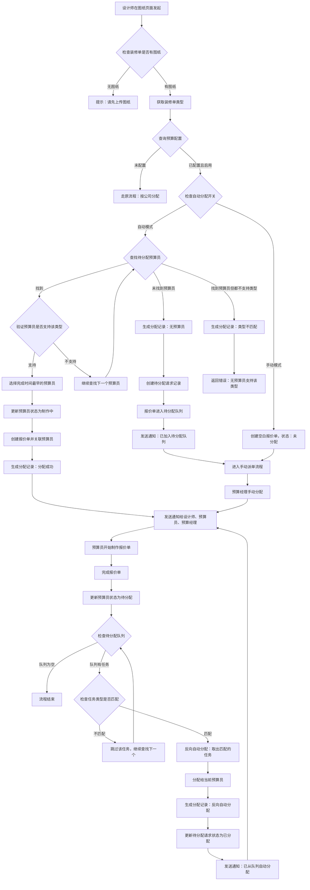
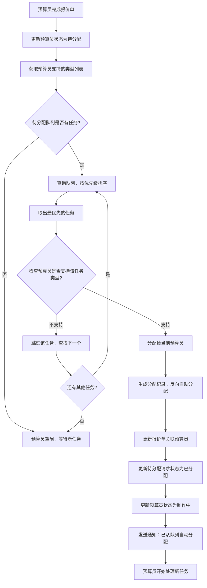

# 报价单预算员自动分配功能设计方案

> **设计文档版本**: v1.4
> **创建日期**: 2026-03-13
> **最后更新**: 2026-03-13
> **设计目标**: 实现装修单预算员的自动分配与手动派单功能，支持待分配队列、反向自动分配、装修类型匹配
> **核心原则**: 一个装修单只分配一次预算员，多个报价单版本共用同一预算员
> **最新变更**:
> - ✅ 预算员分配关系存储在 decoration 层面（decoration.budgetUid）
> - ✅ quotationassignrequest 控制分配逻辑（装修单级别）
> - ✅ quotationassignrecord 纯记录表，用于追溯所有分配尝试
> - ✅ quotationuserrule 状态基于 quotationassignrequest 统计
> - ✅ 已分配装修单不再重新分配预算员

---

## 📋 需求概述

### 业务背景
当前系统需要为报价单创建流程增加预算员自动分配逻辑，提高派单效率，减少人工干预。

### 核心需求
1. **预算员规则管理**: 维护预算员信息、状态、关联公司、**支持的装修类型**
2. **自动分配逻辑**: 创建报价单时自动分配给"待分配"且完成时间最早的预算员
3. **类型匹配**: 预算员只能分配给其支持的装修类型（半包/整装）
4. **手动派单功能**: 支持管理员手动分配预算员
5. **消息通知**: 分配后通知相关角色（设计师、预算员、预算经理）
6. **流程兼容**: 有配置走新流程，无配置走原流程（按公司）

### 装修类型说明
- **半包（type=1）**: 基础装修+人工辅材
- **整装（type=2）**: 全包模式（含主材）
- **全能预算员**: 支持半包和整装两种类型

---

## 🗄️ 数据库设计

### 核心关系说明

```
decoration（装修单）
    ├── budgetUid（预算员ID）- 真正的分配关系存储在这里
    ├── quotationassignrequest（分配请求，最多1条活跃记录）
    │   └── 用于控制待分配队列和分配状态
    ├── quotationassignrecord（分配记录，多条历史记录）
    │   └── 仅用于追溯所有分配尝试（成功、失败、重新分配）
    └── quotation（多个报价单版本）
        └── 继承 decoration.budgetUid，不需要重新分配
```

**关键原则**：
- 一个装修单只分配一次预算员
- 多个报价单版本共用同一预算员
- quotationuserrule 状态基于 quotationassignrequest 统计
- 已分配的装修单不再重新分配

---

### 1. 装修单表字段扩展 (decoration.decoration)

在现有 `decoration` 表中新增字段：

```sql
ALTER TABLE decoration.decoration
ADD COLUMN budgetUid INT(11) COMMENT '预算员用户ID',
ADD COLUMN budgetAssignTime TIMESTAMP NULL COMMENT '预算员分配时间',
ADD KEY idx_budgetUid (budgetUid);
```

**字段说明**:
- `budgetUid`: 关联的预算员用户ID（核心字段，存储分配关系）
- `budgetAssignTime`: 预算员分配时间

**用途**:
- 存储装修单与预算员的分配关系
- 一个装修单只有一个预算员
- 多个报价单版本共用同一预算员

---

### 2. 预算员规则表 (quotation.quotationuserrule)

```sql
CREATE TABLE quotation.quotationuserrule (
    burid INT(11) NOT NULL AUTO_INCREMENT COMMENT '预算员规则ID',
    uid INT(11) NOT NULL COMMENT '用户ID（预算员工号）',
    company INT(11) NOT NULL COMMENT '关联公司ID',
    department INT(11) COMMENT '部门ID',
    status TINYINT(1) NOT NULL DEFAULT 1 COMMENT '状态：1-待分配，2-制作中，3-停止，4-已完成',
    lastFinishTime TIMESTAMP NULL COMMENT '最后完成时间',
    currentTaskCount INT(8) DEFAULT 0 COMMENT '当前任务数量',
    createTime TIMESTAMP DEFAULT CURRENT_TIMESTAMP COMMENT '创建时间',
    updateTime TIMESTAMP DEFAULT CURRENT_TIMESTAMP ON UPDATE CURRENT_TIMESTAMP COMMENT '更新时间',
    PRIMARY KEY (burid),
    UNIQUE KEY uk_uid_company (uid, company),
    KEY idx_status_finishTime (status, lastFinishTime),
    KEY idx_company (company)
) ENGINE=InnoDB DEFAULT CHARSET=utf8 COMMENT='预算员人员规则表';
```

**字段说明**:
- `status`: 预算员状态
  - `1`: 待分配（可接收新任务）
  - `2`: 制作中（正在处理任务）
  - `3`: 停止（不再接收任务）
- `lastFinishTime`: 最后完成时间，用于自动分配时排序（最早完成的优先）
- `currentTaskCount`: 当前任务数量（基于 quotationassignrequest 统计）

**状态更新规则**:
- 状态基于 `quotationassignrequest` 表统计
- 查询 `status = 2`（已分配）的请求数来更新 `currentTaskCount`
- `currentTaskCount = 0` 时，`status = 1`（待分配）
- `currentTaskCount > 0` 时，`status = 2`（制作中）

### 2. 预算员类型支持表 (quotation.quotationuserruletype)

```sql
CREATE TABLE quotation.quotationuserruletype (
    id INT(11) NOT NULL AUTO_INCREMENT COMMENT 'ID',
    burid INT(11) NOT NULL COMMENT '预算员规则ID',
    type TINYINT(1) NOT NULL COMMENT '装修类型：1-半包，2-整装',
    createTime TIMESTAMP DEFAULT CURRENT_TIMESTAMP COMMENT '创建时间',
    PRIMARY KEY (id),
    UNIQUE KEY uk_burid_type (burid, type),
    KEY idx_burid (burid),
    KEY idx_type (type)
) ENGINE=InnoDB DEFAULT CHARSET=utf8 COMMENT='预算员支持类型表';
```

**字段说明**:
- `id`: 主键ID
- `burid`: 预算员规则ID（关联 `quotationuserrule.burid`）
- `type`: 支持的装修类型
  - `1`: 半包
  - `2`: 整装
- 一个预算员可以有多条记录（支持多种类型）

**用途**:
- 定义预算员支持的装修类型
- 支持一对一（只支持一种类型）或一对多（支持多种类型）
- 分配时必须匹配类型才能成功

**数据示例**:
```sql
-- 半包预算员（只能做半包）
INSERT INTO quotation.quotationuserruletype (burid, type) VALUES (1, 1);

-- 整装预算员（只能做整装）
INSERT INTO quotation.quotationuserruletype (burid, type) VALUES (2, 2);

-- 全能预算员（两种都能做）
INSERT INTO quotation.quotationuserruletype (burid, type) VALUES (3, 1);
INSERT INTO quotation.quotationuserruletype (burid, type) VALUES (3, 2);
```

### 3. 装修单预算分配请求表 (quotation.quotationassignrequest)

**职责**：控制分配逻辑和待分配队列（装修单级别，最多1条活跃记录）

```sql
CREATE TABLE quotation.quotationassignrequest (
    barid INT(11) NOT NULL AUTO_INCREMENT COMMENT '请求ID',
    orderId VARCHAR(15) NOT NULL COMMENT '装修单号（关联 decoration）',
    company INT(11) NOT NULL COMMENT '公司ID',
    department INT(11) COMMENT '部门ID',
    decorationType TINYINT(1) NOT NULL COMMENT '装修类型：1-半包，2-整装',
    priority TINYINT(1) NOT NULL DEFAULT 5 COMMENT '优先级：1-最高，5-普通，9-最低',
    requestTime TIMESTAMP DEFAULT CURRENT_TIMESTAMP COMMENT '请求时间',
    requestUid INT(11) COMMENT '请求人用户ID（设计师）',
    status TINYINT(1) NOT NULL DEFAULT 1 COMMENT '状态：1-待分配，2-已分配',
    assignTime TIMESTAMP NULL COMMENT '分配时间',
    remark VARCHAR(255) COMMENT '备注',
    PRIMARY KEY (barid),
    UNIQUE KEY uk_orderId_status (orderId, status),
    KEY idx_company_status (company, status),
    KEY idx_priority_time (priority, requestTime)
) ENGINE=InnoDB DEFAULT CHARSET=utf8 COMMENT='装修单预算分配请求表';
```

**字段说明**:
- `orderId`: 装修单号（关联 decoration.orderId）
- `company`: 公司ID（用于匹配预算员）
- `department`: 部门ID（可选）
- `decorationType`: 装修类型（1-半包，2-整装）
- `priority`: 优先级（1-最高，5-普通，9-最低）
- `status`: 状态
  - `1`: 待分配（在队列中等待）
  - `2`: 已分配（成功分配给预算员）
- `requestTime`: 请求加入队列的时间
- `assignTime`: 实际分配时间

**用途**:
- 控制待分配队列（装修单级别）
- 用于统计预算员的当前任务数
- 支持优先级排序
- 支持反向自动分配
- 一个装修单只有一条待分配/已分配记录

**数据示例**:
```sql
-- 待分配请求
INSERT INTO quotation.quotationassignrequest (
    orderId, company, department, decorationType, priority, status
) VALUES ('1501020001', 1, 10, 1, 5, 1);

-- 已分配请求
UPDATE quotation.quotationassignrequest
SET status = 2, assignTime = NOW()
WHERE orderId = '1501020001';
```

---

### 4. 装修单预算分配记录表 (quotation.quotationassignrecord)

**职责**：追溯所有分配尝试（成功、失败、重新分配）

```sql
CREATE TABLE quotation.quotationassignrecord (
    qarid INT(11) NOT NULL AUTO_INCREMENT COMMENT '记录ID',
    orderId VARCHAR(15) NOT NULL COMMENT '装修单号',
    uid INT(11) COMMENT '预算员用户ID（成功时有值）',
    assignType TINYINT(1) NOT NULL COMMENT '分配类型：1-正向自动，2-手动，3-反向自动',
    assignResult TINYINT(1) NOT NULL COMMENT '分配结果：1-成功，0-失败',
    assignUid INT(11) COMMENT '分配人用户ID（手动分配时）',
    assignTime TIMESTAMP DEFAULT CURRENT_TIMESTAMP COMMENT '分配时间',
    failReason VARCHAR(255) COMMENT '失败原因',
    decorationType TINYINT(1) COMMENT '装修类型',
    PRIMARY KEY (qarid),
    KEY idx_orderId (orderId),
    KEY idx_uid (uid),
    KEY idx_assignTime (assignTime)
) ENGINE=InnoDB DEFAULT CHARSET=utf8 COMMENT='装修单预算分配记录表（历史追溯）';
```

**字段说明**:
- `orderId`: 装修单号
- `uid`: 预算员用户ID（成功分配时有值，失败时为NULL）
- `assignType`: 分配类型
  - `1`: 正向自动分配
  - `2`: 手动分配
  - `3`: 反向自动分配
- `assignResult`: 分配结果
  - `1`: 成功
  - `0`: 失败（无预算员/类型不匹配）
- `failReason`: 失败原因说明
- `decorationType`: 装修类型（用于追溯）

**用途**:
- 记录所有分配尝试（成功、失败、重新分配）
- 支持分配历史追溯
- 统计预算员工作量
- 分析分配失败原因

**数据示例**:
```sql
-- 成功分配记录
INSERT INTO quotation.quotationassignrecord (
    orderId, uid, assignType, assignResult, assignTime, decorationType
) VALUES ('1501020001', 1001, 1, 1, NOW(), 1);

-- 失败记录：无可用预算员
INSERT INTO quotation.quotationassignrecord (
    orderId, uid, assignType, assignResult, failReason, assignTime, decorationType
) VALUES ('1501020002', NULL, 1, 0, '无可用预算员', NOW(), 2);

-- 失败记录：类型不匹配
INSERT INTO quotation.quotationassignrecord (
    orderId, uid, assignType, assignResult, failReason, assignTime, decorationType
) VALUES ('1501020003', NULL, 1, 0, '无预算员支持该类型（整装）', NOW(), 2);
```

---

### 5. 预算配置表 (quotation.quotationconfig)

```sql
CREATE TABLE quotation.quotationconfig (
    bcid INT(11) NOT NULL AUTO_INCREMENT COMMENT '配置ID',
    company INT(11) NOT NULL COMMENT '公司ID',
    department INT(11) COMMENT '部门ID',
    enabled TINYINT(1) NOT NULL DEFAULT 1 COMMENT '是否启用：0-禁用，1-启用',
    autoAssign TINYINT(1) NOT NULL DEFAULT 1 COMMENT '是否自动分配：0-手动，1-自动',
    createTime TIMESTAMP DEFAULT CURRENT_TIMESTAMP COMMENT '创建时间',
    updateTime TIMESTAMP DEFAULT CURRENT_TIMESTAMP ON UPDATE CURRENT_TIMESTAMP COMMENT '更新时间',
    PRIMARY KEY (bcid),
    UNIQUE KEY uk_company_dept (company, department)
) ENGINE=InnoDB DEFAULT CHARSET=utf8 COMMENT='预算配置表';
```

**用途**:
- 控制哪些公司/部门启用预算员分配功能
- 控制自动分配还是手动分配模式

---

## 🔄 业务流程设计

### 流程图

#### 主流程：正向自动分配



#### 反向自动分配流程（含类型匹配）



**待分配队列排序规则**:
1. 优先级（`priority`）：数字越小优先级越高
2. 请求时间（`requestTime`）：同优先级时，先到先得（FIFO）
3. 部门匹配（`department`）：优先分配给同部门的预算员
4. **类型匹配（`decorationType`）**：必须匹配预算员支持的类型

**关键逻辑：类型匹配验证**
```sql
-- 查询预算员支持的类型
SELECT type FROM quotation.quotationuserruletype
WHERE burid = (
    SELECT burid FROM quotation.quotationuserrule
    WHERE uid = ? AND company = ?
);

-- 验证是否包含目标类型（半包1或整装2）
```

**反向自动分配SQL（含类型匹配）**:
```sql
-- 反向自动分配：查询待分配队列中最优先且类型匹配的任务
SELECT bar.* FROM quotation.quotationassignrequest bar
INNER JOIN quotation.quotationuserruletype burtype ON bar.decorationType = burtype.type
INNER JOIN quotation.quotationuserrule bur ON burtype.burid = bur.burid
WHERE bar.status = 1  -- 待分配
  AND bar.company = ?
  AND bur.uid = ?  -- 当前预算员用户ID
  AND bur.status = 1  -- 预算员状态为待分配
  AND (bar.department IS NULL OR bar.department = ?)
ORDER BY bar.priority ASC, bar.requestTime ASC
LIMIT 1
FOR UPDATE;  -- 加锁，防止并发问题
```

### 详细流程说明

#### 1. 正向自动分配流程（含类型匹配）

**触发条件**:
- 设计师在图纸页面点击"发起预算制作"
- 装修单已有图纸（`decorationpicture` 表中存在记录）
- 获取装修单类型（`decoration.type`：1-半包，2-整装）
- 对应公司/部门已配置预算分配规则且启用自动分配

**分配逻辑（含类型匹配）**:
```sql
-- 步骤1：查找待分配且完成时间最早的预算员
SELECT * FROM quotation.quotationuserrule
WHERE status = 1  -- 待分配
  AND company = ?
ORDER BY lastFinishTime ASC, currentTaskCount ASC;

-- 步骤2：验证预算员是否支持该装修类型
SELECT * FROM quotation.quotationuserruletype
WHERE burid = ?
  AND type = ?;  -- 装修单类型（1或2）
```

**执行步骤（分支1：找到且类型匹配的预算员）**:
1. **获取装修单类型**（`decoration.type`：1-半包，2-整装）
2. **检查装修单是否已分配预算员**（`decoration.budgetUid`）
   - 如果已分配：直接返回，不重新分配
   - 如果未分配：继续后续步骤
3. 查找状态为"待分配"的预算员（按完成时间排序）
4. **逐个验证预算员是否支持该类型**：
   - 查询 `quotationuserruletype` 表
   - 判断是否包含目标类型
   - 如果不支持，继续查找下一个
   - 如果支持，选中该预算员
5. **更新装修单的预算员ID**（`decoration.budgetUid` 和 `decoration.budgetAssignTime`）
6. **更新或创建 quotationassignrequest**（`status = 2` 已分配）
7. **更新预算员状态**（基于 quotationassignrequest 统计）
8. **生成分配记录**（`quotationassignrecord`，`assignResult=1` 成功）
9. 发送通知消息（设计师、预算员、预算经理）
10. 返回分配成功

**执行步骤（分支2：未找到预算员）**:
1. **检查装修单是否已存在待分配请求**
   - 如果已存在：不重复创建，直接返回
   - 如果不存在：继续后续步骤
2. **生成分配记录**（`quotationassignrecord`，`assignResult=0` 无预算员）
3. **创建待分配请求记录**（`quotationassignrequest`）
   - `status = 1`（待分配）
   - `decorationType = 装修单类型`（1或2）
   - `priority = 5`（普通优先级，可调整）
   - 记录请求时间
4. 发送通知给设计师："已加入待分配队列，暂无可用预算员"
5. 发送通知给预算经理："有待分配装修单需要处理"
6. 返回等待分配状态

**执行步骤（分支3：找到预算员但类型都不支持）**:
1. **生成分配记录**（`quotationassignrecord`，`assignResult=0` 类型不匹配）
   - `failReason = "无预算员支持该类型（半包/整装）"`
   - `decorationType = 装修单类型`
2. **不创建报价单**
3. **返回错误提示**："当前无预算员支持该装修类型（半包/整装），请联系管理员配置预算员类型"
4. 发送通知给预算经理："需要配置支持该类型的预算员"

**数据变化示例**:
```sql
-- 分配成功记录
INSERT INTO quotation.quotationassignrecord (
    orderId, uid, assignType, assignResult, assignTime, decorationType
) VALUES ('1501020001', 1001, 1, 1, NOW(), 1);

-- 无预算员记录（进入队列）
INSERT INTO quotation.quotationassignrecord (
    orderId, uid, assignType, assignResult, failReason, assignTime, decorationType
) VALUES ('1501020002', NULL, 1, 0, '无可用预算员', NOW(), 2);

-- 类型不匹配记录（返回错误）
INSERT INTO quotation.quotationassignrecord (
    orderId, uid, assignType, assignResult, failReason, assignTime, decorationType
) VALUES ('1501020003', NULL, 1, 0, '无预算员支持该类型（整装）', NOW(), 2);
```

**类型匹配场景示例**:

| 装修单类型 | 预算员情况 | 处理方式 |
|-----------|----------|---------|
| 半包 (type=1) | 有半包预算员 | 分配成功 ✅ |
| 半包 (type=1) | 无预算员 | 进入待分配队列 ⏳ |
| 半包 (type=1) | 只有整装预算员 | **返回错误提示 ❌** |
| 整装 (type=2) | 有整装预算员 | 分配成功 ✅ |
| 整装 (type=2) | 无预算员 | 进入待分配队列 ⏳ |
| 整装 (type=2) | 只有半包预算员 | **返回错误提示 ❌** |

#### 2. 反向自动分配流程（含类型匹配）

**触发时机**:
- 预算员完成报价单制作（调用 `finishQuotation` 接口）
- 预算员任务数量从 >0 变为 =0
- 预算员状态从"制作中"变为"待分配"

**分配逻辑（含类型匹配）**:
```sql
-- 步骤1：获取预算员支持的类型列表
SELECT type FROM quotation.quotationuserruletype
WHERE burid = (
    SELECT burid FROM quotation.quotationuserrule
    WHERE uid = ? AND company = ?
);

-- 步骤2：查询待分配队列中最优先且类型匹配的任务
SELECT bar.* FROM quotation.quotationassignrequest bar
INNER JOIN quotation.quotationuserruletype burtype ON bar.decorationType = burtype.type
INNER JOIN quotation.quotationuserrule bur ON burtype.burid = bur.burid
WHERE bar.status = 1  -- 待分配
  AND bar.company = ?
  AND bur.uid = ?  -- 当前预算员用户ID
  AND bur.status = 1  -- 预算员状态为待分配
ORDER BY bar.priority ASC, bar.requestTime ASC
LIMIT 1
FOR UPDATE;  -- 加锁，防止并发问题
```

**执行步骤**:
1. **事务开始**
2. **获取预算员支持的类型列表**（查询 `quotationuserruletype`）
3. 查找待分配队列中类型匹配且最优先的任务
4. 如果找到任务：
   - 更新装修单关联预算员（`decoration.budgetUid` 和 `decoration.budgetAssignTime`）
   - 更新待分配请求状态为"已分配"（`quotationassignrequest.status = 2`）
   - **更新预算员状态**（基于 quotationassignrequest 统计 `currentTaskCount`）
   - 如果 `currentTaskCount > 0`，则 `status = 2`（制作中）
   - 插入分配记录（`quotationassignrecord`，`assignType=3` 反向自动分配）
   - **事务提交**
   - 发送通知："已从待分配队列自动分配"
5. 如果未找到任务（队列为空或无匹配类型）：
   - 预算员保持"待分配"状态（空闲）
   - **事务结束**

**类型匹配逻辑**:
```java
// 伪代码：验证类型匹配
List<Integer> supportedTypes = getBudgetUserSupportedTypes(quotationUid);  // [1] 或 [2] 或 [1,2]
Integer decorationType = getDecorationType(orderId);  // 1 或 2

if (supportedTypes.contains(decorationType)) {
    // 类型匹配，可以分配
    return true;
} else {
    // 类型不匹配，跳过该任务，继续查找下一个
    return false;
}
```

**数据变化示例**:
```sql
-- 1. 更新装修单关联预算员
UPDATE decoration.decoration
SET budgetUid = 1001,
    budgetAssignTime = NOW()
WHERE orderId = '1501020001';

-- 2. 更新待分配请求状态
UPDATE quotation.quotationassignrequest
SET status = 2,
    assignTime = NOW()
WHERE orderId = '1501020001';

-- 3. 插入分配记录
INSERT INTO quotation.quotationassignrecord (
    orderId, uid, assignType, assignResult, assignTime, decorationType
) VALUES ('1501020001', 1001, 3, 1, NOW(), 1);

-- 4. 更新预算员状态（基于 quotationassignrequest 统计）
UPDATE quotation.quotationuserrule
SET status = 2,
    currentTaskCount = (
        SELECT COUNT(*) FROM quotation.quotationassignrequest
        WHERE uid = 1001 AND status = 2
    )
WHERE uid = 1001;
```

#### 3. 手动派单流程

**使用场景**:
- 预算经理主动分配待分配队列中的任务
- 重新分配已有的报价单
- 调整优先级或指定特定预算员

**操作步骤**:
1. 预算经理进入"预算单分配页面"
2. 查看待分配队列列表（或所有未分配的报价单）
3. 选择报价单，手动指定预算员
4. （可选）调整优先级
5. 系统更新分配信息并发送通知
6. 从待分配队列中移除（如果存在）

#### 4. 待分配队列管理（含类型匹配）

**队列特性**:
- **优先级支持**: 支持紧急单优先处理
- **FIFO机制**: 同优先级按请求时间排序
- **类型隔离**: 不同类型的任务（半包/整装）独立排队
- **自动清理**: 已分配或已取消的请求自动移出队列
- **手动取消**: 支持设计师或预算经理取消待分配请求

**类型隔离机制**:
- 半包任务（`decorationType=1`）只能分配给支持半包的预算员
- 整装任务（`decorationType=2`）只能分配给支持整装的预算员
- 全能预算员可以接收两种类型的任务
- 当预算员空闲时，系统自动从队列中取出匹配类型的任务

**队列查询SQL**:
```sql
-- 查询待分配队列
SELECT
    bar.barid,
    bar.qid,
    bar.orderId,
    bar.priority,
    bar.requestTime,
    bar.status,
    u.userName AS designerName,
    b.buildingName,
    q.name AS quotationName
FROM quotation.quotationassignrequest bar
LEFT JOIN system.user u ON bar.requestUid = u.uid
LEFT JOIN decoration.building b ON bar.orderId = b.orderId
LEFT JOIN quotation.quotation q ON bar.qid = q.qid
WHERE bar.status = 1  -- 待分配
  AND bar.company = ?
ORDER BY bar.priority ASC, bar.requestTime ASC;
```

#### 5. 流程兼容逻辑

**判断条件**:
```java
// 伪代码
if (quotationConfig.isEnabled(company, department)) {
    // 新流程：有配置的分配逻辑
    if (quotationConfig.isAutoAssign()) {
        // 自动分配
        autoAssignBudgetUser(quotation);
    } else {
        // 手动分配
        createQuotationWithoutAssign();
    }
} else {
    // 原流程：按公司分配
    assignByCompany(quotation);
}
```

---

## 🏗️ 功能模块设计

### 模块划分

```
quotation/
├── action/
│   ├── QuotationAction.java              # 报价单Action（修改）
│   ├── BudgetUserRuleAction.java         # 预算员规则Action（新增）
│   ├── QuotationAssignAction.java           # 预算分配Action（新增）
│   └── QuotationAssignRequestAction.java    # 待分配请求Action（新增）
├── service/
│   ├── QuotationService.java              # 报价单Service（修改）
│   ├── BudgetUserRuleService.java         # 预算员规则Service（新增）
│   ├── QuotationAssignService.java           # 预算分配Service（新增）
│   └── QuotationAssignRequestService.java    # 待分配请求Service（新增）
├── dao/
│   ├── QuotationDao.java                  # 报价单Dao（修改）
│   ├── BudgetUserRuleDao.java             # 预算员规则Dao（新增）
│   ├── QuotationAssignLogDao.java            # 分配记录Dao（新增）
│   ├── QuotationAssignRequestDao.java        # 待分配请求Dao（新增）
│   └── BudgetConfigDao.java               # 预算配置Dao（新增）
├── po/
│   ├── QuotationPO.java                   # 报价单PO（修改）
│   ├── BudgetUserRulePO.java              # 预算员规则PO（新增）
│   ├── QuotationAssignRecordPO.java          # 分配记录PO（新增）
│   ├── QuotationAssignRequestPO.java         # 待分配请求PO（新增）
│   └── BudgetConfigPO.java                # 预算配置PO（新增）
└── vo/
    ├── QuotationVO.java                   # 报价单VO（修改）
    ├── BudgetUserRuleVO.java              # 预算员规则VO（新增）
    ├── QuotationAssignVO.java                # 分配请求VO（新增）
    ├── QuotationAssignRequestVO.java         # 待分配请求VO（新增）
    └── BudgetConfigVO.java                # 预算配置VO（新增）
```

### 核心类设计

#### 1. BudgetUserRulePO.java

```java
package com.fanglin.quotation.po;

import javax.persistence.*;

@Entity
@Table(name = "quotationuserrule")
public class BudgetUserRulePO {

    @Id
    @GeneratedValue(strategy = GenerationType.IDENTITY)
    @Column(name = "burid")
    private Integer burid;

    @Column(name = "uid", nullable = false)
    private Integer uid;

    @Column(name = "company", nullable = false)
    private Integer company;

    @Column(name = "department")
    private Integer department;

    @Column(name = "status", nullable = false)
    private Byte status;  // 1-待分配，2-制作中，3-停止，4-已完成

    @Column(name =lastFinishTime")
    private Timestamp lastFinishTime;

    @Column(name = "currentTaskCount")
    private Integer currentTaskCount;

    @Column(name = "createTime")
    private Timestamp createTime;

    @Column(name = "updateTime")
    private Timestamp updateTime;

    // Getters and Setters...
}
```

#### 2. QuotationAssignService.java

```java
package com.fanglin.quotation.service;

import com.fanglin.quotation.vo.QuotationAssignVO;

/**
 * 预算分配服务接口
 */
public interface QuotationAssignService {

    /**
     * 自动分配预算员（含类型匹配）
     * @param qid 报价单ID
     * @param companyId 公司ID
     * @param decorationType 装修类型（1-半包，2-整装）
     * @return 分配的预算员用户ID，失败返回null
     */
    Integer autoAssignBudgetUser(Integer qid, Integer companyId, Integer decorationType);

    /**
     * 手动分配预算员
     * @param assignVO 分配请求对象
     * @return 是否成功
     */
    boolean manualAssignBudgetUser(QuotationAssignVO assignVO);

    /**
     * 完成报价单，更新预算员状态
     * @param qid 报价单ID
     */
    void finishQuotation(Integer qid);

    /**
     * 重新分配预算员
     * @param qid 报价单ID
     * @param newBudgetUid 新预算员用户ID
     * @param assignUid 分配人用户ID
     * @return 是否成功
     */
    boolean reassignBudgetUser(Integer qid, Integer newBudgetUid, Integer assignUid);

    /**
     * 检查是否启用预算分配功能
     * @param companyId 公司ID
     * @param departmentId 部门ID
     * @return 是否启用
     */
    boolean isQuotationAssignEnabled(Integer companyId, Integer departmentId);
}
```

#### 3. QuotationAssignServiceImpl.java

```java
package com.fanglin.quotation.service.impl;

import com.fanglin.quotation.po.BudgetUserRulePO;
import com.fanglin.quotation.po.QuotationAssignRecordPO;
import com.fanglin.quotation.po.QuotationPO;
import com.fanglin.quotation.vo.QuotationAssignVO;
import com.fanglin.quotation.service.QuotationAssignService;
import com.fanglin.quotation.dao.BudgetUserRuleDao;
import com.fanglin.quotation.dao.QuotationAssignLogDao;
import com.fanglin.quotation.dao.QuotationDao;
import org.springframework.beans.factory.annotation.Autowired;
import org.springframework.stereotype.Service;
import org.springframework.transaction.annotation.Transactional;

/**
 * 预算分配服务实现
 */
@Service
public class QuotationAssignServiceImpl implements QuotationAssignService {

    @Autowired
    private BudgetUserRuleDao quotationUserRuleDao;

    @Autowired
    private QuotationAssignLogDao quotationAssignRecordDao;

    @Autowired
    private QuotationDao quotationDao;

    @Autowired
    private BudgetUserRuleDao quotationUserRuleDao;

    @Autowired
    private QuotationAssignLogDao quotationAssignRecordDao;

    @Autowired
    private QuotationAssignRequestDao quotationAssignRequestDao;

    @Autowired
    private BudgetUserRuleTypeDao quotationUserRuleTypeDao;  // 新增：预算员类型DAO

    @Autowired
    private QuotationDao quotationDao;

    @Autowired
    private DecorationDao decorationDao;  // 新增：装修单DAO

    @Override
    @Transactional(rollbackFor = Exception.class)
    public Integer autoAssignBudgetUser(String orderId, Integer companyId, Integer decorationType) {
        // 1. 检查装修单是否已分配预算员
        DecorationPO decoration = decorationDao.findByOrderId(orderId);
        if (decoration.getBudgetUid() != null) {
            // 已分配，记录并返回，不重新分配
            saveAssignRecord(orderId, decoration.getBudgetUid(), (byte) 1, (byte) 1,
                             decorationType, null);
            return decoration.getBudgetUid();
        }

        // 2. 获取装修单类型（如果未传入）
        if (decorationType == null) {
            decorationType = decoration.getType();  // 1-半包，2-整装
        }

        // 3. 查找待分配且完成时间最早的预算员（列表）
        List<BudgetUserRulePO> quotationUsers = quotationUserRuleDao
            .findAvailableBudgetUsers(companyId);

        if (quotationUsers == null || quotationUsers.isEmpty()) {
            // 分支2：未找到预算员，进入待分配队列
            return createAssignRequest(orderId, companyId, decorationType);
        }

        // 4. 遍历预算员，查找支持该类型的预算员
        for (BudgetUserRulePO quotationUser : quotationUsers) {
            // 验证预算员是否支持该装修类型
            boolean isTypeSupported = quotationUserRuleTypeDao
                .existsByBuridAndType(quotationUser.getBurid(), decorationType);

            if (isTypeSupported) {
                // 分支1：找到匹配的预算员，执行分配
                return executeAssign(orderId, quotationUser, companyId, decorationType);
            }
            // 如果不支持，继续查找下一个预算员
        }

        // 分支3：有预算员但都不支持该类型，返回错误提示
        return handleTypeMismatch(orderId, companyId, decorationType);
    }

    /**
     * 执行分配操作（分支1：分配成功）
     */
    private Integer executeAssign(String orderId, BudgetUserRulePO quotationUser,
                                  Integer companyId, Integer decorationType) {
        // 1. 更新装修单的预算员ID
        decorationDao.updateBudgetUid(orderId, quotationUser.getUid());

        // 2. 更新或创建 quotationassignrequest（状态改为已分配）
        QuotationAssignRequestPO request = quotationAssignRequestDao
            .findByOrderId(orderId);

        if (request != null) {
            request.setStatus((byte) 2);  // 已分配
            request.setAssignTime(new Timestamp(System.currentTimeMillis()));
            quotationAssignRequestDao.update(request);
        } else {
            request = new QuotationAssignRequestPO();
            request.setOrderId(orderId);
            request.setCompany(companyId);
            request.setDecorationType(decorationType);
            request.setStatus((byte) 2);  // 已分配
            request.setAssignTime(new Timestamp(System.currentTimeMillis()));
            quotationAssignRequestDao.save(request);
        }

        // 3. 更新预算员状态（基于 quotationassignrequest 统计）
        updateBudgetUserStatus(quotationUser.getUid());

        // 4. 记录分配历史
        saveAssignRecord(orderId, quotationUser.getUid(), (byte) 1, (byte) 1,
                         decorationType, null);

        // 5. 发送通知（异步）
        sendAssignNotification(orderId, quotationUser.getUid(), null, "auto");

        return quotationUser.getUid();
    }

    /**
     * 创建待分配请求（分支2：无预算员）
     */
    private Integer createAssignRequest(String orderId, Integer companyId, Integer decorationType) {
        DecorationPO decoration = decorationDao.findByOrderId(orderId);

        // 1. 检查是否已存在待分配请求
        QuotationAssignRequestPO existingRequest = quotationAssignRequestDao
            .findByOrderId(orderId);
        if (existingRequest != null && existingRequest.getStatus() == 1) {
            return null;  // 已在队列中
        }

        // 2. 生成分配记录（进入队列）
        saveAssignRecord(orderId, null, (byte) 1, (byte) 0, decorationType,
                         "无可用预算员");

        // 3. 创建待分配请求记录
        QuotationAssignRequestPO request = new QuotationAssignRequestPO();
        request.setOrderId(orderId);
        request.setCompany(companyId);
        request.setDepartment(decoration.getDepartment());
        request.setDecorationType(decorationType);  // 装修类型
        request.setPriority((byte) 5);  // 默认普通优先级
        request.setRequestTime(new Timestamp(System.currentTimeMillis()));
        request.setRequestUid(decoration.getCuid());  // 设计师ID
        request.setStatus((byte) 1);  // 待分配
        quotationAssignRequestDao.save(request);

        // 4. 发送通知：已加入待分配队列
        sendQueueNotification(orderId, decoration.getCuid(),
                             companyId, "added_to_queue");

        return null;
    }

    /**
     * 处理类型不匹配（分支3：返回错误）
     */
    private Integer handleTypeMismatch(String orderId, Integer companyId, Integer decorationType) {
        DecorationPO decoration = decorationDao.findByOrderId(orderId);
        String typeName = (decorationType == 1) ? "半包" : "整装";

        // 1. 生成分配记录（类型不匹配）
        saveAssignRecord(orderId, null, (byte) 1, (byte) 0, decorationType,
                         "无预算员支持该类型（" + typeName + "）");

        // 2. 不创建报价单

        // 3. 发送错误通知给设计师
        sendErrorNotification(decoration.getCuid(), orderId, typeName);

        // 4. 发送通知给预算经理
        sendManagerNotification(companyId, orderId, typeName);

        // 5. 抛出异常或返回错误码
        throw new BusinessException(
            "当前无预算员支持该装修类型（" + typeName + "），请联系管理员配置预算员类型"
        );
    }

    /**
     * 生成分配记录（所有分支都调用）
     */
    private void saveAssignRecord(String orderId, Integer quotationUid, byte assignType,
                                  byte assignResult, Integer decorationType, String failReason) {
        QuotationAssignRecordPO record = new QuotationAssignRecordPO();
        record.setOrderId(orderId);
        record.setUid(quotationUid);  // 成功时有值，失败时为null
        record.setAssignType(assignType);
        record.setAssignResult(assignResult);
        record.setFailReason(failReason);
        record.setDecorationType(decorationType);
        record.setAssignTime(new Timestamp(System.currentTimeMillis()));
        quotationAssignRecordDao.save(record);
    }

    @Override
    @Transactional(rollbackFor = Exception.class)
    public boolean manualAssignBudgetUser(QuotationAssignVO assignVO) {
        // 类似自动分配逻辑，但记录分配类型为手动
        // 省略实现...
    }

    @Override
    @Transactional(rollbackFor = Exception.class)
    public void finishQuotation(String orderId) {
        DecorationPO decoration = decorationDao.findByOrderId(orderId);
        Integer quotationUid = decoration.getBudgetUid();

        if (quotationUid != null) {
            // 删除 quotationassignrequest 记录（已完成）
            QuotationAssignRequestPO request = quotationAssignRequestDao
                .findByOrderId(orderId);
            if (request != null) {
                quotationAssignRequestDao.delete(request);
            }

            // **反向自动分配**：预算员变为空闲时，检查待分配队列
            // 基于 quotationassignrequest 统计来决定是否触发反向分配
            reverseAutoAssign(quotationUid);
        }
    }

    /**
     * 反向自动分配：预算员空闲时从待分配队列中获取任务（含类型匹配）
     */
    private void reverseAutoAssign(Integer quotationUid) {
        // 1. 获取预算员信息
        BudgetUserRulePO quotationUser = quotationUserRuleDao.findByUid(quotationUid);
        List<Integer> supportedTypes = quotationUserRuleTypeDao
            .findTypesByBurid(quotationUser.getBurid());  // [1] 或 [2] 或 [1,2]

        if (supportedTypes == null || supportedTypes.isEmpty()) {
            // 预算员未配置类型，无法分配
            return;
        }

        // 2. 查询待分配队列中最优先且类型匹配的任务
        QuotationAssignRequestPO request = quotationAssignRequestDao
            .findTopPriorityRequestByTypes(quotationUser.getCompany(),
                                          quotationUser.getDepartment(),
                                          supportedTypes);

        if (request == null) {
            // 队列为空或无匹配类型，预算员保持空闲
            return;
        }

        // 3. 更新装修单的预算员ID
        decorationDao.updateBudgetUid(request.getOrderId(), quotationUid);

        // 4. 更新待分配请求状态
        request.setStatus((byte) 2);  // 已分配
        request.setAssignTime(new Timestamp(System.currentTimeMillis()));
        quotationAssignRequestDao.update(request);

        // 5. 更新预算员状态（基于 quotationassignrequest 统计）
        updateBudgetUserStatus(quotationUid);

        // 6. 记录分配历史
        QuotationAssignRecordPO record = new QuotationAssignRecordPO();
        record.setOrderId(request.getOrderId());
        record.setUid(quotationUid);
        record.setAssignType((byte) 3);  // 反向自动分配
        record.setAssignResult((byte) 1);  // 成功
        record.setAssignTime(new Timestamp(System.currentTimeMillis()));
        record.setDecorationType(request.getDecorationType());
        quotationAssignRecordDao.save(record);

        // 7. 发送通知
        sendAssignNotification(request.getOrderId(), quotationUid, null,
                             "reverse_auto_assign");
    }

    /**
     * 更新预算员状态（基于 quotationassignrequest 统计）
     */
    private void updateBudgetUserStatus(Integer uid) {
        // 统计该预算员的已分配请求数
        String sql = "SELECT COUNT(*) FROM quotation.quotationassignrequest " +
                     "WHERE orderId IN (SELECT orderId FROM decoration.decoration WHERE budgetUid = ?) " +
                     "AND status = 2";  // 已分配

        int taskCount = quotationAssignRequestDao.countByUid(uid);

        QuotationUserRulePO user = quotationUserRuleDao.findByUid(uid);
        user.setCurrentTaskCount(taskCount);

        if (taskCount == 0) {
            user.setStatus((byte) 1);  // 待分配
        } else {
            user.setStatus((byte) 2);  // 制作中
        }

        quotationUserRuleDao.update(user);
    }

    @Override
    @Transactional(rollbackFor = Exception.class)
    public boolean reassignBudgetUser(String orderId, Integer newBudgetUid,
                                       Integer assignUid) {
        DecorationPO decoration = decorationDao.findByOrderId(orderId);
        Integer oldBudgetUid = decoration.getBudgetUid();

        // 1. 更新装修单的预算员ID
        decorationDao.updateBudgetUid(orderId, newBudgetUid);

        // 2. 更新 quotationassignrequest（如果存在）
        QuotationAssignRequestPO request = quotationAssignRequestDao
            .findByOrderId(orderId);
        if (request != null) {
            request.setAssignTime(new Timestamp(System.currentTimeMillis()));
            quotationAssignRequestDao.update(request);
        }

        // 3. 更新旧预算员状态
        if (oldBudgetUid != null) {
            updateBudgetUserStatus(oldBudgetUid);
        }

        // 4. 更新新预算员状态
        updateBudgetUserStatus(newBudgetUid);

        // 5. 记录分配历史
        QuotationAssignRecordPO record = new QuotationAssignRecordPO();
        record.setOrderId(orderId);
        record.setUid(newBudgetUid);
        record.setAssignType((byte) 2);  // 手动分配
        record.setAssignUid(assignUid);
        record.setAssignResult((byte) 1);  // 成功
        record.setAssignTime(new Timestamp(System.currentTimeMillis()));
        quotationAssignRecordDao.save(record);

        // 6. 发送通知
        sendAssignNotification(orderId, newBudgetUid, assignUid, "manual");

        return true;
    }

    /**
     * 发送分配通知
     */
    private void sendAssignNotification(String orderId, Integer quotationUid,
                                         Integer assignUid, String assignType) {
        // 调用消息推送服务，通知设计师、预算员、预算经理
        // 实现省略...
    }
}
```

---

## 🌐 API 接口设计

### 1. 预算员规则管理接口

#### 1.1 查询预算员规则列表

**接口**: `GET /quotation/quotationUserRule/list`

**请求参数**:
```json
{
  "company": 1,          // 公司ID（可选）
  "department": 10,      // 部门ID（可选）
  "status": 1,           // 状态（可选）
  "page": 1,
  "pageSize": 20
}
```

**响应数据**:
```json
{
  "code": 0,
  "message": "success",
  "data": {
    "total": 50,
    "list": [
      {
        "burid": 1,
        "uid": 1001,
        "userName": "张三",
        "company": 1,
        "companyName": "方林装饰",
        "department": 10,
        "departmentName": "预算部",
        "status": 1,
        "statusName": "待分配",
        "lastFinishTime": "2026-03-11 12:25:20",
        "currentTaskCount": 0
      }
    ]
  }
}
```

#### 1.2 新增/编辑预算员规则

**接口**: `POST /quotation/quotationUserRule/save`

**请求参数**:
```json
{
  "burid": 1,           // 规则ID（编辑时传，新增时不传）
  "uid": 1001,          // 预算员用户ID
  "company": 1,         // 公司ID
  "department": 10,     // 部门ID
  "status": 1           // 状态
}
```

#### 1.3 删除预算员规则

**接口**: `POST /quotation/quotationUserRule/delete`

**请求参数**:
```json
{
  "burid": 1
}
```

### 2. 预算分配接口

#### 2.1 自动分配预算员

**接口**: `POST /quotation/quotationAssign/auto`

**请求参数**:
```json
{
  "qid": 1234           // 报价单ID
}
```

**响应数据**:
```json
{
  "code": 0,
  "message": "分配成功",
  "data": {
    "quotationUid": 1001,
    "quotationUserName": "张三",
    "assignTime": "2026-03-13 14:30:00"
  }
}
```

#### 2.2 手动分配预算员

**接口**: `POST /quotation/quotationAssign/manual`

**请求参数**:
```json
{
  "qid": 1234,          // 报价单ID
  "quotationUid": 1001,    // 预算员用户ID
  "remark": "手动分配"  // 备注（可选）
}
```

#### 2.3 查询待分配报价单列表

**接口**: `GET /quotation/quotationAssign/unassigned`

**请求参数**:
```json
{
  "company": 1,         // 公司ID（可选）
  "page": 1,
  "pageSize": 20
}
```

**响应数据**:
```json
{
  "code": 0,
  "message": "success",
  "data": {
    "total": 10,
    "list": [
      {
        "qid": 1234,
        "orderId": "1501020001",
        "name": "简约风格",
        "designerUid": 2001,
        "designerName": "李设计师",
        "designDept": "设计一部",
        "designArea": "沈阳市",
        "buildingName": "碧桂园",
        "address": "浑南区xxx",
        "createTime": "2026-03-13 10:00:00",
        "quotationStatus": 0,
        "quotationStatusName": "未分配"
      }
    ]
  }
}
```

#### 2.4 重新分配预算员

**接口**: `POST /quotation/quotationAssign/reassign`

**请求参数**:
```json
{
  "qid": 1234,
  "newBudgetUid": 1002,
  "reason": "原预算员任务过重"
}
```

### 3. 预算配置接口

#### 3.1 查询预算配置

**接口**: `GET /quotation/quotationConfig/get`

**请求参数**:
```json
{
  "company": 1,
  "department": 10
}
```

**响应数据**:
```json
{
  "code": 0,
  "message": "success",
  "data": {
    "bcid": 1,
    "company": 1,
    "department": 10,
    "enabled": 1,
    "enabledName": "启用",
    "autoAssign": 1,
    "autoAssignName": "自动分配"
  }
}
```

#### 3.2 保存预算配置

**接口**: `POST /quotation/quotationConfig/save`

**请求参数**:
```json
{
  "company": 1,
  "department": 10,
  "enabled": 1,
  "autoAssign": 1
}
```

### 4. 待分配请求接口

#### 4.1 查询待分配队列

**接口**: `GET /quotation/quotationAssignRequest/list`

**请求参数**:
```json
{
  "company": 1,         // 公司ID（必需）
  "department": 10,     // 部门ID（可选）
  "status": 1,          // 状态（可选）：1-待分配，2-已分配，3-已取消
  "priority": 5,        // 优先级（可选）
  "page": 1,
  "pageSize": 20
}
```

**响应数据**:
```json
{
  "code": 0,
  "message": "success",
  "data": {
    "total": 15,
    "list": [
      {
        "barid": 1,
        "qid": 1234,
        "orderId": "1501020001",
        "company": 1,
        "companyName": "方林装饰",
        "department": 10,
        "departmentName": "预算一部",
        "priority": 5,
        "priorityName": "普通",
        "requestTime": "2026-03-13 10:30:00",
        "requestUid": 2001,
        "requestUserName": "李设计师",
        "status": 1,
        "statusName": "待分配",
        "assignTime": null,
        "assignBudgetUid": null,
        "assignBudgetUserName": null,
        "waitTime": 30,  // 等待时长（分钟）
        "quotationName": "简约风格",
        "buildingName": "碧桂园"
      }
    ]
  }
}
```

#### 4.2 调整待分配请求优先级

**接口**: `POST /quotation/quotationAssignRequest/updatePriority`

**请求参数**:
```json
{
  "barid": 1,           // 请求ID
  "priority": 1,        // 新优先级：1-最高，3-高，5-普通，7-低，9-最低
  "remark": "客户加急"  // 备注（可选）
}
```

**响应数据**:
```json
{
  "code": 0,
  "message": "优先级调整成功"
}
```

#### 4.3 取消待分配请求

**接口**: `POST /quotation/quotationAssignRequest/cancel`

**请求参数**:
```json
{
  "barid": 1,
  "reason": "客户取消需求"
}
```

**响应数据**:
```json
{
  "code": 0,
  "message": "取消成功"
}
```

#### 4.4 待分配队列统计

**接口**: `GET /quotation/quotationAssignRequest/statistics`

**请求参数**:
```json
{
  "company": 1          // 公司ID（必需）
}
```

**响应数据**:
```json
{
  "code": 0,
  "message": "success",
  "data": {
    "total": 15,                    // 总待分配数
    "highest": 2,                   // 最高优先级
    "high": 3,                      // 高优先级
    "normal": 8,                    // 普通优先级
    "low": 2,                       // 低优先级
    "lowest": 0,                    // 最低优先级
    "avgWaitTime": 45,              // 平均等待时长（分钟）
    "maxWaitTime": 120,             // 最长等待时长（分钟）
    "todayCount": 10                // 今日新增数量
  }
}
```

---

## 🎨 前端页面设计

### 1. 预算员规则配置页面

**路径**: `WebContent/views/quotation/quotationUserRule.html`

**页面元素**:
- 搜索表单：公司、部门、状态
- 数据表格：预算员列表
  - 列：工号、姓名、公司、部门、状态、最后完成时间、当前任务数
  - 操作：新增、编辑、删除、重置状态
- 新增/编辑弹窗

**核心功能**:
- 添加预算员到规则表
- 设置预算员状态（待分配/停止）
- 查看预算员任务统计

### 2. 预算单分配页面

**路径**: `WebContent/views/quotation/quotationAssign.html`

**页面元素**:
- 搜索表单：公司、状态（未分配/已分配）
- 数据表格：报价单列表
  - 列：装修单号、设计师、设计部、设计分区、楼盘、地址、预算员、分配时间、状态
  - 操作：手动分配、重新分配、查看详情
- 手动分配弹窗
  - 报价单信息展示
  - 预算员选择器（下拉列表）
  - 确认按钮

**交互流程**:
1. 页面加载时获取待分配报价单列表
2. 点击"手动分配"按钮弹出分配弹窗
3. 选择预算员后提交
4. 显示分配成功提示
5. 刷新列表

### 3. 预算配置页面

**路径**: `WebContent/views/quotation/quotationConfig.html`

**页面元素**:
- 公司选择器
- 部门选择器
- 启用开关
- 自动分配开关
- 保存按钮

### 4. 图纸页面修改

**修改页面**: `WebContent/views/decoration/decorationPicture.html`

**新增功能**:
- 添加"发起预算制作"按钮
- 按钮显示逻辑：
  - 仅当装修单已有图纸时显示
  - 仅当未创建报价单时显示
- 点击后调用创建报价单并自动分配接口

### 5. 待分配队列管理页面（新增）

**路径**: `WebContent/views/quotation/quotationAssignRequest.html`

**页面元素**:
- 统计卡片：
  - 总待分配数
  - 最高/高/普通/低优先级数量
  - 平均等待时长
- 搜索表单：公司、部门、优先级、状态
- 数据表格：待分配队列列表
  - 列：
    - 优先级（颜色标识：最高-红色，高-橙色，普通-蓝色，低-灰色）
    - 装修单号
    - 设计师
    - 楼盘/地址
    - 报价名称
    - 等待时长（实时计算）
    - 请求时间
    - 状态
  - 操作：调整优先级、手动分配、取消请求、查看详情
- 优先级调整弹窗
- 手动分配弹窗
- 取消确认弹窗

**交互流程**:
1. 页面加载时获取统计数据和队列列表
2. 列表每30秒自动刷新（等待时长实时更新）
3. 点击"调整优先级"按钮弹出优先级选择器
4. 点击"手动分配"弹出分配弹窗（从待分配队列中分配）
5. 点击"取消请求"弹出确认对话框

**特色功能**:
- **优先级视觉标识**：不同优先级使用不同颜色的标签
- **等待时长提醒**：等待超过60分钟显示橙色，超过120分钟显示红色
- **实时刷新**：列表自动刷新，显示最新状态
- **批量操作**：支持批量调整优先级、批量取消

---

## 📧 通知机制设计

### 通知对象
- **设计师**: 报价单已分配给预算员、已加入待分配队列、**类型不匹配错误提示**
- **预算员**: 收到新的报价单制作任务、反向自动分配通知
- **预算经理**: 分配完成通知、有待分配任务需要处理、**需要配置预算员类型**

### 通知内容模板

**模板1: 通知设计师（正向分配）**
```
【报价单分配通知】
您的装修单 {orderId} 的报价单已分配给预算员：{quotationUserName}
分配时间：{assignTime}
```

**模板2: 通知设计师（加入待分配队列）**
```
【待分配通知】
您的装修单 {orderId} 已加入待分配队列
当前暂无可用预算员，将在有预算员空闲后自动分配
当前排队位置：第 {queuePosition} 位
预计等待时间：约 {estimatedWaitTime} 分钟
```

**模板3: 通知设计师（从队列自动分配）**
```
【报价单分配通知】
您的装修单 {orderId} 已从待分配队列自动分配给预算员：{quotationUserName}
等待时长：{waitDuration}
分配时间：{assignTime}
```

**模板4: 通知设计师（类型不匹配错误）🆕**
```
【分配失败通知】
您的装修单 {orderId} 报价单分配失败
失败原因：当前无预算员支持该装修类型（{typeName}）
请联系管理员配置支持该类型的预算员
```

**模板5: 通知预算员（新任务）**
```
【新报价单任务】
您有一个新的报价单任务：
装修单号：{orderId}
设计师：{designerName}
楼盘：{buildingName}
地址：{address}
请及时处理。
```

**模板6: 通知预算员（反向自动分配）**
```
【新任务（自动分配）】
您已完成上一个任务，系统已自动从待分配队列分配新任务：
装修单号：{orderId}
设计师：{designerName}
优先级：{priority}
```

**模板7: 通知预算经理（待分配提醒）**
```
【待分配任务提醒】
当前有 {totalCount} 个报价单在待分配队列中
最高优先级任务：
- 装修单号：{orderId}
- 装修类型：{typeName}
- 设计师：{designerName}
- 等待时长：{waitDuration}
请及时安排预算员处理。
```

**模板8: 通知预算经理（需要配置预算员类型）🆕**
```
【预算员类型配置提醒】
装修单 {orderId} 报价单分配失败
失败原因：当前无预算员支持该装修类型（{typeName}）
请及时配置支持该类型的预算员，或调整现有预算员的类型配置
```

**模板9: 通知预算经理（分配完成）**
```
【报价单分配完成】
装修单 {orderId} 已分配给预算员：{quotationUserName}
分配方式：{assignType}（正向自动/反向自动/手动）
分配时间：{assignTime}
```

### 通知实现方式

使用现有的 `information` 模块的消息推送功能：

```java
@Autowired
private InformationService informationService;

/**
 * 发送分配通知（通用方法）
 */
private void sendAssignNotification(String orderId, Integer quotationUid,
                                     Integer assignUid, String assignType) {
    DecorationPO decoration = decorationDao.findByOrderId(orderId);

    // 根据分配类型发送不同通知
    if ("reverse_auto_assign".equals(assignType)) {
        // 反向自动分配通知
        sendReverseAutoAssignNotification(decoration, quotationUid);
    } else {
        // 正向自动分配或手动分配通知
        sendNormalAssignNotification(decoration, quotationUid, assignUid, assignType);
    }
}

/**
 * 发送正向分配通知
 */
private void sendNormalAssignNotification(DecorationPO decoration,
                                          Integer quotationUid,
                                          Integer assignUid,
                                          String assignType) {
    // 1. 发送通知给设计师
    informationService.pushMessage(
        decoration.getCuid(),
        "装修单预算分配通知",
        buildDesignerMessage(decoration, quotationUid)
    );

    // 2. 发送通知给预算员
    informationService.pushMessage(
        quotationUid,
        "新装修单任务",
        buildBudgetUserMessage(decoration)
    );

    // 3. 发送通知给预算经理
    List<Integer> managerIds = getBudgetManagers(decoration.getCompany());
    for (Integer managerId : managerIds) {
        informationService.pushMessage(
            managerId,
            "报价单分配完成",
            buildManagerMessage(quotation, quotationUid, assignType)
        );
    }
}

/**
 * 发送反向自动分配通知
 */
private void sendReverseAutoAssignNotification(QuotationPO quotation,
                                               Integer quotationUid) {
    // 1. 发送通知给设计师（从队列自动分配）
    informationService.pushMessage(
        quotation.getCuid(),
        "报价单分配通知",
        buildQueueAssignMessage(quotation, quotationUid)
    );

    // 2. 发送通知给预算员（反向自动分配）
    informationService.pushMessage(
        quotationUid,
        "新任务（自动分配）",
        buildReverseAssignMessage(quotation)
    );

    // 3. 发送通知给预算经理
    List<Integer> managerIds = getBudgetManagers(quotation.getCompany());
    for (Integer managerId : managerIds) {
        informationService.pushMessage(
            managerId,
            "报价单分配完成",
            buildManagerMessage(quotation, quotationUid, "reverse_auto")
        );
    }
}

/**
 * 发送待分配队列通知
 */
private void sendQueueNotification(String orderId, Integer designerUid,
                                   Integer companyId, String action) {
    if ("added_to_queue".equals(action)) {
        // 加入待分配队列通知
        DecorationPO decoration = decorationDao.findByOrderId(orderId);
        QuotationAssignRequestPO request = quotationAssignRequestDao.findByOrderId(orderId);

        // 1. 通知设计师
        int queuePosition = quotationAssignRequestDao
            .getQueuePosition(companyId, request.getRequestTime());

        informationService.pushMessage(
            designerUid,
            "待分配通知",
            buildQueueAddMessage(decoration, queuePosition)
        );

        // 2. 通知预算经理（有待分配任务）
        List<Integer> managerIds = getBudgetManagers(companyId);
        for (Integer managerId : managerIds) {
            int totalCount = quotationAssignRequestDao
                .getQueueCount(companyId);

            informationService.pushMessage(
                managerId,
                "待分配任务提醒",
                buildQueueReminderMessage(companyId, totalCount)
            );
        }
    }
}

/**
 * 构建待分配队列消息
 */
private String buildQueueAddMessage(DecorationPO decoration, int queuePosition) {
    return String.format(
        "您的装修单 %s 已加入待分配队列\n" +
        "当前暂无可用预算员，将在有预算员空闲后自动分配\n" +
        "当前排队位置：第 %d 位",
        decoration.getOrderId(), queuePosition
    );
}

/**
 * 构建队列自动分配消息
 */
private String buildQueueAssignMessage(DecorationPO decoration, Integer quotationUid) {
    BudgetUserRulePO quotationUser = quotationUserRuleDao.findByUid(quotationUid);
    QuotationAssignRequestPO request = quotationAssignRequestDao.findByOrderId(decoration.getOrderId());

    long waitMinutes = (System.currentTimeMillis() -
        request.getRequestTime().getTime()) / (1000 * 60);

    return String.format(
        "您的装修单 %s 已从待分配队列自动分配给预算员：%s\n" +
        "等待时长：%d 分钟",
        decoration.getOrderId(),
        quotationUser.getUid(),
        waitMinutes
    );
}

/**
 * 构建反向自动分配消息
 */
private String buildReverseAssignMessage(DecorationPO decoration) {
    return String.format(
        "您已完成上一个任务，系统已自动从待分配队列分配新任务：\n" +
        "装修单号：%s\n" +
        "请及时处理。",
        decoration.getOrderId()
    );
}
```

---

## 🔄 原流程兼容设计

### 兼容逻辑

在设计师发起预算制作时判断是否启用预算分配功能：

```java
/**
 * 发起预算制作（修改原方法）
 */
@Override
@Transactional(rollbackFor = Exception.class)
public Integer initiateBudgetProduction(String orderId) {
    // 1. 获取装修单信息
    DecorationPO decoration = decorationDao.findByOrderId(orderId);

    // 2. 判断是否启用预算分配功能
    boolean enabled = quotationAssignService.isQuotationAssignEnabled(
        decoration.getCompany(),
        decoration.getDepartment()
    );

    // 3. 根据配置执行不同流程
    if (enabled) {
        // 新流程：自动分配预算员（基于装修单）
        Integer quotationUid = quotationAssignService
            .autoAssignBudgetUser(orderId, decoration.getCompany(), decoration.getType());

        if (quotationUid == null) {
            // 无可用预算员或进入待分配队列
            return null;
        }

        // 分配成功，创建报价单（如果不存在）
        return createQuotationIfNotExists(orderId);
    } else {
        // 原流程：按公司分配（保持原有逻辑不变）
        Integer defaultBudgetUid = getDefaultBudgetUser(decoration.getCompany());
        decoration.setBudgetUid(defaultBudgetUid);
        decoration.setBudgetAssignTime(new Timestamp(System.currentTimeMillis()));
        decorationDao.update(decoration);

        return createQuotationIfNotExists(orderId);
    }
}

/**
 * 创建报价单（如果不存在）
 */
private Integer createQuotationIfNotExists(String orderId) {
    // 检查是否已存在报价单
    QuotationPO existingQuotation = quotationDao.findByOrderId(orderId);
    if (existingQuotation != null) {
        return existingQuotation.getQid();
    }

    // 创建新的报价单
    DecorationPO decoration = decorationDao.findByOrderId(orderId);
    QuotationPO quotation = new QuotationPO();
    quotation.setOrderId(orderId);
    quotation.setCuid(decoration.getCuid());
    quotation.setCompanyId(decoration.getCompany());
    // ... 设置其他基本属性
    quotationDao.save(quotation);

    return quotation.getQid();
}
```

### 配置开关

通过 `quotationconfig` 表控制是否启用新功能：

- **未配置**（`quotationconfig` 表中无记录）：走原流程
- **已配置但 `enabled = 0`**：走原流程
- **已配置且 `enabled = 1`**：走新流程

---

## 📊 统计报表设计

### 预算员工作量统计

**统计维度**:
- 预算员姓名
- 完成报价单数量
- 进行中任务数
- 平均完成时间
- 最后完成时间

**SQL 示例**:
```sql
SELECT
    u.uid,
    u.userName,
    bur.currentTaskCount AS currentCount,
    bur.lastFinishTime,
    COUNT(DISTINCT CASE WHEN bar.status = 2 THEN bar.orderId END) AS totalAssigned
FROM quotation.quotationuserrule bur
LEFT JOIN system.user u ON bur.uid = u.uid
LEFT JOIN quotation.quotationassignrequest bar ON bar.orderId IN (
    SELECT orderId FROM decoration.decoration WHERE budgetUid = bur.uid
)
WHERE bur.company = ?
GROUP BY bur.uid
ORDER BY totalAssigned DESC;
```

### 分配效率统计

**统计指标**:
- 自动分配成功率
- 手动分配次数
- 平均分配耗时
- 待分配报价单数量

---

## 🚀 实施计划

### 第一阶段：数据库与基础功能（1周）
1. 创建数据库表
2. 开发 PO/VO/DAO 层
3. 实现预算员规则管理功能
4. 单元测试

### 第二阶段：分配逻辑开发（1周）
1. 实现自动分配逻辑
2. 实现手动分配功能
3. 开发分配记录管理
4. 集成测试

### 第三阶段：前端页面开发（1周）
1. 预算员规则配置页面
2. 预算单分配页面
3. 预算配置页面
4. 图纸页面改造

### 第四阶段：通知与测试（1周）
1. 实现消息通知功能
2. 系统集成测试
3. 用户验收测试
4. 性能优化

### 第五阶段：上线与培训（1周）
1. 生产环境部署
2. 用户培训
3. 监控与问题修复

---

## ⚠️ 注意事项

### 1. 数据一致性
- 分配操作需使用事务确保原子性
- 更新预算员状态时需要加锁防止并发问题
- 使用乐观锁或悲观锁防止重复分配

### 2. 性能优化
- 预算员查询添加索引（`status`, `lastFinishTime`）
- 通知消息异步发送，不阻塞主流程
- 列表查询添加分页避免全表扫描

### 3. 异常处理
- 自动分配失败时的降级方案（创建未分配报价单）
- 预算员离职或停用的处理
- 通知发送失败的重试机制

### 4. 权限控制
- 预算员规则配置：仅管理员可操作
- 手动分配功能：仅预算经理可操作
- 数据隔离：按公司/部门权限过滤

### 5. 日志记录
- 记录所有分配操作（自动/手动/重新分配）
- 记录状态变更历史
- 便于问题追溯和数据分析

---

## 📝 附录

### 相关文档
- [报价管理模块文档](../src/com/fanglin/quotation/CLAUDE.md)
- [信息管理模块文档](../src/com/fanglin/information/CLAUDE.md)
- [客户管理模块文档](../src/com/fanglin/customer/CLAUDE.md)

### 相关表结构
- `decoration.decoration` - 装修单表（新增字段：budgetUid, budgetAssignTime）
- `quotation.quotation` - 报价单表
- `quotation.quotationuserrule` - 预算员规则表（新增）
- `quotation.quotationuserruletype` - 预算员类型支持表（新增）
- `quotation.quotationassignrequest` - 分配请求表（新增）
- `quotation.quotationassignrecord` - 分配记录表（新增）
- `quotation.quotationconfig` - 预算配置表（新增）
- `decoration.decorationpicture` - 装修图纸表
- `customer.customeruserrule` - 客户规则表（参考设计）

---

**设计完成日期**: 2026-03-13
**文档维护**: Claude AI
**审核状态**: 待审核
