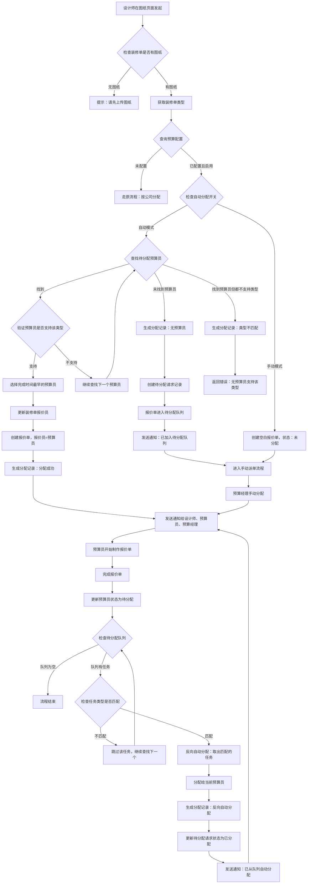
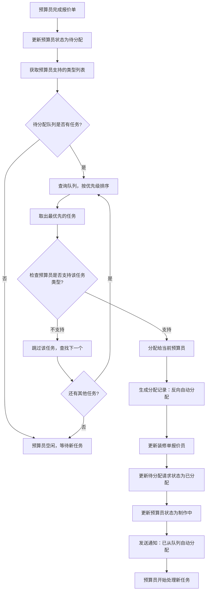

# 报价单预算员自动分配功能设计方案

> **设计文档版本**: v2.0
> **创建日期**: 2026-03-13
> **最后更新**: 2026-03-19
> **设计目标**: 实现装修单预算员的自动分配与手动派单功能，支持待分配队列、反向自动分配、装修类型匹配
> **核心原则**: 一个装修单只分配一次报价员（该人员也是后续报价单的预算员），多个报价单版本共用同一预算员
>
> **重要说明（v2.0）**:
> - ✅ 报价员分配关系存储在 `decoration.quoter`（`decoration.quid`）
> - ✅ **报价员=预算员**：分配给装修单的报价员，就是后续报价单的创建人（`quotation.creater`）
> - ✅ 分配时间使用 `quotation.createtime`，不需要 `budgetAssignTime` 字段
> - ✅ 数据库表结构已更新为v2.0版本（统一使用 `quotationassign` 前缀）
> - ❌ ~~不需要添加 `budgetUid` 和 `budgetAssignTime` 字段~~（v1.4 中的错误已更正）
>
> **v2.0 主要变更**:
> - 🔄 表名统一使用 `quotationassign` 前缀（quotationassignconfig、quotationassignuserrule等）
> - 🔄 主键字段名调整（bcid→qacid, burid→qaurid, barid→qarid）
> - 🔄 状态字段类型从 TINYINT(1) 改为 SMALLINT(6)
> - 🔄 主键字段类型从 INT(11) 改为 BIGINT(20)

---

## 📋 核心业务规则

### 🔑 关键业务规则（重要）

**报价员与预算员的关系**：
- **decoration.quoter (decoration.quid)** = **报价员**
- **quotation.creater (quotation.cuid)** = **预算员**
- **报价员和预算员是同一个人**

**分配流程**：
1. 为装修单分配报价员（`decoration.quoter`）
2. 创建报价单时，该报价员自动成为报价单的创建人/预算员（`quotation.creater`）
3. 分配时间记录在 `quotation.createtime`，不需要额外的 `budgetAssignTime` 字段

**字段映射关系**：
```
decoration.quoter (UserPO 对象)
    ↓ (同一人)
decoration.quid (int 字段，报价员ID)
    ↓ (创建报价单时)
quotation.creater (UserPO 对象)
quotation.cuid (int 字段，预算员ID)
```

---

## 🗄️ 数据库设计

### 核心关系说明

```
decoration（装修单）
    ├── quoter（报价员ID，decoration.quid）- 分配关系存储在这里
    ├── quotationassignrequest（分配请求，最多1条活跃记录）
    │   └── 用于控制待分配队列和分配状态
    ├── quotationassignrecord（分配记录，多条历史记录）
    │   └── 仅用于追溯所有分配尝试（成功、失败、重新分配）
    └── quotation（多个报价单版本）
        └── creater（预算员ID，quotation.cuid，与 decoration.quoter 同一人）
```

**关键原则**：
- 一个装修单只分配一次报价员
- 报价员=预算员（同一个人）
- 多个报价单版本共用同一预算员
- quotationuserrule 状态基于 quotationassignrequest 统计
- 已分配的装修单不再重新分配报价员

---

### 1. 装修单表字段说明 (decoration.decoration)

**已有字段（无需新增）**：

```sql
-- 现有字段，用于存储报价员
decoration.quid INT(11) COMMENT '报价员用户ID'

-- 关联对象
decoration.quoter (UserPO 对象，通过 quid 关联)
```

**字段说明**:
- `quid`: 关联的报价员用户ID（核心字段，存储分配关系）
- `quoter`: UserPO 对象，通过 Hibernate 关联查询

**用途**:
- 存储装修单与报价员的分配关系
- 一个装修单只有一个报价员
- 该报价员也是后续所有报价单的预算员

**⚠️ 注意**：
- ~~不需要添加~~ `budgetUid` 字段（v1.4 中的错误设计）
- ~~不需要添加~~ `budgetAssignTime` 字段（v1.4 中的错误设计）
- 使用 `quotation.createtime` 记录分配时间即可

---

### 2. 预算员规则表 (quotation.quotationassignuserrule)

```sql
CREATE TABLE quotation.quotationassignuserrule (
    qaurid BIGINT(20) NOT NULL AUTO_INCREMENT COMMENT '预算员规则ID',
    uid INT(11) NOT NULL COMMENT '用户ID（预算员工号）',
    company INT(11) NOT NULL COMMENT '关联公司ID',
    department INT(11) DEFAULT NULL COMMENT '部门ID（NULL表示该公司所有部门）',
    status SMALLINT(6) NOT NULL DEFAULT 1 COMMENT '状态：1-待分配，2-制作中，3-停止',
    lastFinishTime TIMESTAMP NULL COMMENT '最后完成时间（用于自动分配排序，最早完成的优先）',
    currentTaskCount INT(8) NOT NULL DEFAULT 0 COMMENT '当前任务数量（缓存字段，基于quotationassignrequest统计）',
    taskCountUpdateTime TIMESTAMP NULL COMMENT '任务数量统计时间',
    createTime TIMESTAMP NOT NULL DEFAULT CURRENT_TIMESTAMP COMMENT '创建时间',
    updateTime TIMESTAMP NOT NULL DEFAULT CURRENT_TIMESTAMP ON UPDATE CURRENT_TIMESTAMP COMMENT '更新时间',
    PRIMARY KEY (qaurid),
    UNIQUE KEY uk_uid_company (uid, company),
    KEY idx_status_finishTime (status, lastFinishTime),
    KEY idx_company_status (company, status),
    KEY idx_department (department)
) ENGINE=InnoDB DEFAULT CHARSET=utf8mb4 COMMENT='预算员人员规则表';
```

**字段说明**:
- `qaurid`: 预算员规则ID（主键，BIGINT类型）
- `uid`: 预算员用户ID（该用户会被分配为装修单的报价员）
- `company`: 关联公司ID
- `department`: 部门ID（NULL表示该公司所有部门）
- `status`: 预算员状态
  - `1`: 待分配（可接收新任务）
  - `2`: 制作中（正在处理任务）
  - `3`: 停止（不再接收任务）
- `lastFinishTime`: 最后完成时间，用于自动分配时排序（最早完成的优先）
- `currentTaskCount`: 当前任务数量（缓存字段，减少实时统计开销）
- `taskCountUpdateTime`: 任务数量统计时间（用于判断缓存是否过期）

**状态更新规则**:
- 状态基于 `quotationassignrequest` 表统计（status=2 的请求数）
- `currentTaskCount = 0` 时，`status = 1`（待分配）
- `currentTaskCount > 0` 时，`status = 2`（制作中）
- 管理员手动设置 `status = 3`（停止）

---

### 3. 预算员类型支持表 (quotation.quotationassignuserruletype)

```sql
CREATE TABLE quotation.quotationassignuserruletype (
    qasrid BIGINT(20) NOT NULL AUTO_INCREMENT COMMENT '类型支持ID',
    qaurid BIGINT(20) NOT NULL COMMENT '预算员规则ID（关联quotationassignuserrule.qaurid）',
    type SMALLINT(6) NOT NULL COMMENT '装修类型：1-半包，2-整装',
    createTime TIMESTAMP NOT NULL DEFAULT CURRENT_TIMESTAMP COMMENT '创建时间',
    updateTime TIMESTAMP NOT NULL DEFAULT CURRENT_TIMESTAMP ON UPDATE CURRENT_TIMESTAMP COMMENT '更新时间',
    PRIMARY KEY (qasrid),
    UNIQUE KEY uk_qaurid_type (qaurid, type),
    KEY idx_qaurid (qaurid),
    KEY idx_type (type)
) ENGINE=InnoDB DEFAULT CHARSET=utf8mb4 COMMENT='预算员支持类型表';
```

**字段说明**:
- `qasrid`: 类型支持ID（主键，Quotation Assign Support Rule Type ID）
- `qaurid`: 预算员规则ID（关联 `quotationassignuserrule.qaurid`）
- `type`: 支持的装修类型
  - `1`: 半包
  - `2`: 整装
- 一个预算员可以有多条记录（支持多种类型）

**用途**:
- 定义预算员支持的装修类型
- 支持一对一（只支持一种类型）或一对多（支持多种类型）
- 分配时必须匹配类型才能成功
- 支持动态修改预算员的类型支持

---

### 4. 装修单预算分配请求表 (quotation.quotationassignrequest)

**职责**：控制分配逻辑和待分配队列（装修单级别，最多1条活跃记录）

```sql
CREATE TABLE quotation.quotationassignrequest (
    qarid BIGINT(20) NOT NULL AUTO_INCREMENT COMMENT '请求ID',
    orderId VARCHAR(15) NOT NULL COMMENT '装修单号（关联 decoration.orderId）',
    company INT(11) NOT NULL COMMENT '公司ID',
    department INT(11) DEFAULT NULL COMMENT '部门ID（NULL表示该公司所有部门）',
    decorationType SMALLINT(6) NOT NULL COMMENT '装修类型：1-半包，2-整装',
    priority SMALLINT(6) NOT NULL DEFAULT 5 COMMENT '优先级：1-最高，5-普通，9-最低',
    requestTime TIMESTAMP NOT NULL DEFAULT CURRENT_TIMESTAMP COMMENT '请求加入队列的时间',
    requestUid INT(11) DEFAULT NULL COMMENT '请求人用户ID（设计师）',
    status SMALLINT(6) NOT NULL DEFAULT 1 COMMENT '状态：1-待分配，2-已分配',
    assignTime TIMESTAMP NULL COMMENT '分配时间（status=2时有值）',
    remark VARCHAR(255) DEFAULT NULL COMMENT '备注',
    PRIMARY KEY (qarid),
    UNIQUE KEY uk_orderId_status (orderId, status),
    KEY idx_company_status_type (company, status, decorationType),
    KEY idx_priority_time (priority, requestTime),
    KEY idx_orderId (orderId)
) ENGINE=InnoDB DEFAULT CHARSET=utf8mb4 COMMENT='装修单预算分配请求表';
```

**字段说明**:
- `qarid`: 请求ID（主键，BIGINT类型）
- `orderId`: 装修单号（关联 decoration.orderId）
- `company`: 公司ID（用于匹配预算员）
- `department`: 部门ID（NULL表示该公司所有部门）
- `decorationType`: 装修类型（1-半包，2-整装）
- `priority`: 优先级（1-最高，5-普通，9-最低）
- `status`: 状态
  - `1`: 待分配（在队列中等待）
  - `2`: 已分配（成功分配给预算员）
- `requestTime`: 请求加入队列的时间
- `assignTime`: 实际分配时间（status=2时有值，status=1时为NULL）
- `remark`: 备注信息

**唯一约束说明**:
- `uk_orderId_status (orderId, status)`: 确保一个装修单在同一个状态下只有一条记录
- 业务含义：
  - 一个装修单可以有一条"待分配"记录 (orderId1, 1)
  - 分配成功后，更新为"已分配" (orderId1, 2)
  - 如果需要重新分配，会创建新的记录

**用途**:
- 控制待分配队列（装修单级别）
- 用于统计预算员的当前任务数（status=2 的记录）
- 支持优先级排序（priority + requestTime）
- 支持反向自动分配
- 一个装修单只有一条待分配/已分配记录

---

### 5. 装修单预算分配记录表 (quotation.quotationassignrecord)

**职责**：追溯所有分配尝试（成功、失败、重新分配）

```sql
CREATE TABLE quotation.quotationassignrecord (
    qasrid BIGINT(20) NOT NULL AUTO_INCREMENT COMMENT '分配记录ID',
    orderId VARCHAR(15) NOT NULL COMMENT '装修单号',
    uid INT(11) DEFAULT NULL COMMENT '预算员用户ID（成功时有值，失败时为NULL）',
    assignType SMALLINT(6) NOT NULL COMMENT '分配类型：1-正向自动，2-手动，3-反向自动',
    assignResult TINYINT(1) NOT NULL COMMENT '分配结果：0-失败，1-成功',
    assignUid INT(11) DEFAULT NULL COMMENT '分配人用户ID（手动分配时有值）',
    assignTime TIMESTAMP NOT NULL DEFAULT CURRENT_TIMESTAMP COMMENT '分配时间（即记录创建时间）',
    failReason VARCHAR(255) DEFAULT NULL COMMENT '失败原因（assignResult=0时有值）',
    decorationType SMALLINT(6) DEFAULT NULL COMMENT '装修类型（用于追溯）',
    PRIMARY KEY (qasrid),
    KEY idx_orderId (orderId),
    KEY idx_uid_result (uid, assignResult),
    KEY idx_assignType_time (assignType, assignTime),
    KEY idx_assignTime (assignTime)
) ENGINE=InnoDB DEFAULT CHARSET=utf8mb4 COMMENT='装修单预算分配记录表（历史追溯）';
```

**字段说明**:
- `qasrid`: 分配记录ID（主键，Quotation Assign Support Record ID）
- `orderId`: 装修单号
- `uid`: 预算员用户ID（成功分配时有值，失败时为NULL）
- `assignType`: 分配类型
  - `1`: 正向自动分配（设计师发起）
  - `2`: 手动分配（预算经理手动派单）
  - `3`: 反向自动分配（预算员完成后自动分配）
- `assignResult`: 分配结果
  - `0`: 失败（无预算员/类型不匹配/其他原因）
  - `1`: 成功
- `assignUid`: 分配人用户ID（手动分配时有值，自动分配时为NULL）
- `assignTime`: 分配时间（即记录创建时间）
- `failReason`: 失败原因说明（assignResult=0时有值）
- `decorationType`: 装修类型（用于追溯分析）

**用途**:
- 记录所有分配尝试（成功、失败、重新分配）
- 支持分配历史追溯和审计
- 统计预算员工作量和成功率
- 分析分配失败原因，优化分配策略
- 支持按时间、类型、结果等多维度查询

---

### 6. 预算配置表 (quotation.quotationassignconfig)

```sql
CREATE TABLE quotation.quotationassignconfig (
    qacid BIGINT(20) NOT NULL AUTO_INCREMENT COMMENT '配置ID',
    company INT(11) NOT NULL COMMENT '公司ID',
    department INT(11) DEFAULT NULL COMMENT '部门ID（NULL表示该公司所有部门）',
    enabled SMALLINT(6) NOT NULL DEFAULT 1 COMMENT '是否启用：0-禁用，1-启用',
    autoAssign SMALLINT(6) NOT NULL DEFAULT 1 COMMENT '是否自动分配：0-手动，1-自动',
    createTime TIMESTAMP NOT NULL DEFAULT CURRENT_TIMESTAMP COMMENT '创建时间',
    updateTime TIMESTAMP NOT NULL DEFAULT CURRENT_TIMESTAMP ON UPDATE CURRENT_TIMESTAMP COMMENT '更新时间',
    PRIMARY KEY (qacid),
    UNIQUE KEY uk_company_dept (company, department),
    KEY idx_enabled (enabled)
) ENGINE=InnoDB DEFAULT CHARSET=utf8mb4 COMMENT='预算配置表';
```

**字段说明**:
- `qacid`: 配置ID（主键，Quotation Assign Config ID）
- `company`: 公司ID
- `department`: 部门ID（NULL表示该公司所有部门）
- `enabled`: 是否启用预算员分配功能
  - `0`: 禁用（不使用预算员自动分配，走原流程）
  - `1`: 启用（使用预算员自动分配）
- `autoAssign`: 分配方式（仅在 enabled=1 时生效）
  - `0`: 手动分配（预算员完成后不自动分配，需要手动派单）
  - `1`: 自动分配（预算员完成后自动从队列分配）

**唯一约束说明**:
- `uk_company_dept (company, department)`: 确保每个公司/部门组合只有一条配置记录
- NULL 值处理：
  - (company1, NULL) 表示公司1的所有部门配置
  - (company1, dept1) 表示公司1的部门1的配置
  - 两者可以同时存在，实现"全局配置 + 部门特殊配置"的层级结构

**用途**:
- 控制哪些公司/部门启用预算员分配功能
- 控制自动分配还是手动分配模式
- 支持层级配置（公司级 + 部门级）

---

## 🔄 业务流程设计

### 流程图

#### 主流程：正向自动分配



#### 反向自动分配流程（含类型匹配）



---

### 详细流程说明

#### 1. 正向自动分配流程（含类型匹配）

**触发条件**:
- 设计师在图纸页面点击"发起预算制作"
- 装修单已有图纸（`decorationpicture` 表中存在记录）
- 获取装修单类型（`decoration.type`：1-半包，2-整装）
- 对应公司/部门已配置预算分配规则且启用自动分配

**分配逻辑（含类型匹配）**:
```sql
-- 步骤1：查找待分配且完成时间最早的预算员
SELECT * FROM quotation.quotationassignuserrule
WHERE status = 1  -- 待分配
  AND company = ?
ORDER BY lastFinishTime ASC, currentTaskCount ASC;

-- 步骤2：验证预算员是否支持该装修类型
SELECT * FROM quotation.quotationassignuserruletype
WHERE qaurid = ?
  AND type = ?;  -- 装修单类型（1或2）
```

**执行步骤（分支1：找到且类型匹配的预算员）**:
1. **获取装修单类型**（`decoration.type`：1-半包，2-整装）
2. **检查装修单是否已分配报价员**（`decoration.quoter`）
   - 如果已分配：直接返回，不重新分配
   - 如果未分配：继续后续步骤
3. 查找状态为"待分配"的预算员（按完成时间排序）
4. **逐个验证预算员是否支持该类型**：
   - 查询 `quotationassignuserruletype` 表
   - 判断是否包含目标类型
   - 如果不支持，继续查找下一个
   - 如果支持，选中该预算员
5. **更新装修单的报价员**（`decoration.quoter` 和 `decoration.quid`）
6. **更新或创建 quotationassignrequest**（`status = 2` 已分配）
7. **更新预算员状态**（基于 quotationassignrequest 统计）
8. **生成分配记录**（`quotationassignrecord`，`assignResult=1` 成功）
9. 发送通知消息（设计师、预算员、预算经理）
10. 返回分配成功

**执行步骤（分支2：未找到预算员）**:
1. **检查装修单是否已存在待分配请求**
   - 如果已存在：不重复创建，直接返回
   - 如果不存在：继续后续步骤
2. **生成分配记录**（`quotationassignrecord`，`assignResult=0` 无预算员）
3. **创建待分配请求记录**（`quotationassignrequest`）
   - `status = 1`（待分配）
   - `decorationType = 装修单类型`（1或2）
   - `priority = 5`（普通优先级，可调整）
   - 记录请求时间
4. 发送通知给设计师："已加入待分配队列，暂无可用预算员"
5. 发送通知给预算经理："有待分配装修单需要处理"
6. 返回等待分配状态

**执行步骤（分支3：找到预算员但类型都不支持）**:
1. **生成分配记录**（`quotationassignrecord`，`assignResult=0` 类型不匹配）
   - `failReason = "无预算员支持该类型（半包/整装）"`
   - `decorationType = 装修单类型`
2. **不创建报价单**
3. **返回错误提示**："当前无预算员支持该装修类型（半包/整装），请联系管理员配置预算员类型"
4. 发送通知给预算经理："需要配置支持该类型的预算员"

---

#### 2. 反向自动分配流程（含类型匹配）

**触发时机**:
- 预算员完成报价单制作（调用 `finishQuotation` 接口）
- 预算员任务数量从 >0 变为 =0
- 预算员状态从"制作中"变为"待分配"

**执行步骤**:
1. **事务开始**
2. **获取预算员支持的类型列表**（查询 `quotationassignuserruletype`）
3. 查找待分配队列中类型匹配且最优先的任务
4. 如果找到任务：
   - 更新装修单报价员（`decoration.quoter`）
   - 更新待分配请求状态为"已分配"（`quotationassignrequest.status = 2`）
   - **更新预算员状态**（基于 quotationassignrequest 统计 `currentTaskCount`）
   - 如果 `currentTaskCount > 0`，则 `status = 2`（制作中）
   - 插入分配记录（`quotationassignrecord`，`assignType=3` 反向自动分配）
   - **事务提交**
   - 发送通知："已从待分配队列自动分配"
5. 如果未找到任务（队列为空或无匹配类型）：
   - 预算员保持"待分配"状态（空闲）
   - **事务结束**

---

## 🏗️ 功能模块设计

### 模块划分

```
quotation/
├── action/
│   ├── QuotationAction.java                    # 报价单Action（修改）
│   ├── QuotationAssignUserRuleAction.java      # 预算员规则Action（新增）
│   ├── QuotationAssignAction.java              # 预算分配Action（新增）
│   └── QuotationAssignRequestAction.java       # 待分配请求Action（新增）
├── service/
│   ├── QuotationService.java                   # 报价单Service（修改）
│   ├── QuotationAssignUserRuleService.java     # 预算员规则Service（新增）
│   ├── QuotationAssignService.java             # 预算分配Service（新增）
│   └── QuotationAssignRequestService.java      # 待分配请求Service（新增）
├── dao/
│   ├── QuotationDao.java                       # 报价单Dao（修改）
│   ├── QuotationAssignUserRuleDao.java         # 预算员规则Dao（新增）
│   ├── QuotationAssignRecordDao.java           # 分配记录Dao（新增）
│   ├── QuotationAssignRequestDao.java          # 待分配请求Dao（新增）
│   └── QuotationConfigDao.java                 # 预算配置Dao（新增）
├── po/
│   ├── QuotationPO.java                        # 报价单PO（修改）
│   ├── QuotationAssignUserRulePO.java          # 预算员规则PO（新增）
│   ├── QuotationAssignRecordPO.java            # 分配记录PO（新增）
│   ├── QuotationAssignRequestPO.java           # 待分配请求PO（新增）
│   └── QuotationConfigPO.java                  # 预算配置PO（新增）
└── vo/
    ├── QuotationVO.java                        # 报价单VO（修改）
    ├── QuotationAssignUserRuleVO.java          # 预算员规则VO（新增）
    ├── QuotationAssignVO.java                  # 分配请求VO（新增）
    ├── QuotationAssignRequestVO.java           # 待分配请求VO（新增）
    └── QuotationConfigVO.java                  # 预算配置VO（新增）
```

---

## 🌐 API 接口设计

### 核心接口说明

**注意**：以下接口中的"预算员"指的是被分配为装修单报价员的人员，该人员同时也是报价单的创建人（预算员）。

### 1. 自动分配报价员

**接口**: `POST /assignQuotationAssign.do`

**请求参数**:
```json
{
  "orderId": "1501020001",        // 装修单号
  "companyId": 1,                 // 公司ID
  "decorationType": 1             // 装修类型：1-半包，2-整装
}
```

**响应数据**:
```json
{
  "code": 0,
  "message": "分配成功",
  "data": {
    "quoterUid": 1001,              // 报价员ID（也是预算员ID）
    "quoterName": "张三",
    "assignTime": "2026-03-16 14:30:00"
  }
}
```

### 2. 手动分配报价员

**接口**: `POST /manualQuotationAssign.do`

**请求参数**:
```json
{
  "orderId": "1501020001",        // 装修单号
  "budgetUid": 1001,              // 预算员用户ID（会被设置为报价员）
  "assignUid": 2001               // 分配人用户ID（预算经理）
}
```

### 3. 完成报价单

**接口**: `POST /finishQuotationAssign.do`

**请求参数**:
```json
{
  "orderId": "1501020001"         // 装修单号
}
```

### 4. 重新分配报价员

**接口**: `POST /reassignQuotationAssign.do`

**请求参数**:
```json
{
  "orderId": "1501020001",        // 装修单号
  "newBudgetUid": 1002,           // 新预算员用户ID
  "assignUid": 2001               // 分配人用户ID
}
```

---

## 📝 附录

### 相关文档
- [报价管理模块文档](../src/com/fanglin/quotation/CLAUDE.md)
- [信息管理模块文档](../src/com/fanglin/information/CLAUDE.md)
- [客户管理模块文档](../src/com/fanglin/customer/CLAUDE.md)

### 相关表结构
- `decoration.decoration` - 装修单表（使用 quid 字段存储报价员）
- `quotation.quotation` - 报价单表（使用 cuid 字段存储预算员）
- `quotation.quotationassignuserrule` - 预算员规则表
- `quotation.quotationassignuserruletype` - 预算员类型支持表
- `quotation.quotationassignrequest` - 分配请求表
- `quotation.quotationassignrecord` - 分配记录表
- `quotation.quotationassignconfig` - 预算配置表
- `decoration.decorationpicture` - 装修图纸表

### 字段对应关系

| 业务概念 | 装修单表 | 报价单表 | 说明 |
|---------|---------|---------|------|
| 报价员 | `decoration.quoter` (UserPO) | - | 分配给装修单的报价员 |
| 报价员ID | `decoration.quid` (int) | - | 报价员用户ID |
| 预算员 | - | `quotation.creater` (UserPO) | 报价单的创建人 |
| 预算员ID | - | `quotation.cuid` (int) | 预算员用户ID |
| **关系** | **报价员 = 预算员（同一个人）** | | |

---

**设计完成日期**: 2026-03-13
**最后更新**: 2026-03-19
**文档维护**: Claude AI
**审核状态**: 已更新（v2.0）

---

## 📝 版本更新日志

### v2.0 (2026-03-19)
**重大更新**: 数据库表结构标准化

**变更内容**:
1. **表名统一化**：
   - `quotationconfig` → `quotationassignconfig`
   - `quotationuserrule` → `quotationassignuserrule`
   - `quotationuserruletype` → `quotationassignuserruletype`
   - `quotationassignrequest` 保持不变（已有assign前缀）
   - `quotationassignrecord` 保持不变（已有assign前缀）

2. **主键字段调整**：
   - `bcid` → `qacid` (Budget Config ID → Quotation Assign Config ID)
   - `burid` → `qaurid` (Budget User Rule ID → Quotation Assign User Rule ID)
   - `barid` → `qarid` (Budget Assign Request ID → Quotation Assign Request ID)

3. **数据类型优化**：
   - 主键字段：`INT(11)` → `BIGINT(20)`（支持更大的数据量）
   - 状态字段：`TINYINT(1)` → `SMALLINT(6)`（更好的扩展性）

4. **索引优化**：
   - 新增 `idx_department` 索引（quotationassignuserrule表）
   - 新增 `idx_orderId` 索引（quotationassignrequest表）
   - 新增 `idx_assignType` 索引（quotationassignrecord表）

5. **SQL脚本**：
   - 完整的建表脚本：`sql/add_quotation_budget_assignment.sql`
   - 包含详细注释和示例数据
   - 包含索引说明和使用场景

**影响范围**:
- ✅ 所有PO实体类已更新（匹配新表结构）
- ✅ 所有DAO、Service、Action已实现
- ✅ 前端API已更新为正确的接口名称
- ⚠️ 需要执行SQL脚本创建数据库表

### v1.5 (2026-03-16)
- 更正报价员与预算员的关系说明
- 明确分配关系存储在 `decoration.quoter`
- 移除错误的 `budgetUid` 和 `budgetAssignTime` 字段设计

### v1.0 (2026-03-13)
- 初始设计版本
- 定义核心业务流程和表结构

---

## 📖 开发指导计划（Implementation Guide）

> **最后更新**: 2026-03-19
> **开发方式**: 小步快跑，前后端同步实现
> **质量原则**: 每个模块完成后需经 review 验证

### ⚠️ 重要：开发前必读

**在开始开发之前，请务必阅读以下规范文档**：

📋 **[模块开发前后台规范说明](./MODULE_DEVELOPMENT_STANDARDS.md)** - **必读！**

该文档包含：
- ✅ Action/Service/DAO 三层架构的完整开发规范
- ✅ 参数传递规范（Action传VO给Service，Service传基本类型给DAO）
- ✅ 命名规范（字段命名、方法命名）
- ✅ PO/VO 开发规范（枚举转换由前端处理）
- ✅ 代码审查检查清单
- ✅ 常见错误对照表

**本设计文档只记录业务需求和数据库设计，详细的代码实现规范请参考上述文档。**

---

## 🎯 开发策略

### 核心原则
1. **小步快跑**: 每个模块独立开发、独立测试、独立验证
2. **前后端同步**: 每个模块都包含完整的后端（三层架构）+ 前端（页面 + API 调用）
3. **质量优先**: 每完成一个模块，经 review 确认后再进行下一个
4. **接口先行**: 后端接口定义明确后，前端再基于接口开发

### 开发顺序
```
配置管理（最简单）
    ↓
预算员规则管理
    ↓
预算员类型支持管理
    ↓
分配请求和记录管理
    ↓
核心分配逻辑（最复杂）
```

---

## 📋 代码规范总结

### 后端代码规范

#### 1. PO 实体类规范

```java
@Entity
@Table(name = "quotationassignconfig", catalog = "quotation")
public class QuotationAssignConfigPO implements Serializable {

    private static final long serialVersionUID = 1L;

    // 常量定义
    public static final Short ENABLED_INT = 1;    // 启用
    public static final Short DISABLED_INT = 0;   // 禁用

    public static final Short AUTO_ASSIGN_INT = 1;  // 自动分配
    public static final Short MANUAL_ASSIGN_INT = 0; // 手动分配

    // 主键（BIGINT）
    @Id
    @GeneratedValue(strategy = GenerationType.IDENTITY)
    @Column(name = "qacid", unique = true, nullable = false)
    private Long qacid;

    // 业务字段
    @Column(name = "company", nullable = false)
    private Integer company;

    @Column(name = "department")
    private Integer department;  // NULL表示该公司所有部门

    @Column(name = "enabled", nullable = false)
    private Short enabled;

    @Column(name = "autoAssign", nullable = false)
    private Short autoAssign;

    // 时间字段（Timestamp）
    @Column(name = "createTime", nullable = false, updatable = false)
    private Timestamp createTime;

    @Column(name = "updateTime", nullable = false)
    private Timestamp updateTime;

    // Getter/Setter 方法
    public Long getQacid() {
        return qacid;
    }

    public void setQacid(Long qacid) {
        this.qacid = qacid;
    }

    public Integer getCompany() {
        return company;
    }

    public void setCompany(Integer company) {
        this.company = company;
    }

    public Integer getDepartment() {
        return department;
    }

    public void setDepartment(Integer department) {
        this.department = department;
    }

    public Short getEnabled() {
        return enabled;
    }

    public void setEnabled(Short enabled) {
        this.enabled = enabled;
    }

    public Short getAutoAssign() {
        return autoAssign;
    }

    public void setAutoAssign(Short autoAssign) {
        this.autoAssign = autoAssign;
    }

    public Timestamp getCreateTime() {
        return createTime;
    }

    public void setCreateTime(Timestamp createTime) {
        this.createTime = createTime;
    }

    public Timestamp getUpdateTime() {
        return updateTime;
    }

    public void setUpdateTime(Timestamp updateTime) {
        this.updateTime = updateTime;
    }
}
```

**关键规范**：
- ✅ 使用 JPA 注解（@Entity, @Table, @Column, @Id, @GeneratedValue）
- ✅ 主键使用 `Long` 类型（BIGINT）
- ✅ 状态字段使用 `Short` 类型（SMALLINT）
- ✅ 布尔字段使用 `TINYINT(1)` 类型（Byte）
- ✅ 时间字段使用 `Timestamp` 类型
- ✅ `createTime` 添加 `updatable = false`（防止修改）
- ✅ 实现 `Serializable` 接口
- ✅ 定义 `serialVersionUID`
- ✅ 定义常量（状态值）
- ✅ NULL 值字段在注释中说明

#### 2. VO 值对象规范

```java
public class QuotationAssignConfigVO implements Serializable {

    private static final long serialVersionUID = 1L;

    // 字段类型与 PO 保持一致
    private Long qacid;
    private Integer company;
    private Integer department;
    private Short enabled;
    private Short autoAssign;
    private Timestamp createTime;
    private Timestamp updateTime;

    // 关联对象（使用 VO 类型）
    private CompanyVO companyVO;
    private DepartmentVO departmentVO;

    // Getter/Setter
    public Long getQacid() {
        return qacid;
    }

    public void setQacid(Long qacid) {
        this.qacid = qacid;
    }

    // ... 其他 Getter/Setter
}
```

**关键规范**：
- ✅ 实现 `Serializable` 接口
- ✅ 字段类型与 PO 一致（使用包装类型）
- ✅ 关联对象使用 VO 类型（如 CompanyVO、DepartmentVO）
- ✅ **不要添加枚举转文字的方法**（如 `getEnabledText()`、`getStatusText()` 等）
- ✅ **枚举值转换由前端处理**：前端使用三元运算符 `v.status == 0 ? "启用" : "禁用"`
- ✅ **前端从 `ds/*.json` 文件读取枚举定义**，后端只提供数据

**❌ 错误示例**：
```java
// ❌ 不要在 VO 中添加转文字的方法
public String getEnabledText() {
    return enabled == 1 ? "启用" : "禁用";
}

// ❌ 不要在 VO 中添加工具方法
public boolean isEnabled() {
    return this.enabled == 1;
}
```

**✅ 正确示例**：
```java
// ✅ 只保留纯数据字段和 Getter/Setter
public Short getEnabled() {
    return enabled;
}

public void setEnabled(Short enabled) {
    this.enabled = enabled;
}
```

**前端转换示例**：
```javascript
// ✅ 前端使用三元运算符转换
var enabledText = config.enabled == 1 ? "启用" : "禁用";

// ✅ 前端从 constant 读取枚举定义
quotation.items.status.bindData(constant.system().status, "key", "value");

// ✅ 前端直接使用三元运算符
[v.status == 0 ? "启用" : "禁用", 'red']
```

#### 3. DAO 接口规范

```java
public interface QuotationAssignConfigDao extends Dao<QuotationAssignConfigPO> {

    /**
     * 根据公司ID查询配置
     * @param company 公司ID
     * @return 配置对象
     */
    QuotationAssignConfigPO queryByCompany(Integer company);

    /**
     * 根据公司和部门查询配置
     * @param company 公司ID
     * @param department 部门ID
     * @return 配置对象
     */
    QuotationAssignConfigPO queryByCompanyAndDepartment(Integer company, Integer department);

    /**
     * 查询所有启用的配置
     * @return 配置列表
     */
    List<QuotationAssignConfigPO> queryAllEnabled();
}
```

**关键规范**：
- ✅ 继承 `Dao<PO>` 泛型接口
- ✅ 方法命名清晰（queryXxx, addXxx, updateXxx, deleteXxx）
- ✅ 参数明确（使用基本类型或 PO 属性）
- ✅ 返回类型具体（PO, List<PO>, int）
- ✅ 添加 JavaDoc 注释

#### 4. Service 接口规范

```java
public interface QuotationAssignConfigService {

    /**
     * 分页查询配置列表
     * @param paging 分页对象
     * @param filters 过滤条件
     * @throws FLException 业务异常
     */
    void pageQuotationAssignConfig(Paging paging, List<Filter> filters) throws FLException;

    /**
     * 根据ID查询配置
     * @param configVO 配置VO（包含ID）
     * @return 配置VO
     * @throws FLException 业务异常
     */
    QuotationAssignConfigVO queryQuotationAssignConfigById(QuotationAssignConfigVO configVO) throws FLException;

    /**
     * 新增配置
     * @param configVO 配置VO
     * @return 影响行数
     * @throws FLException 业务异常
     */
    int addQuotationAssignConfig(QuotationAssignConfigVO configVO) throws FLException;

    /**
     * 更新配置
     * @param configVO 配置VO
     * @return 影响行数
     * @throws FLException 业务异常
     */
    int updateQuotationAssignConfig(QuotationAssignConfigVO configVO) throws FLException;

    /**
     * 删除配置
     * @param configVO 配置VO（包含ID）
     * @return 影响行数
     * @throws FLException 业务异常
     */
    int deleteQuotationAssignConfigById(QuotationAssignConfigVO configVO) throws FLException;
}
```

**关键规范**：
- ✅ 方法签名抛出 `FLException`
- ✅ 参数传递 VO 对象
- ✅ 返回具体类型（VO, List<VO>, int）
- ✅ 添加 JavaDoc 注释

#### 5. Action 控制器规范

```java
@ParentPackage("base")
@Namespace("/")
@Controller
public class QuotationAssignConfigAction extends BaseListAction {

    private static final long serialVersionUID = 1L;

    @Autowired
    private QuotationAssignConfigService quotationAssignConfigService;

    private QuotationAssignConfigVO config;
    private List<QuotationAssignConfigVO> configs;

    @Action(value = "pageQuotationAssignConfig", results = {
        @Result(name = "success", type = "json", params = {"ignoreHierarchy", "false"})
    }, params = {"contentType", "text/html"})
    public String pageQuotationAssignConfig() throws FLException {
        quotationAssignConfigService.pageQuotationAssignConfig(getPaging(), getFilters());
        return SUCCESS;
    }

    @Action(value = "queryQuotationAssignConfigById", results = {
        @Result(name = "success", type = "json", params = {"ignoreHierarchy", "false"})
    }, params = {"contentType", "text/html"})
    public String queryQuotationAssignConfigById() throws FLException {
        config = quotationAssignConfigService.queryQuotationAssignConfigById(config);
        return SUCCESS;
    }

    @Action(value = "addQuotationAssignConfig", results = {
        @Result(name = "success", type = "json", params = {"ignoreHierarchy", "false"})
    }, params = {"contentType", "text/html"})
    public String addQuotationAssignConfig() throws FLException {
        quotationAssignConfigService.addQuotationAssignConfig(config);
        return SUCCESS;
    }

    @Action(value = "updateQuotationAssignConfig", results = {
        @Result(name = "success", type = "json", params = {"ignoreHierarchy", "false"})
    }, params = {"contentType", "text/html"})
    public String updateQuotationAssignConfig() throws FLException {
        quotationAssignConfigService.updateQuotationAssignConfig(config);
        return SUCCESS;
    }

    @Action(value = "deleteQuotationAssignConfigById", results = {
        @Result(name = "success", type = "json", params = {"ignoreHierarchy", "false"})
    }, params = {"contentType", "text/html"})
    public String deleteQuotationAssignConfigById() throws FLException {
        quotationAssignConfigService.deleteQuotationAssignConfigById(config);
        return SUCCESS;
    }

    // Getter/Setter
    public QuotationAssignConfigVO getConfig() {
        return config;
    }

    public void setConfig(QuotationAssignConfigVO config) {
        this.config = config;
    }

    public List<QuotationAssignConfigVO> getConfigs() {
        return configs;
    }

    public void setConfigs(List<QuotationAssignConfigVO> configs) {
        this.configs = configs;
    }
}
```

**关键规范**：
- ✅ 使用 Struts2 注解（@Action, @Namespace, @ParentPackage, @Result）
- ✅ 继承 `BaseListAction`
- ✅ 使用 `@Autowired` 注入 Service
- ✅ 方法返回 `String` 类型
- ✅ 接口路径：`xxxAction.do`
- ✅ 返回 JSON 格式：`type = "json"`, `params = {"ignoreHierarchy", "false"}`
- ✅ 提供 Getter/Setter

### 前端代码规范

#### 1. API 定义规范

**文件**: `WebContent/js/api/quotation.js`

```javascript
// 页面路由定义
$.extend(api.index, {
    quotationAssignConfigIndex: {
        url: "/views/quotation/quotationAssignConfig.html"
    },
    quotationAssignUserRuleIndex: {
        url: "/views/quotation/quotationAssignUserRule.html"
    },
    quotationAssignRequestIndex: {
        url: "/views/quotation/quotationAssignRequest.html"
    }
});

// 后端接口定义
$.extend(api, {
    quotation: {
        // 配置管理接口
        pageQuotationAssignConfig: {
            url: "pageQuotationAssignConfig.do"
        },
        queryQuotationAssignConfigById: {
            url: "queryQuotationAssignConfigById.do"
        },
        addQuotationAssignConfig: {
            url: "addQuotationAssignConfig.do",
            validate: {
                "quotationAssignConfig.company": { required: true },
                "quotationAssignConfig.enabled": { required: true }
            }
        },
        updateQuotationAssignConfig: {
            url: "updateQuotationAssignConfig.do"
        },
        deleteQuotationAssignConfigById: {
            url: "deleteQuotationAssignConfigById.do"
        },

        // 预算员规则管理接口
        pageQuotationAssignUserRule: {
            url: "pageQuotationAssignUserRule.do"
        },
        // ... 其他接口
    }
});
```

**关键规范**：
- ✅ 在 `js/api/quotation.js` 中定义
- ✅ 页面路由定义在 `api.index` 中
- ✅ 后端接口定义在 `api.quotation` 中
- ✅ 接口名称与 Action 方法名一致
- ✅ 参数验证定义在 `validate` 中

#### 2. 前端页面规范

**文件**: `WebContent/views/quotation/quotationAssignConfig.html`

```html
<div id="quotationAssignConfigPageContent" class="page-content">

    <div class="page-header">
        <h1>预算配置管理</h1>
    </div>

    <!-- 操作按钮 -->
    <div class="row">
        <div class="col-xs-12">
            <button id="createBtn" class="btn btn-sm btn-success">
                <i class="icon-plus"></i> 新增配置
            </button>
            <button id="refreshBtn" class="btn btn-sm btn-info">
                <i class="icon-refresh"></i> 刷新
            </button>
        </div>
    </div>

    <div class="space-4"></div>

    <!-- 查询条件 -->
    <div id="condList" class="fl_search clearfix"></div>

    <!-- 数据表格 -->
    <div class="row">
        <div class="col-xs-12">
            <table id="dataTable" class="table table-striped table-bordered table-hover">
                <thead>
                    <tr>
                        <th>ID</th>
                        <th>公司</th>
                        <th>部门</th>
                        <th>状态</th>
                        <th>分配方式</th>
                        <th>创建时间</th>
                        <th>操作</th>
                    </tr>
                </thead>
                <tbody id="dataBody"></tbody>
            </table>
        </div>
    </div>

    <!-- 分页 -->
    <div id="pagenation" class="fl-page-wrap clearfix"></div>

    <!-- 编辑弹窗 -->
    <div class="modal fade" id="editModal" tabindex="-1">
        <div class="modal-dialog">
            <div class="modal-content">
                <div class="modal-header">
                    <button type="button" class="close" data-dismiss="modal">
                        <span>&times;</span>
                    </button>
                    <h4 class="modal-title" id="modalTitle">编辑配置</h4>
                </div>
                <div class="modal-body">
                    <form id="editForm" class="form-horizontal">
                        <input type="hidden" id="qacid" />

                        <div class="form-group">
                            <label class="col-sm-3 control-label">公司</label>
                            <div class="col-sm-9">
                                <select id="company" class="form-control v_required"
                                        data-validate="required"
                                        data-msg-required="请选择公司">
                                    <option value="">请选择</option>
                                </select>
                            </div>
                        </div>

                        <div class="space-4"></div>

                        <div class="form-group">
                            <label class="col-sm-3 control-label">部门</label>
                            <div class="col-sm-9">
                                <select id="department" class="form-control">
                                    <option value="">全部</option>
                                </select>
                            </div>
                        </div>

                        <div class="space-4"></div>

                        <div class="form-group">
                            <label class="col-sm-3 control-label">状态</label>
                            <div class="col-sm-9">
                                <select id="enabled" class="form-control v_required">
                                    <option value="1">启用</option>
                                    <option value="0">禁用</option>
                                </select>
                            </div>
                        </div>

                        <div class="space-4"></div>

                        <div class="form-group">
                            <label class="col-sm-3 control-label">分配方式</label>
                            <div class="col-sm-9">
                                <select id="autoAssign" class="form-control v_required">
                                    <option value="1">自动分配</option>
                                    <option value="0">手动分配</option>
                                </select>
                            </div>
                        </div>
                    </form>
                </div>

                <div class="modal-footer">
                    <button type="button" id="saveBtn" class="btn btn-primary">保存</button>
                    <button type="button" id="cancelBtn" class="btn btn-default" data-dismiss="modal">取消</button>
                </div>
            </div>
        </div>
    </div>

</div>
```

**关键规范**：
- ✅ 使用 Ace Admin + Bootstrap 样式
- ✅ 页面容器：`<div id="xxxPageContent" class="page-content">`
- ✅ 表格使用 `table-striped table-bordered table-hover`
- ✅ 表单使用 `form-horizontal` 布局
- ✅ 必填字段添加 `v_required` 类
- ✅ 验证规则使用 `data-validate` 和 `data-msg-*` 属性

#### 3. 前端 JS 逻辑规范

**文件**: `WebContent/js/quotation/quotationAssignConfig.js`

```javascript
$(function() {
    // 初始化分页
    var page = {
        pageNo: 1,
        pageSize: 20,
        total: 0
    };

    // 加载列表
    function loadList() {
        com.post(api.quotation.pageQuotationAssignConfig, {
            "page.pageNo": page.pageNo,
            "page.pageSize": page.pageSize
        }, function(res) {
            renderList(res.configs);
            page.total = res.page.total;
            renderPagination();
        });
    }

    // 渲染列表
    function renderList(list) {
        var html = '';
        if (list && list.length > 0) {
            $.each(list, function(i, item) {
                html += '<tr>';
                html += '<td>' + item.qacid + '</td>';
                html += '<td>' + (item.companyVO ? item.companyVO.name : '-') + '</td>';
                html += '<td>' + (item.departmentVO ? item.departmentVO.name : '全部') + '</td>';
                html += '<td>' + (item.enabled == 1 ? '启用' : '禁用') + '</td>';
                html += '<td>' + (item.autoAssign == 1 ? '自动' : '手动') + '</td>';
                html += '<td>' + com.formatDate(item.createTime, 'yyyy-MM-dd HH:mm:ss') + '</td>';
                html += '<td>';
                html += '  <button class="btn btn-xs btn-info editBtn" data-id="' + item.qacid + '">编辑</button>';
                html += '  <button class="btn btn-xs btn-danger deleteBtn" data-id="' + item.qacid + '">删除</button>';
                html += '</td>';
                html += '</tr>';
            });
        } else {
            html = '<tr><td colspan="7" class="text-center">暂无数据</td></tr>';
        }
        com.focusPage('#dataBody').html(html);
    }

    // 渲染分页
    function renderPagination() {
        // ... 分页逻辑
    }

    // 打开新增弹窗
    $('#createBtn').on('click', function() {
        com.focusPage('#editForm')[0].reset();
        com.focusPage('#qacid').val('');
        com.focusPage('#modalTitle').text('新增配置');
        com.focusPage('#editModal').modal('show');
    });

    // 打开编辑弹窗
    com.focusPage('#dataBody').on('click', '.editBtn', function() {
        var id = $(this).data('id');
        com.post(api.quotation.queryQuotationAssignConfigById, {
            "quotationAssignConfig.qacid": id
        }, function(res) {
            var config = res.config;
            com.focusPage('#qacid').val(config.qacid);
            com.focusPage('#company').val(config.company);
            com.focusPage('#department').val(config.department || '');
            com.focusPage('#enabled').val(config.enabled);
            com.focusPage('#autoAssign').val(config.autoAssign);
            com.focusPage('#modalTitle').text('编辑配置');
            com.focusPage('#editModal').modal('show');
        });
    });

    // 保存
    com.focusPage('#saveBtn').on('click', function() {
        // 表单验证
        if (!com.validateForm(com.focusPage('#editForm'))) {
            return false;
        }

        var formData = {
            "quotationAssignConfig.qacid": com.focusPage('#qacid').val(),
            "quotationAssignConfig.company": com.focusPage('#company').val(),
            "quotationAssignConfig.department": com.focusPage('#department').val() || null,
            "quotationAssignConfig.enabled": com.focusPage('#enabled').val(),
            "quotationAssignConfig.autoAssign": com.focusPage('#autoAssign').val()
        };

        var apiUrl = formData["quotationAssignConfig.qacid"]
            ? api.quotation.updateQuotationAssignConfig
            : api.quotation.addQuotationAssignConfig;

        com.post(apiUrl, formData, function(res) {
            if (res.errorCode == 0) {
                com.showAlert(com.info, '保存成功');
                com.focusPage('#editModal').modal('hide');
                loadList();
            } else {
                com.showAlert(com.error, res.errorMsg || '保存失败');
            }
        });
    });

    // 删除
    com.focusPage('#dataBody').on('click', '.deleteBtn', function() {
        var id = $(this).data('id');
        com.showConfirm('确认删除该配置吗？', function() {
            com.post(api.quotation.deleteQuotationAssignConfigById, {
                "quotationAssignConfig.qacid": id
            }, function(res) {
                if (res.errorCode == 0) {
                    com.showAlert(com.info, '删除成功');
                    loadList();
                } else {
                    com.showAlert(com.error, res.errorMsg || '删除失败');
                }
            });
        });
    });

    // 刷新
    $('#refreshBtn').on('click', function() {
        page.pageNo = 1;
        loadList();
    });

    // 初始化加载
    loadList();
});
```

**关键规范**：
- ✅ 使用 `com.focusPage()` 获取页面元素（除 login/index 页面外）
- ✅ 使用 `com.post()` 调用后端接口
- ✅ 使用 `com.validateForm()` 验证表单
- ✅ 使用 `com.showAlert()` 显示提示信息
- ✅ 使用 `com.showConfirm()` 显示确认对话框
- ✅ 使用 `com.formatDate()` 格式化日期
- ✅ 事件委托处理动态元素（`$('#dataBody').on('click', '.editBtn', ...)`）

---

## 🔧 开发步骤详解

### 第一步：配置管理模块（前后端完整实现）

#### 后端实现

**1. 创建数据库表**

```sql
-- 执行建表脚本
source sql/add_quotation_budget_assignment.sql;

-- 验证表创建
USE quotation;
SHOW TABLES LIKE 'quotationassign%';
DESC quotationassignconfig;
```

**2. 创建 PO 实体类**

文件：`src/com/fanglin/quotation/po/QuotationAssignConfigPO.java`

**3. 创建 VO 值对象**

文件：`src/com/fanglin/quotation/vo/QuotationAssignConfigVO.java`

**4. 创建 DAO 接口**

文件：`src/com/fanglin/quotation/dao/QuotationAssignConfigDao.java`

**5. 创建 DAO 实现类**

文件：`src/com/fanglin/quotation/dao/impl/QuotationAssignConfigDaoImpl.java`

**6. 创建 Service 接口**

文件：`src/com/fanglin/quotation/service/QuotationAssignConfigService.java`

**7. 创建 Service 实现类**

文件：`src/com/fanglin/quotation/service/impl/QuotationAssignConfigServiceImpl.java`

**8. 创建 Action 控制器**

文件：`src/com/fanglin/quotation/action/QuotationAssignConfigAction.java`

**9. 配置 Spring Bean**

文件：`conf/ApplicationContext.xml`

```xml
<!-- 配置管理 Service -->
<bean id="quotationAssignConfigService" class="com.fanglin.quotation.service.impl.QuotationAssignConfigServiceImpl">
    <property name="quotationAssignConfigDao" ref="quotationAssignConfigDao"/>
</bean>

<bean id="quotationAssignConfigDao" class="com.fanglin.quotation.dao.impl.QuotationAssignConfigDaoImpl">
    <property name="sessionFactory" ref="sessionFactory"/>
</bean>
```

#### 前端实现

**10. 定义 API 接口**

文件：`WebContent/js/api/quotation.js`

**11. 创建前端页面**

文件：`WebContent/views/quotation/quotationAssignConfig.html`

**12. 创建前端 JS 逻辑**

文件：`WebContent/js/quotation/quotationAssignConfig.js`

#### 测试验证

**13. 功能测试**

- ✅ 访问配置页面：`http://localhost:8080/Rhadamanthus/views/quotation/quotationAssignConfig.html`
- ✅ 新增配置：填写公司、部门、状态、分配方式
- ✅ 编辑配置：修改已有配置
- ✅ 删除配置：删除指定配置
- ✅ 分页查询：验证列表分页
- ✅ 数据验证：测试必填项验证

**14. 接口测试**

使用 Postman 或浏览器开发者工具：

```bash
# 分页查询
POST http://localhost:8080/Rhadamanthus/pageQuotationAssignConfig.do
Content-Type: application/x-www-form-urlencoded

page.pageNo=1&page.pageSize=20

# 新增配置
POST http://localhost:8080/Rhadamanthus/addQuotationAssignConfig.do
Content-Type: application/x-www-form-urlencoded

quotationAssignConfig.company=1&quotationAssignConfig.enabled=1&quotationAssignConfig.autoAssign=1

# 查询配置
POST http://localhost:8080/Rhadamanthus/queryQuotationAssignConfigById.do
Content-Type: application/x-www-form-urlencoded

quotationAssignConfig.qacid=1

# 更新配置
POST http://localhost:8080/Rhadamanthus/updateQuotationAssignConfig.do
Content-Type: application/x-www-form-urlencoded

quotationAssignConfig.qacid=1&quotationAssignConfig.enabled=0

# 删除配置
POST http://localhost:8080/Rhadamanthus/deleteQuotationAssignConfigById.do
Content-Type: application/x-www-form-urlencoded

quotationAssignConfig.qacid=1
```

**15. Code Review**

- ✅ 代码符合项目规范
- ✅ 注释完整清晰
- ✅ 异常处理正确
- ✅ 事务管理正确
- ✅ SQL 语句优化
- ✅ 前端交互友好

#### 完成标志

- ✅ 所有单元测试通过
- ✅ 前后端联调成功
- ✅ 代码 Review 通过
- ✅ 文档更新完成

---

### 第二步：预算员规则管理模块（前后端完整实现）

**实现内容**：
1. 数据库表：`quotationassignuserrule`
2. PO: `QuotationAssignUserRulePO.java`
3. VO: `QuotationAssignUserRuleVO.java`
4. DAO: `QuotationAssignUserRuleDao.java` + Impl
5. Service: `QuotationAssignUserRuleService.java` + Impl
6. Action: `QuotationAssignUserRuleAction.java`
7. 前端: `quotationAssignUserRule.html` + `.js`

**核心功能**：
- 预算员 CRUD 操作
- 预算员状态管理（待分配、制作中、停止）
- 任务数量统计
- 最后完成时间更新

**测试验证**：
- ✅ 能够新增预算员
- ✅ 能够编辑预算员信息
- ✅ 能够停用预算员
- ✅ 能够查看预算员任务数

---

### 第三步：预算员类型支持管理模块（前后端完整实现）

**实现内容**：
1. 数据库表：`quotationassignuserruletype`
2. PO: `QuotationAssignUserRuleTypePO.java`
3. VO: `QuotationAssignUserRuleTypeVO.java`
4. DAO: `QuotationAssignUserRuleTypeDao.java` + Impl
5. Service: `QuotationAssignUserRuleTypeService.java` + Impl
6. Action: `QuotationAssignUserRuleTypeAction.java`
7. 前端: 集成到预算员规则管理页面

**核心功能**：
- 为预算员配置支持的类型（半包/整装）
- 类型查询、新增、删除
- 类型验证逻辑

**测试验证**：
- ✅ 能够为预算员选择类型
- ✅ 支持多选类型
- ✅ 分配时类型匹配正确

---

### 第四步：分配请求和记录管理模块（前后端完整实现）

**实现内容**：
1. 数据库表：`quotationassignrequest`、`quotationassignrecord`
2. PO: `QuotationAssignRequestPO.java`、`QuotationAssignRecordPO.java`
3. VO: `QuotationAssignRequestVO.java`、`QuotationAssignRecordVO.java`
4. DAO: `QuotationAssignRequestDao.java`、`QuotationAssignRecordDao.java` + Impl
5. Service: `QuotationAssignRequestService.java`、`QuotationAssignRecordService.java` + Impl
6. Action: `QuotationAssignRequestAction.java`、`QuotationAssignRecordAction.java`
7. 前端: `quotationAssignRequest.html`、`quotationAssignRecord.html` + `.js`

**核心功能**：
- 待分配队列管理
- 分配历史记录查询
- 手动分配功能
- 队列优先级排序

**测试验证**：
- ✅ 能够查看待分配队列
- ✅ 能够手动分配任务
- ✅ 能够查看分配历史
- ✅ 队列按优先级排序正确

---

### 第五步：核心分配逻辑（正向+反向+手动）

**实现内容**：
1. Service 层核心业务逻辑
   - `QuotationAssignService.java` + Impl
   - 正向自动分配方法
   - 反向自动分配方法
   - 手动分配方法
   - 类型匹配方法
2. Action 层接口
   - `QuotationAssignAction.java`
   - `assignQuotationAssign.do`（正向自动）
   - `finishQuotationAssign.do`（反向自动）
   - `manualQuotationAssign.do`（手动分配）
   - `reassignQuotationAssign.do`（重新分配）

**核心功能**：
- 正向自动分配：设计师发起 → 自动分配预算员
- 反向自动分配：预算员完成 → 从队列自动分配
- 手动分配：预算经理手动派单
- 类型匹配：半包/整装类型验证
- 并发控制：事务 + 锁机制
- 错误处理：无预算员、类型不匹配

**测试验证**：
- ✅ 正向自动分配成功
- ✅ 反向自动分配成功
- ✅ 手动分配成功
- ✅ 类型匹配正确
- ✅ 并发安全
- ✅ 错误提示友好

---

## ⚠️ 注意事项

### 1. 并发控制

**反向自动分配时的并发问题**：

```java
// Service 层实现
@Override
@Transactional(rollbackFor = Exception.class)
public void reverseAutoAssign(long qaurid) throws FLException {
    // 1. 查询待分配队列（按优先级排序）
    QuotationAssignRequestPO request = quotationAssignRequestDao.queryFirstPendingRequest();

    if (request != null) {
        // 2. 验证类型匹配
        boolean typeMatched = quotationAssignUserRuleTypeDao.validateTypeMatch(qaurid, request.getDecorationType());

        if (typeMatched) {
            // 3. 更新装修单报价员
            decorationDao.updateQuoter(request.getOrderId(), qaurid);

            // 4. 更新请求状态为已分配
            quotationAssignRequestDao.updateStatus(request.getQarid(), 2);

            // 5. 更新预算员状态
            updateBudgetUserStatus(qaurid);

            // 6. 插入分配记录
            QuotationAssignRecordPO record = new QuotationAssignRecordPO();
            record.setOrderId(request.getOrderId());
            record.setUid(qaurid);
            record.setAssignType(3); // 反向自动
            record.setAssignResult(1); // 成功
            quotationAssignRecordDao.addQuotationAssignRecord(record);

            // 7. 发送通知
            sendNotification(request.getOrderId(), qaurid, "已从待分配队列自动分配");
        }
    }
}
```

### 2. 事务管理

```java
// 正向自动分配
@Override
@Transactional(rollbackFor = Exception.class)
public void forwardAutoAssign(String orderId, Integer company, short decorationType) throws FLException {
    // ... 分配逻辑
}

// 反向自动分配
@Override
@Transactional(rollbackFor = Exception.class)
public void reverseAutoAssign(long qaurid) throws FLException {
    // ... 分配逻辑
}

// 手动分配
@Override
@Transactional(rollbackFor = Exception.class)
public void manualAssign(String orderId, long budgetUid, long assignUid) throws FLException {
    // ... 分配逻辑
}
```

### 3. 异常处理

```java
try {
    quotationAssignService.forwardAutoAssign(orderId, company, decorationType);
    com.showAlert(com.info, '分配成功');
} catch (FLException e) {
    com.showAlert(com.error, e.getMessage());
}
```

### 4. 前端 UI 组件使用

```javascript
// ✅ 正确：使用 com 对象方法
com.showAlert(com.info, '操作成功');
com.showConfirm('确认删除？', function() { });
com.showLoading('正在处理...');
com.hideLoading();

// ❌ 错误：直接调用底层组件
layer.msg('操作成功');        // 禁止
layer.confirm('确认删除？');  // 禁止
```

### 5. DOM 操作规范

```javascript
// ✅ 正确：使用 com.focusPage
var $form = com.focusPage('#editForm');
var $dataBody = com.focusPage('#dataBody');

// ❌ 错误：直接使用 jQuery 选择器
var $form = $('#editForm');        // 禁止
var $dataBody = $('#dataBody');    // 禁止
```

### 6. Constant 常量使用规范 ⭐ 重要

**原则**: 前端必须使用 `constant` 常量系统进行枚举转换，禁止使用三元运算符或后端转换方法。

#### Constant 表结构

`communion.constant` 表字段说明：
- `cid`: 主键（自增）
- `name`: 常量显示名称（如"初始(状态)"）
- `module`: 模块名（如 `quotation`、`decoration`）
- `clazz`: 类名（如 `quotationAssignConfig`）
- `type`: 类型名（如 `enabled`、`autoAssign`）
- `field`: 字段名（通常与type相同）
- `key`: 枚举键（使用大写+下划线命名，如 `ENABLED_ENABLED_INT`）
- `value`: 枚举值（实际存储值，如 `0`、`1`）
- `status`: 状态（0-启用）
- `updateTime`: 更新时间

#### Key 命名规范

**格式**: `[字段名]_[含义]_INT`

**示例**：
```javascript
// 启用状态
ENABLED_DISABLED_INT  // 0 - 禁用
ENABLED_ENABLED_INT   // 1 - 启用

// 分配方式
ASSIGN_MUNAL_INT  // 0 - 手动
ASSIGN_AUTO_INT   // 1 - 自动
```

#### 前端使用方式

**在列表行配置中使用**：
```javascript
// ✅ 正确：使用 constant 常量转换
var lineprops = [{
    field: "enabled",
    name: "启用状态",
    prop: function(v) {
        return constant.quotation().quotationAssignConfig.enabled.datas[v.enabled];
    },
    clazz: function(v) {
        return v.enabled == 1 ? "green" : "red";
    }
}, {
    field: "autoAssign",
    name: "分配方式",
    prop: function(v) {
        return constant.quotation().quotationAssignConfig.autoAssign.datas[v.autoAssign];
    }
}];
```

**在查询条件中使用**：
```javascript
// ✅ 正确：查询条件中引用 constant
"quotation-assign-config-enabled": {
    label: "启用状态",
    type: "select",
    submitConfig: {
        name: "enabled",
        op: "eq",
        alone: true
    },
    dataSource: {
        url: null,
        listPath: constant.quotation().quotationAssignConfig.enabled.datas
    }
}
```

**❌ 错误示例**：
```javascript
// ❌ 错误：使用三元运算符
prop: function(v) {
    return v.enabled == 1 ? "启用" : "禁用";
}

// ❌ 错误：使用后端转换方法
prop: function(v) {
    return v.enabledVO.name;
}

// ❌ 错误：硬编码映射
prop: function(v) {
    var map = {0: "禁用", 1: "启用"};
    return map[v.enabled];
}
```

#### 访问路径格式

```javascript
constant.[module]().[clazz].[type].datas[value]

// 示例
constant.quotation().quotationAssignConfig.enabled.datas[0]  // 返回 "禁用"
constant.quotation().quotationAssignConfig.enabled.datas[1]  // 返回 "启用"
constant.quotation().quotationAssignConfig.autoAssign.datas[0] // 返回 "手动"
constant.quotation().quotationAssignConfig.autoAssign.datas[1] // 返回 "自动"
```

#### 数据库插入示例

```sql
-- 插入启用状态枚举
INSERT INTO `communion`.`constant` (`name`, `module`, `clazz`, `type`, `field`, `key`, `value`, `status`) VALUES
('禁用', 'quotation', 'quotationAssignConfig', 'enabled', 'ENABLED_DISABLED_INT', '0', '禁用', '0'),
('启用', 'quotation', 'quotationAssignConfig', 'enabled', 'ENABLED_ENABLED_INT', '1', '启用', '0');

-- 插入分配方式枚举
INSERT INTO `communion`.`constant` (`name`, `module`, `clazz`, `type`, `field`, `key`, `value`, `status`) VALUES
('手动', 'quotation', 'quotationAssignConfig', 'autoAssign', 'ASSIGN_MUNAL_INT', '0', '手动', '0'),
('自动', 'quotation', 'quotationAssignConfig', 'autoAssign', 'ASSIGN_AUTO_INT', '1', '自动', '0');
```

---

## 📝 版本更新历史

### v2.1 (2026-03-20) - Constant 规范调整

#### Git Pull 差异对比

**Commit**: `1be98239` → `f019b49a`
**文件**: `sql/add_quotation_budget_assignment.sql`
**变更**: 7 insertions(+), 6 deletions(-)

#### 差异分析

**1. Constant 表字段完整性**

❌ **原版本（本地）**：
```sql
INSERT INTO communion.constant (module, clazz, type, field, `key`, `value`) VALUES
('quotation', 'quotationAssignConfig', 'enabled', 'enabled', '0', '禁用'),
('quotation', 'quotationAssignConfig', 'enabled', 'enabled', '1', '启用');
```

✅ **新版本（远程）**：
```sql
INSERT INTO `communion`.`constant` (`name`, `module`, `clazz`, `type`, `field`, `key`, `value`, `status`, `updateTime`) VALUES
('禁用', 'quotation', 'quotationAssignConfig', 'enabled', 'ENABLED_DISABLED_INT', '0', '禁用', '0'),
('启用', 'quotation', 'quotationAssignConfig', 'enabled', 'ENABLED_ENABLED_INT', '1', '启用', '0');
```

**差异点**：
- ✅ 添加了 `name` 字段（常量显示名称）
- ✅ 添加了 `status` 字段（状态标识）
- ✅ 表名和字段名使用反引号（`` ` ``）包裹
- ✅ `key` 字段不使用反引号（不是保留字）

**2. Key 命名规范调整**

❌ **原版本**：
```javascript
'key': 'enabled'    // 直接使用字段名
'key': 'autoAssign'
```

✅ **新版本**：
```javascript
'key': 'ENABLED_DISABLED_INT'    // 使用大写+下划线+INT后缀
'key': 'ENABLED_ENABLED_INT'
'key': 'ASSIGN_MUNAL_INT'
'key': 'ASSIGN_AUTO_INT'
```

**命名规范**：`[字段名]_[含义]_INT`

#### 规范总结

**Constant 表完整字段列表**：
```sql
cid          INT(11)         主键（自增）
name         VARCHAR(32)     常量显示名称（NOT NULL）
module       VARCHAR(64)     模块名
clazz        VARCHAR(64)     类名
type         VARCHAR(64)     类型名
field        VARCHAR(64)     字段名
`key`        VARCHAR(64)     枚举键（不使用反引号）
value        VARCHAR(64)     枚举值
status       TINYINT(1)      状态（0-启用）
updateTime   TIMESTAMP       更新时间
```

**Key 命令规范**：
- 格式：`[字段名]_[含义]_INT`
- 示例：`ENABLED_ENABLED_INT`、`ASSIGN_AUTO_INT`
- 参考：decoration 模块的 `STATUS_INIT_INT`、`STATUS_SIGNED_INT` 等

**SQL 插入规范**：
```sql
-- ✅ 正确：包含所有必需字段
INSERT INTO `communion`.`constant`
(`name`, `module`, `clazz`, `type`, `field`, `key`, `value`, `status`)
VALUES
('禁用', 'quotation', 'quotationAssignConfig', 'enabled', 'ENABLED_DISABLED_INT', '0', '禁用', '0');

-- ❌ 错误：缺少 name 和 status 字段
INSERT INTO communion.constant (module, clazz, type, field, `key`, `value`) VALUES
('quotation', 'quotationAssignConfig', 'enabled', 'enabled', '0', '禁用');
```

**前端使用方式（不变）**：
```javascript
// 访问路径保持不变
constant.quotation().quotationAssignConfig.enabled.datas[0]  // 返回 "禁用"
constant.quotation().quotationAssignConfig.enabled.datas[1]  // 返回 "启用"
```

#### 影响评估

✅ **无影响**：
- 前端代码无需修改（访问路径不变）
- 数据库表结构符合实际（包含 name 和 status 字段）
- SQL 脚本已更新为正确版本

⚠️ **注意事项**：
- 后续添加新常量时，必须包含 `name` 和 `status` 字段
- Key 字段必须遵循 `[字段名]_[含义]_INT` 命名规范
- SQL 中表名和字段名建议使用反引号包裹（避免保留字冲突）

#### 相关文件更新

- ✅ `sql/add_quotation_budget_assignment.sql` - 已更新为正确版本
- ✅ `docs/DESIGN_quotation_budget_assignment_v1.5.md` - 本文档已更新规范说明
- ✅ `WebContent/js/quotation/quotationAssignConfig.js` - 前端代码无需修改

---

## 📊 进度跟踪

### 模块完成清单

- [ ] 第一步：配置管理模块（前后端）
- [ ] 第二步：预算员规则管理模块（前后端）
- [ ] 第三步：预算员类型支持管理模块（前后端）
- [ ] 第四步：分配请求和记录管理模块（前后端）
- [ ] 第五步：核心分配逻辑（正向+反向+手动）

### 测试清单

- [ ] 单元测试
- [ ] 接口测试
- [ ] 前后端联调
- [ ] 并发测试
- [ ] 性能测试
- [ ] Code Review

---

## 📝 附录：数据库常量SQL

### quotationAssign 缺失常量插入语句

**更新日期**: 2026-03-22

**说明**: 以下常量用于替换前端JS文件中的魔法数字，需要在测试/生产环境执行。

#### ✅ 已存在的常量（无需插入）

| clazz | type | 说明 | CID范围 | 数据 |
|-------|------|------|---------|------|
| quotationAssignRequest | decorationType | 装修类型（半包/整装） | 2020-2021 | 1=半包, 2=整装 |
| quotationAssignRequest | priority | 优先级（最高/高/普通/低/最低） | 2015-2019 | 1=最高, 3=高, 5=普通, 7=低, 9=最低 |
| quotationAssignRequest | status | 状态（待分配/已分配） | 2013-2014 | 1=待分配, 2=已分配 |
| quotationAssignUserRule | status | 状态（可用/制作中/停止/已完成） | 2009-2012 | 1=可用, 2=制作中, 3=停止, 4=已完成 |
| quotationAssignRecord | assignResult | 分配结果（失败/成功） | 2025-2026 | 0=失败, 1=成功 |
| quotationAssignRecord | assignType | 分配类型（正向自动/手动/反向自动） | 2022-2024 | 1=正向自动, 2=手动, 3=反向自动 |
| quotationAssignRecord | decorationType | 装修类型（半包/整装） | 2027-2028 | 1=半包, 2=整装 |

**总计**: 17个常量已存在于 `communion.constant` 表中

#### ❌ 缺失的常量（需要插入）

**文件**: `docs/quotationassign_constant_data.sql`

```sql
-- ========================================
-- quotationAssign 配置常量
-- ========================================

-- enabled: 是否启用 (0=禁用, 1=启用)
INSERT INTO communion.constant (name, module, clazz, type, field, `key`, `value`, status) VALUES
('禁用(是否启用)', 'quotation', 'quotationAssignConfig', 'enabled', 'ENABLED_DISABLED_INT', '0', '禁用', 0),
('启用(是否启用)', 'quotation', 'quotationAssignConfig', 'enabled', 'ENABLED_ENABLED_INT', '1', '启用', 0);

-- autoAssign: 分配方式 (0=手动, 1=自动)
INSERT INTO communion.constant (name, module, clazz, type, field, `key`, `value`, status) VALUES
('手动(分配方式)', 'quotation', 'quotationAssignConfig', 'autoAssign', 'AUTOASSIGN_MANUAL_INT', '0', '手动', 0),
('自动(分配方式)', 'quotation', 'quotationAssignConfig', 'autoAssign', 'AUTOASSIGN_AUTO_INT', '1', '自动', 0);

-- ========================================
-- quotationAssignUserRule 支持类型常量
-- ========================================

-- supportedType: 支持类型 (-1=通用, 0=半包, 1=整装, 2=全部)
INSERT INTO communion.constant (name, module, clazz, type, field, `key`, `value`, status) VALUES
('通用(支持类型)', 'quotation', 'quotationAssignUserRule', 'supportedType', 'SUPPORTEDTYPE_COMMON_INT', '-1', '通用', 0),
('半包(支持类型)', 'quotation', 'quotationAssignUserRule', 'supportedType', 'SUPPORTEDTYPE_HALF_INT', '0', '半包', 0),
('整装(支持类型)', 'quotation', 'quotationAssignUserRule', 'supportedType', 'SUPPORTEDTYPE_FULL_INT', '1', '整装', 0),
('全部(支持类型)', 'quotation', 'quotationAssignUserRule', 'supportedType', 'SUPPORTEDTYPE_ALL_INT', '2', '全部', 0);
```

**总计**: 6个常量需要插入

#### 前端常量访问方式

插入上述常量后，前端可以通过以下方式访问：

```javascript
// quotationAssignConfig.enabled
constant.quotation().quotationAssignConfig.enabled.keys[0]    // 返回 "禁用"
constant.quotation().quotationAssignConfig.enabled.keys[1]    // 返回 "启用"
constant.quotation().quotationAssignConfig.enabled.values['禁用']  // 返回 0
constant.quotation().quotationAssignConfig.enabled.values['启用']  // 返回 1

// quotationAssignConfig.autoAssign
constant.quotation().quotationAssignConfig.autoAssign.keys[0]   // 返回 "手动"
constant.quotation().quotationAssignConfig.autoAssign.keys[1]   // 返回 "自动"

// quotationAssignUserRule.supportedType
constant.quotation().quotationAssignUserRule.supportedType.keys[-1]  // 返回 "通用"
constant.quotation().quotationAssignUserRule.supportedType.keys[0]   // 返回 "半包"
constant.quotation().quotationAssignUserRule.supportedType.keys[1]   // 返回 "整装"
constant.quotation().quotationAssignUserRule.supportedType.keys[2]   // 返回 "全部"
```

#### 执行方式

**测试环境**:
```bash
mysql -h rm-2ze6qgdw1vit531v3io.mysql.rds.aliyuncs.com -u fanglin_rhadamanthus -p'Fanglin@2018' communion < docs/quotationassign_constant_data.sql
```

**生产环境**（需谨慎操作，先确认）:
```bash
mysql -h rr-2ze11ccr650aw2c79oo.mysql.rds.aliyuncs.com -u [username] -p[password] communion < docs/quotationassign_constant_data.sql
```

#### 验证方式

执行SQL后，可以通过以下查询验证：

```sql
-- 查看新增的常量
SELECT * FROM communion.constant
WHERE module = 'quotation'
  AND clazz IN ('quotationAssignConfig', 'quotationAssignUserRule')
  AND type IN ('enabled', 'autoAssign', 'supportedType')
ORDER BY clazz, type, `key`;
```

#### 影响范围

执行此SQL后，需要修改以下JS文件以替换魔法数字：

1. **quotationAssignConfig.js** (2处魔法数字)
   - `enabled: 0` → `constant.quotation().quotationAssignConfig.enabled.keys[0]`
   - `enabled: 1` → `constant.quotation().quotationAssignConfig.enabled.keys[1]`
   - `autoAssign: 0` → `constant.quotation().quotationAssignConfig.autoAssign.keys[0]`
   - `autoAssign: 1` → `constant.quotation().quotationAssignConfig.autoAssign.keys[1]`

2. **quotationAssignUserRule.js** (4处魔法数字)
   - `supportedType: -1` → `constant.quotation().quotationAssignUserRule.supportedType.keys[-1]`
   - `supportedType: 0` → `constant.quotation().quotationAssignUserRule.supportedType.keys[0]`
   - `supportedType: 1` → `constant.quotation().quotationAssignUserRule.supportedType.keys[1]`
   - `supportedType: 2` → `constant.quotation().quotationAssignUserRule.supportedType.keys[2]`

**其他常量已存在，无需修改代码**。

---

**维护者**: Claude AI
**审核者**: 待指定
**最后更新**: 2026-03-22
