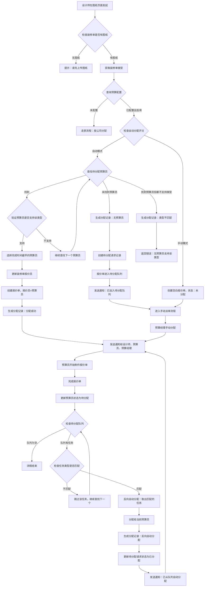
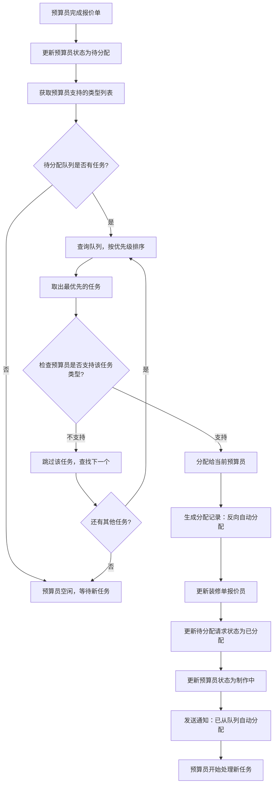

# 报价单预算员自动分配功能设计方案

> **设计文档版本**: v1.5
> **创建日期**: 2026-03-13
> **最后更新**: 2026-03-16
> **设计目标**: 实现装修单预算员的自动分配与手动派单功能，支持待分配队列、反向自动分配、装修类型匹配
> **核心原则**: 一个装修单只分配一次报价员（该人员也是后续报价单的预算员），多个报价单版本共用同一预算员
>
> **重要更正（v1.5）**:
> - ✅ 报价员分配关系存储在 `decoration.quoter`（`decoration.quid`）
> - ✅ **报价员=预算员**：分配给装修单的报价员，就是后续报价单的创建人（`quotation.creater`）
> - ✅ 分配时间使用 `quotation.createtime`，不需要 `budgetAssignTime` 字段
> - ❌ ~~不需要添加 `budgetUid` 和 `budgetAssignTime` 字段~~（v1.4 中的错误已更正）

---

## 📋 核心业务规则

### 🔑 关键业务规则（重要）

**报价员与预算员的关系**：
- **decoration.quoter (decoration.quid)** = **报价员**
- **quotation.creater (quotation.cuid)** = **预算员**
- **报价员和预算员是同一个人**

**分配流程**：
1. 为装修单分配报价员（`decoration.quoter`）
2. 创建报价单时，该报价员自动成为报价单的创建人/预算员（`quotation.creater`）
3. 分配时间记录在 `quotation.createtime`，不需要额外的 `budgetAssignTime` 字段

**字段映射关系**：
```
decoration.quoter (UserPO 对象)
    ↓ (同一人)
decoration.quid (int 字段，报价员ID)
    ↓ (创建报价单时)
quotation.creater (UserPO 对象)
quotation.cuid (int 字段，预算员ID)
```

---

## 🗄️ 数据库设计

### 核心关系说明

```
decoration（装修单）
    ├── quoter（报价员ID，decoration.quid）- 分配关系存储在这里
    ├── quotationassignrequest（分配请求，最多1条活跃记录）
    │   └── 用于控制待分配队列和分配状态
    ├── quotationassignrecord（分配记录，多条历史记录）
    │   └── 仅用于追溯所有分配尝试（成功、失败、重新分配）
    └── quotation（多个报价单版本）
        └── creater（预算员ID，quotation.cuid，与 decoration.quoter 同一人）
```

**关键原则**：
- 一个装修单只分配一次报价员
- 报价员=预算员（同一个人）
- 多个报价单版本共用同一预算员
- quotationuserrule 状态基于 quotationassignrequest 统计
- 已分配的装修单不再重新分配报价员

---

### 1. 装修单表字段说明 (decoration.decoration)

**已有字段（无需新增）**：

```sql
-- 现有字段，用于存储报价员
decoration.quid INT(11) COMMENT '报价员用户ID'

-- 关联对象
decoration.quoter (UserPO 对象，通过 quid 关联)
```

**字段说明**:
- `quid`: 关联的报价员用户ID（核心字段，存储分配关系）
- `quoter`: UserPO 对象，通过 Hibernate 关联查询

**用途**:
- 存储装修单与报价员的分配关系
- 一个装修单只有一个报价员
- 该报价员也是后续所有报价单的预算员

**⚠️ 注意**：
- ~~不需要添加~~ `budgetUid` 字段（v1.4 中的错误设计）
- ~~不需要添加~~ `budgetAssignTime` 字段（v1.4 中的错误设计）
- 使用 `quotation.createtime` 记录分配时间即可

---

### 2. 预算员规则表 (quotation.quotationuserrule)

```sql
CREATE TABLE quotation.quotationuserrule (
    burid INT(11) NOT NULL AUTO_INCREMENT COMMENT '预算员规则ID',
    uid INT(11) NOT NULL COMMENT '用户ID（预算员工号）',
    company INT(11) NOT NULL COMMENT '关联公司ID',
    department INT(11) COMMENT '部门ID',
    status TINYINT(1) NOT NULL DEFAULT 1 COMMENT '状态：1-待分配，2-制作中，3-停止，4-已完成',
    lastFinishTime TIMESTAMP NULL COMMENT '最后完成时间',
    currentTaskCount INT(8) DEFAULT 0 COMMENT '当前任务数量',
    createTime TIMESTAMP DEFAULT CURRENT_TIMESTAMP COMMENT '创建时间',
    updateTime TIMESTAMP DEFAULT CURRENT_TIMESTAMP ON UPDATE CURRENT_TIMESTAMP COMMENT '更新时间',
    PRIMARY KEY (burid),
    UNIQUE KEY uk_uid_company (uid, company),
    KEY idx_status_finishTime (status, lastFinishTime),
    KEY idx_company (company)
) ENGINE=InnoDB DEFAULT CHARSET=utf8 COMMENT='预算员人员规则表';
```

**字段说明**:
- `uid`: 预算员用户ID（该用户会被分配为装修单的报价员）
- `status`: 预算员状态
  - `1`: 待分配（可接收新任务）
  - `2`: 制作中（正在处理任务）
  - `3`: 停止（不再接收任务）
- `lastFinishTime`: 最后完成时间，用于自动分配时排序（最早完成的优先）
- `currentTaskCount`: 当前任务数量（基于 quotationassignrequest 统计）

**状态更新规则**:
- 状态基于 `quotationassignrequest` 表统计
- 查询 `status = 2`（已分配）的请求数来更新 `currentTaskCount`
- `currentTaskCount = 0` 时，`status = 1`（待分配）
- `currentTaskCount > 0` 时，`status = 2`（制作中）

---

### 3. 预算员类型支持表 (quotation.quotationuserruletype)

```sql
CREATE TABLE quotation.quotationuserruletype (
    id INT(11) NOT NULL AUTO_INCREMENT COMMENT 'ID',
    burid INT(11) NOT NULL COMMENT '预算员规则ID',
    type TINYINT(1) NOT NULL COMMENT '装修类型：1-半包，2-整装',
    createTime TIMESTAMP DEFAULT CURRENT_TIMESTAMP COMMENT '创建时间',
    PRIMARY KEY (id),
    UNIQUE KEY uk_burid_type (burid, type),
    KEY idx_burid (burid),
    KEY idx_type (type)
) ENGINE=InnoDB DEFAULT CHARSET=utf8 COMMENT='预算员支持类型表';
```

**字段说明**:
- `id`: 主键ID
- `burid`: 预算员规则ID（关联 `quotationuserrule.burid`）
- `type`: 支持的装修类型
  - `1`: 半包
  - `2`: 整装
- 一个预算员可以有多条记录（支持多种类型）

**用途**:
- 定义预算员支持的装修类型
- 支持一对一（只支持一种类型）或一对多（支持多种类型）
- 分配时必须匹配类型才能成功

---

### 4. 装修单预算分配请求表 (quotation.quotationassignrequest)

**职责**：控制分配逻辑和待分配队列（装修单级别，最多1条活跃记录）

```sql
CREATE TABLE quotation.quotationassignrequest (
    barid INT(11) NOT NULL AUTO_INCREMENT COMMENT '请求ID',
    orderId VARCHAR(15) NOT NULL COMMENT '装修单号（关联 decoration）',
    company INT(11) NOT NULL COMMENT '公司ID',
    department INT(11) COMMENT '部门ID',
    decorationType TINYINT(1) NOT NULL COMMENT '装修类型：1-半包，2-整装',
    priority TINYINT(1) NOT NULL DEFAULT 5 COMMENT '优先级：1-最高，5-普通，9-最低',
    requestTime TIMESTAMP DEFAULT CURRENT_TIMESTAMP COMMENT '请求时间',
    requestUid INT(11) COMMENT '请求人用户ID（设计师）',
    status TINYINT(1) NOT NULL DEFAULT 1 COMMENT '状态：1-待分配，2-已分配',
    assignTime TIMESTAMP NULL COMMENT '分配时间',
    remark VARCHAR(255) COMMENT '备注',
    PRIMARY KEY (barid),
    UNIQUE KEY uk_orderId_status (orderId, status),
    KEY idx_company_status (company, status),
    KEY idx_priority_time (priority, requestTime)
) ENGINE=InnoDB DEFAULT CHARSET=utf8 COMMENT='装修单预算分配请求表';
```

**字段说明**:
- `orderId`: 装修单号（关联 decoration.orderId）
- `company`: 公司ID（用于匹配预算员）
- `department`: 部门ID（可选）
- `decorationType`: 装修类型（1-半包，2-整装）
- `priority`: 优先级（1-最高，5-普通，9-最低）
- `status`: 状态
  - `1`: 待分配（在队列中等待）
  - `2`: 已分配（成功分配给预算员）
- `requestTime`: 请求加入队列的时间
- `assignTime`: 实际分配时间

**用途**:
- 控制待分配队列（装修单级别）
- 用于统计预算员的当前任务数
- 支持优先级排序
- 支持反向自动分配
- 一个装修单只有一条待分配/已分配记录

---

### 5. 装修单预算分配记录表 (quotation.quotationassignrecord)

**职责**：追溯所有分配尝试（成功、失败、重新分配）

```sql
CREATE TABLE quotation.quotationassignrecord (
    qarid INT(11) NOT NULL AUTO_INCREMENT COMMENT '记录ID',
    orderId VARCHAR(15) NOT NULL COMMENT '装修单号',
    uid INT(11) COMMENT '预算员用户ID（成功时有值）',
    assignType TINYINT(1) NOT NULL COMMENT '分配类型：1-正向自动，2-手动，3-反向自动',
    assignResult TINYINT(1) NOT NULL COMMENT '分配结果：1-成功，0-失败',
    assignUid INT(11) COMMENT '分配人用户ID（手动分配时）',
    assignTime TIMESTAMP DEFAULT CURRENT_TIMESTAMP COMMENT '分配时间',
    failReason VARCHAR(255) COMMENT '失败原因',
    decorationType TINYINT(1) COMMENT '装修类型',
    PRIMARY KEY (qarid),
    KEY idx_orderId (orderId),
    KEY idx_uid (uid),
    KEY idx_assignTime (assignTime)
) ENGINE=InnoDB DEFAULT CHARSET=utf8 COMMENT='装修单预算分配记录表（历史追溯）';
```

**字段说明**:
- `orderId`: 装修单号
- `uid`: 预算员用户ID（成功分配时有值，失败时为NULL）
- `assignType`: 分配类型
  - `1`: 正向自动分配
  - `2`: 手动分配
  - `3`: 反向自动分配
- `assignResult`: 分配结果
  - `1`: 成功
  - `0`: 失败（无预算员/类型不匹配）
- `failReason`: 失败原因说明
- `decorationType`: 装修类型（用于追溯）

**用途**:
- 记录所有分配尝试（成功、失败、重新分配）
- 支持分配历史追溯
- 统计预算员工作量
- 分析分配失败原因

---

### 6. 预算配置表 (quotation.quotationconfig)

```sql
CREATE TABLE quotation.quotationconfig (
    bcid INT(11) NOT NULL AUTO_INCREMENT COMMENT '配置ID',
    company INT(11) NOT NULL COMMENT '公司ID',
    department INT(11) COMMENT '部门ID',
    enabled TINYINT(1) NOT NULL DEFAULT 1 COMMENT '是否启用：0-禁用，1-启用',
    autoAssign TINYINT(1) NOT NULL DEFAULT 1 COMMENT '是否自动分配：0-手动，1-自动',
    createTime TIMESTAMP DEFAULT CURRENT_TIMESTAMP COMMENT '创建时间',
    updateTime TIMESTAMP DEFAULT CURRENT_TIMESTAMP ON UPDATE CURRENT_TIMESTAMP COMMENT '更新时间',
    PRIMARY KEY (bcid),
    UNIQUE KEY uk_company_dept (company, department)
) ENGINE=InnoDB DEFAULT CHARSET=utf8 COMMENT='预算配置表';
```

**用途**:
- 控制哪些公司/部门启用预算员分配功能
- 控制自动分配还是手动分配模式

---

## 🔄 业务流程设计

### 流程图

#### 主流程：正向自动分配



#### 反向自动分配流程（含类型匹配）



---

### 详细流程说明

#### 1. 正向自动分配流程（含类型匹配）

**触发条件**:
- 设计师在图纸页面点击"发起预算制作"
- 装修单已有图纸（`decorationpicture` 表中存在记录）
- 获取装修单类型（`decoration.type`：1-半包，2-整装）
- 对应公司/部门已配置预算分配规则且启用自动分配

**分配逻辑（含类型匹配）**:
```sql
-- 步骤1：查找待分配且完成时间最早的预算员
SELECT * FROM quotation.quotationuserrule
WHERE status = 1  -- 待分配
  AND company = ?
ORDER BY lastFinishTime ASC, currentTaskCount ASC;

-- 步骤2：验证预算员是否支持该装修类型
SELECT * FROM quotation.quotationuserruletype
WHERE burid = ?
  AND type = ?;  -- 装修单类型（1或2）
```

**执行步骤（分支1：找到且类型匹配的预算员）**:
1. **获取装修单类型**（`decoration.type`：1-半包，2-整装）
2. **检查装修单是否已分配报价员**（`decoration.quoter`）
   - 如果已分配：直接返回，不重新分配
   - 如果未分配：继续后续步骤
3. 查找状态为"待分配"的预算员（按完成时间排序）
4. **逐个验证预算员是否支持该类型**：
   - 查询 `quotationuserruletype` 表
   - 判断是否包含目标类型
   - 如果不支持，继续查找下一个
   - 如果支持，选中该预算员
5. **更新装修单的报价员**（`decoration.quoter` 和 `decoration.quid`）
6. **更新或创建 quotationassignrequest**（`status = 2` 已分配）
7. **更新预算员状态**（基于 quotationassignrequest 统计）
8. **生成分配记录**（`quotationassignrecord`，`assignResult=1` 成功）
9. 发送通知消息（设计师、预算员、预算经理）
10. 返回分配成功

**执行步骤（分支2：未找到预算员）**:
1. **检查装修单是否已存在待分配请求**
   - 如果已存在：不重复创建，直接返回
   - 如果不存在：继续后续步骤
2. **生成分配记录**（`quotationassignrecord`，`assignResult=0` 无预算员）
3. **创建待分配请求记录**（`quotationassignrequest`）
   - `status = 1`（待分配）
   - `decorationType = 装修单类型`（1或2）
   - `priority = 5`（普通优先级，可调整）
   - 记录请求时间
4. 发送通知给设计师："已加入待分配队列，暂无可用预算员"
5. 发送通知给预算经理："有待分配装修单需要处理"
6. 返回等待分配状态

**执行步骤（分支3：找到预算员但类型都不支持）**:
1. **生成分配记录**（`quotationassignrecord`，`assignResult=0` 类型不匹配）
   - `failReason = "无预算员支持该类型（半包/整装）"`
   - `decorationType = 装修单类型`
2. **不创建报价单**
3. **返回错误提示**："当前无预算员支持该装修类型（半包/整装），请联系管理员配置预算员类型"
4. 发送通知给预算经理："需要配置支持该类型的预算员"

---

#### 2. 反向自动分配流程（含类型匹配）

**触发时机**:
- 预算员完成报价单制作（调用 `finishQuotation` 接口）
- 预算员任务数量从 >0 变为 =0
- 预算员状态从"制作中"变为"待分配"

**执行步骤**:
1. **事务开始**
2. **获取预算员支持的类型列表**（查询 `quotationuserruletype`）
3. 查找待分配队列中类型匹配且最优先的任务
4. 如果找到任务：
   - 更新装修单报价员（`decoration.quoter`）
   - 更新待分配请求状态为"已分配"（`quotationassignrequest.status = 2`）
   - **更新预算员状态**（基于 quotationassignrequest 统计 `currentTaskCount`）
   - 如果 `currentTaskCount > 0`，则 `status = 2`（制作中）
   - 插入分配记录（`quotationassignrecord`，`assignType=3` 反向自动分配）
   - **事务提交**
   - 发送通知："已从待分配队列自动分配"
5. 如果未找到任务（队列为空或无匹配类型）：
   - 预算员保持"待分配"状态（空闲）
   - **事务结束**

---

## 🏗️ 功能模块设计

### 模块划分

```
quotation/
├── action/
│   ├── QuotationAction.java                    # 报价单Action（修改）
│   ├── QuotationAssignUserRuleAction.java      # 预算员规则Action（新增）
│   ├── QuotationAssignAction.java              # 预算分配Action（新增）
│   └── QuotationAssignRequestAction.java       # 待分配请求Action（新增）
├── service/
│   ├── QuotationService.java                   # 报价单Service（修改）
│   ├── QuotationAssignUserRuleService.java     # 预算员规则Service（新增）
│   ├── QuotationAssignService.java             # 预算分配Service（新增）
│   └── QuotationAssignRequestService.java      # 待分配请求Service（新增）
├── dao/
│   ├── QuotationDao.java                       # 报价单Dao（修改）
│   ├── QuotationAssignUserRuleDao.java         # 预算员规则Dao（新增）
│   ├── QuotationAssignRecordDao.java           # 分配记录Dao（新增）
│   ├── QuotationAssignRequestDao.java          # 待分配请求Dao（新增）
│   └── QuotationConfigDao.java                 # 预算配置Dao（新增）
├── po/
│   ├── QuotationPO.java                        # 报价单PO（修改）
│   ├── QuotationAssignUserRulePO.java          # 预算员规则PO（新增）
│   ├── QuotationAssignRecordPO.java            # 分配记录PO（新增）
│   ├── QuotationAssignRequestPO.java           # 待分配请求PO（新增）
│   └── QuotationConfigPO.java                  # 预算配置PO（新增）
└── vo/
    ├── QuotationVO.java                        # 报价单VO（修改）
    ├── QuotationAssignUserRuleVO.java          # 预算员规则VO（新增）
    ├── QuotationAssignVO.java                  # 分配请求VO（新增）
    ├── QuotationAssignRequestVO.java           # 待分配请求VO（新增）
    └── QuotationConfigVO.java                  # 预算配置VO（新增）
```

---

## 🌐 API 接口设计

### 核心接口说明

**注意**：以下接口中的"预算员"指的是被分配为装修单报价员的人员，该人员同时也是报价单的创建人（预算员）。

### 1. 自动分配报价员

**接口**: `POST /assignQuotationAssign.do`

**请求参数**:
```json
{
  "orderId": "1501020001",        // 装修单号
  "companyId": 1,                 // 公司ID
  "decorationType": 1             // 装修类型：1-半包，2-整装
}
```

**响应数据**:
```json
{
  "code": 0,
  "message": "分配成功",
  "data": {
    "quoterUid": 1001,              // 报价员ID（也是预算员ID）
    "quoterName": "张三",
    "assignTime": "2026-03-16 14:30:00"
  }
}
```

### 2. 手动分配报价员

**接口**: `POST /manualQuotationAssign.do`

**请求参数**:
```json
{
  "orderId": "1501020001",        // 装修单号
  "budgetUid": 1001,              // 预算员用户ID（会被设置为报价员）
  "assignUid": 2001               // 分配人用户ID（预算经理）
}
```

### 3. 完成报价单

**接口**: `POST /finishQuotationAssign.do`

**请求参数**:
```json
{
  "orderId": "1501020001"         // 装修单号
}
```

### 4. 重新分配报价员

**接口**: `POST /reassignQuotationAssign.do`

**请求参数**:
```json
{
  "orderId": "1501020001",        // 装修单号
  "newBudgetUid": 1002,           // 新预算员用户ID
  "assignUid": 2001               // 分配人用户ID
}
```

---

## 📝 附录

### 相关文档
- [报价管理模块文档](../src/com/fanglin/quotation/CLAUDE.md)
- [信息管理模块文档](../src/com/fanglin/information/CLAUDE.md)
- [客户管理模块文档](../src/com/fanglin/customer/CLAUDE.md)

### 相关表结构
- `decoration.decoration` - 装修单表（使用 quid 字段存储报价员）
- `quotation.quotation` - 报价单表（使用 cuid 字段存储预算员）
- `quotation.quotationassignuserrule` - 预算员规则表
- `quotation.quotationassignuserruletype` - 预算员类型支持表
- `quotation.quotationassignrequest` - 分配请求表
- `quotation.quotationassignrecord` - 分配记录表
- `quotation.quotationconfig` - 预算配置表
- `decoration.decorationpicture` - 装修图纸表

### 字段对应关系

| 业务概念 | 装修单表 | 报价单表 | 说明 |
|---------|---------|---------|------|
| 报价员 | `decoration.quoter` (UserPO) | - | 分配给装修单的报价员 |
| 报价员ID | `decoration.quid` (int) | - | 报价员用户ID |
| 预算员 | - | `quotation.creater` (UserPO) | 报价单的创建人 |
| 预算员ID | - | `quotation.cuid` (int) | 预算员用户ID |
| **关系** | **报价员 = 预算员（同一个人）** | | |

---

**设计完成日期**: 2026-03-13
**最后更新**: 2026-03-16
**文档维护**: Claude AI
**审核状态**: 已更新（v1.5）
