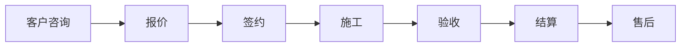

# 项目知识库

> 本文件包含项目的核心知识，AI 在每次对话时都会参考这些内容

---

## 快速索引

- [核心业务规则](#核心业务规则)
- [技术规范](#技术规范)
- [常见问题](#常见问题)
- [代码示例](#代码示例)
- [重要提示](#重要提示)

---

## 核心业务规则

### 1. 装饰订单流程



**关键状态**:
- `status = 1`: 草稿
- `status = 2`: 已签约
- `status = 3`: 施工中
- `status = 4`: 已完工
- `status = 5`: 已结算

### 2. 报价计算规则

**基础公式**:
```
总价 = Σ(功能区报价) + 增项金额 - 减项金额
```

**注意事项**:
- 报价必须关联客户和楼盘
- 报价审核后不能修改（需创建新版本）
- 定制项目需要特殊审批流程

---

## 技术规范

### 1. 分层架构规范

```
Controller (Action) → Service → DAO → Database
      ↓                ↓
    VO              PO
```

**职责划分**:
- **Action 层**: 接收请求、参数验证、调用 Service、返回响应
- **Service 层**: 业务逻辑、事务管理、调用 DAO
- **DAO 层**: 数据库操作（SQL/HQL）

### 2. 命名规范

**包命名**: `com.fanglin.[模块].[层级]`
- `action` - 控制器
- `service` - 业务接口
- `service.impl` - 业务实现
- `dao` - 数据访问接口
- `dao.impl` - 数据访问实现
- `po` - 持久化对象
- `vo` - 视图对象

**类命名**:
- Action: `XxxAction.java`
- Service: `XxxService.java` / `XxxServiceImpl.java`
- DAO: `XxxDao.java` / `XxxDaoImpl.java`
- PO: `XxxPO.java`
- VO: `XxxVO.java`

### 3. 数据库操作规范

**查询规范**:
```java
// ✅ 正确：使用参数化查询
String hql = "from CustomerPO where name = :name and status = :status";
session.createQuery(hql)
    .setParameter("name", customerName)
    .setParameter("status", 1)
    .list();

// ❌ 错误：字符串拼接
String hql = "from CustomerPO where name = '" + customerName + "'";
```

**事务规范**:
```java
@Override
@Transactional(rollbackFor = Exception.class)
public void saveCustomer(CustomerVO customer) {
    // 业务逻辑
}
```

### 4. 编码规范（⚠️ 重要）

#### 4.1 Import 导入规范

**标准导入路径**：
```java
// ✅ 正确的导入
import com.fanglin.core.interceptor.FLException;     // 异常类
import com.fanglin.core.vo.Filter;                    // 过滤条件
import com.fanglin.utils.Paging;                      // 分页对象
import com.fanglin.utils.BeanUtil;                    // Bean转换工具

// ❌ 错误的导入（常见错误）
import com.fanglin.core.exception.FLException;        // 路径错误
import com.fanglin.core.dao.Filter;                   // 路径错误
import com.fanglin.core.dao.Page;                     // 类名错误
```

**完整导入示例**：
```java
package com.fanglin.example.service.impl;

import java.sql.Timestamp;
import java.util.ArrayList;
import java.util.List;

import org.springframework.beans.BeanUtils;
import org.springframework.beans.factory.annotation.Autowired;
import org.springframework.stereotype.Service;
import org.springframework.transaction.annotation.Transactional;

import com.fanglin.core.interceptor.FLException;
import com.fanglin.core.vo.Filter;
import com.fanglin.example.dao.ExampleDao;
import com.fanglin.example.po.ExamplePO;
import com.fanglin.example.service.ExampleService;
import com.fanglin.example.vo.ExampleVO;
import com.fanglin.system.service.impl.CompanyServiceImpl;  // 如需decode公司ID
import com.fanglin.utils.Paging;
```

#### 4.2 Service 层规范

**方法签名规范**：
```java
// ✅ 正确：使用 VO 和 Paging
@Override
@Transactional(rollbackFor = Exception.class)
public void pageExample(Paging paging, List<Filter> filters) throws FLException {
    // 1. 调用 DAO 查询（返回 PO 列表）
    List<ExamplePO> poList = exampleDao.pageExample(paging, filters);

    // 2. PO 转 VO
    List<ExampleVO> voList = new ArrayList<ExampleVO>();
    for (ExamplePO po : poList) {
        voList.add(po.ptv(new ExampleVO()));
    }

    // 3. 设置分页结果
    paging.setData(voList);
}

// ❌ 错误：void 返回，没有 PO 转 VO
@Override
public void pageExample(Page page, List<Filter> filters) {
    exampleDao.pageExample(page, filters);  // 直接返回，没有转换
}
```

**PO 转 VO 规范**：
```java
// ✅ 正确：使用 PO 的 ptv 方法
ExampleVO vo = po.ptv(new ExampleVO());

// ✅ 正确：批量转换
for (ExamplePO po : poList) {
    voList.add(po.ptv(new ExampleVO()));
}

// ❌ 错误：手动拷贝（项目已有 ptv 方法）
ExampleVO vo = new ExampleVO();
vo.setId(po.getId());
vo.setName(po.getName());
// ...
```

**VO 转 PO 规范**：
```java
// ✅ 正确：使用 VO 的 vtp 方法
ExamplePO po = vo.vtp(new ExamplePO());

// ✅ 正确：从 VO 提取属性传递给 DAO
int uid = vo.getUser().getUid();
int company = CompanyServiceImpl.decode(vo.getCompany().getCid());
```

#### 4.3 DAO 层规范

**接口方法签名规范**：
```java
// ✅ 正确：返回 PO 列表
List<ExamplePO> pageExample(Paging paging, List<Filter> filters) throws FLException;
ExamplePO get(long id) throws FLException;

// ❌ 错误：void 返回
void pageExample(Page page, List<Filter> filters) throws FLException;
```

**DAO 实现规范**：
```java
@Override
public List<ExamplePO> pageExample(Paging paging, List<Filter> filters) {
    PagingQuery<ExamplePO> query = pagingQuery(paging, ExamplePO.class);

    // 添加过滤条件
    if (filters != null) {
        for (Filter filter : filters) {
            query.add(query.getCriterion(filter.getField(), filter.getValue(), filter.getOperator()));
        }
    }

    // 排序
    query.desc("createTime");

    return query.list();
}
```

#### 4.4 VO 规范

**VO 字段类型规范**：
```java
// ✅ 正确：关联其他 VO，时间用 String
public class ExampleVO {
    private UserVO user;           // 关联 UserVO，不是 UserPO
    private CompanyVO company;     // 关联 CompanyVO，不是 CompanyPO
    private DepartmentVO department; // 关联 DepartmentVO，不是 DepartmentPO

    private String createTime;     // 时间字段用 String，不是 Timestamp
    private String updateTime;

    // 基本类型
    private Long id;
    private String name;
    private Integer status;
}

// ❌ 错误：VO 中关联 PO
public class ExampleVO {
    private UserPO user;           // 错误！不应该关联 PO
    private Timestamp createTime;  // 错误！时间应该用 String
}
```

**VO 与 PO 的关系**：
```
VO (视图对象) → 用于前端展示和接收参数
  - 只包含 VO 类型或其他基本类型
  - 时间字段用 String
  - 不直接关联 PO

PO (持久化对象) → 用于数据库操作
  - 可以关联其他 PO（Hibernate 关系映射）
  - 时间字段用 Timestamp
  - 提供 ptv() 和 vtp() 方法进行转换
```

#### 4.5 常用工具方法

**CompanyServiceImpl.decode()**：
```java
// 用于解码/编码公司 ID（加密存储）
int companyId = CompanyServiceImpl.decode(vo.getCompany().getCid());
String encodedCid = CompanyServiceImpl.encode(companyId);
```

**常量使用规范**：
```java
// ✅ 正确：使用 PO 中定义的常量
if (status == QuotationAssignUserRulePO.STATUS_AVAILABLE_INT) {
    // ...
}

// ❌ 错误：魔法数字
if (status == 1) {  // 不知道 1 代表什么
    // ...
}
```

**常量命名规范**：
```java
// PO 中的常量必须以 _INT 结尾
public static final Short STATUS_AVAILABLE_INT = 1;
public static final Short STATUS_BUSY_INT = 2;
public static final Short STATUS_STOPPED_INT = 3;
public static final Integer SUPPORTED_TYPE_ALL_INT = -1;
```

#### 4.6 参数传递规范

**Service 层参数规范**：
```java
// ✅ 正确：使用 VO 对象作为参数
public void createExample(ExampleVO example) throws FLException {
    // 从 VO 中提取属性
    String name = example.getName();
    int uid = example.getUser().getUid();
    int company = CompanyServiceImpl.decode(example.getCompany().getCid());

    // 调用 DAO
    exampleDao.addExample(name, uid, company);
}

// ❌ 错误：使用多个独立参数
public void createExample(String name, int uid, int company, String status) {
    // 参数太多，不利于扩展
}
```

**DAO 层参数规范**：
```java
// ✅ 正确：传递基本类型或 PO
int addExample(String name, int uid, int company) throws FLException;
ExamplePO get(long id) throws FLException;

// ❌ 错误：传递 VO
int addExample(ExampleVO example) throws FLException;  // DAO 不应该知道 VO
```

#### 4.7 编码检查清单

**写代码前**：
- [ ] 读 3 个同类文件的实现
- [ ] 复制 import 语句（不要猜测）
- [ ] 确认方法签名模式

**写代码时**：
- [ ] VO 中只关联 VO，不关联 PO
- [ ] 时间字段用 String，不用 Timestamp
- [ ] 使用 PO 的 ptv() / vtp() 方法
- [ ] 使用常量，不用魔法数字
- [ ] Service 层方法抛出 FLException

**写代码后**：
- [ ] 对比已有实现，检查是否符合规范
- [ ] 确认所有 import 路径正确
- [ ] 确认 DAO 返回值类型正确
- [ ] 确认 PO 转 VO 逻辑正确

---

## 常见问题

### Q1: 如何添加新的业务模块？

**步骤**:
1. 创建包结构: `src/com/fanglin/[模块]/action|service|dao|po|vo`
2. 创建实体类: `XxxPO.java`（使用 Hibernate 注解）
3. 创建 DAO 接口和实现
4. 创建 Service 接口和实现
5. 创建 Action 控制器
6. 配置 Struts2 路由（`struts.xml`）
7. 创建前端页面（`WebContent/views/[模块]/`）

### Q2: 如何处理客户手机号加密？

**系统使用 AES 加密**:
```java
// 加密
String encryptedPhone = AESHelper.encrypt(phone);

// 解密
String decryptedPhone = AESHelper.decrypt(encryptedPhone);

// 判断是否已加密
boolean isEncrypted = Base64Util.isBase64(phone);
```

**注意**: 前端显示时需要解密，导出时需要处理加密字段

### Q3: 如何实现分页查询？

**后端实现**:
```java
public Paging<CustomerVO> queryCustomers(CustomerVO condition, int page, int rows) {
    String hql = "from CustomerPO where 1=1";
    // 构建查询条件
    // ...

    // 查询总数
    int total = dao.countByHql(hql, params);

    // 分页查询
    List<CustomerPO> pos = dao.findByHql(hql, params, page, rows);

    // 转换为 VO
    List<CustomerVO> vos = convertToVO(pos);

    Paging<CustomerVO> paging = new Paging<>();
    paging.setPage(page);
    paging.setRows(rows);
    paging.setTotal(total);
    paging.setData(vos);

    return paging;
}
```

**前端调用**:
```javascript
$.ajax({
    url: '/queryCustomers.do',
    data: {
        page: 1,
        rows: 20,
        'condition.name': '张三'
    },
    success: function(response) {
        // response.data - 数据列表
        // response.total - 总记录数
    }
});
```

### Q4: 工具类应该放在哪里？

**规则**:
- 通用工具类 → `com.fanglin.utils`（已存在的工具类包）
- 模块特定工具 → `com.fanglin.[模块].utils`

**常用工具类**:
- `DateUtil` - 日期处理
- `PoiExcelUtil` - Excel 操作
- `HttpHelper` - HTTP 请求
- `LogUtils` - 日志记录
- `Arith` - 精确数学运算

---

## 代码示例

### 示例1: 创建新的 Action

```java
package com.fanglin.example.action;

import com.fanglin.example.service.ExampleService;
import com.fanglin.example.vo.ExampleVO;
import org.apache.struts2.convention.annotation.Action;
import org.apache.struts2.convention.annotation.ParentPackage;

@ParentPackage("fanglin-default")
public class ExampleAction extends BaseAction {

    private ExampleService exampleService;
    private ExampleVO example;

    @Action(value = "/queryExample")
    public void query() {
        try {
            ExampleVO result = exampleService.query(example);
            writeJson(result);
        } catch (Exception e) {
            logger.error("查询失败", e);
            writeError(e.getMessage());
        }
    }

    @Action(value = "/saveExample")
    public void save() {
        try {
            exampleService.save(example);
            writeSuccess();
        } catch (Exception e) {
            logger.error("保存失败", e);
            writeError(e.getMessage());
        }
    }

    // Getter & Setter
    public void setExampleService(ExampleService exampleService) {
        this.exampleService = exampleService;
    }

    public void setExample(ExampleVO example) {
        this.example = example;
    }
}
```

### 示例2: 使用 HttpHelper 发送请求

```java
// GET 请求
JSONObject result = HttpHelper.httpGet("http://api.example.com/data");

// POST JSON 请求
JSONObject data = new JSONObject();
data.put("name", "张三");
data.put("age", 25);
JSONObject result = HttpHelper.httpPost("http://api.example.com/create", data);

// POST 表单请求
Map<String, String> params = new HashMap<>();
params.put("username", "admin");
params.put("password", "123456");
JSONObject result = HttpHelper.httpPostForm("http://api.example.com/login", params);

// 文件上传
File file = new File("test.jpg");
JSONObject result = HttpHelper.uploadMedia("http://api.example.com/upload", file);
```

### 示例3: 处理加密的手机号

```java
// 保存时加密
public void saveCustomer(CustomerVO customer) {
    if (!Base64Util.isBase64(customer.getPhone())) {
        customer.setPhone(AESHelper.encrypt(customer.getPhone()));
    }
    customerDao.save(customer);
}

// 查询时解密
public CustomerVO getCustomerById(Long id) {
    CustomerPO po = customerDao.getById(id);
    CustomerVO vo = BeanUtil.copy(po, CustomerVO.class);

    // 解密手机号
    if (Base64Util.isBase64(vo.getPhone())) {
        vo.setPhone(AESHelper.decrypt(vo.getPhone()));
    }

    return vo;
}
```

---

## 重要提示

### ⚠️ 安全注意事项

1. **手机号加密**: 所有存储的手机号必须使用 AES 加密
2. **SQL 注入防护**: 禁止字符串拼接 SQL，必须使用参数化查询
3. **权限验证**: 所有接口必须验证用户登录状态和操作权限
4. **敏感数据**: 客户身份证、银行卡号等敏感信息需要加密存储

### ⚠️ 性能优化建议

1. **避免 N+1 查询**: 使用 Hibernate 的 `@BatchSize` 或 JOIN FETCH
2. **大文件处理**: Excel 导入导出超过 1 万条需要分批处理
3. **缓存策略**: 字典数据、配置信息使用 EhCache 缓存
4. **事务范围**: 事务尽可能短，避免在事务中进行网络调用

### ⚠️ 代码规范

1. **直接修改原则**: 修改现有功能时必须直接修改原文件，禁止创建新文件实现相同功能
2. **异常处理**: Service 层方法必须添加 `@Transactional(rollbackFor = Exception.class)`
3. **日志记录**: 重要操作必须记录日志（使用 `LogUtils`）
4. **注释规范**: 公共方法必须添加 JavaDoc 注释

---

## 更新记录

### 2026-03-20
- ✅ 新增详细编码规范（第 4 节）
  - Import 导入规范（FLException、Filter、Paging 的正确路径）
  - Service 层规范（PO 转 VO、方法签名）
  - DAO 层规范（返回值类型）
  - VO 规范（不关联 PO、时间字段用 String）
  - 常用工具方法（CompanyServiceImpl.decode、常量使用）
  - 参数传递规范
  - 编码检查清单

### 2025-12-31
- ✅ 创建知识库文件
- ✅ 添加核心业务规则
- ✅ 添加技术规范
- ✅ 添加常见问题解答
- ✅ 添加代码示例

---

**维护说明**: 本文件由 AI 维护，请在文档末尾添加更新记录

---

## 🔑 装修单报价员与预算员关系（重要更新）

**更新日期**: 2026-03-16
**优先级**: ⭐⭐⭐⭐⭐（核心业务规则）

### 核心业务规则

- **decoration.quoter (decoration.quid)** = **报价员**
- **quotation.creater (quotation.cuid)** = **预算员**
- **报价员和预算员是同一个人**

### 业务流程

1. 为装修单分配报价员（设置 `decoration.quoter`）
2. 创建报价单时，该报价员自动成为报价单的创建人/预算员（`quotation.creater`）
3. 分配时间记录在 `quotation.createtime`

### 字段映射关系

```
装修单层: decoration.quoter (UserPO) → decoration.quid (int)
            ↓ (同一人)
报价单层: quotation.creater (UserPO) → quotation.cuid (int)
```

### 代码示例

```java
// 为装修单分配报价员（该人员也是预算员）
DecorationPO decoration = decorationDao.queryDecorationByOrderId(orderId);
UserPO quoter = new UserPO();
quoter.setUid(budgetUserUid);
decoration.setQuoter(quoter);  // 设置报价员
decorationDao.update(decoration);

// 创建报价单时，报价员自动成为预算员
QuotationPO quotation = new QuotationPO();
quotation.setCreater(decoration.getQuoter());  // 报价员 = 预算员
quotation.setOrderId(orderId);
quotationDao.save(quotation);
```

### 重要注意事项

- ~~不需要~~ `budgetUid` 和 `budgetAssignTime` 字段（设计文档 v1.4 中的错误设计已更正）
- 分配时间使用 `quotation.createtime`，不需要额外的分配时间字段
- 报价员和预算员始终是同一个人，不可分离
- 任何提到 `budgetUid` 的设计文档都是过时的，请参考 v1.5 版本

### 相关文档

- [预算分配功能设计文档 v1.5](./DESIGN_quotation_budget_assignment_v1.5.md)
- [报价管理模块文档](../src/com/fanglin/quotation/CLAUDE.md)

