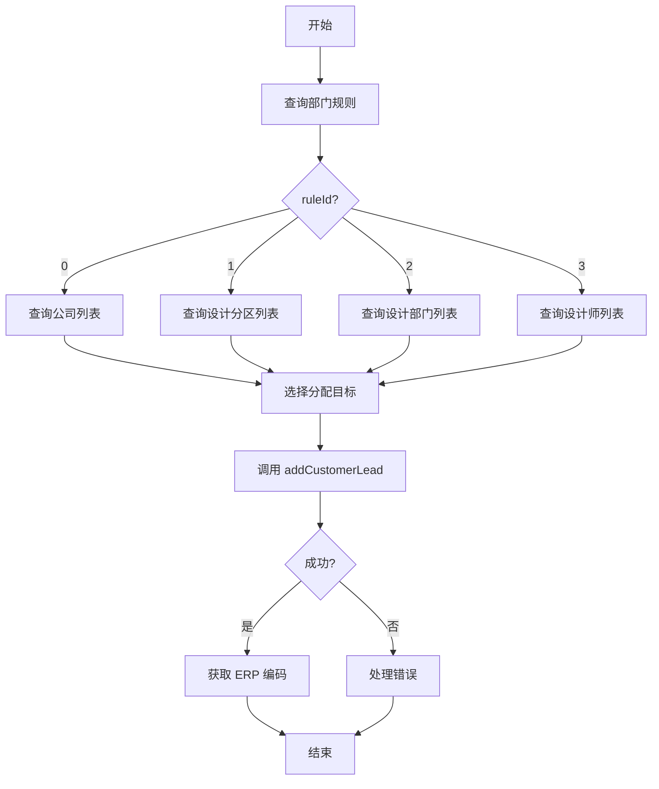

# Seiya 客户线索接入接口 API 文档

> **版本**: v1.0
> **更新日期**: 2026-04-10
> **模块**: seiya（第三方数据接入模块）
> **功能**: 客户线索接入、查询、更新及辅助查询接口
> **控制器**: `A20260103Action`

---

## 目录

- [接口概述](#接口概述)
- [1. 添加客户线索接口](#1-添加客户线索接口-addcustomerlead)
- [2. 查询客户线索接口](#2-查询客户线索接口-querycustomerlead)
- [3. 更新客户线索接口](#3-更新客户线索接口-updatecustomerlead)
- [4. 查询部门列表接口](#4-查询部门列表接口-querydepartmentbynameforsf)
- [5. 根据拼音查询用户接口](#5-根据拼音查询用户接口-queryuserbypinyinforsf)
- [6. 查询客户部门规则接口](#6-查询客户部门规则接口-querycustomerdeptulebydbidforsf)
- [7. 查询公司列表接口](#7-查询公司列表接口-querycompanyforsf)
- [错误码说明](#错误码说明)
- [数据字典](#数据字典)

---

## 接口概述

### 基础信息

| 项目 | 说明 |
|------|------|
| **基础URL** | `http://localhost:8080/Rhadamanthus` |
| **请求方式** | POST |
| **内容类型** | `application/x-www-form-urlencoded` |
| **响应格式** | JSON |
| **字符编码** | UTF-8 |

### 统一响应格式

**成功响应**:
```json
{
    "errorCode": 0,
    "errorMsg": null,
    "data": {
        // 具体业务数据
    }
}
```

**失败响应**:
```json
{
    "errorCode": 400001,
    "errorMsg": "客户名称不能为空",
    "data": null
}
```

### 接口列表

| 序号 | 接口名称 | 请求地址 | 功能描述 |
|:----:|---------|---------|---------|
| 1 | 添加客户线索 | `/addCustomerLead.do` | 创建客户线索并自动分配设计师 |
| 2 | 查询客户线索 | `/queryCustomerLead.do` | 根据条件查询客户线索 |
| 3 | 更新客户线索 | `/updateCustomerLead.do` | 更新现有客户线索信息 |
| 4 | 查询部门列表 | `/queryDepartmentByNameForSF.do` | 查询设计分区/部门列表 |
| 5 | 查询用户列表 | `/queryUserByPinyinForSF.do` | 根据拼音查询设计师 |
| 6 | 查询部门规则 | `/queryCustomerDeptRuleByDbidForSF.do` | 查询客户分配规则 |
| 7 | 查询公司列表 | `/queryCompanyForSF.do` | 查询可选公司列表 |

---

## 1. 添加客户线索接口

### 接口信息

| 项目 | 说明 |
|------|------|
| **接口URL** | `/addCustomerLead.do` |
| **请求方式** | POST |
| **功能描述** | 接收外部系统传入的客户线索信息，转换为 ERP 客户机会并创建 |
| **权限要求** | 需要登录认证 |

### 请求参数

#### 基础参数

| 参数名 | 类型 | 必填 | 说明 | 示例值 |
|--------|------|:----:|------|--------|
| `leadCode` | String | 否 | 线索编码（对应 customerChance.cno） | `"LEAD202601030001"` |
| `adornCode` | String | 否 | 尺源编码（对应 source.no） | `"ADORN202601030001"` |
| `name` | String | **是** | 客户名称 | `"张三"` |
| `phone` | String | **是** | 客户电话（11位） | `"13800138000"` |
| `gender` | String | 否 | 客户性别 | `"男"` / `"女"` |
| `village` | String | 否 | 楼盘名称 | `"方林世纪城"` |
| `houseNumber` | String | 否 | 楼号 | `"1-101"` |
| `buildArea` | Integer | 否 | 建筑面积（单位：平方厘米） | `120000` (表示120㎡) |
| `busitype` | String | 否 | 业务类型名称，默认"电商信息流客源" | `"电商信息流客源"` |
| `userId` | String | **是** | 创建人工号 | `"FL-123456"` |
| `orgId` | Integer | **是** | 公司标识（加密后的公司ID） | `1` |

#### 分配参数（根据部门规则选择）

| 参数名 | 类型 | 必填 | 适用场景 | 说明 | 示例值 |
|--------|------|:----:|:---------|------|--------|
| `designerId` | String | 条件必填 | 规则3：派到设计师 | 设计师工号 | `"FL-789012"` |
| `departmentId` | Integer | 条件必填 | 规则2：派到设计部门 | 部门ID | `101` |
| `regionId` | Integer | 条件必填 | 规则1：派到设计分区 | 分区ID | `100` |

### 部门规则说明

| 规则ID | 规则名称 | 必传参数 | 说明 |
|:------:|---------|---------|------|
| 0 | 派到公司 | - | 自动分配到公司 |
| 1 | 派到设计分区 | `regionId` | 分配到指定分区 |
| 2 | 派到设计部门 | `departmentId` | 分配到指定部门 |
| 3 | 派到设计师 | `designerId` | 分配到指定设计师 |

### 响应参数

#### 成功响应

```json
{
    "errorCode": 0,
    "errorMsg": null,
    "condition": null,
    "data": {
        "leadCode": "LEAD202601030001",
        "adornCode": "ADORN202601030001",
        "name": "张三",
        "phone": "13800138000",
        "gender": "男",
        "village": "方林世纪城",
        "houseNumber": "1-101",
        "buildArea": 120.0,
        "busitype": "电商信息流客源",
        "userId": "FL-123456",
        "orgId": 1,
        "designerId": "FL-789012",
        "departmentId": null,
        "regionId": null,
        "erpJhCode": "12345",
        "erpAssignerCode": "FL-123456",
        "erpDesignerCode": "FL-789012",
        "issusTime": "2026-01-03 10:30:00",
        "erpZxdCode": "FL2601030001",
        "isIssue": 1
    }
}
```

#### 返回字段说明

| 字段名 | 类型 | 说明 |
|--------|------|------|
| `erpJhCode` | String | ERP系统机会编码（对应 ccid） |
| `erpAssignerCode` | String | ERP设计师分派人编码（对应 issuer.userId） |
| `erpDesignerCode` | String | ERP设计师编码（对应 belonger.userId） |
| `issusTime` | String | 派尺时间（对应 issueTime） |
| `erpZxdCode` | String | 装修单编码（对应 orderId） |
| `isIssue` | Integer | 是否已分配（0:未分配, 1:已分配） |

### 请求示例

```bash
curl -X POST "http://localhost:8080/Rhadamanthus/addCustomerLead.do" \
  -H "Content-Type: application/x-www-form-urlencoded" \
  -d "leadCode=LEAD202601030001" \
  -d "adornCode=ADORN202601030001" \
  -d "name=张三" \
  -d "phone=13800138000" \
  -d "gender=男" \
  -d "village=方林世纪城" \
  -d "houseNumber=1-101" \
  -d "buildArea=120000" \
  -d "busitype=电商信息流客源" \
  -d "userId=FL-123456" \
  -d "orgId=1" \
  -d "designerId=FL-789012"
```

---

## 2. 查询客户线索接口

### 接口信息

| 项目 | 说明 |
|------|------|
| **接口URL** | `/queryCustomerLead.do` |
| **请求方式** | POST |
| **功能描述** | 根据条件查询客户线索，支持三种查询方式 |

### 请求参数

| 参数名 | 类型 | 必填 | 说明 | 示例值 |
|--------|------|:----:|------|--------|
| `orderId` | String | 三选一 | 装修单编号（单独查询） | `"FL2601030001"` |
| `village` | String | 三选一 | 楼盘名称（需配合 houseNumber） | `"方林世纪城"` |
| `houseNumber` | String | 三选一 | 楼号（需配合 village） | `"1-101"` |
| `phone` | String | 三选一 | 客户电话（单独查询） | `"13800138000"` |
| `orgId` | Integer | **是** | 公司标识 | `1` |

### 查询方式说明

| 方式 | 必传参数 | 说明 |
|------|---------|------|
| 方式1 | `orderId` | 根据装修单编号单独查询 |
| 方式2 | `village` + `houseNumber` | 根据楼盘+楼号组合查询 |
| 方式3 | `phone` | 根据客户电话单独查询 |

### 响应参数

#### 成功响应

```json
{
    "errorCode": 0,
    "errorMsg": null,
    "data": {
        "orderId": "FL2601030001"
    }
}
```

### 请求示例

```bash
# 方式1：根据装修单编号查询
curl -X POST "http://localhost:8080/Rhadamanthus/queryCustomerLead.do" \
  -d "orderId=FL2601030001" \
  -d "orgId=1"

# 方式2：根据楼盘+楼号查询
curl -X POST "http://localhost:8080/Rhadamanthus/queryCustomerLead.do" \
  -d "village=方林世纪城" \
  -d "houseNumber=1-101" \
  -d "orgId=1"

# 方式3：根据客户电话查询
curl -X POST "http://localhost:8080/Rhadamanthus/queryCustomerLead.do" \
  -d "phone=13800138000" \
  -d "orgId=1"
```

---

## 3. 更新客户线索接口

### 接口信息

| 项目 | 说明 |
|------|------|
| **接口URL** | `/updateCustomerLead.do` |
| **请求方式** | POST |
| **功能描述** | 通过线索编号更新现有客户线索信息 |

### 更新规则

1. **楼盘+楼号必须一起更新**：缺一不可
2. **房产信息处理**：house 存在则关联，不存在则创建
3. **客户信息处理**：customer 存在则关联，不存在则创建

### 请求参数

| 参数名 | 类型 | 必填 | 说明 | 示例值 |
|--------|------|:----:|------|--------|
| `leadCode` | String | **是** | 线索编码（对应 customerChance.cno） | `"LEAD202601030001"` |
| `village` | String | **是** | 楼盘名称 | `"方林世纪城"` |
| `houseNumber` | String | **是** | 楼号（楼盘+楼号必须一起更新） | `"1-101"` |
| `buildArea` | Integer | 否 | 建筑面积（平方厘米） | `120000` |
| `phone` | String | 否 | 客户电话 | `"13800138000"` |
| `name` | String | 否 | 客户名称 | `"张三"` |
| `referOrderId` | String | 否 | 转介绍订单ID | `"FL2601030002"` |
| `sourceInfo` | String | 否 | 来源（三方信息） | `"来源说明"` |
| `contactInfo` | String | 否 | 联系方式（三方信息） | `"联系方式"` |
| `userId` | String | **是** | 操作人工号 | `"FL-123456"` |
| `orgId` | Integer | **是** | 公司标识 | `1` |

### 响应参数

#### 成功响应

```json
{
    "errorCode": 0,
    "errorMsg": null,
    "data": {
        "leadCode": "LEAD202601030001",
        "updateTime": "2026-01-03 14:30:00",
        "message": "更新成功"
    }
}
```

### 请求示例

```bash
curl -X POST "http://localhost:8080/Rhadamanthus/updateCustomerLead.do" \
  -H "Content-Type: application/x-www-form-urlencoded" \
  -d "leadCode=LEAD202601030001" \
  -d "village=方林世纪城" \
  -d "houseNumber=1-101" \
  -d "buildArea=120000" \
  -d "phone=13800138000" \
  -d "name=张三" \
  -d "userId=FL-123456" \
  -d "orgId=1"
```

---

## 4. 查询部门列表接口

### 接口信息

| 项目 | 说明 |
|------|------|
| **接口URL** | `/queryDepartmentByNameForSF.do` |
| **请求方式** | POST |
| **功能描述** | 查询设计分区或设计部门列表（SF专用） |

### 请求参数

| 参数名 | 类型 | 必填 | 说明 | 示例值 |
|--------|------|:----:|------|--------|
| `orgId` | Integer | **是** | 公司标识 | `1` |
| `deptType` | String | 否 | 部门类型：1=设计分区，2=设计部门 | `"1"` |
| `deptName` | String | 否 | 部门名称（支持模糊匹配，为空则按类型查询） | `"设计一部"` |

### 查询逻辑

| deptName | deptType | 查询方式 |
|:--------:|:--------:|---------|
| 为空 | 为空 | 查询所有部门 |
| 为空 | 有值 | 按部门类型查询 |
| 有值 | - | 按部门名称模糊查询 |

### 响应参数

#### 成功响应

```json
{
    "errorCode": 0,
    "errorMsg": null,
    "data": {
        "simpleDeptList": [
            {
                "id": "100",
                "name": "设计一部"
            },
            {
                "id": "101",
                "name": "设计二部"
            }
        ]
    }
}
```

#### 返回字段说明

| 字段名 | 类型 | 说明 |
|--------|------|------|
| `id` | String | 部门ID（对应 department.did） |
| `name` | String | 部门名称 |

### 请求示例

```bash
# 查询所有部门
curl -X POST "http://localhost:8080/Rhadamanthus/queryDepartmentByNameForSF.do" \
  -d "orgId=1"

# 按类型查询设计分区
curl -X POST "http://localhost:8080/Rhadamanthus/queryDepartmentByNameForSF.do" \
  -d "orgId=1" \
  -d "deptType=1"

# 按名称模糊查询
curl -X POST "http://localhost:8080/Rhadamanthus/queryDepartmentByNameForSF.do" \
  -d "orgId=1" \
  -d "deptName=设计一部"
```

---

## 5. 根据拼音查询用户接口

### 接口信息

| 项目 | 说明 |
|------|------|
| **接口URL** | `/queryUserByPinyinForSF.do` |
| **请求方式** | POST |
| **功能描述** | 根据设计师名称（拼音）模糊查询用户列表 |

### 请求参数

| 参数名 | 类型 | 必填 | 说明 | 示例值 |
|--------|------|:----:|------|--------|
| `pinyinName` | String | **是** | 设计师名称（支持模糊匹配） | `"zhangsan"` |
| `userStatus` | String | 否 | 人员状态：0=在职，1=离职 | `"0"` |
| `orgId` | Integer | **是** | 公司标识 | `1` |

### 响应参数

#### 成功响应

```json
{
    "errorCode": 0,
    "errorMsg": null,
    "data": {
        "simpleUserList": [
            {
                "id": "12345",
                "code": "FL-123456",
                "name": "张三",
                "dept": "设计一部",
                "region": "设计一区",
                "company": "方林装饰"
            }
        ]
    }
}
```

#### 返回字段说明

| 字段名 | 类型 | 说明 |
|--------|------|------|
| `id` | String | 用户ID（对应 user.uid） |
| `code` | String | 用户工号（对应 user.userId） |
| `name` | String | 用户姓名（对应 user.currentName） |
| `dept` | String | 部门名称 |
| `region` | String | 分区名称（父部门名称） |
| `company` | String | 公司名称 |

### 请求示例

```bash
# 查询在职设计师
curl -X POST "http://localhost:8080/Rhadamanthus/queryUserByPinyinForSF.do" \
  -d "pinyinName=zhangsan" \
  -d "userStatus=0" \
  -d "orgId=1"

# 查询所有设计师（包含离职）
curl -X POST "http://localhost:8080/Rhadamanthus/queryUserByPinyinForSF.do" \
  -d "pinyinName=zhangsan" \
  -d "orgId=1"
```

---

## 6. 查询客户部门规则接口

### 接口信息

| 项目 | 说明 |
|------|------|
| **接口URL** | `/queryCustomerDeptRuleByDbidForSF.do` |
| **请求方式** | POST |
| **功能描述** | 查询当前用户所属部门的客户派发规则 |

### 请求参数

| 参数名 | 类型 | 必填 | 说明 | 示例值 |
|--------|------|:----:|------|--------|
| `orgId` | Integer | **是** | 公司标识 | `1` |
| `userId` | String | **是** | 约访专员工号（如FL-123456） | `"FL-123456"` |
| `busitype` | String | 否 | 业务类型，默认"电商信息流客源" | `"电商信息流客源"` |

### 响应参数

#### 成功响应

```json
{
    "errorCode": 0,
    "errorMsg": null,
    "data": {
        "ruleId": 3
    }
}
```

#### 返回字段说明

| 字段名 | 类型 | 说明 |
|--------|------|------|
| `ruleId` | Integer | 部门规则类型 |

### 规则类型说明

| ruleId | 规则名称 | 说明 |
|:------:|---------|------|
| 0 | 派到公司 | 客户分配到公司层面 |
| 1 | 派到设计分区 | 客户分配到设计分区 |
| 2 | 派到设计部门 | 客户分配到设计部门 |
| 3 | 派到设计师 | 客户直接分配给设计师 |

### 请求示例

```bash
curl -X POST "http://localhost:8080/Rhadamanthus/queryCustomerDeptRuleByDbidForSF.do" \
  -d "orgId=1" \
  -d "userId=FL-123456" \
  -d "busitype=电商信息流客源"
```

---

## 7. 查询公司列表接口

### 接口信息

| 项目 | 说明 |
|------|------|
| **接口URL** | `/queryCompanyForSF.do` |
| **请求方式** | POST |
| **功能描述** | 根据客户公司规则查询可选公司列表 |

### 请求参数

| 参数名 | 类型 | 必填 | 说明 | 示例值 |
|--------|------|:----:|------|--------|
| `orgId` | Integer | **是** | 公司标识 | `1` |
| `userId` | String | **是** | 操作人工号 | `"FL-123456"` |
| `busitype` | String | 否 | 业务类型 | `"电商信息流客源"` |
| `buildArea` | Integer | 否 | 建筑面积（用于规则匹配） | `120000` |
| `cpid` | Integer | 否 | 楼盘ID | `100` |

### 响应参数

#### 成功响应

```json
{
    "errorCode": 0,
    "errorMsg": null,
    "data": {
        "simpleCompanyList": [
            {
                "id": 1,
                "name": "方林装饰"
            },
            {
                "id": 2,
                "name": "方林装饰二公司"
            }
        ]
    }
}
```

#### 返回字段说明

| 字段名 | 类型 | 说明 |
|--------|------|------|
| `id` | Integer | 公司ID（对应 company.cid 解密后） |
| `name` | String | 公司名称 |

### 请求示例

```bash
# 基础查询
curl -X POST "http://localhost:8080/Rhadamanthus/queryCompanyForSF.do" \
  -d "orgId=1" \
  -d "userId=FL-123456"

# 根据面积和业务类型查询
curl -X POST "http://localhost:8080/Rhadamanthus/queryCompanyForSF.do" \
  -d "orgId=1" \
  -d "userId=FL-123456" \
  -d "busitype=电商信息流客源" \
  -d "buildArea=120000" \
  -d "cpid=100"
```

---

## 错误码说明

### 通用错误码

| 错误码 | 错误信息 | 说明 |
|--------|---------|------|
| 0 | 成功 | 请求成功 |
| 500000 | 系统异常 | 服务器内部错误 |

### 参数验证错误码（40xxxx）

| 错误码 | 错误信息 | 触发条件 |
|--------|---------|---------|
| 400001 | 客户名称不能为空 | `name` 为空 |
| 400002 | 客户电话不能为空 | `phone` 为空 |

### 基础数据错误码（13xxxx）

| 错误码 | 错误信息 | 触发条件 |
|--------|---------|---------|
| 130061 | 业务类型不存在 | `busitype` 配置错误 |
| 130062 | 部门规则不存在 | 未配置部门规则 |
| 130018 | 楼盘不存在 | `village` 数据不存在 |

### 人员管理错误码（19xxxx）

| 错误码 | 错误信息 | 触发条件 |
|--------|---------|---------|
| 190005 | 人员不存在 | `userId` 或 `designerId` 无效 |

### 部门管理错误码（31xxxx）

| 错误码 | 错误信息 | 触发条件 |
|--------|---------|---------|
| 310001 | 部门不存在 | `departmentId` 或 `regionId` 无效 |

### 客户管理错误码（33xxxx）

| 错误码 | 错误信息 | 触发条件 |
|--------|---------|---------|
| 330071 | 客户资源不存在/手机号重复 | 资源对象为空或撞尺 |
| 330074 | 客户资源不可操作 | 资源状态为禁用或已转单 |
| 330075 | 客户机会不存在 | 机会对象为空 |
| 330076 | 客户机会已存在 | 重复分配机会 |
| 330081 | 无设计师接单 | 分配规则未配置或无匹配 |

---

## 数据字典

### 性别值（gender）

| 值 | 说明 |
|----|------|
| "男" | 男性 |
| "女" | 女性 |
| null | 未指定 |

### 人员状态（userStatus）

| 值 | 说明 |
|----|------|
| "0" | 在职 |
| "1" | 离职 |

### 部门类型（deptType）

| 值 | 说明 |
|----|------|
| "1" | 设计分区 |
| "2" | 设计部门 |

### 客户分配规则（ruleId）

| 值 | 规则名称 | addCustomerLead 必传参数 |
|----|---------|-------------------------|
| 0 | 派到公司 | - |
| 1 | 派到设计分区 | `regionId` |
| 2 | 派到设计部门 | `departmentId` |
| 3 | 派到设计师 | `designerId` |

### 面积单位说明

| 接口参数 | 传递单位 | 说明 |
|---------|---------|------|
| `buildArea` | 平方厘米 | 传递值需乘以1000（如120㎡传120000） |

---

## 调用流程示例

### 完整的客户线索创建流程



### Java 调用示例

```java
// 1. 查询部门规则
String orgId = "1";
String userId = "FL-123456";

CustomerDeptRuleResult ruleResult = queryCustomerDeptRuleByDbidForSF(orgId, userId, "电商信息流客源");
int ruleId = ruleResult.getRuleId();

// 2. 根据规则查询对应列表
String designerId = null;
Integer departmentId = null;
Integer regionId = null;

switch (ruleId) {
    case 1: // 派到设计分区
        List<SimpleDepartmentVO> regions = queryDepartmentByNameForSF(orgId, "1", null);
        regionId = Integer.parseInt(regions.get(0).getId());
        break;
    case 2: // 派到设计部门
        List<SimpleDepartmentVO> depts = queryDepartmentByNameForSF(orgId, "2", null);
        departmentId = Integer.parseInt(depts.get(0).getId());
        break;
    case 3: // 派到设计师
        List<SimpleUserVO> designers = queryUserByPinyinForSF(orgId, "zhangsan", "0");
        designerId = designers.get(0).getCode();
        break;
    default: // 派到公司
        break;
}

// 3. 创建客户线索
CustomerLeadRequest request = new CustomerLeadRequest();
request.setLeadCode("LEAD" + System.currentTimeMillis());
request.setName("张三");
request.setPhone("13800138000");
request.setVillage("方林世纪城");
request.setHouseNumber("1-101");
request.setBuildArea(120000);
request.setUserId(userId);
request.setOrgId(1);
request.setDesignerId(designerId);
request.setDepartmentId(departmentId);
request.setRegionId(regionId);

// 4. 调用接口
CustomerLeadResult result = addCustomerLead(request);
```

---

## 相关文件

- **Action**: `src/com/fanglin/seiya/action/A20260103Action.java`
- **Service接口**: `src/com/fanglin/seiya/service/A20260103Service.java`
- **Service实现**: `src/com/fanglin/seiya/service/impl/A20260103ServiceImpl.java`
- **异常文档**: `docs/ADD_CUSTOMER_LEAD_EXCEPTIONS.md`

---

## 更新日志

### v1.0 (2026-04-10)

- 初始版本
- 完成 7 个接口的文档编写
- 添加完整的请求/响应参数说明
- 添加错误码速查表
- 添加数据字典
- 添加调用流程示例
