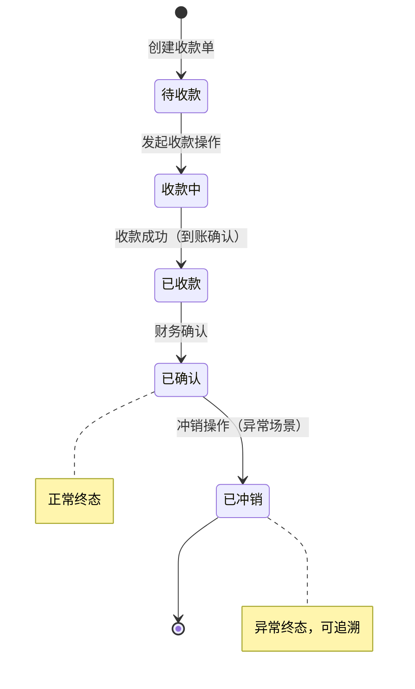
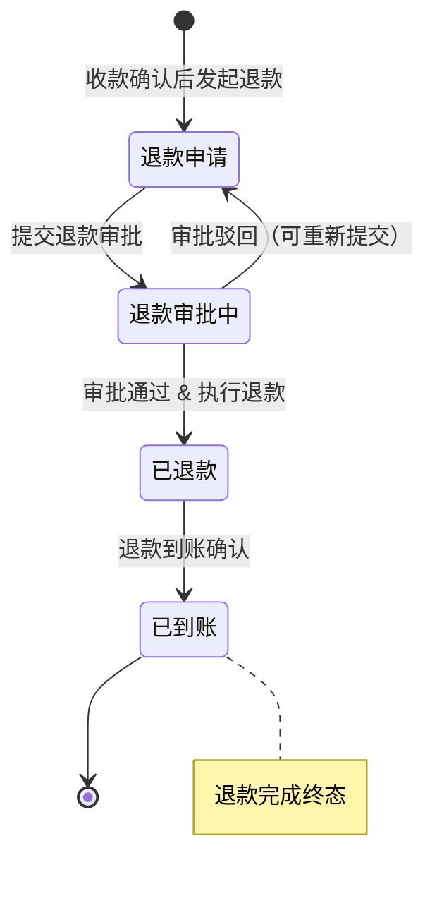
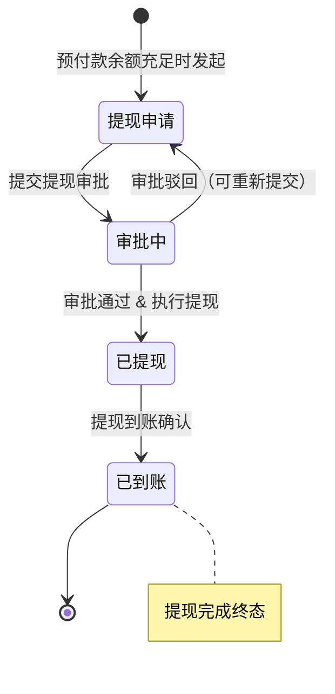

# 付款(Payment)模块迁移文档

> 从 Rhadamanthus (jQuery/Bootstrap) → view-decoration-pc (Vue 3 + TypeScript + Arco Design)

---

## 一、概述

### 1.1 迁移范围

将 R 项目中的 **payment（付款/收款）** 模块完整迁移到新业务平台 view-decoration-pc，涵盖装修款、主材款、销售款、服务费、活动款、外销款、代收款、POS交易、钱包、支付合同、预付款等子域。Payment 是 ERP 系统的核心财务模块，与 decoration/sales/balance/inventory 等模块有深度耦合。

### 1.2 源模块规模

| 类别 | 文件数 | 代码行数 | 说明 |
|------|--------|----------|------|
| HTML 页面 | 31 | 2,836 | `WebContent/views/payment/*.html` |
| JS 业务逻辑 | 32 | 10,675 | `WebContent/js/payment/*.js` |
| JS 共享工具 | 1 | 1,197 | `WebContent/js/utils/paymentUtils.js` (约40个函数) |
| API 定义 | 1 | ~500 | `WebContent/js/api/payment.js` (136 个端点) |
| 搜索条件 | 1 | 397 | `WebContent/js/condition/payment.js` (31个条件项) |
| **前端合计** | **66** | **~15,605** | |
| Java Action | 13 | 2,358 | 付款相关控制器 |
| Java DAO | 24 | 1,439 | 数据访问层(接口+Impl) |
| Java Service | 24 | 7,025 | 业务逻辑层(接口+Impl) |
| Java PO | 14 | 3,150 | 持久化对象 |
| Java VO | 12 | 3,135 | 视图对象 |
| **后端合计(payment包)** | **87** | **17,107** | com.fanglin.payment 包内 |
| 其他包关联文件 | 74 | ~6,024 | customer/approval/data/exports/information/right/store 包 |
| **项目总规模** | **227** | **~38,736** | 前端+后端 |

### 1.3 技术栈对照

| 维度 | 旧项目 (Rhadamanthus) | 新项目 (view-decoration-pc) |
|------|----------------------|---------------------------|
| 框架 | jQuery 1.x + Bootstrap 3 | Vue 3.5 + TypeScript 5.8 |
| UI 库 | Bootstrap Modal / Dropdown / Tab | Arco Design Vue 2.57 |
| 构建 | 无 (直接引入) | Vite 6.2 |
| 状态管理 | 全局变量 + DOM 操作 | Pinia 3.0 |
| 路由 | 无 (多页面 + iframe) | Vue Router 4.5 |
| HTTP | `com.post()` (jQuery.ajax 封装) | Axios + interceptor.ts |
| 弹窗 | Bootstrap Modal (峰值65个/页) | Arco Modal / Drawer |
| 子页面导航 | com.popup4page (仅3处) | Vue Router + 组件化 |
| 搜索组件 | Searcher (自定义, 21个实例) | Arco Table + 自定义 Filter |
| 动态配置 | paymentUtils.getConfig (8个页面) | Route Meta + Pinia Store |
| 常量系统 | constant.payment() (~20子分组) | DictStore / TypeScript enum |
| 支付工具 | paymentUtils.js (1197行, 40函数) | composable usePayment.ts |
| 表单验证 | com.validator | Arco Form + 自定义规则 |
| 收据打印 | com.popup 新窗口 | window.open / vue-print |
| 包管理 | script 标签 | pnpm |
| 微前端 | 无 | Wujie (CRM:2001, Member:2002) |
| 认证 | Cookie + Session | Bearer Token + 自动刷新 |

---

### 1.4 核心业务流程

> 以下状态图描述了支付模块中三类核心业务流程的状态流转。
> 跨款项类型（装修款、主材款、销售款、服务费、活动款）流程结构相同，仅在业务校验规则上有差异。

#### 收款流程



#### 退款流程



#### 预付款提现流程



### 1.5 路由配置引用

> 新项目中 payment 模块的路由将统一注册到 Vue Router，所有页面共享以下配置约定。

- **路径前缀:** `/payment`
- **权限前缀:** `payment:`

| 页面 | 路由路径 | 权限标识 |
|------|----------|----------|
| 装修款管理 | `/payment/decoration` | `payment:decoration` |
| 装修款审核 | `/payment/decoration-check` | `payment:decoration:check` |
| 主材款管理 | `/payment/material` | `payment:material` |
| 主材款审核 | `/payment/material-check` | `payment:material:check` |
| 销售款管理 | `/payment/sales` | `payment:sales` |
| 服务费管理 | `/payment/service` | `payment:service` |
| 活动款管理 | `/payment/activity` | `payment:activity` |
| 外销款管理 | `/payment/oales` | `payment:oales` |
| 代收款管理 | `/payment/proxy` | `payment:proxy` |
| 预付款管理 | `/payment/advance` | `payment:advance` |
| 预付款审核 | `/payment/advance-check` | `payment:advance:check` |
| POS交易 | `/payment/paytran` | `payment:paytran` |
| 钱包管理 | `/payment/wallet` | `payment:wallet` |
| 钱包卡 | `/payment/wallet-card` | `payment:wallet:card` |
| 钱包交易 | `/payment/wallet-tran` | `payment:wallet:tran` |
| 支付合同 | `/payment/contract` | `payment:contract` |
| 付款打印 | `/payment/print` | `payment:print` |

> 路由定义示例（`src/router/modules/payment.ts`）：
> ```ts
> {
>   path: '/payment',
>   component: Layout,
>   meta: { title: '付款管理', icon: 'icon-finance', authority: ['payment:*'] },
>   children: [
>     { path: 'decoration',       component: () => import('@/views/payment/decoration/index.vue'),       meta: { title: '装修款', authority: ['payment:decoration'] } },
>     { path: 'material',         component: () => import('@/views/payment/material/index.vue'),         meta: { title: '主材款', authority: ['payment:material'] } },
>     // ... 其余子路由
>   ]
> }
> ```

---

## 二、API 清单 (136 个端点)

### 2.1 页面路由 (api.index, 19个)

| API 名称 | URL | 用途 |
|----------|-----|------|
| salesPaymentReceiptIndex | /views/payment/salesPaymentReceipt.html | 销售款收据页 |
| oalesPaymentReceiptIndex | /views/payment/oalesPaymentReceipt.html | 外销款收据页 |
| decorationPaymentIndex | /views/payment/decorationPayment.html | 装修款页 |
| decorationPaymentCheckIndex | /views/payment/decorationPayment2check.html | 装修款审核页 |
| decorationPaymentReceiptIndex | /views/payment/decorationPaymentReceipt.html | 装修款收据页 |
| activityPaymentReceiptIndex | /views/payment/activityPaymentReceipt.html | 活动款收据页 |
| materialPaymentIndex | /views/payment/materialPayment.html | 主材款页 |
| materialPaymentReceiptIndex | /views/payment/materialPaymentReceipt.html | 主材款收据页 |
| materialPaymentCheckIndex | /views/payment/materialPayment2check.html | 主材款审核页 |
| paymentIndex | /views/payment/payment.html | 预付款列表页 |
| paymentCheckIndex | /views/payment/payment2check.html | 预付款审核页 |
| paymentReceiptIndex | /views/payment/paymentReceipt.html | 预付款收据页 |
| servicePaymentReceiptIndex | /views/payment/servicePaymentReceipt.html | 服务费收据页 |
| walletardIndex | /views/payment/walletard.html | 钱包卡页 |
| walletranIndex | /views/payment/walletran.html | 钱包交易页 |
| walletresIndex | /views/payment/walletres.html | 钱包资源页 |
| payment2printIndex | /views/payment/payment2print.html | 付款打印页 |

### 2.2 预付款 AdvancePayment (6个)

| API 端点 (.do) | 用途 |
|----------------|------|
| `pageAdvancePayment.do` | 预付款分页 |
| `queryAdvancePaymentByOrderId.do` | 按订单查询预付款 |
| `addAdvancePayment.do` | 添加预付款 |
| `updateAdvancePayment.do` | 更新预付款 |
| `deleteAdvancePayment.do` | 删除预付款 |
| `amountAdvancePayment.do` | 预付款金额计算 |

### 2.3 款项 Payment (8个)

| API 端点 (.do) | 用途 |
|----------------|------|
| `pagePayment.do` | 款项分页 |
| `queryPaymentByArid.do` | 按预付款ID查询 |
| `collectPayment.do` | 收款 |
| `confirmPayment.do` | 确认收款 |
| `addPayment.do` | 添加款项 |
| `updatePayment.do` | 更新款项 |
| `withdrawPayment.do` | 提现 |
| `sendPayment.do` | 发送款项 |

### 2.4 装修款 DecorationPayment (16个)

| API 端点 (.do) | 用途 |
|----------------|------|
| `pageDecorationPayment.do` | 装修款分页 |
| `queryDecorationPaymentByOrderId.do` | 按订单查询 |
| `addDecorationPayment.do` | 添加装修款 |
| `updateDecorationPayment.do` | 更新装修款 |
| `collectDecorationPayment.do` | 收款 |
| `collectDecorationPaymentForCommit.do` | 提交收款 |
| `confirmDecorationPayment.do` | 确认 |
| `refundDecorationPayment.do` | 退款 |
| `refundDecorationPaymentForCommit.do` | 提交退款 |
| `sendDecorationPayment.do` | 发送 |
| `affirmDecorationPayment.do` | 确认装修款 |
| `reverseDecorationPayment.do` | 冲销 |
| `pageDecorationPaymentForCheck.do` | 审核分页 |
| `checkDecorationPayment.do` | 审核 |
| `queryDecorationPaymentForSalary.do` | 查询薪资相关 |
| `amountDecorationPayment.do` | 金额计算 |

### 2.5 主材款 MaterialPayment (17个)

| API 端点 (.do) | 用途 |
|----------------|------|
| `pageMaterialPayment.do` | 主材款分页 |
| `queryMaterialPaymentByOrderId.do` | 按订单查询 |
| `addMaterialPaymentForDeposit.do` | 添加定金 |
| `addMaterialPaymentForFullpay.do` | 添加全款 |
| `collectMaterialPayment.do` | 单项收款 |
| `collectMaterialPayments.do` | 批量收款 |
| `confirmMaterialPayment.do` | 确认 |
| `confirmMaterialPayments.do` | 批量确认 |
| `refundMaterialPayment.do` | 退款 |
| `refundMaterialPaymentForDeposit.do` | 定金退款 |
| `refundMaterialPaymentForFullpay.do` | 全款退款 |
| `cancelMaterialPaymentForDeposit.do` | 取消定金 |
| `cancelMaterialPaymentForFullpay.do` | 取消全款 |
| `sendMaterialPayment.do` | 发送 |
| `checkMaterialPayment.do` | 审核 |
| `pageMaterialPaymentForCheck.do` | 审核分页 |
| `updateMaterialPayment.do` | 更新主材款 |

### 2.6 销售款 SalesPayment (20个)

| API 端点 (.do) | 用途 |
|----------------|------|
| `pageSalesPayment.do` | 销售款分页 |
| `querySalesPaymentBySid.do` | 按销售ID查询 |
| `querySalesPaymentByOrderId.do` | 按订单查询 |
| `addSalesPaymentForDeposit.do` | 添加定金 |
| `addSalesPaymentForFullpay.do` | 添加全款 |
| `collectSalesPayment.do` | 单项收款 |
| `collectSalesPayments.do` | 批量收款 |
| `confirmSalesPayment.do` | 确认 |
| `confirmSalesPayments.do` | 批量确认 |
| `refundSalesPayment.do` | 退款 |
| `refundSalesPaymentForDeposit.do` | 定金退款 |
| `cancelSalesPaymentForDeposit.do` | 取消定金 |
| `cancelSalesPaymentForFullpay.do` | 取消全款 |
| `updateSalesPayment.do` | 更新销售款 |
| `updateSalesPaymentForAdvance.do` | 更新预付款 |
| `sendSalesPayment.do` | 发送 |
| `amountSalesPayment.do` | 金额计算 |
| `pageSalesPaymentForCheck.do` | 审核分页 |
| `checkSalesPayment.do` | 审核 |
| `affirmSalesPayment.do` | 确认销售款 |

### 2.7 服务费 ServicePayment (12个)

| API 端点 (.do) | 用途 |
|----------------|------|
| `pageServicePayment.do` | 服务费分页 |
| `makeServicePayment.do` | 生成服务费 |
| `collectServicePayment.do` | 收款 |
| `confirmServicePayment.do` | 确认 |
| `refundServicePaymentForService.do` | 退款 |
| `queryServicePaymentBySpid.do` | 按服务ID查询 |
| `sendServicePayment.do` | 发送 |
| `updateServicePayment.do` | 更新 |
| `checkServicePayment.do` | 审核 |
| `pageServicePaymentForCheck.do` | 审核分页 |
| `amountServicePayment.do` | 金额计算 |
| `affirmServicePayment.do` | 确认服务费 |

### 2.8 活动款 ActivityPayment (9个)

| API 端点 (.do) | 用途 |
|----------------|------|
| `pageActivityPayment.do` | 活动款分页 |
| `queryActivityPaymentByNo.do` | 按编号查询 |
| `queryActivityPaymentByArid.do` | 按活动ID查询 |
| `createActivityPayment.do` | 创建活动款 |
| `collectActivityPayment.do` | 收款 |
| `refundActivityPayment.do` | 退款 |
| `countActivityPayment.do` | 统计活动款 |
| `sendActivityPayment.do` | 发送 |
| `confirmActivityPayment.do` | 确认 |

### 2.9 POS交易 Paytran (9个)

| API 端点 (.do) | 用途 |
|----------------|------|
| `pagePaytran.do` | POS交易分页 |
| `queryPaytran.do` | 查询POS交易 |
| `addPaytran.do` | 添加POS交易 |
| `checkPaytran.do` | 审核POS交易 |
| `cancelPaytran.do` | 取消POS交易 |
| `sendPaytran.do` | 发送POS交易 |
| `posPay.do` | POS机支付 |
| `codePay.do` | 扫码支付 |

### 2.10 代收款 ProxyPayment (7个)

| API 端点 (.do) | 用途 |
|----------------|------|
| `pageProxyPayment.do` | 代收款分页 |
| `queryProxyPayment.do` | 查询代收款 |
| `addProxyPayment.do` | 添加代收款 |
| `collectProxyPayment.do` | 收款 |
| `refundProxyPayment.do` | 退款 |
| `confirmProxyPayment.do` | 确认 |
| `cancelProxyPayment.do` | 取消 |

### 2.11 钱包 Wallet / Walletard / Walletran / Walletres (12个)

| API 端点 (.do) | 用途 |
|----------------|------|
| `pageWallet.do` | 钱包分页 |
| `queryWallet.do` | 查询钱包 |
| `applyWallet.do` | 申请钱包 |
| `bindWallet.do` | 绑定钱包 |
| `updateWallet.do` | 更新钱包 |
| `confirmWallet.do` | 确认 |
| `freezeWallet.do` | 冻结 |
| `unfreezeWallet.do` | 解冻 |
| `consumeWallet.do` | 消费 |
| `rechargeWallet.do` | 充值 |
| `withdrawWallet.do` | 提现 |
| `consentWallet.do` | 同意 |
| `transferWallet.do` | 转账 |
| `approveWallet.do` | 审批 |
| `queryWalletard.do` | 查询钱包卡 |
| `bindWalletard.do` | 绑定钱包卡 |
| `confirmWalletard.do` | 确认绑定 |
| `unbindWalletard.do` | 解绑 |
| `deleteWalletard.do` | 删除 |
| `pageWalletran.do` | 钱包交易分页 |
| `queryWalletran.do` | 查询交易 |
| `queryWalletres.do` | 查询钱包资源 |
| `addWalletres.do` | 添加资源 |
| `deleteWalletres.do` | 删除资源 |

### 2.12 支付合同 PaymentContract (12个)

| API 端点 (.do) | 用途 |
|----------------|------|
| `pagePaymentContract.do` | 合同分页 |
| `pollingPaymentContract.do` | 轮询合同状态 |
| `queryPaymentContract.do` | 查询合同 |
| `sendPaymentContractForAuth.do` | 发送授权 |
| `sendPaymentContract.do` | 发送合同 |
| `redirectPaymentContract.do` | 重定向 |
| `viewPaymentContract.do` | 查看合同 |
| `signPaymentContractForCompany.do` | 公司签约 |
| `signPaymentContractForCustomer.do` | 客户签约 |
| `addPaymentContract.do` | 添加合同 |
| `affixPaymentContract.do` | 附件 |
| `expirePaymentContract.do` | 到期处理 |
| `filingPaymentContract.do` | 归档 |

### 2.13 其他 (6个)

| API 端点 (.do) | 用途 |
|----------------|------|
| `queryPaymentFunction.do` | 查询付款功能项 |
| `alipay.do` | 支付宝支付 |
| `updateKey.do` | 更新密钥 |
| `pageKingdeeRecord.do` | 金蝶记录分页 |
| `addKingdeeRecord.do` | 添加金蝶记录 |
| `pageStatement.do` | 对账单分页 |
| `pageReceipt.do` | 收据分页 |

---

## 三、跨模块依赖 (11个外部模块, ~21个API)

| 外部模块 | 引用次数 | 关键 API | 说明 |
|----------|---------|---------|------|
| **decoration** | ~15 | queryDecorationByOrderId, queryDecorationForCommonByOrderId | 装修单信息(最频繁依赖) |
| **system** | 6 | queryCompanyByCid | 公司信息(收据打印) |
| **data** | 3 | queryReceiptType, queryReceiptTypeByType, querySignet, queryBrandByPinyin | 收据类型/品牌/印章 |
| **salary** | 2 | addWithhold, queryWithhold | 薪资扣款(decorationPayment) |
| **quotation** | 2 | queryAddReduceByDecorationPaymentId, queryAddReduceItemByAddReduceId | 报价增减项 |
| **approval** | 2 | submitApprovalForDecorationRefund, submitApprovalForPaymentWithdraw | 审批流 |
| **information** | 2 | createPlan, queryActivityForValid | 信息/活动 |
| **right** | 2 | queryPaymentFunctionRight, updatePaymentFunctionRight | 功能权限配置 |
| **common** | 1 | uploadImg | 图片上传 |
| **ds** | 1 | salary | 数据源 |
| **personel** | 1 | queryUserByPinyin | 用户搜索(condition) |

**依赖特征分析：**
- payment 模块的核心依赖是 **decoration** 模块 — 装修款/主材款/销售款都需关联装修单
- **收据打印** 场景依赖 system/data 获取公司和收据类型信息
- **approval 审批流** 覆盖装修退款和付款提现两个关键流程
- 整体跨模块依赖较少(21个)，但每个依赖点都是业务关键路径

---

## 四、页面级分析

### 4.1 页面清单与复杂度

按 JS 代码行数从高到低排列：

| # | HTML 页面 | JS 文件 | JS行 | HTML行 | Modal | popup4page | Searcher | APIs | 常量 | 复杂度 | 预估天 |
|---|----------|---------|------|--------|-------|-----------|----------|------|------|--------|--------|
| 1 | decorationPayment.html | decorationPayment.js | 1,085 | 292 | 59 | 0 | 2 | 14 | 48 | **核心** | 5-7 |
| 2 | payment.html | payment.js | 1,009 | 277 | 65 | 0 | 1 | 16 | 28 | **核心** | 5-7 |
| 3 | salesPayment.html | salesPayment.js | 1,009 | 187 | 32 | 0 | 1 | 13 | 25 | **核心** | 4-5 |
| 4 | materialPayment.html | materialPayment.js | 719 | 177 | 23 | 0 | 1 | 6 | 13 | **高** | 3-4 |
| 5 | servicePayment.html | servicePayment.js | 703 | 201 | 44 | 0 | 1 | 11 | 12 | **高** | 3-4 |
| 6 | oalesPayment.html | oalesPayment.js | 630 | 130 | 26 | 0 | 1 | 7 | 17 | **高** | 3-4 |
| 7 | payment4common.html | payment4common.js | 574 | 137 | 12 | 0 | 4 | 4 | 9 | 中 | 2-3 |
| 8 | activityPayment.html | activityPayment.js | 479 | 200 | 26 | 0 | 1 | 2 | 10 | 中 | 2-3 |
| 9 | proxyPayment.html | proxyPayment.js | 429 | 179 | 28 | 0 | 1 | 4 | 13 | 中 | 2-3 |
| 10 | wallet.html | wallet.js | 302 | 150 | 39 | 3 | 1 | 8 | 2 | 中 | 2-3 |
| 11 | paytran.html | paytran.js | 296 | 85 | 26 | 0 | 1 | 7 | 6 | 中 | 2-3 |
| 12 | payment2print.html | payment2print.js | 280 | 24 | 0 | 0 | 0 | 4 | 4 | 低 | 1 |
| 13 | salesPaymentReceipt.html | salesPaymentReceipt.js | 250 | 39 | 1 | 0 | 0 | 2 | 2 | 低 | 1 |
| 14 | paymentReceipt.html | paymentReceipt.js | 243 | 39 | 1 | 0 | 0 | 1 | 4 | 低 | 1 |
| 15 | servicePaymentReceipt.html | servicePaymentReceipt.js | 241 | 40 | 1 | 0 | 0 | 2 | 0 | 低 | 0.5 |
| 16 | materialPaymentReceipt.html | materialPaymentReceipt.js | 226 | 39 | 1 | 0 | 0 | 2 | 2 | 低 | 0.5 |
| 17 | oalesPaymentReceipt.html | oalesPaymentReceipt.js | 229 | 39 | 1 | 0 | 0 | 2 | 1 | 低 | 0.5 |
| 18 | decorationPaymentReceipt.html | decorationPaymentReceipt.js | 221 | 44 | 1 | 0 | 0 | 2 | 0 | 低 | 0.5 |
| 19 | paymentContract.html | paymentContract.js | 190 | 44 | 26 | 0 | 1 | 11 | 14 | 中 | 2-3 |
| 20 | customer.html | customer.js | 183 | 115 | 8 | 0 | 0 | 3 | 2 | 低 | 1 |
| 21 | kingdeeRecord.html | kingdeeRecord.js | 185 | 27 | 6 | 0 | 1 | 5 | 13 | 低 | 1 |
| 22 | designerSalaryCalculationIndex.html | designerSalaryCalculationIndex.js | 172 | — | 9 | 0 | 0 | 0 | 0 | 低 | 1 |
| 23 | walletard.html | walletard.js | 179 | 86 | 13 | 0 | 0 | 4 | 3 | 低 | 1 |
| 24 | receipt.html | receipt.js | 154 | 54 | 14 | 0 | 1 | 1 | 2 | 低 | 1 |
| 25 | paymentFunction.html | paymentFunction.js | 136 | 69 | 9 | 0 | 0 | 2 | 7 | 低 | 0.5 |
| 26 | paymentActivity.html | paymentActivity.js | 110 | 54 | 13 | 0 | 1 | 2 | 1 | 低 | 0.5 |
| 27 | walletres.html | walletres.js | 94 | 19 | 0 | 0 | 0 | 3 | 3 | 低 | 0.5 |
| 28 | statement.html | statement.js | 62 | 13 | 0 | 0 | 1 | 1 | 2 | 低 | 0.5 |
| 29 | walletran.html | walletran.js | 66 | 9 | 0 | 0 | 0 | 1 | 2 | 低 | 0.5 |
| 30 | activityPaymentCount.html | activityPaymentCount.js | 38 | 40 | 0 | 0 | 0 | 0 | 0 | 低 | 0.5 |

**预估总工时: 单人 45-65 天**

### 4.2 核心页面详解

#### P1: payment.js — 预付款管理 (1,009行)

**功能描述：** 预付款的全生命周期管理，包含创建、收款、确认、提现、退款等操作。通过 `paymentUtils.getConfig(payment.type, 1)` 加载动态配置。

**关键特征：**
- **65 个 Modal** — 模块内最高，涵盖收款弹窗(现金/银行/刷卡/预付/优惠券)、确认弹窗、提现弹窗、退款弹窗等
- 16 个 API 调用
- 28 个常量引用 (advancePayment + payment + receiptType)
- 使用 `paymentUtils.getConfig` 动态配置

**迁移要点：**
- 65 个 Modal 必须按支付方式拆分为独立组件：CashPayModal、BankPayModal、CheckvPayModal、AdvancePayModal、CouponPayModal
- paymentUtils 中的 init/param 函数对 (initCash/paramCash 等) 迁移为各支付组件的内部状态管理
- 通用收款逻辑提取为 `usePaymentCollect` composable

#### P2: decorationPayment.js — 装修款管理 (1,085行)

**功能描述：** 装修款项的完整管理，包含装修进度款、增减项、全款/定金混合收款、退款、审核、薪资扣款等。是 payment 模块最复杂的单文件。

**关键特征：**
- **59 个 Modal** — 仅次于 payment.js
- 14 个 API 调用
- **48 个常量引用** — 模块内最高，涉及 decorationPayment/paymentStatus/isAffirm/onetype/twotype 等大量状态判断
- 2 个 Searcher
- 跨模块调用: approval(退款审批), salary(薪资扣款), quotation(增减项)
- 使用 `paymentUtils.getConfig(decorationPayment.type, 2)`

**迁移要点：**
- 装修款业务逻辑最复杂，涉及增减项金额计算、进度款比例、薪资自动扣款
- 48 个常量需建立完整的 TypeScript enum 体系
- 增减项关联需与 quotation 模块协同设计
- 薪资扣款需与 salary 模块集成

#### P3: salesPayment.js — 销售款管理 (1,009行)

**功能描述：** 销售款项的收款/退款/确认/审核管理，支持全款和定金两种模式。

**关键特征：**
- 32 个 Modal
- 13 个 API 调用
- 25 个常量引用 (salesPayment + materialPayment 类型常量)
- 使用 `paymentUtils.getConfig(salesPayment.type, 8)`

**迁移要点：**
- 定金/全款模式切换需用 TypeScript 联合类型区分
- 收款流程与 decorationPayment 类似，可复用支付组件

#### P4: servicePayment.js — 服务费管理 (703行)

**功能描述：** 服务费的生成、收款、确认、退款管理。

**关键特征：**
- **44 个 Modal** — 第三多
- 11 个 API 调用
- 12 个常量引用

#### P5: materialPayment.js — 主材款管理 (719行)

**功能描述：** 主材款项管理，支持定金/全款/拒收/退款等多种操作。

**关键特征：**
- 23 个 Modal
- 6 个 API 调用
- 13 个常量引用 (含 PAYMENTTYPE_TYPE_DEPOSIT_INT 等多个子类型)

---

## 五、paymentUtils 共享工具文件

### 5.1 概况

`WebContent/js/utils/paymentUtils.js` — 1,197行，约 40 个函数，是 payment 模块的核心共享工具。

### 5.2 函数分类

#### 支付方式初始化/参数收集 (10个函数, 成对出现)

| 初始化函数 | 参数收集函数 | 支付方式 |
|-----------|-------------|---------|
| initCash | paramCash | 现金 |
| initBank | paramBank | 银行转账(含POS) |
| initCheckv | paramCheckv | 刷卡 |
| initAdvance | paramAdvance | 预付款 |
| initCoupon | paramCoupon | 优惠券 |

**模式：** 每种支付方式都有 init(渲染DOM表单) + param(收集表单数据) 函数对。

#### POS 交易相关 (4个)

| 函数 | 功能 |
|------|------|
| showPos | 显示POS交易列表 |
| pushPos | 推送POS交易 |
| addPos | 添加POS条目到UI |
| pushPosBank | POS银行默认方式 |

#### 动态银行/优惠券 (2个)

| 函数 | 功能 |
|------|------|
| addBank | 动态添加银行行 |
| addCounpon | 创建优惠券UI元素 |

#### 工具函数 (10个)

| 函数 | 功能 |
|------|------|
| splitBankInfo | 解析银行信息字符串 |
| splitCoupon | 解析优惠券信息字符串 |
| initBankGrade | 按等级筛选银行参数 |
| getReceiptType | 获取收款类型基础信息 |
| checkAll | 全选/取消全选 |
| emptyData | 空数据展示 |
| drawHistoryData | 绘制历史数据 |
| dataURLtoFile | DataURL转File |
| getCode | 获取验证码 |
| setTime | 倒计时 |

#### 页面配置 (2个)

| 函数 | 功能 |
|------|------|
| getConfig | 获取页面权限配置(调用 queryPaymentFunctionRight API) |
| getPropertyArr | 获取属性展示数组(支持40+字段类型映射) |

#### 合同/签订 (8个)

| 函数 | 功能 |
|------|------|
| showContractBtn | 显示合同签订按钮 |
| customerSign | 客户签订 |
| companySign | 公司签订 |
| customerSignCode | 客户签订二维码 |
| customerSignSend | 发送签订通知 |
| bindSignet | 绑定印章选择 |
| showQRCode | 显示二维码 |
| makeContract | 创建合同 |

#### 收据辅助 (4个)

| 函数 | 功能 |
|------|------|
| getReceiptRowspan | 计算收据行合并数 |
| getBankRowspan | 计算银行行合并数 |
| initSignet | 初始化印章表单 |
| initQrcode | 初始化二维码 |

### 5.3 迁移策略

```
旧: paymentUtils.js (1197行全局函数 + DOM操作)
新: src/composables/payment/ 目录下拆分为多个 composable
```

**建议拆分方案：**

| composable 文件 | 替代的函数 | 说明 |
|----------------|----------|------|
| `usePaymentMethod.ts` | initCash/paramCash, initBank/paramBank, initCheckv/paramCheckv, initAdvance/paramAdvance, initCoupon/paramCoupon | 统一支付方式管理 |
| `usePosTransaction.ts` | showPos, pushPos, addPos, pushPosBank | POS交易 |
| `usePaymentReceipt.ts` | getReceiptType, getReceiptRowspan, getBankRowspan | 收据辅助 |
| `usePaymentContract.ts` | showContractBtn, customerSign, companySign, makeContract, showQRCode | 合同签订 |
| `usePaymentPageConfig.ts` | getConfig, getPropertyArr | 页面配置 |
| `usePaymentHelpers.ts` | checkAll, emptyData, drawHistoryData, dataURLtoFile, getCode, setTime | 通用工具 |

---

## 六、paymentUtils.getConfig 页面配置系统

### 6.1 机制说明

8 个页面使用 `paymentUtils.getConfig(page, type)` 从数据库表 `PaymentFunctionRight` 动态加载页面配置。

**内部流程：**
1. 调用 `api.right.queryPaymentFunctionRight` 获取配置
2. 根据 type 值确定功能域
3. 返回配置对象：apiPage(数据接口), pageBtn(按钮权限), condArr(搜索条件), extraParam(额外参数), propertyArr(列配置)

### 6.2 使用页面一览

| 页面 | type参数 | 功能域标识 |
|------|---------|-----------|
| payment.js | 1 | 预付款 |
| decorationPayment.js | 2 | 装修款 |
| materialPayment.js | 4 | 主材款 |
| salesPayment.js | 8 | 销售款 |
| servicePayment.js | 16 | 服务费 |
| activityPayment.js | 32 | 活动款 |
| proxyPayment.js | 64 | 代收款 |
| oalesPayment.js | 65 | 外销款 |

### 6.3 迁移策略

```typescript
// src/stores/modules/paymentPageConfig.ts
export const usePaymentPageConfigStore = defineStore('paymentPageConfig', () => {
  const configMap = ref<Record<number, PaymentPageConfig>>({})

  async function fetchConfig(type: number) {
    if (configMap.value[type]) return configMap.value[type]
    const { data } = await queryPaymentFunctionRight({ type })
    configMap.value[type] = data
    return data
  }

  return { configMap, fetchConfig }
})
```

---

## 七、常量系统

### 7.1 子分组清单 (~20个)

| 子分组 | 主要常量 | 引用文件数 | 说明 |
|--------|---------|-----------|------|
| **receipt** | paymentType.keys/datas | 8 | 收据类型/支付方式 |
| **receiptType** | receiptType.keys/datas, posway.datas | 7 | 收据类型/POS方式 |
| **advancePayment** | type.keys, paymentType.keys, TYPE_COLLECTION_INT, PAYMENTTYPE_* | 5 | 预付款类型 |
| **payment** | status.keys, STATUS_INIT/PAID/CONFIRMED_INT | 3 | 款项状态 |
| **decorationPayment** | paymentStatus.keys, isAffirm.keys/datas, ONETYPE_*, TWOTYPE_*, PAYMENTSTATUS_* | 5 | 装修款状态(最复杂) |
| **materialPayment** | status/paymentType/advanceType.keys, PAYMENTTYPE_TYPE_*, STATUS_* | 5 | 主材款类型/状态 |
| **salesPayment** | status.keys, advanceType.keys | 2 | 销售款状态 |
| **salespayment** | type.keys | 1 | 销售款类型 |
| **servicePayment** | status/type.keys, TYPE_COLLECT_INT | 4 | 服务费状态/类型 |
| **activityPayment** | status.keys, activityCouponType.datas, paymentType.keys/datas, ways.datas, PAYMENTTYPE_* | 2 | 活动款状态 |
| **oalesPayment** | status/type.keys | 2 | 外销款状态/类型 |
| **proxyPayment** | type/status.keys, isexpire.keys/datas, TYPE_*/STATUS_* | 2 | 代收款状态 |
| **paytran** | status.keys/datas, ATTTYPE_DECORATION/MATERIAL_INT, STATUS_INIT_INT | 6 | POS交易状态 |
| **paymentContract** | status.keys, STATUS_FILE/VALID/SIGN_INT | 1 | 合同状态 |
| **paymentFunction** | TYPE_API/CONDITION/FIELD/FUNCTION/NODE/STATUS/PAYTYPE_INT | 1 | 功能配置类型 |
| **wallet** | type/status.keys | 1 | 钱包状态/类型 |
| **walletard** | status/type.keys/datas | 1 | 钱包卡状态/类型 |
| **walletran** | status/type.keys | 1 | 钱包交易类型 |
| **walletres** | type.keys/datas | 1 | 钱包资源类型 |
| **statement** | type/status.keys/datas | 1 | 对账单类型/状态 |

### 7.2 迁移策略

```typescript
// src/types/payment/enums.ts
export enum PaymentStatus {
  INIT = 0,
  COLLECT = 1,
  CONFIRM = 2,
  // ...
}

export enum DecorationPaymentStatus {
  UNPAY = 0,
  PAY = 1,
  CONFIRM = 2,
  // ...
}

export enum DecorationPaymentOneType {
  ADD = 0,      // 正常增项
  REFUND = 1,   // 退款
  HISTORY = 2,  // 历史
}

export enum MaterialPaymentType {
  DEPOSIT = 0,
  FULL = 1,
  REJECT = 2,
  FULL_REFUND = 3,
  COUPON_REFUND = 4,
  DEPOSIT_REFUND = 5,
  DEPOSIT_NOTREFUND = 6,
}

export enum ReceiptType {
  CASH = 0,
  BANK = 1,
  CHECKV = 2,
  PUBLIC = 3,
  COUPON = 4,
}
```

---

## 八、搜索条件系统

### 8.1 Condition 文件分析

`WebContent/js/condition/payment.js` (397行) 包含 31 个搜索条件。

**主要搜索字段：**

| 字段名 | 类型 | 说明 |
|--------|------|------|
| orderId | text | 装修单号 |
| village | autofill | 楼盘 |
| houseNumber | text | 楼号 |
| designer | autofill | 设计师 |
| collectTime | dateRangePicker | 收款时间范围 |
| confirmTime | dateRangePicker | 确认时间范围 |
| material-no | text | 主材号 |
| sales-no | text | 销售单号 |
| paymentType | select | 款项类型 |
| receiptType | select | 收据类型 |
| activity-no | text | 会员号 |
| activity-category | autofill | 品类 |
| activity-brand | autofill | 品牌 |
| point-sn | text | 机器编号(POS) |
| point-status | select | POS状态 |
| wallet-belonger-name | autofill | 钱包归属人 |
| kingdee-orderId | text | 金蝶单号 |
| name | text | 客户姓名 |
| phone | text | 手机号 |
| isexpire | select | 过期标识 |
| statement-custNo | text | 商户号 |
| statement-type | select | 对账单类型 |
| statement-status | select | 对账单状态 |
| statement-payTime | dateRangePicker | 对账单付款时间 |

### 8.2 迁移策略

与 sales 模块相同，创建通用 `FilterBar.vue` 组件：
- text → `a-input`
- autofill → `a-auto-complete` + 防抖API
- select → `a-select`
- dateRangePicker → `a-range-picker`

---

## 九、Java 后端架构

### 9.1 分层结构 (payment 包内)

| 层 | 文件数 | 代码行数 | 关键文件 |
|----|--------|---------|---------|
| **Action** | 13 | 2,358 | DecorationPaymentAction(300), SalesPaymentAction(306), MaterialPaymentAction(297), PaymentCommonAction(249) |
| **DAO** | 24 | 1,439 | MaterialPaymentDaoImpl(214), DecorationPaymentDaoImpl(196), SalesPaymentDaoImpl(173) |
| **Service** | 24 | 7,025 | **MaterialPaymentServiceImpl(1,240)**, **SalesPaymentServiceImpl(1,171)**, **DecorationPaymentServiceImpl(1,013)** |
| **PO** | 14 | 3,150 | SalesPaymentPO(291), DecorationPaymentPO(282), PaymentContractPO(248) |
| **VO** | 12 | 3,135 | DecorationPaymentVO(415), SalesPaymentVO(414), MaterialPaymentVO(389) |
| **合计** | **87** | **17,107** | |

### 9.2 跨包分布

| 所属包 | 文件数 | 行数 | 说明 |
|--------|--------|------|------|
| **customer** | 25+ | ~1,943 | 客户端付款查询(含独立DAO/Service/VO) |
| **approval** | 8 | ~709 | 付款审批(材料全款、提现) |
| **data.common** | 12 | ~1,132 | PaymentScale/PaymentType 基础数据 |
| **exports** | 4 | ~596 | 款项导出 |
| **information** | 4 | ~749 | 付款通知(Vpayment) |
| **right** | 4 | ~366 | PaymentFunctionRight 权限 |
| **store** | 4 | ~321 | 门店付款(Mpayment) |
| **合计** | **61+** | **~4,816** | |

### 9.3 后端迁移建议

- **后端 API URL 保持不变** (相同的 `.do` 端点)
- VO 结构与前端 TypeScript 类型定义对齐
- 三个巨型 Service (3424行) 建议后端逐步重构拆分
- 新项目 `src/api/modules/payment.ts` 封装所有 136 个 API 调用

---

## 十、迁移实施计划

### 10.1 阶段划分

#### 第一阶段：基础设施 (5-7天)

| 任务 | 说明 | 预估 |
|------|------|------|
| 创建 payment 模块目录结构 | views/payment/, api/modules/payment.ts, types/payment/ | 0.5天 |
| TypeScript 类型定义 | 20+ 个 enum + 15+ 个 VO/VO 类型 | 2-3天 |
| API 层封装 | 136 个 API 函数 | 1.5天 |
| paymentPageConfig Store | getConfig 系统迁移 | 1天 |
| paymentUtils composable 拆分 | 6 个 composable (usePaymentMethod 等) | 1-2天 |
| 通用支付组件 | CashPayModal, BankPayModal, CheckvPayModal, AdvancePayModal, CouponPayModal | 2天 |

#### 第二阶段：简单页面 — 收据/打印/辅助 (5-7天)

| 页面 | 复杂度 | 预估 |
|------|--------|------|
| activityPaymentCount.js | 低 | 0.5天 |
| statement.js | 低 | 0.5天 |
| walletran.js | 低 | 0.5天 |
| walletres.js | 低 | 0.5天 |
| payment2print.js | 低 | 1天 |
| paymentReceipt.js | 低 | 0.5天 |
| decorationPaymentReceipt.js | 低 | 0.5天 |
| salesPaymentReceipt.js | 低 | 0.5天 |
| materialPaymentReceipt.js | 低 | 0.5天 |
| servicePaymentReceipt.js | 低 | 0.5天 |
| oalesPaymentReceipt.js | 低 | 0.5天 |
| activityPaymentReceipt.js | 低 | 0.5天 |
| paymentFunction.js | 低 | 0.5天 |
| customer.js | 低 | 1天 |
| designerSalaryCalculationIndex.js | 低 | 1天 |
| receipt.js | 低 | 1天 |
| paymentActivity.js | 低 | 0.5天 |
| walletard.js | 低 | 1天 |
| kingdeeRecord.js | 低 | 1天 |

#### 第三阶段：中等页面 — 钱包/POS/代收/合同 (8-10天)

| 页面 | 复杂度 | 预估 |
|------|--------|------|
| wallet.js | 中 | 2-3天 |
| paytran.js | 中 | 2天 |
| proxyPayment.js | 中 | 2-3天 |
| paymentContract.js | 中 | 2-3天 |
| payment4common.js | 中 | 2天 |
| activityPayment.js | 中 | 2天 |

#### 第四阶段：核心页面 — 各类款项 (18-25天)

| 页面 | 复杂度 | 预估 |
|------|--------|------|
| materialPayment.js | 高 | 3-4天 |
| servicePayment.js | 高 | 3-4天 |
| oalesPayment.js | 高 | 3-4天 |
| salesPayment.js | 核心 | 4-5天 |
| payment.js | 核心 | 5-7天 |
| decorationPayment.js | 核心 | 5-7天 |

#### 第五阶段：集成测试 (5-7天)

| 任务 | 预估 |
|------|------|
| 收款流程联调(现金/银行/刷卡/预付/优惠券) | 2天 |
| 退款+审批流联调 | 1天 |
| POS交易端到端测试 | 1天 |
| 钱包完整流程测试 | 1天 |
| 跨模块联调(decoration/sales/salary) | 1天 |
| Bug修复与优化 | 2天 |

### 10.2 总工时估算

| 阶段 | 天数 |
|------|------|
| 基础设施 | 5-7 |
| 简单页面 | 5-7 |
| 中等页面 | 8-10 |
| 核心页面 | 18-25 |
| 集成测试 | 5-7 |
| **合计** | **41-56** |

单人完成约 8-11 周，建议 2 人并行可缩短至 4-6 周。

### 10.3 与 Sales/Decoration 模块的工时对比

| 模块 | 前端文件 | 前端行数 | API数 | 核心页数 | 总工时 |
|------|---------|---------|-------|---------|--------|
| decoration | 57 | ~26,500 | 149 | 2 | 36-52天 |
| sales | 57 | ~16,019 | 110 | 5 | 36-51天 |
| **payment** | **66** | **~15,605** | **136** | **6** | **41-56天** |

Payment 模块虽然前端行数最少，但核心页面最多(6个)，且共享工具文件最复杂(1197行)，整体工时与 sales/decoration 相当。

### 10.4 风险点

| 风险 | 影响 | 缓解措施 |
|------|------|---------|
| paymentUtils.js 1197行全局函数 | 需完全重写为 composable | 第一阶段优先拆分，建立 6 个 composable |
| payment.js 65个Modal | 组件拆分工作量大 | 5种支付方式统一为可复用支付组件 |
| decorationPayment.js 48个常量 | 状态判断复杂 | 建立完整 TypeScript enum + 状态机 |
| 3个巨型Service (3424行) | 后端逻辑复杂，前端需完全理解 | 详细梳理业务流程，前后端对齐 |
| 8种不同支付方式 | 收银逻辑各有差异 | 用策略模式统一支付接口 |
| POS/扫码支付集成 | 涉及硬件交互 | mock测试先行，后期联调 |
| 审批流跨模块 | 退款/提现需审批 | 与 approval 模块协同设计 |

---

## 十一、命名规范

### 11.1 目录结构建议

```
src/views/payment/
├── advance/                      # 预付款 (payment.js)
│   ├── AdvancePaymentList.vue
│   └── components/
│       └── AdvancePaymentFilter.vue
├── decoration/                   # 装修款 (decorationPayment.js)
│   ├── DecorationPaymentList.vue
│   └── components/
│       ├── DecorationPaymentCheck.vue
│       └── DecorationRefundModal.vue
├── material/                     # 主材款 (materialPayment.js)
│   └── MaterialPaymentList.vue
├── sales/                        # 销售款 (salesPayment.js)
│   └── SalesPaymentList.vue
├── service/                      # 服务费 (servicePayment.js)
│   └── ServicePaymentList.vue
├── activity/                     # 活动款
│   ├── ActivityPaymentList.vue
│   └── ActivityPaymentCount.vue
├── oales/                        # 外销款 (oalesPayment.js)
│   └── OalesPaymentList.vue
├── proxy/                        # 代收款 (proxyPayment.js)
│   └── ProxyPaymentList.vue
├── pos/                          # POS交易 (paytran.js)
│   └── PaytranList.vue
├── wallet/                       # 钱包
│   ├── WalletList.vue
│   ├── WalletCard.vue
│   ├── WalletTransaction.vue
│   └── WalletResource.vue
├── contract/                     # 支付合同 (paymentContract.js)
│   └── PaymentContractList.vue
├── receipt/                      # 收据
│   ├── PaymentReceiptList.vue
│   └── components/
│       └── ReceiptPrint.vue
├── common/                       # 通用 (payment4common.js)
│   └── PaymentCommonList.vue
├── shared/                       # 共享组件
│   ├── payment-methods/          # 支付方式组件
│   │   ├── CashPayModal.vue
│   │   ├── BankPayModal.vue
│   │   ├── CheckvPayModal.vue
│   │   ├── AdvancePayModal.vue
│   │   └── CouponPayModal.vue
│   ├── PaymentStatusTag.vue
│   ├── PaymentActionButtons.vue
│   └── PaymentCollectDrawer.vue
└── other/                        # 其他
    ├── KingdeeRecord.vue
    ├── StatementList.vue
    └── DesignerSalaryCalculation.vue

src/api/modules/payment.ts        # 136个API封装
src/types/payment/
├── enums.ts                      # 20+ 状态/类型枚举
├── vo.ts                         # VO 类型定义
└── api.ts                        # 请求/响应类型

src/stores/modules/
└── paymentPageConfig.ts          # 页面配置 Store

src/composables/payment/
├── usePaymentMethod.ts            # 支付方式管理(替代init/param函数对)
├── usePosTransaction.ts           # POS交易
├── usePaymentReceipt.ts           # 收据辅助
├── usePaymentContract.ts          # 合同签订
├── usePaymentPageConfig.ts        # 页面配置
└── usePaymentHelpers.ts           # 通用工具
```

### 11.2 命名规范

```
组件:     PascalCase (DecorationPaymentList.vue)
组合式函数: camelCase (usePaymentMethod)
Store:   use + Module + Store (usePaymentPageConfigStore)
API:     动词 + 名词 (collectDecorationPayment)
类型:    PascalCase + 后缀 (PaymentVO / DecorationPaymentQry)
路由:    kebab-case (decoration-payment, sales-payment)
```

### 11.3 Git 规范

```
feat(payment): 新增装修款列表页
feat(payment): 新增通用支付方式组件
feat(payment): 新增销售款管理页
fix(payment): 修复装修款退款金额计算问题
refactor(payment): 拆分paymentUtils为独立composable
```

---

## 十二、参考资源

| 资源 | 路径 |
|------|------|
| 新项目源码 | `/d/GIT/view-decoration-pc/` (分支: `erp-master`) |
| R 项目源码 | `/d/GIT/Rhadamanthus/` |
| R 项目 payment JS | `WebContent/js/payment/*.js` |
| R 项目 payment HTML | `WebContent/views/payment/*.html` |
| R 项目 API 定义 | `WebContent/js/api/payment.js` |
| R 项目共享工具 | `WebContent/js/utils/paymentUtils.js` |
| R 项目搜索条件 | `WebContent/js/condition/payment.js` |
| R 项目常量系统 | `WebContent/js/com/constant.js` |
| decoration 迁移文档 | `docs/migration-decoration.md` |
| sales 迁移文档 | `docs/migration-sales.md` |
| 新项目 interceptor | `src/api/interceptor.ts` |
| 新项目 DictStore | `src/stores/modules/dict.ts` |
| Arco Design Vue 文档 | https://arco.design/vue/docs/start |
| Vue 3 文档 | https://vuejs.org/ |
| Pinia 文档 | https://pinia.vuejs.org/ |

---

*文档生成时间: 2026-04-26*
*基于 Rhadamanthus payment 模块分析 (66 前端文件, ~15,605 行代码, 136 个 API 端点, 87 后端文件, ~17,107 行 Java)*
