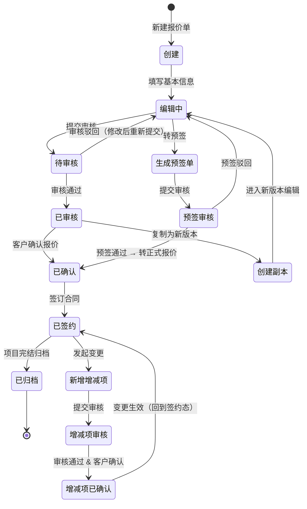
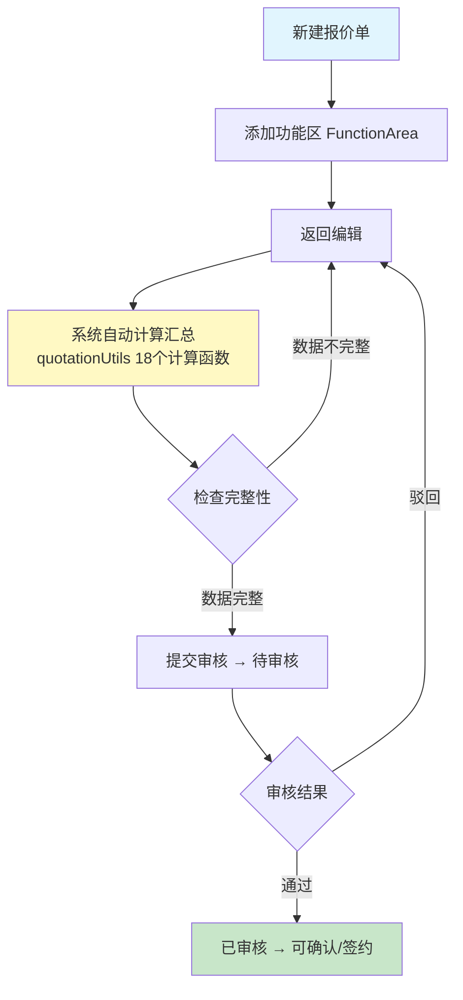
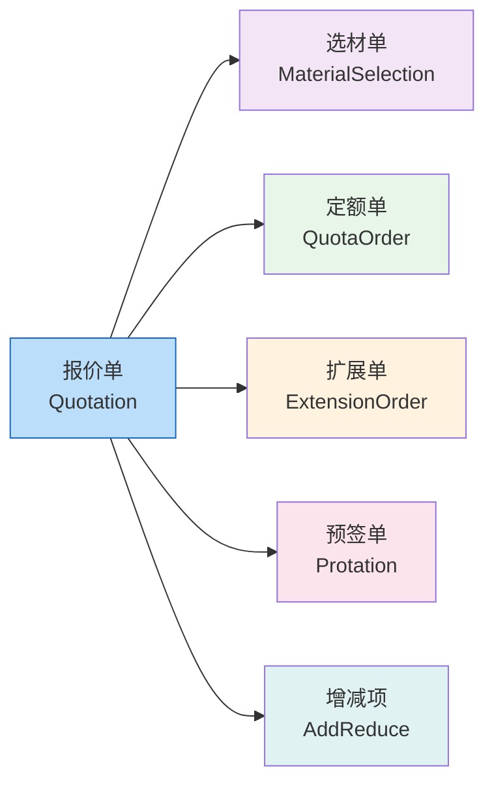

# 报价(Quotation)模块迁移文档

> 从 Rhadamanthus (jQuery/Bootstrap) → view-decoration-pc (Vue 3 + TypeScript + Arco Design)

---

## 一、概述

### 1.1 迁移范围

将 R 项目中的 **quotation（报价）** 模块完整迁移到新业务平台 view-decoration-pc，涵盖报价单、预签单、增减项、选材单、定额单（材料/人工/工时）、扩展单、报退单、预算分配、功能区、报价基础数据等子域。Quotation 是 ERP 系统中最复杂的前端模块，包含两套并行的报价系统（新版 Quotation + 旧版 Quotetion）。

### 1.2 源模块规模

| 类别 | 文件数 | 代码行数 | 说明 |
|------|--------|----------|------|
| HTML 页面 | 59 | 9,640 | `WebContent/views/quotation/*.html` |
| JS 业务逻辑 | 60 | 40,063 | `WebContent/js/quotation/*.js` |
| JS 共享工具 | 1 | 1,925 | `WebContent/js/utils/quotationUtils.js` (18个函数) |
| API 定义 | 1 | 2,563 | `WebContent/js/api/quotation.js` (388个端点) |
| 搜索条件 | 1 | 1,460 | `WebContent/js/condition/quotation.js` (60+条件项) |
| **前端合计** | **122** | **~55,651** | |
| Java Action | 32 | 4,460 | 报价相关控制器 |
| Java DAO | 86 | 4,591 | 数据访问层(接口44 + Impl42) |
| Java Service | 69 | 13,640 | 业务逻辑层(接口35 + Impl34) |
| Java PO | 60 | 14,751 | 持久化对象 |
| Java VO | 42 | 7,533 | 视图对象 |
| **后端合计(核心包)** | **289** | **44,975** | com.fanglin.quotation 包内 |
| data/quotation 子包 | 138 | 10,183 | 报价基础数据配置 |
| 其他包关联文件 | 65 | ~4,429 | approval/communion/report/right/imports |
| **项目总规模** | **614** | **~115,238** | 前端+后端 |

### 1.3 技术栈对照

| 维度 | 旧项目 (Rhadamanthus) | 新项目 (view-decoration-pc) |
|------|----------------------|---------------------------|
| 框架 | jQuery 1.x + Bootstrap 3 | Vue 3.5 + TypeScript 5.8 |
| UI 库 | Bootstrap Modal / Dropdown / Tab | Arco Design Vue 2.57 |
| 构建 | 无 (直接引入) | Vite 6.2 |
| 状态管理 | 全局变量 + DOM 操作 | Pinia 3.0 |
| 路由 | 无 (多页面 + iframe) | Vue Router 4.5 |
| HTTP | `com.post()` (jQuery.ajax 封装) | Axios + interceptor.ts |
| 弹窗 | Bootstrap Modal (峰值180个/页) | Arco Modal / Drawer |
| 子页面导航 | com.popup4page (11处) | Vue Router + 组件化 |
| 搜索组件 | Searcher (自定义, ~50个实例) | Arco Table + 自定义 Filter |
| 动态配置 | drawNode.getConfig("quoter") 仅1处 | Route Meta + Pinia Store |
| 常量系统 | constant.quotation() (~22子分组) | DictStore / TypeScript enum |
| 报价计算 | quotationUtils.js (1925行, 18函数) | composable useQuotationCalc.ts |
| 包管理 | script 标签 | pnpm |
| 微前端 | 无 | Wujie (CRM:2001, Member:2002) |
| 认证 | Cookie + Session | Bearer Token + 自动刷新 |

---

### 1.4 核心业务流程

#### 1.4.1 报价单生命周期（状态流转）



#### 1.4.2 报价编辑器内部流程



#### 1.4.3 衍生子单据流程



### 1.5 路由配置引用

本模块路由配置详见 → [guide-shared 6.4 后端菜单→动态路由构建](migration-guide-shared.md#64-后端菜单--动态路由构建)

核心路由结构:

| 维度 | 值 |
|------|-----|
| 路径前缀 | `/quotation` |
| 权限前缀 | `quotation:` |
| 懒加载 | `() => import('@/views/quotation/xxx/index.vue')` |
| 字典预加载 | `meta.dictGroups: ['quotation.status', 'quotation.type', 'quotation.area.type']` |

```typescript
// src/router/modules/quotation.ts (路由定义参考)
export const quotationRoutes: RouteRecordRaw[] = [
  {
    path: '/quotation',
    name: 'QuotationRoot',
    redirect: '/quotation/list',
    meta: { requiresAuth: true, module: 'quotation', title: '报价管理' },
    children: [
      { path: 'list', name: 'QuotationList', meta: { title: '报价单列表', permission: 'quotation:list' } },
      { path: 'detail/:id', name: 'QuotationDetail', meta: { title: '报价单详情', hideInMenu: true, permission: 'quotation:detail' } },
      { path: 'addreduce/:id', name: 'QuotationAddReduce', meta: { title: '增减项', hideInMenu: true, permission: 'quotation:addreduce' } },
      { path: 'selection/:id', name: 'QuotationSelection', meta: { title: '选材单', hideInMenu: true, permission: 'quotation:selection' } },
      { path: 'normtion/:id', name: 'QuotationNormtion', meta: { title: '定额单', hideInMenu: true, permission: 'quotation:normtion' } },
      { path: 'extension/:id', name: 'QuotationExtension', meta: { title: '扩展单', hideInMenu: true, permission: 'quotation:extension' } },
      { path: 'protation/:id', name: 'QuotationProtation', meta: { title: '预签单', hideInMenu: true, permission: 'quotation:protation' } },
    ],
  },
]
```

> 注意: 实际路由由后端菜单接口动态生成，此处仅列出核心路由结构供参考。

---

## 二、API 清单 (388 个端点)

### 2.1 页面路由 (api.index, 40个)

| API 名称 | URL | 用途 |
|----------|-----|------|
| quotationIndexIndex | /views/quotation/quotationIndex.html | 报价单列表 |
| quotationPartIndex | /views/quotation/quotationPart.html | 报价单详情(分部) |
| quotationWholeIndex | /views/quotation/quotationWhole.html | 报价单详情(整体) |
| quotationDetailIndex | /views/quotation/quotationDetail.html | 报价单明细 |
| quotationVersionIndex | /views/quotation/quotationVersion.html | 报价版本管理 |
| quotationFunctionIndex | /views/quotation/quotationFunction.html | 报价功能区 |
| quotationFunctionAreaIndex | /views/quotation/functionArea.html | 功能区管理 |
| quotationFunctionAreaItemIndex | /views/quotation/functionAreaItem.html | 功能区项管理 |
| quotationFormatIndex | /views/quotation/quotationFormat.html | 报价格式 |
| quotationPriceIndex | /views/quotation/quotationPrice.html | 报价价格 |
| quotationProfileIndex | /views/quotation/quotationProfile.html | 报价概况 |
| quotationLabelIndex | /views/quotation/quotationLabel.html | 报价标签 |
| quotationItemIndex | /views/quotation/quotationItem.html | 报价项管理 |
| quotationCtemIndex | /views/quotation/quotationCtem.html | 自定义报价项 |
| quotationRtemIndex | /views/quotation/quotationRtem.html | 关联报价项 |
| quotationRecordIndex | /views/quotation/quotationRecord.html | 报价记录 |
| quotationRefundIndex | /views/quotation/quotationRefundIndex.html | 报退单列表 |
| quotationRefundPartIndex | /views/quotation/quotationRefundPart.html | 报退单详情 |
| quotetionIndexIndex | /views/quotation/quotetionIndex.html | 旧版报价列表 |
| quotetionPartIndex | /views/quotation/quotetionPart.html | 旧版报价详情 |
| quotetionCompareIndex | /views/quotation/quotetionCompare.html | 旧版报价对比 |
| protationIndexIndex | /views/quotation/protationIndex.html | 预签列表 |
| protationPartIndex | /views/quotation/protationPart.html | 预签详情 |
| protationOutputIndex | /views/quotation/protationOutput.html | 预签输出 |
| addReduceIndexIndex | /views/quotation/addReduceIndex.html | 增减项列表 |
| addReducePartIndex | /views/quotation/addReducePart.html | 增减项详情 |
| addReduceOutputIndex | /views/quotation/addReduceOutput.html | 增减项输出 |
| extensionIndexIndex | /views/quotation/extensionIndex.html | 扩展单列表 |
| extensionPartIndex | /views/quotation/extensionPart.html | 扩展单详情 |
| selectionIndexIndex | /views/quotation/selectionIndex.html | 选材单列表 |
| selectionPartIndex | /views/quotation/selectionPart.html | 选材单详情 |
| selectionItemIndex | /views/quotation/selectionItem.html | 选材项管理 |
| selectionOutputIndex | /views/quotation/selectionOutput.html | 选材输出 |
| normtionIndexIndex | /views/quotation/normtionIndex.html | 定额单列表 |
| normtionPartIndex | /views/quotation/normtionPart.html | 定额单详情 |
| normoodOutputIndex | /views/quotation/normoodOutput.html | 材料定额输出 |
| normriceOutputIndex | /views/quotation/normriceOutput.html | 人工定额输出 |
| normtimeOutputIndex | /views/quotation/normtimeOutput.html | 工时定额输出 |
| quotationAssignConfigIndex | /views/quotation/quotationAssignConfig.html | 预算分配配置 |
| quotationAssignRequestIndex | /views/quotation/quotationAssignRequest.html | 预算分配请求 |
| quotationAssignRecordIndex | /views/quotation/quotationAssignRecord.html | 预算分配记录 |
| quotationAssignUserRuleIndex | /views/quotation/quotationAssignUserRule.html | 预算员规则 |
| quotationAssignUserRuleItemIndex | /views/quotation/quotationAssignUserRuleItem.html | 预算员规则项 |
| presignProduceIndex | /views/quotation/presignProduce.html | 预签产品 |
| presignItemIndex | /views/quotation/presignItem.html | 预签项目 |
| presignPriceIndex | /views/quotation/presignPrice.html | 预签价格 |
| presignCostIndex | /views/quotation/presignCost.html | 预签成本 |
| qeasure4detailIndex | /views/quotation/qeasure4detail.html | 复测明细 |
| quotationOutputIndex | /views/quotation/quotationOutput.html | 报价输出 |
| quotationTestIndex | /views/quotation/quotationTest.html | 报价测试 |
| quotationToggleIndex | /views/quotation/quotationToggle.html | 报价切换 |
| quotationConfigIndex | /views/quotation/quotationConfig.html | 报价配置 |
| quotationProfile4detailIndex | /views/quotation/quotationProfile4detail.html | 报价概况明细 |
| quotationBigCategoryIndex | /views/quotation/quotationBigCategory.html | 报价大类 |
| quotationSmallCategoryIndex | /views/quotation/quotationSmallCategory.html | 报价小类 |
| quotationClassificationIndex | /views/quotation/quotationClassification.html | 报价分类 |
| quotationTypeIndex | /views/quotation/quotationType.html | 报价类型 |
| systemDefineItemIndex | /views/quotation/systemDefineItem.html | 系统定义项 |

### 2.2 报价单 Quotation (~25个)

| API 端点 (.do) | 用途 |
|----------------|------|
| `pageQuotation.do` | 报价单分页 |
| `queryQuotationByQid.do` | 按ID查询报价单 |
| `queryQuotationForDefaultByOrderId.do` | 按订单查默认报价 |
| `addQuotation.do` | 添加报价单 |
| `updateQuotation.do` | 更新报价单 |
| `deleteQuotation.do` | 删除报价单 |
| `submitQuotation.do` | 提交报价单 |
| `lockQuotation.do` | 锁定报价单 |
| `unlockQuotation.do` | 解锁报价单 |
| `copyQuotation.do` | 复制报价单 |
| `checkQuotation.do` | 审核报价单 |
| `amountQuotation.do` | 报价金额计算 |
| `auditQuotation.do` | 报价审计 |
| `pageQuotationForStatus.do` | 按状态分页 |
| `pageQuotationForAdvance.do` | 预付款相关报价 |
| `pageQuotationForCount.do` | 报价统计 |
| `queryQuotationForSalary.do` | 薪资相关报价查询 |
| `setQuotationForDefault.do` | 设置默认报价 |
| `updateQuotationForStatus.do` | 更新报价状态 |
| `updateQuotationForPicture.do` | 更新报价图片 |
| `updateQuotationForWorkerType.do` | 更新工种信息 |
| `viewQuotation.do` | 查看报价详情 |
| `signQuotation.do` | 签订报价 |
| `sendQuotation.do` | 发送报价 |
| `pageQuotationForCheck.do` | 审核列表 |

### 2.3 预签单 Protation (~19个)

| API 端点 (.do) | 用途 |
|----------------|------|
| `pageProtation.do` | 预签单分页 |
| `queryProtationByPid.do` | 按ID查询 |
| `queryProtationForDefaultByOrderId.do` | 按订单查默认预签 |
| `addProtation.do` | 添加预签单 |
| `updateProtation.do` | 更新预签单 |
| `deleteProtation.do` | 删除预签单 |
| `lockProtation.do` | 锁定预签 |
| `unlockProtation.do` | 解锁预签 |
| `copyProtation.do` | 复制预签 |
| `setProtationForDefault.do` | 设置默认预签 |
| `queryProtationItemByPid.do` | 查询预签项 |
| `addProtationItem.do` | 添加预签项 |
| `updateProtationItem.do` | 更新预签项 |
| `deleteProtationItem.do` | 删除预签项 |
| `queryProtationCostByPid.do` | 查询预签成本 |
| `addProtationCost.do` | 添加预签成本 |
| `updateProtationCost.do` | 更新预签成本 |
| `deleteProtationCost.do` | 删除预签成本 |
| `queryProtationForCommonByOrderId.do` | 通用查询 |

### 2.4 增减项 AddReduce (~25个)

| API 端点 (.do) | 用途 |
|----------------|------|
| `pageAddReduce.do` | 增减项分页 |
| `queryAddReduceByArid.do` | 按ID查询 |
| `queryAddReduceByOrderId.do` | 按订单查询 |
| `queryAddReduceByDecorationPaymentId.do` | 按装修款ID查询 |
| `queryAddReduceItemByAddReduceId.do` | 按增减项ID查明细 |
| `addAddReduce.do` | 添加增减项 |
| `updateAddReduce.do` | 更新增减项 |
| `deleteAddReduce.do` | 删除增减项 |
| `submitAddReduce.do` | 提交增减项 |
| `checkAddReduce.do` | 审核增减项 |
| `lockAddReduce.do` | 锁定 |
| `unlockAddReduce.do` | 解锁 |
| `addAddReduceItem.do` | 添加增减项明细 |
| `updateAddReduceItem.do` | 更新增减项明细 |
| `deleteAddReduceItem.do` | 删除增减项明细 |
| `amountAddReduce.do` | 增减项金额计算 |
| `pageAddReduceForStatus.do` | 按状态分页 |
| `pageAddReduceForCount.do` | 增减项统计 |
| `queryAddReduceItemByArid.do` | 按ARID查明细 |
| `addAddReduceItemForCommit.do` | 提交增减项明细 |
| `updateAddReduceItemForCommit.do` | 更新提交明细 |
| `deleteAddReduceItemForCommit.do` | 删除提交明细 |
| `viewAddReduce.do` | 查看增减项详情 |
| `sendAddReduce.do` | 发送增减项 |
| `pageAddReduceForCheck.do` | 审核列表 |

### 2.5 选材单 Selection (~30个)

| API 端点 (.do) | 用途 |
|----------------|------|
| `pageSelection.do` | 选材单分页 |
| `querySelectionBySid.do` | 按ID查询 |
| `querySelectionByOrderId.do` | 按订单查询 |
| `querySelectionForDefaultByOrderId.do` | 按订单查默认 |
| `addSelection.do` | 添加选材单 |
| `updateSelection.do` | 更新选材单 |
| `deleteSelection.do` | 删除选材单 |
| `lockSelection.do` | 锁定 |
| `unlockSelection.do` | 解锁 |
| `setSelectionForDefault.do` | 设置默认 |
| `copySelection.do` | 复制选材 |
| `querySelectionItemBySid.do` | 查询选材项 |
| `querySelectionItemByOrderId.do` | 按订单查选材项 |
| `addSelectionItem.do` | 添加选材项 |
| `updateSelectionItem.do` | 更新选材项 |
| `deleteSelectionItem.do` | 删除选材项 |
| `addSelectionItemForCommit.do` | 提交添加 |
| `updateSelectionItemForCommit.do` | 提交更新 |
| `deleteSelectionItemForCommit.do` | 提交删除 |
| `pageSelectionItem.do` | 选材项分页 |
| `pageSelectionForStatus.do` | 按状态分页 |
| `amountSelection.do` | 选材金额计算 |
| `auditSelection.do` | 选材审计 |
| `confirmSelectionItem.do` | 确认选材项 |
| `pageSelectionForCount.do` | 选材统计 |
| `sendSelection.do` | 发送选材 |
| `viewSelection.do` | 查看选材详情 |
| `setSelectionItemForStatus.do` | 设置选材项状态 |
| `countSelectionItemForNotBalance.do` | 未结算计数 |
| `balanceSelectionItem.do` | 结算选材项 |

### 2.6 定额单 Normtion (~30个)

| API 端点 (.do) | 用途 |
|----------------|------|
| `pageNormtion.do` | 定额单分页 |
| `queryNormtionByNid.do` | 按ID查询 |
| `addNormtion.do` | 添加定额单 |
| `updateNormtion.do` | 更新定额单 |
| `deleteNormtion.do` | 删除定额单 |
| `pageNormood.do` | 材料定额分页 |
| `queryNormoodByNoid.do` | 按ID查材料定额 |
| `addNormood.do` | 添加材料定额 |
| `updateNormood.do` | 更新材料定额 |
| `deleteNormood.do` | 删除材料定额 |
| `addNormoodItem.do` | 添加材料定额项 |
| `updateNormoodItem.do` | 更新材料定额项 |
| `deleteNormoodItem.do` | 删除材料定额项 |
| `pageNormrice.do` | 人工定额分页 |
| `queryNormriceByNrid.do` | 按ID查人工定额 |
| `addNormrice.do` | 添加人工定额 |
| `updateNormrice.do` | 更新人工定额 |
| `deleteNormrice.do` | 删除人工定额 |
| `addNormriceItem.do` | 添加人工定额项 |
| `updateNormriceItem.do` | 更新人工定额项 |
| `deleteNormriceItem.do` | 删除人工定额项 |
| `pageNormtime.do` | 工时定额分页 |
| `addNormtime.do` | 添加工时定额 |
| `updateNormtime.do` | 更新工时定额 |
| `deleteNormtime.do` | 删除工时定额 |
| `addNormtimeItem.do` | 添加工时定额项 |
| `updateNormtimeItem.do` | 更新工时定额项 |
| `deleteNormtimeItem.do` | 删除工时定额项 |
| `pageNormtionForCount.do` | 定额统计 |
| `queryNormoodItemByNoid.do` | 查询材料定额项 |

### 2.7 扩展单 Extension (~10个)

| API 端点 (.do) | 用途 |
|----------------|------|
| `pageExtension.do` | 扩展单分页 |
| `queryExtensionByEid.do` | 按ID查询 |
| `queryExtensionByOrderId.do` | 按订单查询 |
| `addExtension.do` | 添加扩展单 |
| `updateExtension.do` | 更新扩展单 |
| `deleteExtension.do` | 删除扩展单 |
| `addExtensionItem.do` | 添加扩展项 |
| `updateExtensionItem.do` | 更新扩展项 |
| `deleteExtensionItem.do` | 删除扩展项 |
| `amountExtension.do` | 扩展金额计算 |

### 2.8 报退单 QuotationRefund (~8个)

| API 端点 (.do) | 用途 |
|----------------|------|
| `pageQuotationRefund.do` | 报退单分页 |
| `queryQuotationRefundByQrid.do` | 按ID查询 |
| `addQuotationRefund.do` | 添加报退单 |
| `updateQuotationRefund.do` | 更新报退单 |
| `deleteQuotationRefund.do` | 删除报退单 |
| `addQuotationRefundItem.do` | 添加报退项 |
| `updateQuotationRefundItem.do` | 更新报退项 |
| `deleteQuotationRefundItem.do` | 删除报退项 |

### 2.9 功能区 FunctionArea (~21个)

| API 端点 (.do) | 用途 |
|----------------|------|
| `pageFunctionArea.do` | 功能区分页 |
| `queryFunctionAreaByFaid.do` | 按ID查询 |
| `addFunctionArea.do` | 添加功能区 |
| `updateFunctionArea.do` | 更新功能区 |
| `deleteFunctionArea.do` | 删除功能区 |
| `queryFunctionAreaItemByFaid.do` | 查询功能区项 |
| `addFunctionAreaItem.do` | 添加功能区项 |
| `updateFunctionAreaItem.do` | 更新功能区项 |
| `deleteFunctionAreaItem.do` | 删除功能区项 |
| `pageFunctionAreaForCount.do` | 功能区统计 |
| `queryFunctionAreaForCommon.do` | 通用查询 |
| `queryFunctionAreaItemByFids.do` | 批量查询功能区项 |
| `addFunctionAreaForCommit.do` | 提交功能区 |
| `updateFunctionAreaForCommit.do` | 更新提交功能区 |
| `deleteFunctionAreaForCommit.do` | 删除提交功能区 |
| `addFunctionAreaItemForCommit.do` | 提交功能区项 |
| `updateFunctionAreaItemForCommit.do` | 更新提交功能区项 |
| `deleteFunctionAreaItemForCommit.do` | 删除提交功能区项 |
| `sortFunctionArea.do` | 功能区排序 |
| `sortFunctionAreaItem.do` | 功能区项排序 |
| `queryFunctionAreaItemByQfid.do` | 按报价功能区ID查询 |

### 2.10 报价功能区 QuotationFunctionArea (~12个)

| API 端点 (.do) | 用途 |
|----------------|------|
| `pageQuotationFunctionArea.do` | 报价功能区分页 |
| `queryQuotationFunctionAreaByQuotationId.do` | 按报价ID查询 |
| `addQuotationFunctionArea.do` | 添加 |
| `updateQuotationFunctionArea.do` | 更新 |
| `deleteQuotationFunctionArea.do` | 删除 |
| `addQuotationFunctionAreaForCommit.do` | 提交添加 |
| `updateQuotationFunctionAreaForCommit.do` | 提交更新 |
| `deleteQuotationFunctionAreaForCommit.do` | 提交删除 |
| `queryQuotationFunctionAreaItemByQfaid.do` | 查询功能区项 |
| `addQuotationFunctionAreaItem.do` | 添加功能区项 |
| `updateQuotationFunctionAreaItem.do` | 更新功能区项 |
| `deleteQuotationFunctionAreaItem.do` | 删除功能区项 |

### 2.11 旧版报价 Quotetion (~14个)

| API 端点 (.do) | 用途 |
|----------------|------|
| `pageQuotetion.do` | 旧版报价分页 |
| `queryQuotetionByQid.do` | 按ID查询 |
| `addQuotetion.do` | 添加 |
| `updateQuotetion.do` | 更新 |
| `deleteQuotetion.do` | 删除 |
| `copyQuotetion.do` | 复制 |
| `lockQuotetion.do` | 锁定 |
| `unlockQuotetion.do` | 解锁 |
| `setQuotetionForDefault.do` | 设置默认 |
| `pageQuotetionFunctionArea.do` | 旧版功能区分页 |
| `queryQuotetionFunctionAreaByQid.do` | 按报价ID查功能区 |
| `addQuotetionFunctionArea.do` | 添加旧版功能区 |
| `updateQuotetionFunctionArea.do` | 更新旧版功能区 |
| `deleteQuotetionFunctionArea.do` | 删除旧版功能区 |

### 2.12 预算分配 Assign (~50个)

| API 端点 (.do) | 用途 |
|----------------|------|
| `pageQuotationAssignRequest.do` | 分配请求分页 |
| `queryQuotationAssignRequestByQarid.do` | 按ID查询请求 |
| `addQuotationAssignRequest.do` | 添加分配请求 |
| `updateQuotationAssignRequest.do` | 更新分配请求 |
| `deleteQuotationAssignRequest.do` | 删除分配请求 |
| `receiveQuotationAssignRequest.do` | 接收分配请求 |
| `refuseQuotationAssignRequest.do` | 拒绝分配请求 |
| `transferQuotationAssignRequest.do` | 转交分配请求 |
| `pageQuotationAssignConfig.do` | 分配配置分页 |
| `queryQuotationAssignConfigByQacid.do` | 按ID查配置 |
| `addQuotationAssignConfig.do` | 添加配置 |
| `updateQuotationAssignConfig.do` | 更新配置 |
| `deleteQuotationAssignConfig.do` | 删除配置 |
| `pageQuotationAssignRecord.do` | 分配记录分页 |
| `queryQuotationAssignRecordByQarid.do` | 按ID查记录 |
| `addQuotationAssignRecord.do` | 添加记录 |
| `pageQuotationAssignUserRule.do` | 预算员规则分页 |
| `queryQuotationAssignUserRuleByQaurid.do` | 按ID查规则 |
| `addQuotationAssignUserRule.do` | 添加规则 |
| `updateQuotationAssignUserRule.do` | 更新规则 |
| `deleteQuotationAssignUserRule.do` | 删除规则 |
| `queryQuotationAssignUserRuleItemByQaurid.do` | 查询规则项 |
| `addQuotationAssignUserRuleItem.do` | 添加规则项 |
| `updateQuotationAssignUserRuleItem.do` | 更新规则项 |
| `deleteQuotationAssignUserRuleItem.do` | 删除规则项 |
| `queryQuotationAssignUserRuleAvailable.do` | 查询可用规则 |
| `countQuotationAssignRequestForUnReceive.do` | 未接收计数 |
| `pageQuotationAssignRequestForCount.do` | 分配统计 |
| ... (约50个端点覆盖请求/配置/记录/规则/分配操作) |

### 2.13 报价版本/价格/格式/优惠/标签/记录 (~25个)

| 功能域 | 主要端点 |
|--------|---------|
| 版本 Version (13) | page/add/update/delete/copy/setDefault/queryVersion |
| 价格 Price (4) | page/add/update/deleteQuotationPrice |
| 格式 Format (6) | page/add/update/delete/sortQuotationFormat |
| 优惠 Prefer (2) | query/updateQuotationPrefer |
| 标签 Label (4) | page/add/update/deleteQuotationLabel |
| 记录 Record (2) | page/queryQuotationRecord |
| 图片 Picture (2) | query/updateQuotationPicture |
| 概况 Profile (6) | page/query/add/update/deleteQuotationProfile |

### 2.14 其他 — 系统/测量/预签产品/报价项 (~25个)

| 功能域 | 主要端点 |
|--------|---------|
| 系统定义项 SystemDefineItem (9) | page/add/update/delete/query |
| 测量 Qeasure (11) | page/query/add/update/deleteQeasure + 项管理 |
| 预签产品 PresignProduce (5) | page/add/update/deletePresignProduce |
| 预签项目 PresignItem (6) | page/add/update/delete/queryPresignItem |
| 预签价格 PresignPrice (5) | page/add/update/deletePresignPrice |
| 预签成本 PresignCost (3) | query/add/updatePresignCost |
| 报价项 QuotationItem (15) | page/add/update/delete + Ctem/Rtem + 系统定义 |
| 报价功能 QuotationFunction (1) | queryQuotationFunction |
| 输出 Output (6) | quotationOutput/selectionOutput/protationOutput/normoodOutput/normriceOutput/normtimeOutput |
| 配置 Config (2) | query/updateQuotationConfig |
| 切换 Toggle (1) | updateQuotationToggle |

---

## 三、跨模块依赖 (7个外部模块, ~33个API)

| 外部模块 | 引用次数 | 关键 API | 说明 |
|----------|---------|---------|------|
| **data** | ~18 | pageSoods, pageSoodsItemByQiid, queryConstructionNode, queryConstructionNodeByOrderId, queryConstructionPace, queryConstructionPaceNode, queryDecorationAtttype, queryDecorationMatching, queryGoodsByGId, queryNoodsByName, queryNormadd, queryNormpack, queryPaymentTypeByName, querySurveyTemplate, updateHouse, fetchPaymentScaleItem, copySoods, pageNormood/pageNormrice | 数据服务(最大依赖源) |
| **system** | ~4 | getModuleConfig, queryCompany, querySystemConfigByKey, updateModuleConfig | 系统配置 |
| **common** | ~4 | queryMeasurementUnit, queryWorkType, uploadImg, uploadOther | 公共服务 |
| **decoration** | ~3 | queryDecorationForCommonByOrderId, amountDecorationActivity | 装修单关联 |
| **material** | ~2 | queryMaterialModelById, queryMaterialModelForAllByName | 材料模型 |
| **personel** | ~2 | queryUserByPinyin | 用户搜索 |
| **construction** | ~1 | countConstructionInfo | 施工信息 |

**依赖特征分析：**
- quotation 模块最大依赖是 **data** 模块 — 报价系统需要大量基础数据（材料/施工节点/施工进度/装修类型等）
- 对 **decoration** 的依赖较少但关键 — 通过 orderId 关联装修单
- **material** 模块提供材料规格查询 — 选材单核心依赖
- 整体外部依赖相对集中，内部业务闭环度高

---

## 四、页面级分析

### 4.1 页面清单与复杂度

按 JS 代码行数从高到低排列（仅列主要页面）：

| # | JS 文件 | 行数 | Modal | popup4page | Searcher | APIs | 常量 | 复杂度 | 预估天 |
|---|---------|------|-------|-----------|----------|------|------|--------|--------|
| 1 | quotationPart.js | 5,195 | 180 | 0 | 1 | 30 | 4 | **极高** | 8-10 |
| 2 | quotetionPart.js | 4,133 | 165 | 0 | 2 | 18 | 4 | **极高** | 6-8 |
| 3 | addReducePart.js | 1,733 | 145 | 0 | 2 | 17 | 5 | **高** | 4-5 |
| 4 | protationPart.js | 1,708 | 34 | 0 | 1 | 8 | 1 | **高** | 3-4 |
| 5 | quotationIndex.js | 1,707 | 125 | 2 | 1 | 21 | 3 | **高** | 4-5 |
| 6 | quotationWhole.js | 1,492 | 66 | 0 | 1 | 15 | 0 | **高** | 3-4 |
| 7 | normtionPart.js | 1,401 | 55 | 0 | 0 | 11 | 2 | **高** | 3-4 |
| 8 | selectionItem.js | 1,314 | 56 | 0 | 3 | 16 | 2 | **高** | 3-4 |
| 9 | extensionPart.js | 1,295 | 74 | 0 | 1 | 12 | 3 | **高** | 3-4 |
| 10 | quotationDetail.js | 1,232 | 81 | 0 | 0 | 12 | 0 | **高** | 3-4 |
| 11 | selectionPart.js | 1,205 | 36 | 0 | 1 | 20 | 5 | **高** | 3-4 |
| 12 | protationIndex.js | 1,203 | 54 | 0 | 0 | 1 | 13 | 1 | **高** | 2-3 |
| 13 | addReduceIndex.js | 1,151 | 19 | 0 | 1 | 12 | 1 | 中 | 2-3 |
| 14 | quotationRefundPart.js | 1,133 | 16 | 0 | 0 | 8 | 2 | 中 | 2-3 |
| 15 | quotationItem.js | 842 | 45 | 6 | 0 | 15 | 0 | 中 | 2-3 |
| 16 | quotetionCompare.js | 826 | 0 | 0 | 0 | 4 | 0 | 中 | 1-2 |
| 17 | quotationOutput.js | 780 | 0 | 0 | 0 | 6 | 2 | 中 | 1-2 |
| 18 | quotationAssignRequest.js | 677 | 63 | 0 | 0 | 7 | 1 | 中 | 2-3 |
| 19 | extensionIndex.js | 648 | 7 | 0 | 0 | 5 | 1 | 低 | 1 |
| 20 | functionArea.js | 583 | 29 | 1 | 1 | 8 | 0 | 中 | 2 |
| 21 | qeasure4detail.js | 526 | 35 | 0 | 0 | 11 | 1 | 中 | 1-2 |
| 22 | quotetionIndex.js | 446 | 30 | 0 | 0 | 1 | 8 | 0 | 低 | 1 |
| 23 | normoodOutput.js | 416 | 0 | 0 | 0 | 5 | 0 | 低 | 0.5 |
| 24 | normriceOutput.js | 416 | 0 | 0 | 0 | 5 | 0 | 低 | 0.5 |
| 25 | normtimeOutput.js | 416 | 0 | 0 | 0 | 5 | 0 | 低 | 0.5 |
| 26 | functionAreaItem.js | 400 | 22 | 0 | 0 | 1 | 6 | 0 | 低 | 1 |
| 27 | presignItem.js | 383 | 29 | 0 | 0 | 1 | 6 | 0 | 低 | 1 |
| 28 | quotationPart.opt.js | 385 | 0 | 0 | 0 | 0 | 1 | 低 | 0.5 |
| 29 | presignProduce.js | 374 | 35 | 3 | 0 | 5 | 0 | 中 | 1-2 |
| 30 | quotationVersion.js | 367 | 26 | 0 | 0 | 1 | 6 | 0 | 低 | 1 |
| 31 | selectionIndex.js | 388 | 1 | 0 | 0 | 1 | 3 | 1 | 低 | 0.5 |
| 32 | normtionIndex.js | 302 | 1 | 0 | 0 | 1 | 1 | 1 | 低 | 0.5 |
| 33 | quotationConfig.js | 296 | 0 | 0 | 0 | 0 | 0 | 低 | 0.5 |
| 34 | protationOutput.js | 295 | 0 | 0 | 0 | 3 | 1 | 低 | 0.5 |
| 35 | presignPrice.js | 275 | 38 | 0 | 0 | 1 | 5 | 0 | 中 | 1 |
| 36 | quotationToggle.js | 280 | 0 | 0 | 0 | 0 | 0 | 低 | 0.5 |
| 37 | systemDefineItem.js | 285 | 0 | 0 | 0 | 0 | 0 | 低 | 0.5 |
| 38 | quotationAssignConfig.js | 305 | 19 | 0 | 0 | 2 | 5 | 1 | 低 | 1 |
| 39 | quotationRefundIndex.js | 336 | 13 | 0 | 0 | 1 | 3 | 0 | 低 | 0.5 |
| 40 | quotationProfile4detail.js | 317 | 13 | 0 | 0 | 6 | 0 | 低 | 1 |
| 41 | quotationAssignUserRule.js | 338 | 16 | 1 | 0 | 2 | 5 | 1 | 低 | 1 |
| 42 | quotationRtem.js | 245 | 25 | 0 | 0 | 2 | 4 | 0 | 低 | 0.5 |
| 43 | quotationAssignUserRuleItem.js | 248 | 24 | 0 | 0 | 2 | 4 | 1 | 低 | 0.5 |
| 44 | selectionOutput.js | 265 | 0 | 0 | 0 | 5 | 2 | 低 | 0.5 |
| 45 | addReduceOutput.js | 199 | 0 | 0 | 0 | 2 | 0 | 低 | 0.5 |
| 46 | quotationAssignRecord.js | 201 | 1 | 0 | 0 | 2 | 0 | 低 | 0.5 |
| 47 | quotationFunction.js | 145 | 9 | 0 | 0 | 1 | 0 | 低 | 0.5 |
| 48 | quotationProfile.js | 139 | 22 | 1 | 0 | 2 | 0 | 低 | 1 |
| 49 | quotationCtem.js | 136 | 17 | 2 | 0 | 1 | 4 | 0 | 低 | 0.5 |
| 50 | quotationPrice.js | 163 | 20 | 0 | 0 | 1 | 4 | 0 | 低 | 0.5 |
| 51 | quotationFormat.js | 124 | 15 | 0 | 0 | 1 | 5 | 0 | 低 | 0.5 |
| 52 | quotationLabel.js | 106 | 18 | 0 | 0 | 1 | 4 | 0 | 低 | 0.5 |
| 53 | presignCost.js | 111 | 9 | 0 | 0 | 3 | 0 | 低 | 0.5 |
| 54 | quotationAssignUserRuleAvailable.js | 141 | 0 | 0 | 0 | 1 | 0 | 低 | 0.5 |
| 55 | quotationRecord.js | 55 | 1 | 0 | 0 | 1 | 1 | 低 | 0.5 |
| 56 | quotationBigCategory.js | 52 | 0 | 0 | 0 | 1 | 1 | 0 | 低 | 0.5 |
| 57 | quotationClassification.js | 52 | 0 | 0 | 0 | 1 | 1 | 0 | 低 | 0.5 |
| 58 | quotationSmallCategory.js | 51 | 0 | 0 | 0 | 1 | 1 | 0 | 低 | 0.5 |
| 59 | quotationType.js | 51 | 0 | 0 | 0 | 1 | 1 | 0 | 低 | 0.5 |

**预估总工时: 单人 75-100 天**

### 4.2 核心页面详解

#### P1: quotationPart.js — 报价单详情/分部视图 (5,195行)

**功能描述：** 报价单的核心编辑页面，包含功能区管理、报价项增删改、金额计算、折扣管理、优惠处理、锁定/解锁、版本切换等全部操作。是整个 quotation 模块最复杂的页面。

**关键特征：**
- **180 个 Modal** — 全模块最高，涵盖功能区编辑弹窗、报价项选择弹窗、折扣设置弹窗、优惠弹窗、版本管理弹窗等
- 30 个 API 调用
- 4 个常量引用
- 1 个 Searcher
- 深度依赖 quotationUtils.js 的报价计算逻辑

**迁移要点：**
- 180 个 Modal 必须按业务场景拆分为独立组件：FunctionAreaEditor、QuotationItemSelector、DiscountModal、PreferModal、VersionSwitchModal
- 报价计算引擎需完整迁移为 TypeScript composable
- 功能区与报价项的嵌套结构用递归组件处理
- 金额计算精度用 Decimal.js 替代浮点运算

#### P2: quotetionPart.js — 旧版报价单详情 (4,133行)

**功能描述：** 旧版报价系统的编辑页面，功能与 quotationPart.js 类似但使用不同的数据结构和 API。

**关键特征：**
- 165 个 Modal
- 18 个 API 调用
- 2 个 Searcher

**迁移要点：**
- 需与业务方确认旧版报价系统是否仍需保留
- 如需保留，可复用新版组件，通过 props/配置区分新旧版差异
- 如弃用，仅保留数据迁移/查看功能

#### P3: addReducePart.js — 增减项详情 (1,733行)

**功能描述：** 增减项的完整编辑页面，包含增减项的添加、删除、提交审核、金额计算。

**关键特征：**
- 145 个 Modal
- 17 个 API 调用
- 5 个常量引用 (addreduce + addReduceItem 子分组)
- 2 个 Searcher

**迁移要点：**
- 增减项与报价单结构相似，可复用报价项组件
- 增/减类型通过 TypeScript 联合类型区分
- 提交/审核流程需与 approval 模块集成

#### P4: quotationIndex.js — 报价单列表页 (1,707行)

**功能描述：** 报价单的分页列表，包含搜索、筛选、批量操作、drawNode 动态配置。

**关键特征：**
- 125 个 Modal
- 2 个 popup4page (跳转子页面)
- 21 个 API 调用
- 3 个常量引用
- 使用 `drawNode.getConfig("quoter")` 加载报价员配置

**迁移要点：**
- drawNode.getConfig 替换为 Pinia Store
- popup4page 替换为 Vue Router 编程式导航
- 列表页需支持多种搜索条件组合

#### P5: quotationWhole.js — 报价单整体视图 (1,492行)

**功能描述：** 报价单的整体展示视图（区别于分部视图），用于查看报价全貌。

**关键特征：**
- 66 个 Modal
- 15 个 API 调用

#### P6: protationPart.js — 预签详情 (1,708行)

**功能描述：** 预签报价单的编辑页面，功能类似 quotationPart 但面向预签场景。

**关键特征：**
- 34 个 Modal
- 8 个 API 调用

---

## 五、quotationUtils 共享工具文件

### 5.1 概况

`WebContent/js/utils/quotationUtils.js` — 1,925行，18 个函数，是 quotation 模块的核心计算引擎。

### 5.2 函数分类

#### 报价计算核心 (5个)

| 函数 | 行数估算 | 功能 |
|------|---------|------|
| quotationCalculator | ~200 | 报价计算器 — 综合计算报价金额 |
| quotationTotal | ~150 | 报价总计 — 汇总所有功能区金额 |
| quotationDataProcessing | ~300 | 报价数据处理 — 主数据转换流程 |
| statisticalQuotationItem | ~150 | 统计报价项 — 折扣/非折扣/成本分别统计 |
| sortQuo | ~50 | 报价项排序 |

#### 定额处理 (4个)

| 函数 | 功能 |
|------|------|
| quotationNormriceProcessing | 定额人工处理 |
| quotationNormtimeProcessing | 定额工时处理 |
| quotationNormoodProcessing | 定额材料处理 |
| quotationMaterial | 报价材料处理 |

#### 详情初始化 (7个)

| 函数 | 功能 |
|------|------|
| loadQuotationDetail | 加载完整报价详情（含报价、优惠、装修、功能区、增减项、扩展） |
| initQuotationDetailItem | 初始化报价明细项 |
| initQuotationSelectionCategoryDetail | 初始化选材品类明细 |
| initQuotationFunctionAreaDetail | 初始化功能区明细 |
| initQuotationWorkerTypeDetail | 初始化工种明细 |
| initSelectionDetail | 初始化选材明细 |
| initPresignDetail | 初始化预签明细 |

#### 其他 (2个)

| 函数 | 功能 |
|------|------|
| initApproverDetail | 初始化审批人明细 |
| createDivForHolonomy | 创建整体展示DIV (DOM操作) |

### 5.3 引用的内部 API (8个)

| API | 用途 |
|-----|------|
| queryAddReduceByOrderId | 查询增减项 |
| queryExtensionByOrderId | 查询扩展项 |
| queryProtationForDefaultByOrderId | 查询默认预签 |
| queryProtationItemByPid | 查询预签项 |
| queryQuotationForDefaultByOrderId | 查询默认报价 |
| queryQuotationFunctionAreaByQuotationId | 查询报价功能区 |
| queryQuotationPrefer | 查询报价优惠 |
| querySelectionItemByOrderId | 查询选材项 |

### 5.4 迁移策略

```
旧: quotationUtils.js (1925行全局函数 + DOM操作)
新: src/composables/quotation/ 目录下拆分为多个 composable
```

**建议拆分方案：**

| composable 文件 | 替代的函数 | 说明 |
|----------------|----------|------|
| `useQuotationCalculator.ts` | quotationCalculator, quotationTotal, statisticalQuotationItem, sortQuo | 报价计算引擎(核心) |
| `useQuotationDataProcessor.ts` | quotationDataProcessing, quotationMaterial | 数据处理管道 |
| `useNormtionProcessor.ts` | quotationNormriceProcessing, quotationNormtimeProcessing, quotationNormoodProcessing | 定额处理 |
| `useQuotationDetail.ts` | loadQuotationDetail, initQuotationDetailItem, initQuotationFunctionAreaDetail, initQuotationWorkerTypeDetail | 详情初始化 |
| `useSelectionDetail.ts` | initQuotationSelectionCategoryDetail, initSelectionDetail | 选材明细 |
| `usePresignDetail.ts` | initPresignDetail | 预签明细 |
| `useQuotationRenderer.ts` | createDivForHolonomy, initApproverDetail | 渲染辅助 |

---

## 六、drawNode.getConfig 页面配置系统

### 6.1 使用情况

仅 **quotationIndex.js** (第87行) 使用了 `drawNode.getConfig("quoter")`，用于获取报价员配置。

### 6.2 迁移策略

```typescript
// src/stores/modules/quotationConfig.ts
export const useQuotationConfigStore = defineStore('quotationConfig', () => {
  const quoterConfig = ref<QuoterConfig | null>(null)

  async function fetchQuoterConfig() {
    if (quoterConfig.value) return quoterConfig.value
    // 替换 drawNode.getConfig("quoter")
    const { data } = await queryQuoterConfig()
    quoterConfig.value = data
    return data
  }

  return { quoterConfig, fetchQuoterConfig }
})
```

---

## 七、常量系统

### 7.1 子分组清单 (~22个)

| 子分组 | 主要常量 | 引用文件数 | 说明 |
|--------|---------|-----------|------|
| **quotation** | attstatus, defaults, status (初始/锁定) | 3 | 报价单状态 |
| **quotetionFunctionArea** | type (成就/综合/成本/管理/隐藏等) | 2 | 旧版功能区类型 |
| **quotetionFunctionAreaItem** | discount, subtype, type (综合/普通/自定义/隐藏/管理/税/交通等) | 2 | 旧版功能区项类型 |
| **quotationFunctionArea** | type | 多个 | 功能区类型 |
| **quotationFunctionAreaItem** | discount, subtype, type | 多个 | 功能区项类型(最复杂) |
| **addreduce** | atttype, isAffirm, manageDiscount, paytype, status, type | 5 | 增减项状态/类型 |
| **addReduceItem** | discount, itemtype, subtype, type | 3 | 增减项明细类型 |
| **extension** | atttype, manageDiscount, status, type (活动/货币/置换/报价) | 3 | 扩展单类型 |
| **extensionItem** | discount, subtype, type | 2 | 扩展项类型 |
| **selection** | isAffirm, status (初始/锁定) | 2 | 选材单状态 |
| **selectionItem** | accountStatus, status, type | 2 | 选材项类型/状态 |
| **protation** | default, status (初始/锁定) | 2 | 预签状态 |
| **protationItem** | onetype, type (多种施工类型) | 2 | 预签项类型 |
| **normtion** | status | 2 | 定额单状态 |
| **normoodItem** | normtype(材料/包), type(增减/扩展/报价/定额) | 2 | 材料定额项类型 |
| **normriceItem** | normtype, type | 2 | 人工定额项类型 |
| **normtimeItem** | (类似normriceItem) | 2 | 工时定额项类型 |
| **qeasureItem** | type (日期/输入/多选/单选/文本) | 1 | 测量项类型 |
| **quotationAssignConfig** | autoAssign, enabled | 1 | 分配配置 |
| **quotationAssignUserRule** | status, supportedType | 1 | 预算员规则 |
| **quotationPrefer** | drawing, redo, urgent | 1 | 优惠偏好 |
| **quotationRecord** | type | 1 | 记录类型 |
| **quotationPicture** | TYPE_SELECT_INT | 1 | 图片类型 |

### 7.2 迁移策略

```typescript
// src/types/quotation/enums.ts
export enum QuotationStatus {
  INIT = 0,
  LOCKED = 1,
}

export enum FunctionAreaType {
  ACHIEVE = 0,    // 成就
  COMPREHENSIVE = 1, // 综合
  COST = 2,       // 成本
  MANAGE = 3,     // 管理
  HIDDEN = 4,     // 隐藏
}

export enum FunctionAreaItemType {
  COMPREHENSIVE = 0, // 综合
  NORMAL = 1,        // 普通
  CUSTOM = 2,        // 自定义
  HIDDEN = 3,        // 隐藏
  MANAGE = 4,        // 管理
  TAX = 5,           // 税
  TRANSPORT = 6,     // 交通
}

export enum AddReduceType {
  ADD = 0,          // 增项
  REDUCE = 1,       // 减项
}

export enum AddReduceStatus {
  INIT = 0,
  SUBMIT = 1,
  CHECK = 2,
  LOCKED = 3,
}

export enum SelectionStatus {
  INIT = 0,
  LOCKED = 1,
}

export enum SelectionItemType {
  // 多种选材项类型
}

export enum ProtationStatus {
  INIT = 0,
  LOCKED = 1,
}

export enum NormoodItemNormType {
  MATERIAL = 0, // 材料
  PACKAGE = 1,  // 包
}

export enum NormoodItemType {
  ADDREDUCE = 0,  // 增减
  EXTENSION = 1,  // 扩展
  QUOTATION = 2,  // 报价
  NORMTION = 3,   // 定额
}

export enum ExtensionType {
  ACTIVITY = 0,    // 活动
  CURRENCY = 1,    // 货币
  EXCHANGE = 2,    // 置换
  QUOTATION = 3,   // 报价
}

export enum QeasureItemType {
  DATE = 0,
  INPUT = 1,
  MULTISELECT = 2,
  SINGLESELECT = 3,
  TEXT = 4,
}

export enum QuotationAssignUserRuleSupportedType {
  // 预算员规则支持的类型
}
```

---

## 八、搜索条件系统

### 8.1 Condition 文件分析

`WebContent/js/condition/quotation.js` (1,460行) 包含 60+ 个搜索条件，覆盖全部子模块。

**按子模块分布：**

| 子模块 | 条件数 | 典型字段 |
|--------|--------|---------|
| 预签单(protation) | ~8 | orderId, village, houseNumber, designer, status, createTime |
| 报价单(quotation) | ~10 | orderId, village, designer, quotationStatus, createTime, decorator |
| 报退单(quotationRefund) | ~5 | orderId, status, createTime |
| 扩展单(extension) | ~5 | orderId, type, status, createTime |
| 选材单(selection) | ~8 | orderId, village, designer, status, createTime |
| 定额单(norm) | ~6 | orderId, status, createTime |
| 增减项(addreduce) | ~6 | orderId, type, status, createTime |
| 报价标签(quotationLabel) | ~3 | name, status |
| 报价记录(quotationRecord) | ~3 | type, createTime |
| 预算分配(assign) | ~8 | orderId, assignStatus, quoter, createTime |

**常用字段类型分布：**
- text: ~20个 (订单号/姓名/手机号等)
- autofill: ~15个 (楼盘/设计师/材料等)
- select: ~12个 (状态/类型等)
- dateRangePicker: ~8个 (创建时间/操作时间等)

### 8.2 迁移策略

创建通用 `FilterBar.vue` 组件（与 decoration/sales/payment 共享）：
- text → `a-input`
- autofill → `a-auto-complete` + 防抖API
- select → `a-select`
- dateRangePicker → `a-range-picker`

60+ 条件按子模块分组为独立配置文件：
```
src/views/quotation/config/filters/
├── protation-filters.ts
├── quotation-filters.ts
├── addreduce-filters.ts
├── selection-filters.ts
├── normtion-filters.ts
├── extension-filters.ts
├── refund-filters.ts
└── assign-filters.ts
```

---

## 九、Java 后端架构

### 9.1 分层结构 (quotation 核心包)

| 层 | 文件数 | 代码行数 | 关键文件 |
|----|--------|---------|---------|
| **Action** | 32 | 4,460 | NormtionAction(363), QuotationAssignUserRuleAction(330), AddReduceAction(255), QuotationAction(247) |
| **DAO** | 86 | 4,591 | 接口44 + Impl42 |
| **Service** | 69 | 13,640 | **NormtionServiceImpl(1,597)**, **QuotationServiceImpl(1,206)**, **SelectionItemServiceImpl(921)**, **AddReduceServiceImpl(793)** |
| **PO** | 60 | 14,751 | ProtationPO(579), QuotationPO(506), QuotationAssignRequestPO(488), AddReducePO(475) |
| **VO** | 42 | 7,533 | ProtationVO(500), QuotationVO(432), SelectionItemVO(414), AddReduceVO(397) |
| **合计** | **289** | **44,975** | |

### 9.2 data/quotation 子包 (基础数据配置)

| 维度 | 数量 |
|------|------|
| 文件数 | 138 |
| 代码行数 | 10,183 |
| 包含 | QuotationItem/QuotationVersion/QuotationPrice/QuotationFormat/FunctionArea/Presign/Norm系列等基础数据管理 |

### 9.3 跨包分布

| 所属包 | 文件数 | 行数 | 说明 |
|--------|--------|------|------|
| **approval** | 14 | ~1,200 | 报价折扣/优惠审批 |
| **communion** | 16 | ~1,500 | 报价大类/小类/分类/类型 |
| **data/po** | 8 | ~600 | 报价基础PO |
| **imports** | 3 | ~300 | 报价项导入 |
| **report** | 5 | ~500 | 报价排行报表 |
| **right** | 6 | ~400 | 报价功能权限 |
| **合计** | **52** | **~4,500** | |

### 9.4 新旧版本并存

项目中存在 **Quotation / Quotetion** 两套并行代码：

| 维度 | 新版 (Quotation) | 旧版 (Quotetion) |
|------|-----------------|-----------------|
| Action | QuotationAction (247行) | QuotetionAction (127行) |
| Service | QuotationServiceImpl (1206行) | QuotetionServiceImpl (535行) |
| 前端Part | quotationPart.js (5195行) | quotetionPart.js (4133行) |
| 前端Index | quotationIndex.js (1707行) | quotetionIndex.js (446行) |
| 功能区 | quotationFunctionAreaAction | quotetionFunctionAreaAction |

**迁移建议：** 先确认业务方是否仍需旧版报价系统。如弃用可节省 ~15% 工作量。

### 9.5 后端迁移建议

- **后端 API URL 保持不变** (相同的 `.do` 端点)
- VO 结构与前端 TypeScript 类型定义对齐
- 4 个巨型 Service (NormtionServiceImpl 1597 + QuotationServiceImpl 1206 + SelectionItemServiceImpl 921 + AddReduceServiceImpl 793 = 4517行) 建议后端逐步重构拆分
- 新项目 `src/api/modules/quotation.ts` 封装所有 388 个 API 调用

---

## 十、迁移实施计划

### 10.1 阶段划分

#### 第一阶段：基础设施 (7-10天)

| 任务 | 说明 | 预估 |
|------|------|------|
| 创建 quotation 模块目录结构 | views/quotation/ 子目录, api/modules/quotation.ts, types/quotation/ | 1天 |
| TypeScript 类型定义 | 22+ 个 enum + 20+ 个 VO 类型 | 3-4天 |
| API 层封装 | 388 个 API 函数 (工作量最大) | 3天 |
| quotationConfig Store | drawNode.getConfig 替换 | 0.5天 |
| quotationUtils composable 拆分 | 7 个 composable (见第五章) | 2-3天 |
| 通用报价组件 | FunctionAreaEditor, QuotationItemSelector, DiscountModal | 2天 |

#### 第二阶段：简单页面 — 基础数据/输出/辅助 (10-12天)

| 页面 | 复杂度 | 预估 |
|------|--------|------|
| quotationBigCategory.js | 低 | 0.5天 |
| quotationSmallCategory.js | 低 | 0.5天 |
| quotationClassification.js | 低 | 0.5天 |
| quotationType.js | 低 | 0.5天 |
| quotationRecord.js | 低 | 0.5天 |
| quotationConfig.js | 低 | 0.5天 |
| quotationToggle.js | 低 | 0.5天 |
| systemDefineItem.js | 低 | 0.5天 |
| quotationFunction.js | 低 | 0.5天 |
| quotationFormat.js | 低 | 0.5天 |
| quotationLabel.js | 低 | 0.5天 |
| quotationPrice.js | 低 | 0.5天 |
| quotationCtem.js | 低 | 0.5天 |
| addReduceOutput.js | 低 | 0.5天 |
| selectionOutput.js | 低 | 0.5天 |
| protationOutput.js | 低 | 0.5天 |
| normoodOutput.js | 低 | 0.5天 |
| normriceOutput.js | 低 | 0.5天 |
| normtimeOutput.js | 低 | 0.5天 |
| normtionIndex.js | 低 | 0.5天 |
| selectionIndex.js | 低 | 0.5天 |
| quotationRefundIndex.js | 低 | 0.5天 |
| extensionIndex.js | 低 | 1天 |
| quotationAssignRecord.js | 低 | 0.5天 |
| quotationAssignUserRuleAvailable.js | 低 | 0.5天 |
| quotationPart.opt.js | 低 | 0.5天 |
| presignCost.js | 低 | 0.5天 |
| quotationRtem.js | 低 | 0.5天 |
| quotationAssignUserRuleItem.js | 低 | 0.5天 |

#### 第三阶段：中等页面 — 列表/分配/预签/测量 (15-18天)

| 页面 | 复杂度 | 预估 |
|------|--------|------|
| quotetionIndex.js | 低 | 1天 |
| quotationVersion.js | 低 | 1天 |
| functionAreaItem.js | 低 | 1天 |
| presignItem.js | 低 | 1天 |
| quotationAssignConfig.js | 低 | 1天 |
| quotationProfile4detail.js | 低 | 1天 |
| presignProduce.js | 中 | 1-2天 |
| presignPrice.js | 中 | 1天 |
| quotationProfile.js | 低 | 1天 |
| quotationAssignUserRule.js | 低 | 1天 |
| quotationAssignRequest.js | 中 | 2-3天 |
| functionArea.js | 中 | 2天 |
| qeasure4detail.js | 中 | 1-2天 |
| quotetionCompare.js | 中 | 1-2天 |
| quotationOutput.js | 中 | 1-2天 |
| quotationRefundPart.js | 中 | 2-3天 |
| addReduceIndex.js | 中 | 2-3天 |
| protationIndex.js | 高 | 2-3天 |

#### 第四阶段：核心页面 — 报价/增减/选材/定额 (30-40天)

| 页面 | 复杂度 | 预估 |
|------|--------|------|
| protationPart.js | 高 | 3-4天 |
| quotationWhole.js | 高 | 3-4天 |
| selectionItem.js | 高 | 3-4天 |
| extensionPart.js | 高 | 3-4天 |
| selectionPart.js | 高 | 3-4天 |
| normtionPart.js | 高 | 3-4天 |
| quotationDetail.js | 高 | 3-4天 |
| addReducePart.js | 高 | 4-5天 |
| quotationIndex.js | 高 | 4-5天 |
| quotetionPart.js | 极高 | 6-8天 |
| quotationPart.js | 极高 | 8-10天 |

#### 第五阶段：集成测试 (7-10天)

| 任务 | 预估 |
|------|------|
| 报价计算逻辑验证(金额/折扣/优惠) | 2天 |
| 增减项+报价关联测试 | 1天 |
| 选材+材料模块联调 | 1天 |
| 定额(材料/人工/工时)端到端测试 | 1天 |
| 预算分配流程测试 | 1天 |
| 新旧版报价兼容性测试 | 1天 |
| 跨模块联调(decoration/payment/data) | 1-2天 |
| Bug修复与优化 | 2天 |

### 10.2 总工时估算

| 阶段 | 天数 |
|------|------|
| 基础设施 | 7-10 |
| 简单页面 | 10-12 |
| 中等页面 | 15-18 |
| 核心页面 | 30-40 |
| 集成测试 | 7-10 |
| **合计** | **69-90** |

单人完成约 14-18 周，建议 2-3 人并行可缩短至 5-7 周。

### 10.3 四大模块工时对比

| 模块 | 前端文件 | 前端行数 | API数 | 核心页数 | 总工时 |
|------|---------|---------|-------|---------|--------|
| decoration | 57 | ~26,500 | 149 | 2 | 36-52天 |
| sales | 57 | ~16,019 | 110 | 5 | 36-51天 |
| payment | 66 | ~15,605 | 136 | 6 | 41-56天 |
| **quotation** | **122** | **~55,651** | **388** | **11** | **69-90天** |

Quotation 模块前端代码量是其他三个模块之和(55,651 vs 58,224)，API 端点是其他模块的 3 倍(388 vs 平均 132)，核心页面 11 个(含 2 个"极高"复杂度页面)，是工作量最大的模块。

### 10.4 风险点

| 风险 | 影响 | 缓解措施 |
|------|------|---------|
| quotationPart.js 5195行/180Modal | 全项目最复杂单页 | 优先拆分组件，建立报价编辑器框架 |
| quotationUtils.js 1925行计算引擎 | 报价计算逻辑不可出错 | 独立单元测试，用 Decimal.js 保证精度 |
| 新旧版报价并存 | 增加理解成本和工作量 | 先确认旧版是否弃用，可节省15%工时 |
| 388个API端点 | API封装工作量巨大 | 第一阶段集中完成，后续页面直接引用 |
| 功能区+报价项嵌套 | UI组件层级深，状态管理复杂 | 用 Pinia Store 管理功能区树形结构 |
| 跨data模块依赖(18个API) | 基础数据服务耦合高 | mock 数据先行，后期联调 |
| 增减项审批流 | 需与 approval 模块协同 | 定义清晰的审批接口契约 |
| 预算分配子系统 | 包含请求/配置/记录/规则4个维度 | 按维度独立开发，最后整合 |

---

## 十一、命名规范

### 11.1 目录结构建议

```
src/views/quotation/
├── quotation/                      # 报价单
│   ├── QuotationList.vue           # quotationIndex.js
│   ├── QuotationPartView.vue       # quotationPart.js (分部视图)
│   ├── QuotationWholeView.vue      # quotationWhole.js (整体视图)
│   ├── QuotationDetail.vue         # quotationDetail.js
│   ├── QuotationOutput.vue         # quotationOutput.js
│   └── components/
│       ├── FunctionAreaEditor.vue
│       ├── QuotationItemSelector.vue
│       ├── DiscountModal.vue
│       ├── PreferModal.vue
│       └── VersionSwitchModal.vue
├── quotetion/                      # 旧版报价(如保留)
│   ├── QuotetionList.vue
│   ├── QuotetionPartView.vue
│   └── QuotetionCompare.vue
├── protation/                      # 预签单
│   ├── ProtationList.vue
│   ├── ProtationPartView.vue
│   └── ProtationOutput.vue
├── addreduce/                      # 增减项
│   ├── AddReduceList.vue
│   ├── AddReducePartView.vue
│   └── AddReduceOutput.vue
├── selection/                      # 选材单
│   ├── SelectionList.vue
│   ├── SelectionPartView.vue
│   ├── SelectionItem.vue
│   └── SelectionOutput.vue
├── normtion/                       # 定额单
│   ├── NormtionList.vue
│   ├── NormtionPartView.vue
│   ├── NormoodOutput.vue
│   ├── NormriceOutput.vue
│   └── NormtimeOutput.vue
├── extension/                      # 扩展单
│   ├── ExtensionList.vue
│   ├── ExtensionPartView.vue
│   └── components/
│       └── ExtensionItemEditor.vue
├── refund/                         # 报退单
│   ├── QuotationRefundList.vue
│   └── QuotationRefundPartView.vue
├── assign/                         # 预算分配
│   ├── AssignConfig.vue
│   ├── AssignRequest.vue
│   ├── AssignRecord.vue
│   ├── AssignUserRule.vue
│   └── AssignUserRuleItem.vue
├── presign/                        # 预签基础数据
│   ├── PresignProduce.vue
│   ├── PresignItem.vue
│   ├── PresignPrice.vue
│   └── PresignCost.vue
├── base/                           # 报价基础数据
│   ├── QuotationVersion.vue
│   ├── QuotationFormat.vue
│   ├── QuotationPrice.vue
│   ├── QuotationLabel.vue
│   ├── QuotationProfile.vue
│   ├── QuotationItem.vue
│   ├── QuotationCtem.vue
│   ├── QuotationRtem.vue
│   ├── SystemDefineItem.vue
│   ├── QuotationBigCategory.vue
│   ├── QuotationSmallCategory.vue
│   ├── QuotationClassification.vue
│   └── QuotationType.vue
├── qeasure/                        # 复测
│   └── QeasureDetail.vue
├── shared/                         # 共享组件
│   ├── FunctionAreaTree.vue        # 功能区树形展示
│   ├── QuotationItemTable.vue      # 报价项表格
│   ├── QuotationAmountSummary.vue  # 金额汇总
│   └── QuotationStatusTag.vue      # 状态标签
├── QuotationConfig.vue             # 报价配置
├── QuotationToggle.vue             # 报价切换
└── QuotationRecord.vue             # 报价记录

src/api/modules/quotation.ts        # 388个API封装
src/types/quotation/
├── enums.ts                        # 22+ 状态/类型枚举
├── vo.ts                           # VO 类型定义
└── api.ts                          # 请求/响应类型

src/stores/modules/
└── quotationConfig.ts              # 报价配置 Store

src/composables/quotation/
├── useQuotationCalculator.ts       # 报价计算引擎
├── useQuotationDataProcessor.ts    # 数据处理管道
├── useNormtionProcessor.ts         # 定额处理
├── useQuotationDetail.ts           # 详情初始化
├── useSelectionDetail.ts           # 选材明细
├── usePresignDetail.ts             # 预签明细
└── useQuotationRenderer.ts         # 渲染辅助
```

### 11.2 命名规范

```
组件:     PascalCase (QuotationPartView.vue)
组合式函数: camelCase (useQuotationCalculator)
Store:   use + Module + Store (useQuotationConfigStore)
API:     动词 + 名词 (addQuotation, queryQuotationFunctionArea)
类型:    PascalCase + 后缀 (QuotationVO / AddReduceQry)
路由:    kebab-case (quotation-part, addreduce-index)
配置:    camelCase + Filters (quotationFilters, addreduceFilters)
```

### 11.3 Git 规范

```
feat(quotation): 新增报价单列表页
feat(quotation): 新增报价计算引擎 composable
feat(quotation): 新增功能区编辑器组件
feat(quotation): 新增增减项详情页
fix(quotation): 修复报价金额计算精度问题
refactor(quotation): 拆分quotationUtils为独立composable
```

---

## 十二、参考资源

| 资源 | 路径 |
|------|------|
| 新项目源码 | `/d/GIT/view-decoration-pc/` (分支: `erp-master`) |
| R 项目源码 | `/d/GIT/Rhadamanthus/` |
| R 项目 quotation JS | `WebContent/js/quotation/*.js` (60个文件) |
| R 项目 quotation HTML | `WebContent/views/quotation/*.html` (59个文件) |
| R 项目 API 定义 | `WebContent/js/api/quotation.js` (2,563行) |
| R 项目共享工具 | `WebContent/js/utils/quotationUtils.js` (1,925行) |
| R 项目搜索条件 | `WebContent/js/condition/quotation.js` (1,460行) |
| R 项目常量系统 | `WebContent/js/com/constant.js` |
| decoration 迁移文档 | `docs/migration-decoration.md` |
| sales 迁移文档 | `docs/migration-sales.md` |
| payment 迁移文档 | `docs/migration-payment.md` |
| 新项目 interceptor | `src/api/interceptor.ts` |
| 新项目 DictStore | `src/stores/modules/dict.ts` |
| Arco Design Vue 文档 | https://arco.design/vue/docs/start |
| Vue 3 文档 | https://vuejs.org/ |
| Pinia 文档 | https://pinia.vuejs.org/ |

---

*文档生成时间: 2026-04-26*
*基于 Rhadamanthus quotation 模块分析 (122 前端文件, ~55,651 行代码, 388 个 API 端点, 289 后端核心包文件, ~44,975 行 Java)*
