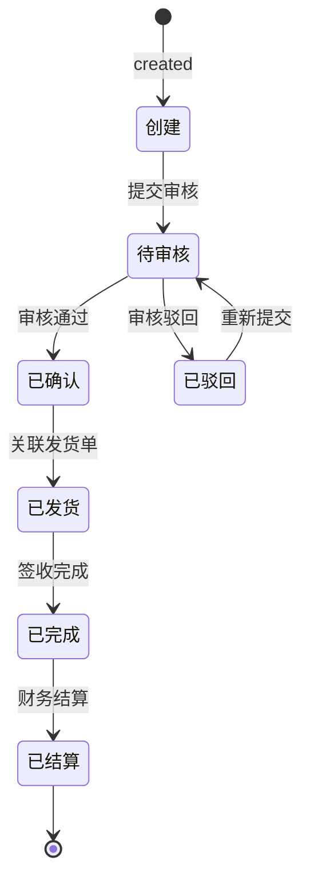
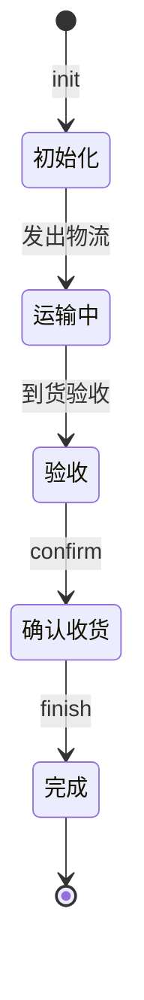
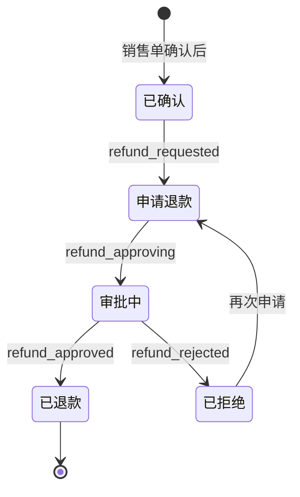
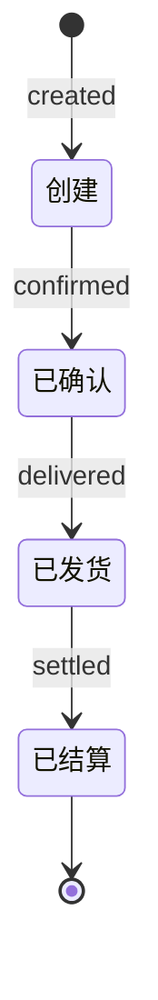

# 销售(Sales)模块迁移文档

> 从 Rhadamanthus (jQuery/Bootstrap) → view-decoration-pc (Vue 3 + TypeScript + Arco Design)

---

## 一、概述

### 1.1 迁移范围

将 R 项目中的 **sales（销售）** 模块完整迁移到新业务平台 view-decoration-pc，涵盖销售单、外销单、销售结算、销售发货、销售活动、销售退款等子域。

### 1.2 源模块规模

| 类别 | 文件数 | 代码行数 | 说明 |
|------|--------|----------|------|
| HTML 页面 | 28 | 2,835 | `WebContent/views/sales/*.html` |
| JS 业务逻辑 | 28 | 12,201 | `WebContent/js/sales/*.js` |
| API 定义 | 1 | ~350 | `WebContent/js/api/sales.js` (~110 个 .do 端点) |
| 搜索条件 | 1 | 983 | `WebContent/js/condition/sales.js` |
| **前端合计** | **57** | **~16,019** | |
| Java Action | 15 | ~2,117 | 后端控制器 |
| Java DAO | 44 | ~5,500 | 数据访问层 |
| Java Service | 36 | ~6,800 | 业务逻辑层 |
| Java PO/VO | 46 | ~4,731 | 数据模型 |
| **后端合计** | **141** | **~19,148** | com.fanglin.sales 包内 |
| **项目总规模** | **198** | **~35,167** | 前端+后端(sales包) |

### 1.3 技术栈对照

| 维度 | 旧项目 (Rhadamanthus) | 新项目 (view-decoration-pc) |
|------|----------------------|---------------------------|
| 框架 | jQuery 1.x + Bootstrap 3 | Vue 3.5 + TypeScript 5.8 |
| UI 库 | Bootstrap Modal / Dropdown / Tab | Arco Design Vue 2.57 |
| 构建 | 无 (直接引入) | Vite 6.2 |
| 状态管理 | 全局变量 + DOM 操作 | Pinia 3.0 |
| 路由 | 无 (多页面 + iframe) | Vue Router 4.5 |
| HTTP | `com.post()` (jQuery.ajax 封装) | Axios + interceptor.ts |
| 弹窗 | Bootstrap Modal + com.popup | Arco Modal / Drawer |
| 子页面导航 | com.popup4page (iframe) | Vue Router + 组件化 |
| 搜索组件 | Searcher (自定义) | Arco Table + 自定义 Filter |
| 动态配置 | drawNode.getConfig (DB驱动) | Route Meta + Pinia Store |
| 常量系统 | constant.sales() (动态加载) | DictStore / TypeScript enum |
| 表单验证 | com.validator | Arco Form + 自定义规则 |
| 包管理 | script 标签 | pnpm |
| 微前端 | 无 | Wujie (CRM:2001, Member:2002) |
| 认证 | Cookie + Session | Bearer Token + 自动刷新 |

---

### 1.4 核心业务流程

> 以下状态图描述了销售模块中四条核心业务流转路径。

#### 1.4.1 销售单流程



#### 1.4.2 发货流程



#### 1.4.3 退款流程



#### 1.4.4 外销单流程



### 1.5 路由配置引用

> 销售模块在新项目中的路由与权限配置规范。

| 配置项 | 值 |
|--------|-----|
| **路径前缀** | `/sales` |
| **权限前缀** | `sales:` |

**路由定义参考：**

```typescript
// src/router/modules/sales.ts
import type { RouteRecordRaw } from 'vue-router'

const salesRoutes: RouteRecordRaw[] = [
  {
    path: '/sales',
    name: 'SalesRoot',
    meta: { title: '销售管理', icon: 'icon-shopping-cart', authPrefix: 'sales:' },
    children: [
      {
        path: 'list',
        name: 'SalesList',
        component: () => import('@/views/sales/SalesList.vue'),
        meta: { title: '销售单', auth: 'sales:list' },
      },
      {
        path: 'balance',
        name: 'SalesBalance',
        component: () => import('@/views/sales/SalesBalance.vue'),
        meta: { title: '销售结算', auth: 'sales:balance' },
      },
      {
        path: 'delivery',
        name: 'SalesDelivery',
        component: () => import('@/views/sales/SalesDelivery.vue'),
        meta: { title: '销售发货', auth: 'sales:delivery' },
      },
      {
        path: 'activity',
        name: 'SalesActivity',
        component: () => import('@/views/sales/SalesActivity.vue'),
        meta: { title: '销售活动', auth: 'sales:activity' },
      },
      {
        path: 'refunds',
        name: 'SalesRefunds',
        component: () => import('@/views/sales/SalesRefunds.vue'),
        meta: { title: '销售退款', auth: 'sales:refunds' },
      },
      {
        path: 'oales',
        name: 'Oales',
        component: () => import('@/views/sales/OalesList.vue'),
        meta: { title: '外销单', auth: 'sales:oales' },
      },
    ],
  },
]

export default salesRoutes
```

**权限标识规则：** `{authPrefix}{子模块}:{操作}`，例如：
- `sales:list` — 销售单列表
- `sales:balance:check` — 结算审核
- `sales:delivery:confirm` — 发货确认
- `sales:oales:add` — 新建外销单

---

## 二、API 清单 (~110 个端点)

### 2.1 页面路由 (api.index, 13个)

| API 名称 | 用途 |
|----------|------|
| querySalesIndex | 销售单列表页 |
| salesItemDetialIndex | 销售项详情页 |
| addSalesItemsIndex | 添加销售项页 |
| refundsItemDetialIndex | 退款项详情页 |
| salesCollectionIndex | 销售收款页 |
| salesPaymentReceiptIndex | 销售付款收据页 |
| salesPrintIndex | 销售打印页 |
| salesRefundsPrintIndex | 退款打印页 |
| salesActivityIndex | 销售活动页 |
| salesSupplement | 销售补充页 |
| salesProfile2print | 销售档案打印页 |
| oalesItemIndex | 外销项页 |
| oalesRecordIndex | 外销记录页 |

### 2.2 销售单 CRUD (约22个)

| API 端点 (.do) | 用途 |
|----------------|------|
| `pageSales.do` | 通用分页查询 |
| `pageSalesForAdvance.do` | 预付款视角分页 |
| `pageSalesForBalance.do` | 结算视角分页 |
| `pageSalesForDompany.do` | 设计公司视角分页 |
| `pageSalesForBalanceByDompany.do` | 设计公司结算视角 |
| `pageSalesForPompany.do` | 材料公司视角分页 |
| `pageSalesForSupplier.do` | 供应商视角分页 |
| `pageSalesByOrderId.do` | 按订单号分页 |
| `querySalesBySid.do` | 按销售ID查询 |
| `querySalesByNo.do` | 按销售单号查询 |
| `querySalesForGrade.do` | 查询评分 |
| `amountSales.do` | 销售金额计算 |
| `addSales.do` | 创建销售单 |
| `updateSales.do` | 更新销售单 |
| `updateSalesForBelong.do` | 更新归属 |
| `updateSalesForCoupon.do` | 更新优惠券 |
| `updateSalesForMaling.do` | 更新抹零 |
| `updateSalesForAdvance.do` | 更新预付款 |
| `sendSales.do` | 发送销售单 |
| `affirmSales.do` | 确认销售单 |
| `terminalSales.do` | 终止销售单 |
| `finishSales.do` | 完成销售单 |
| `unpaySales.do` | 取消支付 |

### 2.3 销售项 SalesItem (约6个)

| API 端点 (.do) | 用途 |
|----------------|------|
| `querySalesItemBySid.do` | 按销售单ID查询项 |
| `querySalesItemBySids.do` | 批量查询项 |
| `addSalesItem.do` | 添加销售项 |
| `updateSalesItem.do` | 更新销售项 |
| `updateSalesItemForBalance.do` | 更新结算项 |
| `deleteSalesItem.do` | 删除销售项 |

### 2.4 销售退款 SalesRefunds (约7个)

| API 端点 (.do) | 用途 |
|----------------|------|
| `pageSalesRefunds.do` | 退款分页 |
| `querySalesRefundsBySid.do` | 按销售ID查退款 |
| `querySalesRefundsByRid.do` | 按退款ID查退款 |
| `querySalesRefundsItemBySid.do` | 按销售ID查退款项 |
| `querySalesRefundsItemByRid.do` | 按退款ID查退款项 |
| `sendSalesRefunds.do` | 发送退款 |
| `affirmSalesRefunds.do` | 确认退款 |

### 2.5 销售结算 SalesBalance (约16个)

| API 端点 (.do) | 用途 |
|----------------|------|
| `pageSalesBalance.do` | 结算分页 |
| `pageSalesBalanceForDompany.do` | 设计公司结算分页 |
| `pageSalesBalanceForPompany.do` | 材料公司结算分页 |
| `pageSalesBalanceForSupplier.do` | 供应商结算分页 |
| `pageSalesBalanceForCheck.do` | 结算审核分页 |
| `querySalesBalanceItemBySbid.do` | 按结算ID查明细 |
| `updateSalesBalanceForVBalance.do` | 更新供应商结算 |
| `updateSalesBalanceForPBalance.do` | 更新材料结算 |
| `rpreSalesBalance.do` | 反预结算 |
| `passSalesBalance.do` | 通过结算 |
| `preSalesBalance.do` | 预结算 |
| `vpostSalesBalance.do` | 供应商过账 |
| `postSalesBalance.do` | 过账 |
| `rejectSalesBalance.do` | 驳回结算 |
| `advSalesBalance.do` | 预付结算 |
| `revSalesBalance.do` | 冲销结算 |

### 2.6 销售活动 SalesActivity (约17个)

| API 端点 (.do) | 用途 |
|----------------|------|
| `pageSalesActivity.do` | 活动分页 |
| `addSalesActivityItem.do` | 添加活动项 |
| `querySalesActivityItem.do` | 查询活动项 |
| `querySalesActivityRecord.do` | 查询活动记录 |
| `addSalesActivityRecord.do` | 添加活动记录 |
| `amountSalesActivity.do` | 活动金额计算 |
| `amountSalesActivityForActivity.do` | 活动项金额 |
| `amountSalesActivityForPayment.do` | 活动付款金额 |
| `updateSalesForActivity.do` | 更新销售活动 |
| `abateSalesActivityItem.do` | 活动项失效 |
| `receiveSalesActivityItem.do` | 接收活动项 |
| `deliveSalesActivityItem.do` | 发放活动项 |
| `unrefundSalesActivityItem.do` | 取消退款 |
| `upgradeSalesActivityItem.do` | 升级活动项 |
| `refundSalesActivityItem.do` | 退款活动项 |
| `expendSalesActivityItem.do` | 支出活动项 |
| `discountSalesActivityItem.do` | 折扣活动项 |
| `sendSalesActivityItem.do` | 发送活动项 |
| `affirmSalesActivityItem.do` | 确认活动项 |

### 2.7 销售发货 SalesDelivery (约12个)

| API 端点 (.do) | 用途 |
|----------------|------|
| `pageSalesDeliveryItem.do` | 发货项分页 |
| `pageSalesDeliveryItemForSupplier.do` | 供应商发货分页 |
| `pageSalesDeliveryItemForInstorer.do` | 库管员发货分页 |
| `querySalesDeliveryItem.do` | 查询发货项 |
| `tranSalesDeliveryItem.do` | 转移发货项 |
| `checkSalesDeliveryItem.do` | 审核发货项 |
| `confirmSalesDeliveryItem.do` | 确认发货项 |
| `finishSalesDeliveryItem.do` | 完成发货项 |
| `balanceSalesDeliveryItem.do` | 结算发货项 |
| `deliveSalesDeliveryItem.do` | 发放发货项 |
| `updateSalesDeliveryItem.do` | 更新发货项 |
| `deliveSalesDelivery.do` | 批量发货 |

### 2.8 外销单 Oales (约17个)

| API 端点 (.do) | 用途 |
|----------------|------|
| `pageOales.do` | 外销单分页 |
| `pageOalesForAccount.do` | 外销结算视角分页 |
| `queryOalesByOrderId.do` | 按订单号查询 |
| `addOales.do` | 创建外销单 |
| `updateOales.do` | 更新外销单 |
| `refundOales.do` | 退款外销单 |
| `scaleOales.do` | 称重外销单 |
| `activityOales.do` | 活动外销单 |
| `deleteOales.do` | 删除外销单 |
| `amountOales.do` | 金额计算 |
| `abateOales.do` | 失效处理 |
| `confirmOales.do` | 确认外销单 |
| `submitOales.do` | 提交外销单 |
| `cancelOales.do` | 取消外销单 |
| `rejectOales.do` | 驳回外销单 |
| `checkOales.do` | 审核外销单 |
| `finishOales.do` | 完成外销单 |

### 2.9 外销子项 OalesItem / OalesPay / OalesRecord (约12个)

| API 端点 (.do) | 用途 |
|----------------|------|
| `pageOalesItem.do` | 外销项分页 |
| `queryOalesItem.do` | 查询外销项 |
| `addOalesItem.do` | 添加外销项 |
| `deleteOalesItem.do` | 删除外销项 |
| `pageOalesPay.do` | 外销付款分页 |
| `queryOalesPay.do` | 查询外销付款 |
| `addOalesPay.do` | 添加外销付款 |
| `updateOalesPay.do` | 更新外销付款 |
| `updateOalesPayForAdvance.do` | 更新预付外销付款 |
| `deleteOalesPay.do` | 删除外销付款 |
| `pageOalesRecord.do` | 外销记录分页 |
| `queryOalesRecordByOid.do` | 按外销ID查记录 |

### 2.10 其他 (约6个)

| API 端点 (.do) | 用途 |
|----------------|------|
| `querySalesFunction.do` | 查询销售功能项 |
| `querySalesFunctionByName.do` | 按名称查询功能项 |
| `addSalesPicture.do` | 添加销售图片 |
| `querySalesPicture.do` | 查询销售图片 |
| `deleteSalesPicture.do` | 删除销售图片 |
| `querySalesProfileByOrderId.do` | 按订单查询档案 |
| `handleSalesProfile.do` | 处理销售档案 |
| `makeSalesProfile.do` | 生成销售档案 |
| `addSalesProfileBrand.do` | 添加档案品牌 |
| `updateSalesProfileBrand.do` | 更新档案品牌 |

---

## 三、跨模块依赖 (13个外部模块, ~55个API)

| 外部模块 | 引用次数 | 关键 API | 说明 |
|----------|---------|---------|------|
| **api.data** | 32 | queryBrandByPinyin, queryGoodsByName, queryBrandByBid, queryBrandBalance, queryColorForEnableByGid, queryFormatForEnableByGid, queryPriceByGid, queryPriceByPid, queryReceiptType, querySurveyTemplate, queryTalking | 商品/品牌/价格/收据数据 |
| **api.personel** | 13 | queryUserByPinyin, querySupplierByPinyin | 用户/供应商模糊搜索 |
| **api.inventory** | 11 | addManifestForXG, addPurchase, queryGoodsStorehouseStockByGid, queryManifestForPUByPids, queryManifestForXGBySid, queryStorehouseForSelf | 仓库/清单/采购库存 |
| **api.decoration** | 10 | queryDecorationByOrderId, queryDecorationForCommonByOrderId | 装修单信息关联 |
| **api.payment** | 9 | addSalesPaymentForFullpay, addSalesPaymentForDeposit, cancelSalesPaymentForDeposit, cancelSalesPaymentForFullpay, refundSalesPaymentForDeposit, querySalesPaymentBySid, amountSalesPayment | 销售付款/全款/定金 |
| **api.balance** | 7 | submitBalanceSales, submitBalanceOales, queryBalanceSales, queryBalanceSalesByBsid, queryBalanceOales, countBalanceSalesBalance | 结算提交/查询 |
| **api.index** | 8 | goods, salesActivityIndex, salesPrintIndex, salesProfile, salesRefundsPrintIndex | 页面路由跳转 |
| **api.approval** | 3 | submitApprovalForSalesDayment, submitApprovalForSalesDiscount, submitApprovalForSalesRefund | 审批流 |
| **api.ds** | 5 | sales, manifest | 数据源配置 |
| **api.information** | 4 | queryActivityForValid, queryActivityItemByAid | 活动信息 |
| **api.common** | 4 | uploadImg | 图片上传 |
| **api.right** | 2 | querySalesFunctionRightByName, updateSalesFunctionRight | 功能权限配置 |
| **api.system** | 1 | querySystemConfigByKey | 系统配置 |
| **api.communion** | 1 | queryBrandSupplier | 品牌供应商 |

---

## 四、页面级分析

### 4.1 页面清单与复杂度

按 JS 代码行数从高到低排列：

| # | HTML 页面 | JS 文件 | JS行数 | HTML行 | Modals | popup4page | Searcher | APIs | 复杂度 | 预估天数 |
|---|----------|---------|--------|--------|--------|-----------|----------|------|--------|----------|
| 1 | sales.html | sales.js | 1,600 | 394 | 19 | 8 | 18 | 17 | **核心** | 4-5 |
| 2 | oales.html | oales.js | 1,106 | 165 | 30 | 3 | 24 | 20 | **核心** | 4-5 |
| 3 | sales4activity.html | sales4activity.js | 887 | 208 | 22 | 2 | 3 | 20 | **核心** | 3-4 |
| 4 | salesBalance.html | salesBalance.js | 895 | 185 | 4 | 2 | 14 | 11 | **高** | 3-4 |
| 5 | salesDelivery.html | salesDelivery.js | 685 | 203 | 15 | 0 | 16 | 12 | **高** | 3-4 |
| 6 | salesItem.html | salesItem.js | 687 | 143 | 0 | 0 | 0 | 7 | 中 | 2-3 |
| 7 | oalesPay.html | oalesPay.js | 539 | 109 | 19 | 0 | 9 | 7 | 中 | 2-3 |
| 8 | sales2create.html | sales2create.js | 533 | 332 | 1 | 1 | 0 | 1 | 中 | 2-3 |
| 9 | sales2add.html | sales2add.js | 552 | 267 | 1 | 2 | 0 | 5 | 中 | 2 |
| 10 | salesBalance4check.html | salesBalance4check.js | 530 | 46 | 5 | 2 | 3 | 0 | 中 | 2 |
| 11 | sales2xg.html | sales2xg.js | 531 | 52 | 0 | 0 | 2 | 2 | 低 | 1-2 |
| 12 | sales2pu.html | sales2pu.js | 495 | 43 | 0 | 0 | 2 | 2 | 低 | 1-2 |
| 13 | salesProfile4detail.html | salesProfile4detail.js | 411 | 89 | 19 | 0 | 0 | 7 | 中 | 2 |
| 14 | salesBalance4pre.html | salesBalance4pre.js | 351 | 81 | 0 | 1 | 1 | 5 | 低 | 1 |
| 15 | sales4inventory.html | sales4inventory.js | 255 | 72 | 0 | 0 | 0 | 0 | 低 | 1 |
| 16 | sales2supple.html | sales2supple.js | 296 | 120 | 0 | 0 | 0 | 3 | 低 | 1 |
| 17 | sales2print.html | sales2print.js | 216 | 20 | 0 | 0 | 0 | 1 | 低 | 0.5 |
| 18 | sales4payment.html | sales4payment.js | 212 | 48 | 0 | 0 | 0 | 0 | 低 | 0.5 |
| 19 | salesRefundsItem.html | salesRefundsItem.js | 201 | 11 | 0 | 0 | 0 | 4 | 低 | 0.5 |
| 20 | salesBalance4detail.html | salesBalance4detail.js | 201 | 12 | 0 | 0 | 0 | 4 | 低 | 0.5 |
| 21 | oalesItem.html | oalesItem.js | 171 | 81 | 4 | 0 | 8 | 3 | 低 | 1 |
| 22 | salesRefunds.html | salesRefunds.js | 176 | 15 | 0 | 1 | 6 | 3 | 低 | 1 |
| 23 | salesFunction.html | salesFunction.js | 123 | 57 | 4 | 0 | 0 | 2 | 低 | 0.5 |
| 24 | salesProfile2print.html | salesProfile2print.js | 155 | 24 | 0 | 0 | 0 | 2 | 低 | 0.5 |
| 25 | salesRefunds2print.html | salesRefunds2print.js | 184 | 21 | 0 | 0 | 0 | 1 | 低 | 0.5 |
| 26 | salesItem4balance.html | salesItem4balance.js | 88 | 10 | 0 | 0 | 0 | 2 | 低 | 0.5 |
| 27 | oalesRecord.html | oalesRecord.js | 76 | 16 | 0 | 0 | 5 | 1 | 低 | 0.5 |
| 28 | salesActivityRecord.html | salesActivityRecord.js | 45 | 11 | 1 | 0 | 3 | 1 | 低 | 0.5 |

**预估总工时: 单人 35-50 天**

### 4.2 核心页面详解

#### P1: sales.js — 销售单列表 (1,600行)

**功能描述：** 销售单的统一列表入口，通过 `drawNode.getConfig()` 动态加载页面配置，按不同角色展示不同数据视图。

**关键特征：**
- 19 个 Bootstrap Modal（创建/编辑/查看/打印等弹窗）
- 8 个 popup4page 子页面导航（销售项、活动、结算、打印等）
- 18 个 Searcher 实例（多角色多条件搜索）
- 17 个 API 调用
- 使用 `drawNode.getConfig(pageType)` 动态配置，pageType 可为: sales, dompany, pompany, supplier, advance, activity

**迁移要点：**
- 将 19 个 Modal 拆分为独立 Vue 组件，使用 Arco `<a-modal>` 或 `<a-drawer>`
- 将 Searcher 替换为 Arco Table + Filter Bar 组合
- drawNode.getConfig 迁移为 Pinia Store + route meta 配置
- popup4page 改为 Vue Router 子路由或动态组件

#### P2: oales.js — 外销单列表 (1,106行)

**功能描述：** 外销单管理，包含外销单的创建、编辑、退款、称重、活动关联等完整流程。按不同角色(serve/material/finance/account)展示视图。

**关键特征：**
- **模块最高复杂度**: 30 个 Modal, 24 个 Searcher, 20 个 API, 36 个 constant 引用
- 使用 `params.urlLoadParams.pagetype` 区分视图: serve, material, finance, account
- 3 个 popup4page 子页面

**迁移要点：**
- 必须按功能域拆分为多个子组件（外销单CRUD、外销项、外销付款、外销记录）
- 36 个常量引用需转为 TypeScript enum
- 24 个 Searcher 需统一为可复用的过滤组件

#### P3: sales4activity.js — 销售活动 (887行)

**功能描述：** 销售活动项管理，关联活动优惠、金额计算、发放/退款/升级等操作。

**关键特征：**
- 22 个 Modal（大量操作确认弹窗）
- 20 个 API 调用（活动项生命周期完整）
- 2 个 popup4page

**迁移要点：**
- 活动项状态机需用 TypeScript 类型严格定义
- 22 个操作弹窗可合并为通用的确认弹窗组件 + 不同配置

#### P4: salesBalance.js — 销售结算 (895行)

**功能描述：** 销售单结算管理，支持预结算、过账、冲销、驳回等流程，按不同公司角色展示。

**关键特征：**
- 14 个 Searcher（多角色多视图）
- 11 个 API
- 使用 `drawNode.getConfig()` 配置，pageType: bdompany, bsupplier, bpompany

**迁移要点：**
- 结算流程需抽取为独立的 useSalesBalance 组合式函数
- 审核工作流需与审批模块集成

#### P5: salesDelivery.js — 销售发货 (685行)

**功能描述：** 销售发货项管理，包含发货、转运、审核、确认、完成等流程。

**关键特征：**
- 15 个 Modal
- 16 个 Searcher
- 12 个 API
- 使用 `drawNode.getConfig()` 配置，pagetype: init, tran, check, confirm, finish

**迁移要点：**
- 发货流程状态机需严格定义（init→tran→check→confirm→finish）
- 16 个 Searcher 可复用统一模板

---

## 五、drawNode 动态页面配置系统

### 5.1 机制说明

sales 模块有 7 个页面使用 `drawNode.getConfig(pageType)` 从数据库表 `SalesFunctionRight` 动态加载页面配置，包含：

- API 端点地址
- 按钮显示/隐藏
- 搜索条件列表
- 列表属性（字段、排序）
- 导出设置

### 5.2 使用页面一览

| 页面 | pageType 值 | 说明 |
|------|------------|------|
| sales.js | sales, dompany, pompany, supplier, advance, activity | 销售单多角色视图 |
| sales2pu.js | (采购相关) | 销售转采购 |
| sales2xg.js | (销购相关) | 销售转销购 |
| salesBalance.js | bdompany, bsupplier, bpompany | 结算多角色视图 |
| salesBalance4check.js | (结算审核) | 结算审核页 |
| salesBalance4pre.js | predompany, prepompany | 预结算 |
| salesDelivery.js | init, tran, check, confirm, finish | 发货流程各阶段 |

### 5.3 迁移策略

```
旧: drawNode.getConfig(type) → 查DB → 动态生成DOM
新: usePageConfig(type) → API获取 → Pinia缓存 → 响应式渲染
```

**建议实现：**

1. 创建 `src/stores/modules/salesPageConfig.ts`：
   - 调用 `querySalesFunctionRightByName` API 获取配置
   - 按 pageType 缓存到 Pinia store
   - 返回响应式 computed 配置对象

2. 创建 `src/composables/sales/usePageConfig.ts`：
   - 根据 pageType 返回 buttons / columns / conditions / exportConfig
   - 与路由 meta 结合控制页面权限

3. 每个页面组件通过 `usePageConfig('sales')` 获取配置，驱动 UI 渲染

---

## 六、常量系统

### 6.1 子分组清单 (11个)

| 子分组 | 主要常量 | 说明 |
|--------|---------|------|
| **sales** | status, type, isAffirm, fullpayStatus, depositpayStatus, balanceStatus, OTHERSTATUS, FULLPAYSTATUS, DESPOSITPAYSTATUS | 销售单状态/类型枚举 |
| **salesItem** | CTYPE_RESERVEPRICE_INT | 销售项保留价格类型 |
| **salesBalance** | status, type, onetype, verifyStatus, deliverStatus, confirmStatus, STATUS_*, TYPE_* | 结算状态/类型/审核 |
| **salesDeliveryItem** | status | 发货项状态 |
| **salesActivityItem** | type, state, isAffirm, STATUS_UNVALID_INT | 活动项类型/状态 |
| **salesFunction** | TYPE_STATUS, FUNCTION, FILID, CONDITION, API_INT | 功能配置类型 |
| **salesPicture** | STATUS_YES_SHORT | 图片状态 |
| **refunds** | type, status | 退款类型/状态 |
| **oales** | status, type, awardType, atttype, isScale, isActivity, ISSCALE_*, ISACTIVITY_*, STATUS_*, TYPE_PUR_INT | 外销单完整枚举 |
| **oalespay** | type | 外销付款类型 |
| **oalesRecord** | type | 外销记录类型 |

### 6.2 迁移策略

```typescript
// src/types/sales/enums.ts
export enum SalesStatus {
  UNPAY = 0,
  PAYING = 1,
  PAID = 2,
  // ...
}

export enum SalesType {
  NORMAL = 0,
  RETURN = 1,
  // ...
}

export enum OalesStatus {
  // 外销单状态
}
```

- 运行时从后端获取常量数据时，通过 `DictStore` 缓存
- 编译时使用 TypeScript enum 确保类型安全
- 常量值需与后端保持一致，通过 API 文档对齐

---

## 七、搜索条件系统

### 7.1 Condition 文件分析

`WebContent/js/condition/sales.js` (983行) 包含 50+ 搜索条件配置。

**主要搜索字段：**

| 字段名 | 类型 | 说明 |
|--------|------|------|
| orderId | text | 装修单号 |
| no | text | 销售单号 |
| village | autofill | 楼盘(带自动补全) |
| category-name | autofill | 品类名称 |
| fullName | text | 客户姓名 |
| phone | text | 客户电话 |
| salesman | autofill | 销售员 |
| designer | autofill | 设计师 |
| createTime | dateRange | 创建时间范围 |
| status | select | 状态筛选 |

### 7.2 迁移策略

```vue
<!-- 替换为 Arco Form + Filter 组合 -->
<a-form :model="filterForm" layout="inline">
  <a-form-item field="orderId" label="装修单号">
    <a-input v-model="filterForm.orderId" placeholder="请输入" />
  </a-form-item>
  <a-form-item field="village" label="楼盘">
    <a-auto-complete v-model="filterForm.village" :data="villageOptions" />
  </a-form-item>
  <!-- ... -->
</a-form>
```

- 创建通用的 `FilterBar.vue` 组件，根据配置数组自动渲染筛选项
- autofill 类型迁移为 `a-auto-complete` + 防抖 API 调用
- dateRange 迁移为 `a-range-picker`

---

## 八、迁移模式映射

### 8.1 Bootstrap Modal → Arco Modal/Drawer

```
旧: $('#modalId').modal('show')
    HTML: <div class="modal fade" id="modalId">

新: <a-modal v-model:visible="showModal" title="标题">
      <!-- 内容 -->
    </a-modal>
    或
    <a-drawer v-model:visible="showDrawer" title="标题" :width="600">
      <!-- 内容 -->
    </a-drawer>
```

**规则：** 简单表单/确认 → Modal，复杂表单/列表 → Drawer

### 8.2 com.popup → Arco Modal / 新窗口

```
旧: com.popup("标题", url, width, height, callback)

新: // 简单预览
    window.open(url, '_blank')
    // 或弹窗
    <a-modal v-model:visible="showPreview" :title="title" fullscreen>
```

### 8.3 com.popup4page → Vue Router 子路由

```
旧: com.popup4page("#layerPopUp", "/views/sales/salesItem.html", "销售项", params, callback)

新: router.push({ name: 'sales-item', params: { sid }, query: { ... } })
    // 或嵌套路由
    <router-view />  // 在父组件的某个区域内
```

### 8.4 Searcher → Arco Table + FilterBar

```
旧: var searcher = new Searcher(options)
    searcher.render("#container")

新: const { data, loading, pagination, run } = useRequest(querySalesAPI, {
      defaultParams: [{ ...filterForm, pageNum: 1, pageSize: 20 }]
    })
    <a-table :data="data" :pagination="pagination" :loading="loading">
      <template #columns>
        <a-table-column title="订单号" data-index="orderId" />
        <!-- ... -->
      </template>
    </a-table>
```

### 8.5 com.validator → Arco Form Rules

```
旧: com.validator({
      "#field": { required: true, type: "number" }
    })

新: const rules: FormRules = {
      field: [{ required: true, type: 'number', message: '必填' }]
    }
    <a-form :model="form" :rules="rules">
```

### 8.6 com.post → Axios

```
旧: com.post(api.sales.addSales, params, function(result) { ... })

新: import { salesApi } from '@/api/modules/sales'
    const { data } = await salesApi.addSales(params)
```

---

## 九、Java 后端架构

### 9.1 分层结构

| 层 | 文件数 | 关键文件 |
|----|--------|---------|
| **Action** | 15 | SalesAction(369行), OalesAction(202行), SalesBalanceAction(184行), SalesDeliveryAction(166行) |
| **DAO** | 44 | 接口+Impl成对 |
| **Service** | 36 | SalesServiceImpl(799行), SalesBalanceServiceImpl(913行), OalesServiceImpl(524行) |
| **PO** | 24 | SalesPO, SalesItemPO, SalesBalancePO, SalesDeliveryItemPO, OalesPO 等 |
| **VO** | 22 | 与PO对应，用于前端数据传输 |

### 9.2 其他模块中 Sales 相关文件 (102个, ~10,185行)

| 所属包 | 文件数 | 说明 |
|--------|--------|------|
| approval | ~15 | 销售审批流程 |
| balance | ~12 | 销售结算 |
| payment | ~20 | 销售付款 (含 SalesPaymentServiceImpl 1,171行) |
| production | ~10 | 生产关联 |
| report | ~15 | 销售报表 |
| right | ~8 | 功能权限 |
| customer | ~8 | 客户关联 |
| kingdee | ~14 | 金蝶财务对接 |

### 9.3 后端迁移建议

- **后端 API URL 保持不变** (相同的 `.do` 端点)
- VO 结构与前端 TypeScript 类型定义对齐
- 新项目 `src/api/modules/sales.ts` 封装所有 API 调用

---

## 十、迁移实施计划

### 10.1 阶段划分

#### 第一阶段：基础设施 (3-5天)

| 任务 | 说明 | 预估 |
|------|------|------|
| 创建 sales 模块目录结构 | `src/views/sales/`, `src/api/modules/sales.ts`, `src/types/sales/` | 0.5天 |
| TypeScript 类型定义 | SalesVO, SalesItemVO, OalesVO 等 + enums | 2天 |
| API 层封装 | 110+ API 函数封装 | 1天 |
| salesPageConfig Store | drawNode 配置系统迁移 | 1天 |
| 通用组件 | FilterBar / StatusTag / ActionButton | 0.5天 |

#### 第二阶段：简单页面 (5-7天)

按复杂度从低到高迁移，建立模式：

| 页面 | 复杂度 | 预估 |
|------|--------|------|
| sales2print.js | 低 | 0.5天 |
| salesRefunds2print.js | 低 | 0.5天 |
| salesProfile2print.js | 低 | 0.5天 |
| salesItem4balance.js | 低 | 0.5天 |
| sales4payment.js | 低 | 0.5天 |
| salesActivityRecord.js | 低 | 0.5天 |
| salesBalance4detail.js | 低 | 0.5天 |
| salesFunction.js | 低 | 0.5天 |
| oalesRecord.js | 低 | 0.5天 |
| salesRefunds.js | 低 | 1天 |
| oalesItem.js | 低 | 1天 |
| sales2supple.js | 低 | 1天 |
| sales4inventory.js | 低 | 1天 |
| sales2add.js | 中 | 2天 |

#### 第三阶段：中等页面 (8-12天)

| 页面 | 复杂度 | 预估 |
|------|--------|------|
| sales2pu.js | 低 | 1.5天 |
| sales2xg.js | 低 | 1.5天 |
| salesBalance4pre.js | 低 | 1天 |
| salesRefundsItem.js | 低 | 1天 |
| sales2create.js | 中 | 2天 |
| salesBalance4check.js | 中 | 2天 |
| oalesPay.js | 中 | 2.5天 |
| salesItem.js | 中 | 2.5天 |
| salesProfile4detail.js | 中 | 2天 |

#### 第四阶段：核心页面 (15-20天)

| 页面 | 复杂度 | 预估 |
|------|--------|------|
| salesDelivery.js | 高 | 3-4天 |
| salesBalance.js | 高 | 3-4天 |
| sales4activity.js | 核心 | 3-4天 |
| sales.js | 核心 | 4-5天 |
| oales.js | 核心 | 4-5天 |

#### 第五阶段：集成测试 (5-7天)

| 任务 | 预估 |
|------|------|
| 跨模块联调 (payment/balance/inventory) | 2天 |
| drawNode 配置系统验证 | 1天 |
| 外销单完整流程测试 | 1天 |
| 销售结算完整流程测试 | 1天 |
| Bug 修复与优化 | 2天 |

### 10.2 总工时估算

| 阶段 | 天数 |
|------|------|
| 基础设施 | 3-5 |
| 简单页面 | 5-7 |
| 中等页面 | 8-12 |
| 核心页面 | 15-20 |
| 集成测试 | 5-7 |
| **合计** | **36-51** |

单人完成约 7-10 周，建议 2 人并行可缩短至 4-5 周。

### 10.3 风险点

| 风险 | 影响 | 缓解措施 |
|------|------|---------|
| drawNode 动态配置系统复杂度高 | 页面渲染依赖DB配置 | 优先实现 salesPageConfig Store，先硬编码后动态化 |
| oales.js 复杂度极高 (30 modal, 24 searcher) | 迁移工作量大 | 按功能域拆分为5+子组件 |
| 跨13个外部模块依赖 | 联调复杂 | 优先完成 api.data / api.payment / api.inventory 的类型定义 |
| 常量系统与后端耦合 | 需确保前后端一致 | 建立常量对照表，自动化测试验证 |
| SalesPaymentServiceImpl 1171行 | 付款逻辑复杂 | 与 payment 模块协同迁移 |

---

## 十一、命名规范

### 11.1 目录结构建议

```
src/views/sales/
├── list/                    # 销售单列表 (sales.js)
│   ├── SalesList.vue
│   ├── components/
│   │   ├── SalesCreateModal.vue
│   │   ├── SalesEditModal.vue
│   │   └── SalesFilterBar.vue
│   └── composables/
│       └── useSalesList.ts
├── detail/                  # 销售项详情
├── balance/                 # 销售结算
│   ├── SalesBalanceList.vue
│   ├── SalesBalanceCheck.vue
│   └── SalesBalancePre.vue
├── delivery/                # 销售发货
│   └── SalesDeliveryList.vue
├── activity/                # 销售活动
│   ├── SalesActivityList.vue
│   └── SalesActivityRecord.vue
├── refunds/                 # 销售退款
│   ├── SalesRefundsList.vue
│   └── SalesRefundsItem.vue
├── oales/                   # 外销单
│   ├── OalesList.vue
│   ├── OalesItem.vue
│   ├── OalesPay.vue
│   └── OalesRecord.vue
├── print/                   # 打印页
│   ├── SalesPrint.vue
│   ├── SalesRefundsPrint.vue
│   └── SalesProfilePrint.vue
└── shared/                  # 共享组件
    ├── SalesStatusTag.vue
    └── SalesActionButtons.vue

src/api/modules/sales.ts     # API 封装
src/types/sales/
├── enums.ts                 # 状态/类型枚举
├── vo.ts                    # VO 类型定义
└── api.ts                   # 请求/响应类型

src/stores/modules/
└── salesPageConfig.ts       # 页面配置 Store

src/composables/sales/
├── usePageConfig.ts          # drawNode 替代
├── useSalesBalance.ts        # 结算逻辑
└── useSalesDelivery.ts       # 发货逻辑
```

### 11.2 命名规范

```
组件:     PascalCase (SalesList.vue)
组合式函数: camelCase (useSalesList)
Store:   use + Module + Store (useSalesPageConfigStore)
API:     动词 + 名词 (querySalesBySid)
类型:    PascalCase + 后缀 (SalesVO / SalesQry / SalesCreateCmd)
路由:    kebab-case (sales-list, sales-balance-check)
```

### 11.3 Git 规范

```
feat(sales): 新增销售单列表页
feat(sales): 新增外销单管理页
feat(sales): 新增销售结算页
fix(sales): 修复销售项金额计算问题
refactor(sales): 拆分外销单子组件
```

---

## 十二、参考资源

| 资源 | 路径 |
|------|------|
| 新项目源码 | `/d/GIT/view-decoration-pc/` (分支: `erp-master`) |
| R 项目源码 | `/d/GIT/Rhadamanthus/` |
| R 项目 sales JS | `WebContent/js/sales/*.js` |
| R 项目 sales HTML | `WebContent/views/sales/*.html` |
| R 项目 API 定义 | `WebContent/js/api/sales.js` |
| R 项目搜索条件 | `WebContent/js/condition/sales.js` |
| R 项目常量系统 | `WebContent/js/com/constant.js` |
| decoration 迁移文档 | `docs/migration-decoration.md` (参考案例) |
| 新项目 interceptor | `src/api/interceptor.ts` |
| 新项目 DictStore | `src/stores/modules/dict.ts` |
| Arco Design Vue 文档 | https://arco.design/vue/docs/start |
| Vue 3 文档 | https://vuejs.org/ |
| Pinia 文档 | https://pinia.vuejs.org/ |

---

*文档生成时间: 2026-04-26*
*基于 Rhadamanthus sales 模块分析 (57 前端文件, ~16,019 行代码, ~110 个 API 端点, 141 后端文件, ~19,148 行 Java)*
