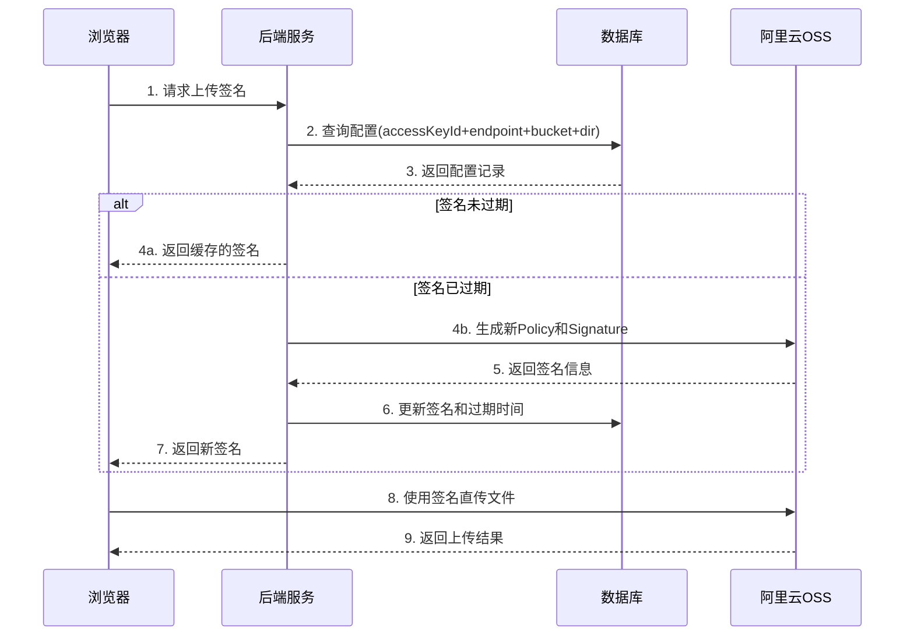
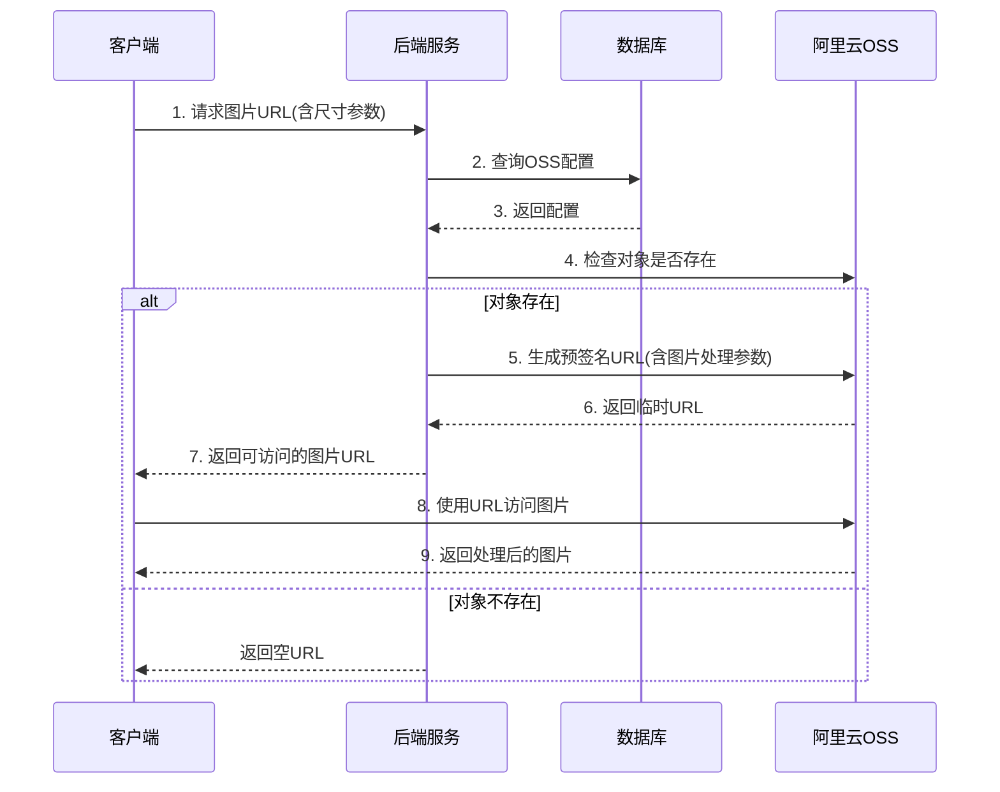

# 阿里云集成模块 (aliyun)

[根目录](../../../../CLAUDE.md) > [src/com/fanglin](../../) > **aliyun**

> 最后更新：2025-12-06

---

## 模块职责

**阿里云集成模块**是 Rhadamanthus ERP 系统的第三方服务集成模块,负责阿里云对象存储服务(OSS)的集成,为系统提供文件上传、图片处理等云存储功能。

**核心价值**
- 阿里云 OSS 对象存储集成
- 上传签名生成与管理
- 图片渐进式处理
- 文件访问URL生成
- 上传凭证缓存优化

---

## 入口与启动

### 主入口 Action
- **OssConfigAction.java** - OSS配置管理控制器

### 访问路径
```
API 端点: *.do
示例: generatePostSignature.do, getProgressiveImage.do
```

---

## 对外接口

### 核心 API 端点

| 接口名称 | 请求方式 | 路径 | 功能描述 |
|---------|---------|------|------------|
| generatePostSignature | POST | /generatePostSignature.do | 生成OSS上传签名 |
| getProgressiveImage | POST | /getProgressiveImage.do | 获取渐进式图片URL |

### API 详细说明

#### 1. generatePostSignature - 生成上传签名

**功能**: 生成阿里云 OSS 浏览器端直传所需的签名信息

**请求参数**:
```json
{
  "ossConfig.accessKeyId": "LTAI****",
  "ossConfig.endpoint": "oss-cn-beijing.aliyuncs.com",
  "ossConfig.bucket": "fanglin-erp",
  "ossConfig.dir": "upload/2024/"
}
```

**响应数据**:
```json
{
  "errorCode": 0,
  "errorMsg": null,
  "ossConfig": {
    "ossId": 1,
    "accessKeyId": "LTAI****",
    "endpoint": "oss-cn-beijing.aliyuncs.com",
    "bucket": "fanglin-erp",
    "dir": "upload/2024/",
    "expireTime": 3600,
    "host": "https://fanglin-erp.oss-cn-beijing.aliyuncs.com",
    "policy": "eyJleHBpcmF0aW9uIjoiMjAyNC0xMi0wNlQxNjowMDowMC4wMDBaIiwiY29uZGl0aW9ucyI6W1siY29udGVudC1sZW5ndGgtcmFuZ2UiLDAsMTA0ODU3NjAwMF0sWyJzdGFydHMtd2l0aCIsIiRrZXkiLCJ1cGxvYWQvMjAyNC8iXV19",
    "signature": "h8Kxvf****",
    "deadline": "2024-12-06 16:00:00"
  }
}
```

**业务逻辑**:
1. 根据 accessKeyId、endpoint、bucket、dir 查询已保存的配置
2. 检查签名是否过期(deadline < 当前时间)
3. 如果过期:
   - 创建 OSS 客户端
   - 生成新的 Policy 和 Signature
   - 更新数据库记录
   - 返回新签名
4. 如果未过期:
   - 直接返回缓存的签名信息

**缓存机制**: 签名默认有效期1小时,避免频繁调用阿里云API

#### 2. getProgressiveImage - 获取渐进式图片

**功能**: 获取经过尺寸处理的图片临时访问URL

**请求参数**:
```json
{
  "ossConfig.accessKeyId": "LTAI****",
  "ossConfig.endpoint": "oss-cn-beijing.aliyuncs.com",
  "ossConfig.bucket": "fanglin-erp",
  "ossConfig.dir": "upload/2024/",
  "ossConfig.key": "photo.jpg",
  "ossConfig.width": 800,
  "ossConfig.height": 600
}
```

**响应数据**:
```json
{
  "errorCode": 0,
  "errorMsg": null,
  "ossConfig": {
    "url": "https://fanglin-erp.oss-cn-beijing.aliyuncs.com/upload/2024/photo.jpg?Expires=1701878400&OSSAccessKeyId=LTAI****&Signature=****&x-oss-process=image/resize,m_fill,w_800,h_600"
  }
}
```

**业务逻辑**:
1. 根据配置查询 OSS 凭证
2. 创建 OSS 客户端
3. 检查对象是否存在
4. 如果指定了宽高,添加图片处理参数
5. 生成带签名的临时访问URL(有效期10分钟)

**图片处理参数**: `image/resize,m_fill,w_{width},h_{height}` (按比例填充裁剪)

---

## 关键依赖与配置

### 依赖的模块
- **core** - 核心框架组件(BaseListAction)
- **utils** - 工具类(BeanUtil、DateUtil)

### 外部依赖
- **aliyun-sdk-oss** - 阿里云 OSS Java SDK
  - OSS 客户端操作
  - 签名生成
  - 策略条件设置
  - 预签名URL生成

### 配置文件
- `conf/ApplicationContext.xml` - Spring Bean 配置
- `conf/struts.xml` - Struts2 路由配置

### 关键常量
- 上传文件大小限制: 1048576000 字节 (1GB)
- 签名有效期: 由 `expireTime` 字段控制(秒)
- 渐进式图片URL有效期: 10分钟
- 图片处理模式: `m_fill` (按比例填充裁剪)

---

## 数据模型

### 核心实体 (PO)

#### OssConfigPO - OSS配置表

```java
@Entity
@Table(name = "ossconfig", catalog = "data")
public class OssConfigPO {
    @Id
    @GeneratedValue(strategy = IDENTITY)
    private long ossId;                      // 配置ID (主键)

    private String accessKeyId;              // 阿里云AccessKey ID
    private String accessKeySecret;          // 阿里云AccessKey Secret
    private String endpoint;                 // OSS访问端点 (如: oss-cn-beijing.aliyuncs.com)
    private String bucket;                   // Bucket名称
    private String dir;                      // 上传目录前缀
    private int expireTime;                  // 签名有效期(秒)
    private String policy;                   // Base64编码的Policy
    private String signature;                // 签名字符串
    private Timestamp deadline;              // 签名过期时间
}
```

**数据库表**: `data.ossconfig`

**索引设计**:
- 主键: `ossId`
- 联合查询: `(accessKeyId, endpoint, bucket, dir)` - 用于查询配置

**字段说明**:
- `accessKeyId`: 阿里云账号的AccessKey ID,用于身份验证
- `accessKeySecret`: AccessKey Secret,敏感信息需加密存储
- `endpoint`: OSS服务端点,不同地域不同(如北京: oss-cn-beijing.aliyuncs.com)
- `bucket`: OSS存储空间名称,需提前在阿里云控制台创建
- `dir`: 上传文件的目录前缀,支持多级目录(如: upload/2024/12/)
- `expireTime`: Policy和Signature的有效期,单位秒,建议3600(1小时)
- `policy`: 上传策略的Base64编码,包含权限、大小限制等
- `signature`: 使用AccessKeySecret对Policy的签名
- `deadline`: 签名过期时间戳,超过此时间需重新生成

### 值对象 (VO)

#### OssConfigVO - OSS配置传输对象

```java
public class OssConfigVO {
    private Long ossId;                      // 配置ID
    private String accessKeyId;              // AccessKey ID
    private String endpoint;                 // 访问端点
    private String bucket;                   // Bucket名称
    private String dir;                      // 上传目录
    private Integer expireTime;              // 有效期
    private String host;                     // 完整的Host地址
    private String policy;                   // Base64编码的Policy
    private String signature;                // 签名

    @JSON(format = "yyyy-MM-dd HH:mm:ss")
    private Timestamp deadline;              // 过期时间

    // 图片处理相关
    private String key;                      // 文件Key(不含dir前缀)
    private Integer width;                   // 目标宽度
    private Integer height;                  // 目标高度
    private String url;                      // 生成的访问URL
}
```

**字段说明**:
- `host`: 格式为 `https://{bucket}.{endpoint}`,用于浏览器端构建完整URL
- `key`: 文件名或相对路径(不含dir前缀),与dir拼接后为完整对象名
- `width`/`height`: 图片处理目标尺寸,传入后自动添加处理参数
- `url`: 包含签名的完整访问链接,可直接用于img标签src属性

---

## 业务流程

### 1. 浏览器端直传流程



### 2. 图片处理流程



---

## 安全机制

### 1. 签名验证

- **Policy**: 定义上传权限和限制条件
  - 文件大小限制: 0 - 1GB
  - 目录限制: 只能上传到指定dir前缀目录
  - 有效期限制: 超过deadline后签名失效

### 2. 凭证管理

- **AccessKeySecret**: 不返回给前端,仅后端持有
- **签名缓存**: 避免频繁调用阿里云API,减少凭证暴露
- **时效性**: Policy和Signature有明确的过期时间

### 3. 访问控制

- **预签名URL**: 临时访问链接,10分钟后失效
- **Bucket权限**: 建议配置为私有读写,通过签名控制访问
- **防盗链**: 可在阿里云控制台配置Referer白名单

---

## 性能优化

### 1. 签名缓存策略

```java
// 检查签名是否过期
if (ossConfigPO.getDeadline().getTime() < DateUtil.getDateToTimestamp(new Date()).getTime()) {
    // 过期则重新生成
    generateNewSignature();
} else {
    // 未过期直接返回缓存
    return cachedSignature;
}
```

**优化效果**:
- 减少OSS API调用次数(每小时仅1次)
- 降低网络延迟
- 节省阿里云API费用

### 2. 图片处理参数

```java
// 仅在需要时添加图片处理
if (ossConfig.getWidth() != null && ossConfig.getHeight() != null) {
    String style = String.format("image/resize,m_fill,w_%s,h_%s", width, height);
    req.setProcess(style);
}
```

**支持的处理模式**:
- `m_fill`: 按比例填充裁剪(保持宽高比,可能裁剪)
- `m_lfit`: 等比缩放(不裁剪,可能留白)
- `m_pad`: 缩放并填充(不裁剪,留白填充)

---

## 测试与质量

### 当前状态
- ❌ 未发现单元测试
- ❌ 未发现集成测试
- ⚠️ 主要依赖手工测试

### 建议测试用例

1. **签名生成测试**
   - 测试首次生成签名
   - 测试签名缓存命中
   - 测试签名过期后重新生成
   - 测试Policy内容正确性

2. **图片处理测试**
   - 测试存在的图片生成URL
   - 测试不存在的图片返回空
   - 测试不同尺寸参数
   - 测试URL有效期

3. **异常处理测试**
   - 测试OSS服务异常捕获
   - 测试客户端通信失败处理
   - 测试编码异常处理
   - 测试配置不存在场景

---

## 常见问题 (FAQ)

### Q1: 如何配置新的OSS Bucket?

**A**: 在 `data.ossconfig` 表中插入新记录:
```sql
INSERT INTO ossconfig (accessKeyId, accessKeySecret, endpoint, bucket, dir, expireTime)
VALUES ('LTAI****', 'your_secret', 'oss-cn-beijing.aliyuncs.com', 'your-bucket', 'upload/', 3600);
```

### Q2: 上传失败提示"SignatureDoesNotMatch"?

**A**: 可能原因:
1. AccessKeySecret配置错误
2. 签名已过期,需调用 `generatePostSignature` 获取新签名
3. Policy参数被篡改
4. 系统时间不准确,导致deadline计算错误

### Q3: 如何修改上传文件大小限制?

**A**: 修改 `OssConfigServiceImpl.java` 第59行:
```java
// 当前限制1GB,修改第二个参数即可(单位:字节)
policyConds.addConditionItem(PolicyConditions.COND_CONTENT_LENGTH_RANGE, 0, 1048576000);
```

### Q4: 图片URL为什么会过期?

**A**: 出于安全考虑,预签名URL有10分钟有效期。如需长期访问:
1. 将Bucket设置为公共读
2. 使用不带签名的URL: `https://{bucket}.{endpoint}/{dir}{key}`
3. 或配置CDN域名

### Q5: 支持哪些地域的OSS?

**A**: 支持所有阿里云OSS地域,常用endpoint:
- 华北2(北京): `oss-cn-beijing.aliyuncs.com`
- 华东1(杭州): `oss-cn-hangzhou.aliyuncs.com`
- 华东2(上海): `oss-cn-shanghai.aliyuncs.com`
- 华南1(深圳): `oss-cn-shenzhen.aliyuncs.com`

---

## 相关文件清单

### Action 层
```
OssConfigAction.java                     - OSS配置管理控制器
```

### Service 层
```
service/OssConfigService.java            - OSS配置服务接口
service/impl/OssConfigServiceImpl.java   - OSS配置服务实现
```

### DAO 层
```
dao/OssConfigDao.java                    - OSS配置DAO接口
dao/impl/OssConfigDaoImpl.java           - OSS配置DAO实现
```

### PO 层
```
po/OssConfigPO.java                      - OSS配置实体
```

### VO 层
```
vo/OssConfigVO.java                      - OSS配置传输对象
```

---

## 变更记录

### 2025-12-06
- 从 system 模块迁移 OSS 相关代码到 aliyun 模块
- 更新包名从 `com.fanglin.system` 到 `com.fanglin.aliyun`
- 创建模块文档
- 完善业务流程和API说明

---

## 扩展计划

### 短期计划
- [ ] 添加单元测试
- [ ] 实现多Bucket配置支持
- [ ] 添加文件删除接口
- [ ] 支持更多图片处理参数(水印、格式转换等)

### 长期计划
- [ ] 集成阿里云其他服务(SMS短信、人脸识别等)
- [ ] 支持其他云服务商(腾讯云COS、七牛云等)
- [ ] 实现文件上传进度回调
- [ ] 添加文件访问统计

---

## 相关链接

- [阿里云OSS官方文档](https://help.aliyun.com/product/31815.html)
- [OSS浏览器端直传最佳实践](https://help.aliyun.com/document_detail/31925.html)
- [图片处理指南](https://help.aliyun.com/document_detail/44686.html)
- [根目录文档](../../../../CLAUDE.md)
- [System模块文档](../system/CLAUDE.md)
