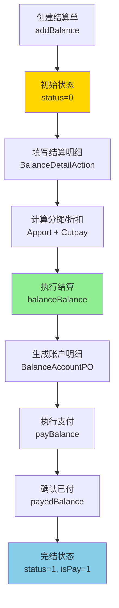

# Balance - 财务结算模块

[根目录](../../../../CLAUDE.md) > [src/com/fanglin](../) > **balance**

---

## 📋 模块职责

财务结算模块负责装饰订单的账务管理、收支记录、分摊计算、折扣抵扣、销售结算等核心财务功能，是ERP系统的资金管理中枢。

**核心功能：**
- 💰 结算单管理（收款/支出/提款）
- 📊 账户明细追踪
- 🧮 费用分摊计算
- 💸 折扣与抵扣管理
- 🛒 销售结算（主材/选材）
- 📸 结算凭证管理
- 💳 支付确认流程
- 📋 成本核算

---

## 🏗️ 模块结构

```
balance/
├── action/          # API 控制器层（15个Action）
│   ├── BalanceAction.java                   # 结算单主控制器
│   ├── BalanceAccountAction.java            # 账户明细管理
│   ├── BalanceDetailAction.java             # 结算明细管理
│   ├── BalanceApportAction.java             # 费用分摊管理
│   ├── BalanceCutpayAction.java             # 折扣抵扣管理
│   ├── BalanceDccountAction.java            # 优惠账户管理
│   ├── BalanceSalesAction.java              # 销售结算管理
│   ├── BalanceSalesBalanceAction.java       # 销售结算单管理
│   ├── BalanceOalesAction.java              # 其他销售管理
│   ├── BalanceOalesItemAction.java          # 其他销售项管理
│   ├── BalanceSelectionAction.java          # 选材结算管理
│   ├── BalanceSelectionItemAction.java      # 选材项管理
│   ├── BalanceSelectionRecordAction.java    # 选材记录管理
│   ├── BalancePictureAction.java            # 结算凭证图片管理
│   └── ComcostAction.java                   # 公司成本管理
├── service/         # 业务逻辑层
├── dao/             # 数据访问层
├── po/              # 持久化对象层（15个PO + 3个BO）
└── vo/              # 值对象层
```

---

## 🔌 入口 Action 清单

| Action 类 | 职责描述 | 关键接口 | 路径 |
|-----------|---------|---------|------|
| `BalanceAction` | 结算单CRUD、结算/支付操作 | pageBalance, addBalance, balanceBalance, payBalance, payedBalance | balance/action/BalanceAction.java:21 |
| `BalanceAccountAction` | 账户明细查询与管理 | 未统计 | - |
| `BalanceDetailAction` | 结算明细项管理 | 未统计 | - |
| `BalanceApportAction` | 费用分摊计算与分配 | 未统计 | - |
| `BalanceCutpayAction` | 折扣抵扣记录 | 未统计 | - |
| `BalanceDccountAction` | 优惠账户管理 | 未统计 | - |
| `BalanceSalesAction` | 主材销售结算 | 未统计 | - |
| `BalanceSalesBalanceAction` | 销售结算单处理 | 未统计 | - |
| `BalanceOalesAction` | 其他销售项结算 | 未统计 | - |
| `BalanceOalesItemAction` | 其他销售项明细 | 未统计 | - |
| `BalanceSelectionAction` | 选材结算管理 | 未统计 | - |
| `BalanceSelectionItemAction` | 选材项明细 | 未统计 | - |
| `BalanceSelectionRecordAction` | 选材记录管理 | 未统计 | - |
| `BalancePictureAction` | 结算凭证图片上传与查询 | 未统计 | - |
| `ComcostAction` | 公司成本核算 | 未统计 | - |

---

## 📦 数据模型（15个 PO + 3个 BO）

### 核心实体

#### 1. BalancePO - 结算单主表

**职责**：存储结算单核心信息（收款/支出/提款）

**关键字段**：
```java
- bid: long                         # 结算单ID
- no: String                        # 结算单编号
- belonger: UserPO                  # 归属人（多对一）
- creater: UserPO                   # 创建人（多对一）
- balancer: UserPO                  # 结算人（多对一）
- payeder: UserPO                   # 付款人（多对一）
- createTime: Timestamp             # 创建时间
- startTime: Timestamp              # 开始时间
- endTime: Timestamp                # 结束时间
- balanceTime: Timestamp            # 结算时间
- payedTime: Timestamp              # 付款时间
- amount: long                      # 总金额（单位：分）
- surplus: long                     # 余额（单位：分）
- cutpay: long                      # 折扣抵扣金额（单位：分）
- type: short                       # 类型（0-支出 1-收款 2-提款）
- status: short                     # 状态（0-初始 1-完结）
- isPay: short                      # 支付状态（1-已付）
- company: int                      # 所属公司
```

**常量定义**：
```java
STATUS_INIT_INT = 0                 # 初始状态
STATUS_FINISH_INT = 1               # 完结状态
TYPE_PAYOUT_INT = 0                 # 支出类型
TYPE_COLLECT_INT = 1                # 收款类型
TYPE_WITHDRAW_INT = 2               # 提款类型
ISPAY_PAYED_INT = 1                 # 已付款
```

**关联关系**：
- 多对一 → `UserPO`（归属人、创建人、结算人、付款人）
- 一对多 → `BalanceAccountPO`（账户明细）
- 一对多 → `BalanceDetailPO`（结算明细项）

**业务规则**：
- 所有金额字段单位为"分"
- 结算流程：创建 → 结算（balanceBalance） → 支付（payBalance） → 确认（payedBalance）
- 余额计算：surplus = amount - cutpay

---

### 辅助实体（简略）

| PO 类 | 职责描述 | 数据库表名 |
|-------|---------|-----------|
| `BalanceAccountPO` | 账户明细记录 | balance_account |
| `BalanceDetailPO` | 结算明细项 | balance_detail |
| `BalanceApportPO` | 费用分摊记录 | balance_apport |
| `BalanceCutpayPO` | 折扣抵扣记录 | balance_cutpay |
| `BalanceDccountPO` | 优惠账户 | balance_dccount |
| `BalanceSalesPO` | 销售结算记录 | balance_sales |
| `BalanceSalesBalancePO` | 销售结算单 | balance_sales_balance |
| `BalanceOalesPO` | 其他销售记录 | balance_oales |
| `BalanceOalesItemPO` | 其他销售项 | balance_oales_item |
| `BalanceSelectionPO` | 选材结算记录 | balance_selection |
| `BalanceSelectionItemPO` | 选材项 | balance_selection_item |
| `BalanceSelectionRecordPO` | 选材记录 | balance_selection_record |
| `BalancePicturePO` | 结算凭证图片 | balance_picture |
| `ComcostPO` | 公司成本记录 | comcost |

**业务对象（BO）**：
- `BalanceOalesBO` - 其他销售业务对象
- `BalanceSalesBO` - 销售业务对象
- `BalanceSelectionBO` - 选材业务对象

---

## 🔗 API 接口详情

### BalanceAction - 结算单管理

**基础路径**：`/`

#### 1. 分页查询结算单
```
POST /pageBalance
参数：Paging, Filters, Company
返回：JSON { success: boolean, rows: Balance[], total: number }
异常：FLException
```

#### 2. 查询结算单列表
```
POST /queryBalance
参数：{ balance: BalanceVO, filters: {}, company: int }
返回：JSON { success: boolean, balances: Balance[] }
异常：FLException
```

#### 3. 新增结算单
```
POST /addBalance
参数：{ balance: BalanceVO, userId: long, company: int }
返回：JSON { success: boolean }
异常：FLException
说明：创建初始状态的结算单，记录创建人和创建时间
```

#### 4. 结算操作
```
POST /balanceBalance
参数：{ balance: BalanceVO, balanceAccountes: BalanceAccountVO[], userId: long }
返回：JSON { success: boolean }
异常：FLException
说明：执行结算操作，生成账户明细，记录结算人和结算时间
```

#### 5. 支付操作
```
POST /payBalance
参数：{ balance: BalanceVO, balanceAccountes: BalanceAccountVO[], userId: long }
返回：JSON { success: boolean }
异常：FLException
说明：执行支付操作，记录付款人和付款时间
```

#### 6. 确认已付
```
POST /payedBalance
参数：{ balances: BalanceVO[], userId: long }
返回：JSON { success: boolean }
异常：FLException
说明：批量确认结算单已付款，设置 isPay = 1
```

---

## 📊 业务流程

### 结算单生命周期



### 余额计算逻辑

```
余额 (surplus) = 总金额 (amount) - 折扣抵扣 (cutpay)

最终应付金额 = 余额 - 账户明细中的已付金额
```

---

## 🔗 依赖关系

### 内部依赖（本项目模块）

- **`com.fanglin.personel`** - 人事管理模块
  - `UserPO` - 用户实体（归属人、创建人、结算人、付款人）

- **`com.fanglin.decoration`** - 装饰订单模块
  - 结算单关联装饰订单（需查看 BalanceDetailPO 确认）

- **`com.fanglin.sales`** - 销售管理模块
  - `BalanceSalesPO` 关联主材销售

- **`com.fanglin.core`** - 核心基础模块
  - `BaseListAction`, `FLException`

---

## 📂 关键文件路径

```
src/com/fanglin/balance/
├── action/
│   ├── BalanceAction.java                   # 👈 结算单主控制器
│   ├── BalanceAccountAction.java            # 账户明细管理
│   ├── BalanceDetailAction.java             # 结算明细管理
│   └── ...（其他12个Action）
├── service/
│   ├── BalanceService.java                  # 结算业务逻辑接口
│   └── impl/                                # 业务实现类
├── dao/
│   ├── BalanceDao.java                      # 结算数据访问接口
│   └── impl/                                # DAO 实现类
└── po/
    ├── BalancePO.java                       # 👈 结算单主表实体
    ├── BalanceAccountPO.java                # 账户明细实体
    ├── BalanceDetailPO.java                 # 结算明细实体
    └── ...（其他12个PO + 3个BO）
```

---

## ❓ FAQ

### Q1: 结算单的三种类型（支出/收款/提款）有什么区别？
**A**:
- **支出（TYPE_PAYOUT_INT = 0）**：公司向外付款（如支付供应商、工人工资）
- **收款（TYPE_COLLECT_INT = 1）**：公司向客户收款（如装饰订单回款）
- **提款（TYPE_WITHDRAW_INT = 2）**：内部资金提取（如备用金、报销）

---

### Q2: 如何理解"账户明细"（BalanceAccountPO）？
**A**:
- 一个结算单可能关联多个账户明细
- 例如：客户收款 10000 元，分三次支付：3000 + 4000 + 3000
- 每次支付生成一条 `BalanceAccountPO` 记录
- 用于追踪资金流水和余额变动

---

### Q3: 折扣抵扣（cutpay）和费用分摊（apport）的关系？
**A**:
- **折扣抵扣**：减少应付金额（如优惠券、满减活动）
- **费用分摊**：将费用分配到不同成本中心（如装修费、设计费、管理费）
- 两者独立计算，影响最终结算金额

---

### Q4: 结算单状态流转规则是什么？
**A**:
```
初始 (status=0) → 结算 (balanceBalance) → 支付 (payBalance) → 确认 (payedBalance) → 完结 (status=1)
```

**状态检查点**：
- 未结算前可修改明细
- 已结算后锁定金额
- 确认支付后不可撤销（需联系财务）

---

### Q5: 如何查询某个客户的所有结算记录？
**A**:
```http
POST /queryBalance
Body: {
  "balance": {
    "belonger": {
      "uid": 12345  # 客户用户ID
    }
  },
  "filters": {},
  "company": 1
}
```

---

## 📝 变更记录（Changelog）

| 日期 | 版本 | 变更内容 | 负责人 |
|------|------|---------|--------|
| 2025-12-01 | 1.0.0 | 初始化模块文档，包含 15 个 PO/BO 和 15 个 Action | AI Assistant |

---

## 📚 扩展阅读

- [根目录 CLAUDE.md](../../../../CLAUDE.md) - 查看完整项目架构
- [Construction 模块文档](../construction/CLAUDE.md) - 了解施工结算流程
- [Sales 模块文档](../sales/CLAUDE.md) - 了解销售结算关联

---

**文档生成时间**: 2025-12-01
**模块路径**: `src/com/fanglin/balance/`
**维护状态**: ✅ 已完成基础文档（部分细节待补充）