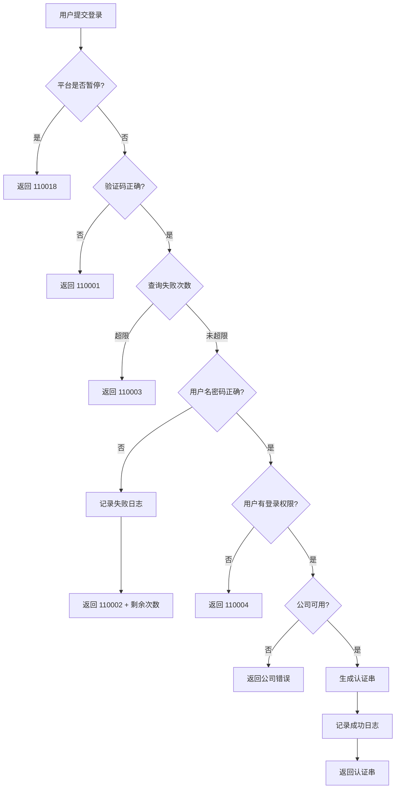

# common - 通用功能模块

[根目录](../../../../CLAUDE.md) > [src](../../../) > [com.fanglin](../../) > **common**

> 最后更新：2025-12-01 15:43:46

---

## 变更记录 (Changelog)

### 2025-12-01 15:43:46
- 初始化 common 模块 AI 上下文文档
- 完成登录认证、文件上传、验证码功能分析

---

## 模块职责

common 模块提供系统**通用基础功能**，是用户与系统交互的第一层入口，负责：

- **登录认证**：用户名密码登录、验证码校验、手机号登录、认证串切换
- **文件上传**：集成阿里云 OSS 和华为云 OBS，提供文件上传服务
- **验证码服务**：生成图片验证码和加密的验证码串
- **二维码生成**：生成业务二维码（通过 `WMCodeAction`）
- **通用数据服务**：计数统计、服务记录等

**核心价值**：
- 统一登录入口，支持多种认证方式
- 文件存储云化，支持多云厂商
- 安全验证机制，防止暴力破解

---

## 入口与启动

### 模块结构

```
src/com/fanglin/common/
├── action/                 # 控制器层
│   ├── LoginAction.java            # 登录相关（核心）
│   ├── UploadAction.java           # 文件上传
│   ├── VerifyCodeAction.java       # 验证码生成
│   ├── WMCodeAction.java           # 二维码生成
│   └── DoginAction.java            # 其他登录辅助
├── service/                # 业务逻辑层
│   ├── LoginService.java           # 登录业务接口
│   ├── CountingService.java        # 计数统计服务
│   └── impl/
│       ├── LoginServiceImpl.java   # 登录业务实现
│       └── CountingServiceImpl.java
├── dao/                    # 数据访问层
│   ├── CountingDao.java            # 计数 DAO
│   ├── ServiceRecordDao.java       # 服务记录 DAO
│   └── impl/
├── po/                     # 持久化对象
│   ├── CountingPO.java             # 计数实体
│   └── ServiceRecordPO.java        # 服务记录实体
└── vo/                     # 值对象
    ├── LoginInfoVO.java            # 登录信息
    ├── CountingVO.java             # 计数统计
    ├── ServiceRecordVO.java        # 服务记录
    ├── ExcelWorkSheet.java         # Excel 工作表
    ├── KeyValueVO.java             # 键值对
    └── TopVO.java                  # 顶部导航
```

### 访问入口

| 功能 | URL | 说明 |
|------|-----|------|
| 登录 | `/doLogin.do` | 用户名密码登录 |
| 登出 | `/logout.do` | 清除 Cookie，跳转登录页 |
| 验证码图片 | `/verifyCode.do` | 返回图片流 |
| 验证码串 | `/queryVode.do` | 返回加密验证码 JSON |
| 文件上传 | `/uploadFile.do` | 上传到云存储，返回 URL |
| 扫码登录 | `/requestAuthCode.do` | 扫码授权登录 |
| 手机登录 | `/phoneAuthCode.do` | 手机号 + 验证码登录 |
| 切换公司 | `/changeAuthCode.do` | 切换当前登录公司 |

---

## 对外接口

### 1. doLogin - 用户名密码登录

**路径**：`LoginAction.doLogin()`

**请求参数**：

| 参数名 | 类型 | 必填 | 说明 |
|--------|------|------|------|
| `userId` | String | 是 | 用户名/账号 |
| `password` | String | 是 | 密码（明文） |
| `verifyCode` | String | 是 | 验证码（用户输入） |
| `securityCode` | String | 是 | 加密的验证码串（从 `queryVode` 获取） |

**响应 JSON**：

```json
{
  "errorCode": 0,              // 0 表示成功，其他表示失败
  "errorMsg": "成功",
  "authentication": "xxx..."    // 加密后的认证串（成功时返回）
}
```

**错误码**：

| 错误码 | 含义 |
|--------|------|
| 110001 | 验证码错误 |
| 110002 | 用户名或密码错误（包含剩余尝试次数） |
| 110003 | 密码输入错误次数过多，拒绝登陆 |
| 110004 | 该用户不能登陆系统（权限不足） |
| 110018 | 平台暂停使用 |

**登录流程**：



**关键逻辑**（代码位置 `LoginAction.doLogin()`）：

1. **验证码解密**（91 行）：
   ```java
   String verifyCode = AESHelper.decrypt(securityCode, encryptKey, encryptIv);
   ```

2. **失败次数限制**（99 行）：
   ```java
   int times = loginLogService.isCanLogin(loginLogVO);
   if (times == -1) throw new FLException(110003, "密码输入错误次数过多,拒绝登陆");
   ```

3. **用户验证**（104 行）：
   ```java
   UserVO user = userService.validateUser(loginId, password);
   ```

4. **登录权限检查**（116 行）：
   ```java
   if ((user.getIsLogin() & UserPO.ISLOGIN_FIP_INT) != UserPO.ISLOGIN_FIP_INT) {
       throw new FLException(110004, "该用户不能登陆系统");
   }
   ```

5. **生成认证串**（122-124 行）：
   ```java
   Authentication auth = new Authentication(userId, userName, roleId, timestamp, false, company, freedom);
   authentication = AESHelper.encrypt(auth.getAuthenticationStr(), encryptKey, encryptIv);
   ```

---

### 2. requestAuthCode - 扫码登录

**路径**：`LoginAction.requestAuthCode()`

**使用场景**：扫描二维码后，通过授权码登录（如微信扫码登录）。

**请求参数**：

| 参数名 | 类型 | 必填 | 说明 |
|--------|------|------|------|
| `userId` | String | 是 | 用户 ID |
| `code` | String | 是 | 授权码 |
| `secret` | String | 是 | 密钥 |

**响应 JSON**：

```json
{
  "errorCode": 0,
  "authentication": "xxx..."
}
```

**实现逻辑**：调用 `LoginService.requestAuthCode()` 验证授权码并生成认证串。

---

### 3. phoneAuthCode - 手机号登录

**路径**：`LoginAction.phoneAuthCode()`

**请求参数**：

| 参数名 | 类型 | 必填 | 说明 |
|--------|------|------|------|
| `userId` | String | 是 | 用户 ID |
| `phone` | String | 是 | 手机号 |
| `code` | String | 是 | 短信验证码 |
| `secret` | String | 是 | 密钥 |

---

### 4. changeAuthCode - 切换公司

**路径**：`LoginAction.changeAuthCode()`

**使用场景**：用户在多家公司任职，切换当前操作的公司。

**请求参数**：

| 参数名 | 类型 | 必填 | 说明 |
|--------|------|------|------|
| `authentication` | String | 是 | 当前认证串 |
| `company` | String | 是 | 目标公司编号 |

**响应**：返回新的认证串（`company` 字段更新）。

---

### 5. uploadFile - 文件上传

**路径**：`UploadAction.uploadFile()`

**请求方式**：`POST multipart/form-data`

**请求参数**：

| 参数名 | 类型 | 必填 | 说明 |
|--------|------|------|------|
| `file` 或 `strutsUploads` | File | 是 | 上传的文件 |

**响应 JSON**：

```json
{
  "errorCode": 0,
  "resUrl": "http://nullpoint.oss-cn-beijing.aliyuncs.com/xxx.jpg"
}
```

**支持的云存储**：

#### 1. 阿里云 OSS（默认）

**配置**（`UploadAction.uploadFile()` 71-86 行）：

```java
String backet = "nullpoint";
String endpoint = "oss-cn-beijing.aliyuncs.com";
String accessKeyId = "LTAI5ao4pYU3xDPO";  // ⚠️ 硬编码凭证
String accessKeySecret = "0k3gefryHw67KA4yPsRqBszkBAq7yG";
```

**文件命名规则**：`UUID.扩展名`（如 `abc123.jpg`）

**访问地址**：`http://{bucket}.{endpoint}/{fileName}`

#### 2. 华为云 OBS

**方法**：`UploadAction.uploadFileByObs()`

**配置**（95-127 行）：

```java
String backet = "fanglin-media";
String endpoint = "obs.cn-north-4.myhuaweicloud.com";
String accessKeyId = "MHKHWOL3WHNXP7XEFNS5";  // ⚠️ 硬编码凭证
String accessKeySecret = "viHL8ZxF2UmEq5K3ouT8QE4um8AINmLytq34nynB";
```

**文件命名规则**：`yyyy/MM/dd/UUID.扩展名`（按日期分目录）

**访问地址**：`https://{bucket}.{endpoint}/{fileName}`

**文件大小限制**：5MB（5242880 字节）

**错误码**：

| 错误码 | 含义 |
|--------|------|
| 110014 | 无效文件 |
| 110016 | 文件大小超出 |

---

### 6. queryVode - 获取验证码

**路径**：`VerifyCodeAction.queryVode()`

**响应 JSON**：

```json
{
  "errorCode": 0,
  "securityCode": "xxx..."  // 加密后的验证码字符串
}
```

**生成逻辑**：

1. 调用 `SecurityCodeHelper.getSecurityCode()` 生成随机验证码（通常 4 位）
2. 使用 AES 加密验证码
3. 返回加密串给前端

**前端使用**：

```javascript
// 1. 获取验证码串
$.get('/queryVode.do', function(res) {
  securityCode = res.securityCode;
  // 2. 显示验证码图片
  $('#codeImg').attr('src', '/verifyCode.do?securityCode=' + securityCode);
});

// 3. 登录时传递 securityCode 和用户输入的 verifyCode
```

---

### 7. verifyCode - 获取验证码图片

**路径**：`VerifyCodeAction.verifyCode()`

**请求参数**：

| 参数名 | 类型 | 必填 | 说明 |
|--------|------|------|------|
| `securityCode` | String | 是 | 从 `queryVode` 获取的加密串 |

**响应**：`image/jpeg` 流

**生成逻辑**：

1. 解密 `securityCode` 得到原始验证码字符串
2. 调用 `SecurityImageHelper.getImageAsInputStream(code)` 生成图片
3. 返回图片流

---

## 关键依赖与配置

### 依赖的服务

| 服务 | 提供者模块 | 用途 |
|------|-----------|------|
| `UserService` | `personel` | 用户验证、用户信息查询 |
| `CompanyService` | `system` | 公司验证 |
| `LoginLogService` | `log` | 登录日志记录与失败次数查询 |

### 依赖的工具

| 工具类 | 位置 | 用途 |
|--------|------|------|
| `AESHelper` | `core.security` | 加解密 |
| `CookieUtil` | `utils` | Cookie 操作 |
| `IPUtil` | `utils` | 获取客户端 IP |
| `DateUtil` | `utils` | 时间处理 |
| `LogUtils` | `utils` | 日志记录 |
| `SystemConfig` | `utils` | 读取配置 |

### 第三方库

| 库名 | 版本 | 用途 |
|------|------|------|
| `aliyun-oss-sdk` | - | 阿里云 OSS SDK |
| `obs-java-sdk` | - | 华为云 OBS SDK |

---

## 数据模型

### 1. CountingPO - 计数统计实体

**表名**：（根据实际数据库表）

**用途**：记录各类业务数据的统计计数。

**字段**（推测）：
- `id`：主键
- `type`：计数类型
- `count`：计数值
- `updateTime`：更新时间

### 2. ServiceRecordPO - 服务记录实体

**用途**：记录系统服务调用或操作记录。

---

## 测试与质量

### 当前测试覆盖

- 无独立单元测试
- 依赖手工功能测试

### 建议增强

1. **登录流程集成测试**
   - 测试验证码校验
   - 测试失败次数限制
   - 测试权限验证

2. **文件上传测试**
   - 测试大小限制
   - 测试文件类型验证
   - 测试云存储连接失败场景

3. **验证码测试**
   - 测试验证码唯一性
   - 测试验证码过期机制（如有）

---

## 常见问题 (FAQ)

### Q1: 上传文件时提示"文件大小超出"

**原因**：文件超过 5MB 限制。

**解决方案**：
1. **压缩文件**：图片可压缩或转换格式
2. **修改限制**：编辑 `UploadAction.uploadFile()` 63 行：
   ```java
   if (_file.length() > 10485760) {  // 改为 10MB
   ```
3. **分片上传**：对于大文件，需改造为分片上传

---

### Q2: 登录后显示"平台暂停使用"

**原因**：系统维护期间，管理员设置了 `disable` 配置。

**配置位置**：`conf/sysconfig.properties`

```properties
disable=admin  # 仅允许 admin 用户登录，其他用户提示暂停使用
```

**解除方法**：删除或注释此配置项。

---

### Q3: 文件上传到 OSS 后访问 404

**可能原因**：
1. Bucket 权限设置为私有
2. 文件名生成重复（概率极低）
3. OSS 凭证无效

**排查步骤**：
1. 登录阿里云 OSS 控制台，检查文件是否上传成功
2. 检查 Bucket 权限设置（公共读 / 私有）
3. 验证 `accessKeyId` 和 `accessKeySecret` 是否正确

---

### Q4: 验证码一直提示错误

**可能原因**：
1. 加密密钥配置错误
2. 验证码大小写问题
3. 验证码已过期（如有过期机制）

**排查**：
1. 检查 `encryptKey` 和 `encryptIv` 配置
2. 验证码输入时是否区分大小写（检查 `SecurityCodeHelper` 实现）
3. 查看后端日志确认解密后的验证码值

---

## 相关文件清单

### 核心源码

| 文件路径 | 说明 | 关键方法 |
|---------|------|---------|
| `action/LoginAction.java` | 登录控制器（核心） | `doLogin()`, `requestAuthCode()`, `changeAuthCode()` |
| `action/UploadAction.java` | 文件上传 | `uploadFile()`, `uploadFileByObs()` |
| `action/VerifyCodeAction.java` | 验证码生成 | `queryVode()`, `verifyCode()` |
| `action/WMCodeAction.java` | 二维码生成 | - |
| `service/impl/LoginServiceImpl.java` | 登录业务实现 | - |
| `dao/impl/CountingDaoImpl.java` | 计数 DAO 实现 | - |
| `po/CountingPO.java` | 计数实体 | - |
| `vo/LoginInfoVO.java` | 登录信息 VO | - |

### 配置文件

| 文件路径 | 说明 |
|---------|------|
| `conf/sysconfig.properties` | 加密密钥、平台开关配置 |
| `conf/struts.xml` | 登录 Action 路由配置 |

---

## 安全注意事项

### ⚠️ 硬编码凭证问题

**发现位置**：`UploadAction.java`

**风险**：
- 阿里云 OSS AccessKey 硬编码在代码中（79-80 行）
- 华为云 OBS AccessKey 硬编码在代码中（199-200 行）
- 代码泄露将导致云存储账户被盗用

**整改建议**：

1. **迁移到配置文件**：

```properties
# conf/sysconfig.properties
oss.endpoint=oss-cn-beijing.aliyuncs.com
oss.accessKeyId=xxx
oss.accessKeySecret=xxx
oss.bucket=nullpoint

obs.endpoint=obs.cn-north-4.myhuaweicloud.com
obs.accessKeyId=xxx
obs.accessKeySecret=xxx
obs.bucket=fanglin-media
```

2. **使用环境变量**（更安全）：

```java
String accessKeyId = System.getenv("OSS_ACCESS_KEY_ID");
String accessKeySecret = System.getenv("OSS_ACCESS_KEY_SECRET");
```

3. **使用 STS 临时凭证**：客户端先请求临时 Token，再上传。

---

### 验证码安全

**当前机制**：
- 验证码通过 AES 加密传输
- 前端获取加密串，后端解密验证

**改进建议**：
- **添加过期时间**：验证码 5 分钟内有效
- **单次使用**：验证码使用后立即失效
- **限制生成频率**：同一 IP 1 分钟内最多生成 10 次

---

## 与其他模块的关系

### 依赖的模块

- `core`：继承 `BaseAction`，使用 `AESHelper` 和拦截器
- `personel`：用户验证与信息查询
- `system`：公司验证
- `log`：登录日志记录

### 被依赖模块

- 所有前端页面：依赖登录认证
- 其他模块：可能使用文件上传和验证码服务

---

**关键提示**：
1. **凭证安全优先级最高**：尽快迁移硬编码的云存储凭证
2. **验证码机制需增强**：添加过期时间和单次使用限制
3. **登录失败次数限制**：依赖 `LoginLogService`，需确保此服务正常运行
