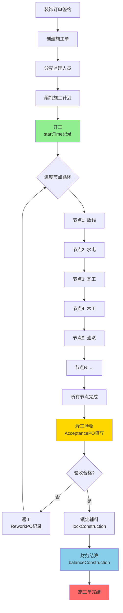
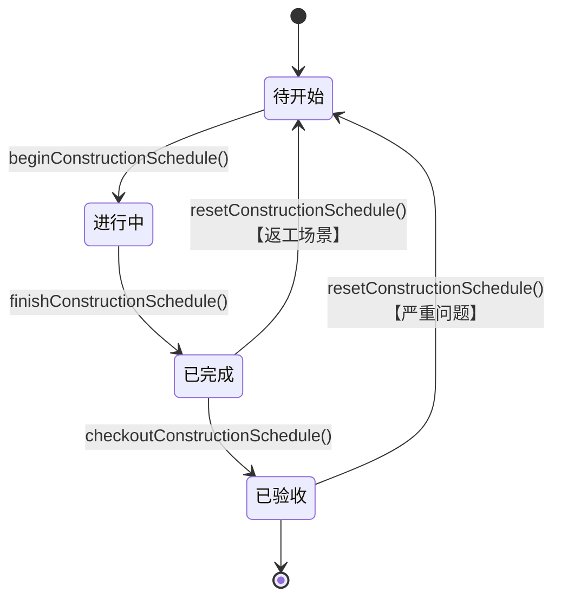

# Construction - 施工管理模块

[根目录](../../../../CLAUDE.md) > [src/com/fanglin](../) > **construction**

---

## 📋 模块职责

施工管理模块负责装饰订单从开工到竣工的全生命周期管理，涵盖施工进度追踪、工人管理、质检验收、客服回访等核心业务流程。

**核心功能：**
- 🏗️ 施工单管理（开工、锁定、结算）
- 📅 施工进度管理（13个节点流转）
- 👷 工人分配与考勤
- ✅ 质检与验收（多工种评分）
- 📝 施工日志与图纸
- 💰 施工成本与辅料管理
- 📞 客服回访与投诉处理
- 🔨 返工记录管理
- 📋 施工计划与排期

---

## 🏗️ 模块结构

```
construction/
├── action/          # API 控制器层（20个Action）
│   ├── ConstructionAction.java              # 施工单主控制器
│   ├── ConstructionScheduleAction.java      # 施工进度管理
│   ├── AcceptanceAction.java                # 验收管理
│   ├── ConstructerAction.java               # 施工人员管理
│   ├── QualiterAction.java                  # 质检人员管理
│   ├── ConstructionDiaryAction.java         # 施工日志
│   ├── ConstructionDrawingAction.java       # 施工图纸
│   ├── ConstructionCostAction.java          # 施工成本
│   ├── ConstructionPlanAction.java          # 施工计划
│   ├── ConstructionAccessoryAction.java     # 辅料管理
│   ├── InspectionRecordAction.java          # 巡检记录
│   ├── ReworkAction.java                    # 返工记录
│   ├── DrawLineAction.java                  # 放线管理
│   ├── CustomerServiceBackVisitAction.java  # 客户回访
│   ├── CustomerServiceComplaintAction.java  # 客户投诉
│   ├── CustomerServiceGuaranteeAction.java  # 保修服务
│   └── ...（其他4个Action）
├── service/         # 业务逻辑层
├── dao/             # 数据访问层
└── po/              # 持久化对象层（23个PO）
    ├── ConstructionPO.java                  # 施工单主表
    ├── ConstructionSchedulePO.java          # 施工进度节点
    ├── AcceptancePO.java                    # 验收记录
    ├── ConstructerPO.java                   # 施工人员
    ├── QualiterPO.java                      # 质检人员
    ├── ConstructionDiaryPO.java             # 施工日志
    ├── ConstructionDrawingPO.java           # 施工图纸
    ├── ConstructionCostPO.java              # 施工成本
    ├── ReworkPO.java                        # 返工记录
    └── ...（其他14个PO）
```

---

## 🔌 入口 Action 清单

### 核心业务 Action

| Action 类 | 职责描述 | 关键接口数 | 路径 |
|-----------|---------|----------|------|
| `ConstructionAction` | 施工单CRUD、开工/锁定/结算 | 12个 | construction/action/ConstructionAction.java:33 |
| `ConstructionScheduleAction` | 施工进度节点管理、开始/完成/验收 | 13个 | construction/action/ConstructionScheduleAction.java:31 |
| `AcceptanceAction` | 验收单管理（含多工种评分） | 2个 | construction/action/AcceptanceAction.java:29 |
| `ConstructerAction` | 施工人员分配与管理 | 未统计 | construction/action/ConstructerAction.java |
| `QualiterAction` | 质检人员管理 | 未统计 | construction/action/QualiterAction.java |

### 辅助功能 Action

| Action 类 | 职责描述 | 关键接口数 |
|-----------|---------|----------|
| `ConstructionDiaryAction` | 施工日志记录与查询 | 未统计 |
| `ConstructionDrawingAction` | 施工图纸管理 | 未统计 |
| `ConstructionCostAction` | 施工成本记录 | 未统计 |
| `ConstructionPlanAction` | 施工计划编排 | 未统计 |
| `ConstructionAccessoryAction` | 辅料领用管理 | 未统计 |
| `ConstructionRecordAction` | 施工记录归档 | 未统计 |
| `InspectionRecordAction` | 巡检记录管理 | 未统计 |
| `ReworkAction` | 返工记录管理 | 未统计 |
| `DrawLineAction` | 放线记录管理 | 未统计 |

### 客服相关 Action

| Action 类 | 职责描述 |
|-----------|---------|
| `CustomerServiceBackVisitAction` | 客户回访记录 |
| `CustomerServiceComplaintAction` | 客户投诉处理 |
| `CustomerServiceGuaranteeAction` | 保修服务管理 |

---

## 📦 数据模型（23个 PO）

### 核心实体

#### 1. ConstructionPO - 施工单主表

**职责**：存储施工单的核心信息（关联装饰订单），管理施工生命周期

**关键字段**：
```java
- cid: long                         # 施工单ID
- decoration: DecorationPO          # 关联装饰订单（多对一）
- cnid: long                        # 施工编号
- schedule: int                     # 当前进度节点
- process: short                    # 施工流程状态（0-初始化 1-完成）
- period: int                       # 施工工期（天数）
- accessory: short                  # 辅料状态（0-开放 1-锁定）
- accessoryLimit: long              # 辅料限额（单位：分）
- accessoryTotal: long              # 辅料实际使用总额（单位：分）
- salaryLimit: long                 # 人工费限额（单位：分）
- salaryLimitTotal: long            # 人工费限额总计（单位：分）
- salaryTotal: long                 # 人工费实际总额（单位：分）
- supervisor: UserPO                # 监理人员（多对一）
- locker: UserPO                    # 锁定操作人（多对一）
- balancer: UserPO                  # 结算操作人（多对一）
- createTime: Timestamp             # 创建时间
- preStartTime: Timestamp           # 预计开工时间
- preEndTime: Timestamp             # 预计竣工时间
- startTime: Timestamp              # 实际开工时间
- endTime: Timestamp                # 实际竣工时间
- finishTime: Timestamp             # 完工时间
- lockTime: Timestamp               # 锁定时间
- processTime: Timestamp            # 流程完成时间
- balanceTime: Timestamp            # 结算时间
- workStatus: short                 # 施工状态
- scheduleStatus: short             # 进度状态
- balanceStatus: short              # 结算状态（1-已结算）
- terminalStatus: short             # 终端状态
```

**关联关系**：
- 多对一 → `DecorationPO`（装饰订单）
- 多对一 → `UserPO`（监理、锁定人、结算人）
- 一对多 → `ConstructionSchedulePO`（施工进度节点）
- 一对一 → `AcceptancePO`（验收记录）

**常量定义**：
```java
SCHEDULE_TYPE_PUTLINE_INT = 2             # 放线节点
SCHEDULE_TYPE_WATERWAYCIRCUIT_INT = 3     # 水电节点
ACCESSORY_OPEN_SHORT = 0                  # 辅料开放
ACCESSORY_LOCK_SHORT = 1                  # 辅料锁定
PROCESS_INIT_INT = 0                      # 流程初始化
PROCESS_FINISH_INT = 1                    # 流程完成
BALANCE_STATUS_BALANCE_INT = 1            # 已结算
```

**业务规则**：
- 施工单与装饰订单一对一关联（通过 `orderId`）
- 辅料状态控制辅料领用权限
- 结算前需完成所有进度节点
- 所有金额字段单位为"分"

---

#### 2. ConstructionSchedulePO - 施工进度节点

**职责**：记录施工过程中的各个工序节点（如水电、瓦工、木工等）

**关键字段**（推测）：
```java
- csid: long                        # 进度节点ID
- construction: ConstructionPO      # 关联施工单
- schedule: int                     # 节点编号（2-放线 3-水电 ...）
- norm: String                      # 标准工艺要求
- scal: String                      # 实际施工情况
- period: int                       # 节点工期（天数）
- beginTime: Timestamp              # 开始时间
- finishTime: Timestamp             # 完成时间
- checkoutTime: Timestamp           # 验收时间
- enterTime: Timestamp              # 进场时间
- leaveTime: Timestamp              # 离场时间
- status: short                     # 节点状态（待开始/进行中/已完成/已验收）
```

**关联关系**：
- 多对一 → `ConstructionPO`

**业务流程**（基于 Action 接口推测）：
```
待开始 → beginConstructionSchedule() → 进行中
      → finishConstructionSchedule() → 已完成
      → checkoutConstructionSchedule() → 已验收
```

---

#### 3. AcceptancePO - 验收记录

**职责**：存储竣工验收的质量评分（按工种分类）

**关键字段**：
```java
- actId: int                        # 验收ID
- orderId: String                   # 订单号（外键）
- acceptanceTime: String            # 验收时间（格式：yyyy-MM-dd）

# 水路工种评分
- waterwayQuality: int              # 水路施工质量评分
- waterwayServer: int               # 水路服务评分
- waterwayHygiene: int              # 水路卫生评分
- waterwayDes: String               # 水路描述/问题说明

# 电路工种评分
- circuitQuality: int               # 电路施工质量评分
- circuitServer: int                # 电路服务评分
- circuitHygiene: int               # 电路卫生评分
- circuitDes: String                # 电路描述/问题说明

# 瓦工工种评分
- bricklayQuality: int              # 瓦工施工质量评分
- bricklayServer: int               # 瓦工服务评分
- bricklayHygiene: int              # 瓦工卫生评分
- bricklayDes: String               # 瓦工描述/问题说明

# 木工工种评分
- carpentQuality: int               # 木工施工质量评分
- carpentServer: int                # 木工服务评分
- carpentHygiene: int               # 木工卫生评分
- carpentDes: String                # 木工描述/问题说明

# 油漆工种评分
- oilQuality: int                   # 油漆施工质量评分
- oilServer: int                    # 油漆服务评分
- oilHygiene: int                   # 油漆卫生评分
- oilDes: String                    # 油漆描述/问题说明

# 监理评分
- supervisQuality: int              # 监理质量评分
- supervisServer: int               # 监理服务评分
- supervisHygiene: int              # 监理卫生评分
- supervisDes: String               # 监理描述/问题说明

# 材料评分
- materialQuality: int              # 材料质量评分
- materialServer: int               # 材料服务评分
- materialDes: String               # 材料描述/问题说明

# 综合评价
- question: String                  # 存在问题
- propose: String                   # 改进建议
- multiple: int                     # 多套评分标识
- internal: int                     # 内部评分标识
```

**关联关系**：
- 一对一 → `ConstructionPO`（通过 `orderId`）

**常量定义**：
```java
ACCEPTANCE_ALLOCATION_WORKER_FLAG_INT = 512  # 工人分配标识
ACCEPTANCE_CONSTRUCTION_SCHEDULE_TYPE_NAME_STR = "验收"  # 验收节点名称
CURRENT_TIME_FORMAT_STR = "yyyy-MM-dd"       # 时间格式
```

**业务规则**：
- 每个工种从三个维度评分（质量、服务、卫生）
- 评分为整数（推测为百分制或十分制）
- 支持多套评分（`multiple`）和内部评分（`internal`）

---

### 辅助实体（简略）

| PO 类 | 职责描述 | 数据库表名 |
|-------|---------|-----------|
| `ConstructerPO` | 施工人员信息 | constructer |
| `ConstructerRecordPO` | 施工人员出勤记录 | constructer_record |
| `QualiterPO` | 质检人员信息 | qualiter |
| `ConstructionDiaryPO` | 施工日志 | construction_diary |
| `ConstructionDiaryDrawingPO` | 施工日志图片 | construction_diary_drawing |
| `ConstructionDrawingPO` | 施工图纸 | construction_drawing |
| `ConstructionCostPO` | 施工成本记录 | construction_cost |
| `ConstructionPlanPO` | 施工计划 | construction_plan |
| `ConstructionAccessoryPO` | 辅料领用记录 | construction_accessory |
| `ConstructionRecordPO` | 施工总记录 | construction_record |
| `ConstructionInfoPO` | 施工信息摘要 | construction_info |
| `ConstructionInfoDO` | 施工信息数据对象 | - |
| `ConstructionScheduleDO` | 施工进度数据对象 | - |
| `InspectionRecordPO` | 巡检记录 | inspection_record |
| `ReworkPO` | 返工记录 | rework |
| `ReworkDrawingPO` | 返工图片 | rework_drawing |
| `DrawLinePO` | 放线记录 | draw_line |
| `CustomerServiceBackVisitPO` | 客户回访 | customer_service_back_visit |
| `CustomerServiceComplaintPO` | 客户投诉 | customer_service_complaint |
| `CustomerServiceGuaranteePO` | 保修服务 | customer_service_guarantee |

---

## 🔗 API 接口详情

### ConstructionAction - 施工单管理

**基础路径**：`/`

#### 1. 分页查询施工单
```
POST /pageConstruction
参数：Paging, Filters, { construction: { decoration: { company: int } } }
返回：JSON { success: boolean, rows: Construction[], total: number }
异常：FLException
说明：支持按公司筛选，优先使用 construction.decoration.company，否则使用当前登录公司
```

#### 2. 分页查询施工单（监理视图）
```
POST /pageConstructionForSupervision
参数：Paging, Filters, UserId（当前登录用户）
返回：JSON { success: boolean, rows: Construction[], total: number }
异常：FLException
说明：仅显示当前用户负责监理的施工单
```

#### 3. 分页查询施工单（验收视图）
```
POST /pageConstructionForAcceptance
参数：Paging, Filters, Company
返回：JSON { success: boolean, rows: Construction[], total: number }
异常：FLException
说明：查询待验收的施工单
```

#### 4. 分页查询施工单（基础视图）
```
POST /pageConstructionForBase
参数：Paging, Filters, Company
返回：JSON { success: boolean, rows: Construction[], total: number }
异常：FLException
```

#### 5. 分页查询施工单（质检视图）
```
POST /pageConstructionForQualiter
参数：Paging, Filters, UserId（当前登录用户）
返回：JSON { success: boolean, rows: Construction[], total: number }
异常：FLException
说明：仅显示当前用户负责质检的施工单
```

#### 6. 根据订单ID查询施工单
```
POST /queryConstructionByOrderId
参数：{ construction: { decoration: { orderId: String } } }
返回：JSON { success: boolean, construction: Construction }
异常：FLException
```

#### 7. 更新施工单（按订单ID）
```
POST /updateConstructionByOrderId
参数：{ construction: ConstructionVO, qualiters: QualiterVO[], userId: long }
返回：JSON { success: boolean }
异常：FLException
说明：同时更新施工单和质检人员列表
```

#### 8. 更新施工单（按施工单ID）
```
POST /updateConstructionByCid
参数：{ construction: ConstructionVO }
返回：JSON { success: boolean }
异常：FLException
```

#### 9. 更新施工单（预付款相关）
```
POST /updateConstructionForAdvance
参数：{ construction: ConstructionVO, userId: long }
返回：JSON { success: boolean }
异常：FLException
```

#### 10. 开放施工单（允许辅料领用）
```
POST /openConstruction
参数：{ construction: { cid: long } }
返回：JSON { success: boolean }
异常：FLException
说明：设置 accessory = 0（开放状态）
```

#### 11. 锁定施工单（禁止辅料领用）
```
POST /lockConstruction
参数：{ construction: { cid: long }, userId: long }
返回：JSON { success: boolean }
异常：FLException
说明：设置 accessory = 1（锁定状态），记录锁定人和锁定时间
```

#### 12. 结算施工单
```
POST /balanceConstruction
参数：{ construction: { cid: long }, userId: long }
返回：JSON { success: boolean }
异常：FLException
说明：设置 balanceStatus = 1（已结算），记录结算人和结算时间
```

---

### ConstructionScheduleAction - 施工进度管理

#### 1. 分页查询施工进度
```
POST /pageConstructionSchedule
参数：Paging, Filters, Company
返回：JSON { success: boolean, rows: ConstructionSchedule[], total: number }
异常：FLException
```

#### 2. 根据订单ID查询进度列表
```
POST /queryConstructionScheduleByOrderId
参数：{ constructionSchedule: { construction: { decoration: { orderId: String } } } }
返回：JSON { success: boolean, constructionSchedules: ConstructionSchedule[] }
异常：FLException
```

#### 3. 根据施工单ID查询进度列表
```
POST /queryConstructionScheduleByCid
参数：{ constructionSchedule: { construction: { cid: long } } }
返回：JSON { success: boolean, constructionSchedules: ConstructionSchedule[] }
异常：FLException
```

#### 4. 根据进度ID查询详情
```
POST /queryConstructionScheduleByCsid
参数：{ constructionSchedule: { csid: long } }
返回：JSON { success: boolean, constructionSchedule: ConstructionSchedule }
异常：FLException
```

#### 5. 根据订单ID和节点编号查询
```
POST /queryConstructionScheduleByOrderIdASchedule
参数：{ constructionSchedule: { construction: { decoration: { orderId: String } }, schedule: int } }
返回：JSON { success: boolean, constructionSchedule: ConstructionSchedule }
异常：FLException
```

#### 6. 更新进度标准工艺
```
POST /updateConstructionScheduleForNorm
参数：{ constructionSchedule: { csid: long, norm: String } }
返回：JSON { success: boolean }
异常：FLException
```

#### 7. 更新进度实际情况
```
POST /updateConstructionScheduleForScal
参数：{ constructionSchedule: { csid: long, scal: String } }
返回：JSON { success: boolean }
异常：FLException
```

#### 8. 更新进度工期
```
POST /updateConstructionScheduleForPeriod
参数：{ constructionSchedule: { csid: long, period: int } }
返回：JSON { success: boolean }
异常：FLException
```

#### 9. 开始施工节点
```
POST /beginConstructionSchedule
参数：{ constructionSchedule: { csid: long }, userId: long }
返回：JSON { success: boolean }
异常：FLException
说明：记录节点开始时间，更新状态为"进行中"
```

#### 10. 完成施工节点
```
POST /finishConstructionSchedule
参数：{ constructionSchedule: { csid: long }, userId: long }
返回：JSON { success: boolean }
异常：FLException
说明：记录节点完成时间，更新状态为"已完成"
```

#### 11. 验收施工节点
```
POST /checkoutConstructionSchedule
参数：{ constructionSchedule: { csid: long } }
返回：JSON { success: boolean }
异常：FLException
说明：记录节点验收时间，更新状态为"已验收"
```

#### 12. 进场登记
```
POST /enterConstructionSchedule
参数：{ constructionSchedule: { csid: long } }
返回：JSON { success: boolean }
异常：FLException
说明：记录施工人员进场时间
```

#### 13. 离场登记
```
POST /leaveConstructionSchedule
参数：{ constructionSchedule: { csid: long } }
返回：JSON { success: boolean }
异常：FLException
说明：记录施工人员离场时间
```

#### 14. 重置施工节点
```
POST /resetConstructionSchedule
参数：{ constructionSchedule: { csid: long } }
返回：JSON { success: boolean }
异常：FLException
说明：重置节点状态和时间（用于返工场景）
```

---

### AcceptanceAction - 验收管理

#### 1. 查询验收记录
```
POST /queryAcceptance
参数：{ acceptance: { orderId: String } }
返回：JSON { success: boolean, acceptance: Acceptance }
异常：FLException
```

#### 2. 更新验收记录
```
POST /updateAcceptance
参数：{ acceptance: AcceptanceVO }
返回：JSON { success: boolean }
异常：FLException
说明：支持更新所有工种的评分和描述
```

---

## 📊 业务流程

### 施工单完整生命周期



### 施工进度节点状态流转



---

## 🔗 依赖关系

### 内部依赖（本项目模块）

- **`com.fanglin.decoration`** - 装饰订单模块
  - `DecorationPO` - 装饰订单实体（施工单关联的源头）

- **`com.fanglin.personel`** - 人事管理模块
  - `UserPO` - 用户实体（监理、质检、锁定人、结算人）

- **`com.fanglin.communion`** - 公共基础数据模块
  - `DepartmentVO` - 部门信息
  - `DutyVO` - 职务信息

- **`com.fanglin.core`** - 核心基础模块
  - `BaseListAction` - 分页查询基础类
  - `FLException` - 业务异常类

### 外部依赖（第三方库）

- **Hibernate/JPA**
  - `@Entity`, `@Table` - 实体映射
  - `@Id`, `@GeneratedValue` - 主键生成
  - `@Column` - 字段映射
  - `@ManyToOne`, `@JoinColumn` - 关联关系
  - `FetchType.LAZY` - 懒加载策略

- **Spring Framework**
  - `@Autowired` - 依赖注入
  - `@Controller` - 控制器标注

- **Struts2**
  - `@Action`, `@Namespace`, `@ParentPackage`, `@Result`

---

## 📂 关键文件路径

```
src/com/fanglin/construction/
├── action/
│   ├── ConstructionAction.java              # 👈 施工单主控制器
│   ├── ConstructionScheduleAction.java      # 👈 施工进度管理
│   ├── AcceptanceAction.java                # 👈 验收管理
│   └── ...（其他17个Action）
├── service/
│   ├── ConstructionService.java             # 施工单业务逻辑接口
│   ├── ConstructionScheduleService.java     # 施工进度业务逻辑接口
│   └── impl/                                # 业务实现类
├── dao/
│   ├── ConstructionDao.java                 # 施工单数据访问接口
│   ├── ConstructionScheduleDao.java         # 施工进度数据访问接口
│   └── impl/                                # DAO 实现类
└── po/
    ├── ConstructionPO.java                  # 👈 施工单主表实体
    ├── ConstructionSchedulePO.java          # 👈 施工进度节点实体
    ├── AcceptancePO.java                    # 👈 验收记录实体
    └── ...（其他20个PO）
```

---

## 🧪 测试建议

### 单元测试覆盖点

1. **施工单状态流转**
   - 测试开工 → 进行中 → 锁定 → 结算的完整流程
   - 测试状态回退（如结算后能否重新开放）
   - 边界值测试（如空订单、重复开工）

2. **进度节点管理**
   - 测试节点顺序校验（是否必须按顺序完成）
   - 测试节点时间记录准确性
   - 测试返工场景的节点重置

3. **权限校验**
   - 测试监理视图/质检视图的数据隔离
   - 测试辅料锁定状态下的领用拦截
   - 测试结算后的数据不可修改

4. **金额计算**
   - 测试 `accessoryTotal` 与实际辅料领用的一致性
   - 测试 `salaryTotal` 与工人工资的一致性
   - 测试预算超限告警

### 集成测试场景

1. **完整施工流程**
   - 订单签约 → 创建施工单 → 分配监理 → 进度节点推进 → 验收 → 结算

2. **返工流程**
   - 节点验收不合格 → 创建返工记录 → 重置节点 → 重新施工 → 再次验收

3. **辅料管理**
   - 开放辅料 → 领用辅料 → 锁定辅料 → 校验总额

---

## ❓ FAQ

### Q1: 施工进度节点编号（schedule）有哪些？
**A**: 根据代码常量推测：
```
2 - 放线（SCHEDULE_TYPE_PUTLINE_INT）
3 - 水电（SCHEDULE_TYPE_WATERWAYCIRCUIT_INT）
其他节点编号需查看数据字典或数据库配置
```

**建议**：在 `com.fanglin.data` 或 `com.fanglin.communion` 包中查找 `ConstructionScheduleType` 枚举类。

---

### Q2: 验收评分的标准是什么？
**A**: 代码中未明确评分范围，推测为：
- **百分制**（0-100）或 **十分制**（0-10）
- 评分维度：质量（Quality）、服务（Server）、卫生（Hygiene）

**建议**：
- 查看前端表单的输入校验规则
- 查询数据库中现有记录的数值范围
- 咨询产品经理确认评分标准

---

### Q3: 辅料限额（accessoryLimit）如何计算？
**A**: 推测计算逻辑：
```
accessoryLimit = 装饰订单总额 * 辅料比例
```

**关键点**：
- 限额在施工单创建时设定（来自装饰订单配置）
- 实际使用通过 `ConstructionAccessoryAction` 记录
- 超限时系统应触发告警（需查看 Service 层实现）

---

### Q4: 如何查询某个施工单的所有进度节点？
**A**: 调用接口：
```http
POST /queryConstructionScheduleByCid
Body: {
  "constructionSchedule": {
    "construction": {
      "cid": 12345
    }
  }
}
```

**返回示例**：
```json
{
  "success": true,
  "constructionSchedules": [
    { "csid": 1, "schedule": 2, "norm": "放线规范", "scal": "已完成", "beginTime": "2025-01-01", "finishTime": "2025-01-02" },
    { "csid": 2, "schedule": 3, "norm": "水电规范", "scal": "进行中", "beginTime": "2025-01-03", "finishTime": null }
  ]
}
```

---

### Q5: 施工单锁定后还能进行哪些操作？
**A**: 基于代码分析：

**允许的操作**：
- 查询施工单信息
- 查看施工日志和图纸
- 进行结算操作（`balanceConstruction`）

**禁止的操作**：
- 辅料领用（`accessory = 1` 时拦截）
- 修改施工进度节点
- 新增施工成本

**解锁方式**：
- 调用 `openConstruction` 接口（需权限校验）

---

### Q6: 验收记录中的 `multiple` 和 `internal` 字段有什么用？
**A**: 基于字段名推测：

**`multiple`（多套评分标识）：**
- 用于一个订单有多套房屋的场景
- 每套房屋单独评分，`multiple` 区分套数

**`internal`（内部评分标识）：**
- 区分"客户评分"和"内部质检评分"
- 0 - 客户评分（对外展示）
- 1 - 内部评分（质检部门使用）

**建议**：查看 `AcceptanceServiceImpl` 确认具体业务逻辑。

---

### Q7: 如何实现施工日志的图文记录？
**A**: 基于数据模型推测：

**数据结构**：
- `ConstructionDiaryPO` - 日志文本内容
- `ConstructionDiaryDrawingPO` - 日志关联图片（一对多）

**操作流程**：
1. 创建施工日志记录（`ConstructionDiaryAction`）
2. 上传图片文件到服务器
3. 创建图片关联记录（`ConstructionDiaryDrawingAction`）
4. 前端展示时联合查询

**建议**：查看 `ConstructionDiaryAction` 和 `ConstructionDiaryDrawingAction` 的具体实现。

---

## 📝 变更记录（Changelog）

| 日期 | 版本 | 变更内容 | 负责人 |
|------|------|---------|--------|
| 2025-12-01 | 1.0.0 | 初始化模块文档，包含 23 个 PO 和 20 个 Action | AI Assistant |

---

## 📚 扩展阅读

- [根目录 CLAUDE.md](../../../../CLAUDE.md) - 查看完整项目架构
- [Decoration 模块文档](../decoration/CLAUDE.md) - 了解装饰订单如何关联施工
- [Personel 模块文档](../personel/CLAUDE.md) - 了解监理/质检人员管理

---

**文档生成时间**: 2025-12-01
**模块路径**: `src/com/fanglin/construction/`
**维护状态**: ✅ 已完成基础文档（基于代码推测，部分细节待补充）