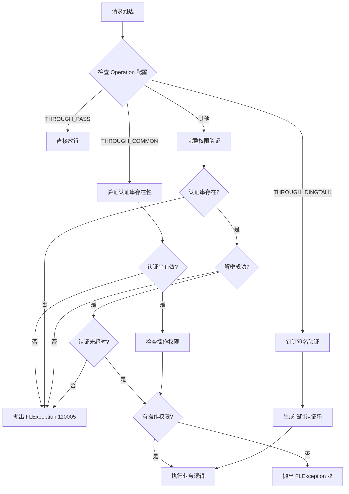

# core - 核心组件模块

[根目录](../../../../CLAUDE.md) > [src](../../../) > [com.fanglin](../../) > **core**

> 最后更新：2025-12-01 15:43:46

---

## 变更记录 (Changelog)

### 2025-12-01 15:43:46
- 初始化 core 模块 AI 上下文文档
- 完成核心组件架构分析
- 识别拦截器、基础DAO、安全组件

---

## 模块职责

core 模块是 Rhadamanthus ERP 系统的**核心框架层**，提供所有业务模块依赖的基础设施和通用能力。它实现了 Struts2 + Hibernate 的基础架构封装，包括：

- **基础 Action 抽象类**：提供统一的 HTTP 请求/响应处理和用户认证逻辑
- **拦截器系统**：实现登录验证、权限控制、异常捕获
- **通用 DAO 层**：封装 Hibernate 操作，提供分页、查询、缓存等通用能力
- **安全组件**：AES 加解密、MD5 哈希、验证码生成、图片验证码
- **类型转换器**：Struts2 参数类型转换支持
- **值对象 (VO)**：认证信息、过滤条件等核心数据结构

**核心价值**：
- 统一技术栈封装，降低业务模块开发复杂度
- 提供安全可靠的用户认证与授权机制
- 实现高效的数据库访问与查询性能优化
- 标准化异常处理与日志记录

---

## 入口与启动

### 模块结构

```
src/com/fanglin/core/
├── action/              # 基础 Action 抽象类
│   ├── BaseAction.java           # 所有非列表 Action 的基类
│   ├── BaseListAction.java       # 列表类 Action 的基类
│   ├── BaseExportAction.java     # 导出功能 Action 基类
│   └── BaseImportAction.java     # 导入功能 Action 基类
├── dao/                 # 通用 DAO 接口与实现
│   ├── Dao.java                  # 基础 DAO 接口
│   ├── GenericDao.java           # 泛型 DAO 接口
│   └── impl/
│       ├── DaoImpl.java          # 基础 DAO 实现
│       └── GenericDaoImpl.java   # 泛型 DAO 实现（核心）
├── interceptor/         # 拦截器
│   ├── LoginInterceptor.java     # 登录拦截器（异常处理）
│   ├── AccessInterceptor.java    # 访问权限拦截器
│   ├── CommonInterceptor.java    # 通用拦截器
│   └── FLException.java          # 业务异常类
├── security/            # 安全组件
│   ├── AESHelper.java            # AES 加解密工具
│   ├── MD5Helper.java            # MD5 哈希工具
│   ├── SecurityCodeHelper.java   # 验证码生成
│   └── SecurityImageHelper.java  # 图片验证码生成
├── converter/           # 类型转换器
│   └── StringTimestampConverter.java  # 字符串到 Timestamp 转换
└── vo/                  # 核心值对象
    ├── Authentication.java       # 用户认证信息
    ├── Duthentication.java       # 钉钉认证信息
    └── Filter.java               # 查询过滤条件
```

### 初始化流程

1. **Spring 容器启动**：加载 `conf/ApplicationContext.xml`，注入 SessionFactory
2. **Struts2 初始化**：加载 `conf/struts.xml`，配置拦截器栈
3. **拦截器链装配**：按顺序执行 AccessInterceptor → LoginInterceptor
4. **DAO 层初始化**：GenericDaoImpl 注入三个数据源（主库、公共库、财务库）

---

## 对外接口

### 1. BaseAction - 基础控制器

**路径**：`com.fanglin.core.action.BaseAction`

**核心方法**：

| 方法名 | 功能 | 返回值 |
|--------|------|--------|
| `queryUserId()` | 从 Cookie 或参数解析当前用户 ID | String |
| `queryUserName()` | 从 Cookie 或参数解析当前用户名 | String |
| `queryRoleId()` | 获取当前用户角色 ID | Integer |
| `queryCompany()` | 获取当前用户所属公司编号 | int |
| `authentication()` | 解析完整认证信息对象 | Authentication |

**认证流程**：
1. 从请求参数 `authentication` 获取加密认证串
2. 若无参数，从 Cookie `COOKIE_AUTHENTICATION` 读取
3. 使用 AES 解密（密钥从 `SystemConfig` 读取）
4. 解析为 `Authentication` 对象，包含用户 ID、角色、公司等信息

**继承关系**：
- 非列表页面继承 `BaseAction`
- 列表页面继承 `BaseListAction` → 提供分页查询能力
- 导出功能继承 `BaseExportAction` → 提供 Excel 导出
- 导入功能继承 `BaseImportAction` → 提供 Excel 导入

---

### 2. GenericDaoImpl - 通用 DAO 实现

**路径**：`com.fanglin.core.dao.impl.GenericDaoImpl`

**核心能力**：

#### (1) 基础 CRUD
```java
void save(Object obj);           // 保存对象
void update(Object obj);         // 更新对象
void delete(Object obj);         // 删除对象
void merge(Object obj);          // 合并对象
void refresh(Object obj);        // 刷新对象
```

#### (2) 分页查询 - PagingQuery
```java
PagingQuery<T> pagingQuery(Paging paging, Class<T> clazz);
```

**特性**：
- 自动计算总记录数和总页数
- 支持动态条件组装（Criterion）
- 支持排序（asc/desc）
- 支持表关联（alias）
- 支持二级缓存（可指定 cacheRegion）
- **降级策略**：超过 30 页且每页 >10 条时返回空结果（防止深度分页性能问题）

**操作符支持**：
| 操作符 | 含义 | 示例 |
|--------|------|------|
| `eq` | 等于 | `field = value` |
| `ne` | 不等于 | `field != value` |
| `lt` / `le` | 小于 / 小于等于 | `field < value` |
| `gt` / `ge` | 大于 / 大于等于 | `field > value` |
| `cn` | 包含（模糊匹配） | `field LIKE '%value%'` |
| `nc` | 不包含 | `NOT field LIKE '%value%'` |
| `bw` / `ew` | 开头 / 结尾 | `field LIKE 'value%'` |
| `in` / `ni` | 在列表中 / 不在列表中 | `field IN (...)` |

#### (3) Top 查询 - TopQuery
```java
TopQuery<T> topQuery(int maxResults, Class<T> clazz);
```

**用途**：查询前 N 条记录，不需要分页信息。

#### (4) 时间范围查询
```java
void timeranges(String field, String datetime);  // "2025-01-01-2025-12-31"
void timeranges(String profield, String postfield, String start, String end);
```

#### (5) 多数据源支持
```java
session()          // 主数据库（业务库）
communionSession() // 公共数据库（基础数据）
financeSession()   // 财务数据库
```

---

### 3. AccessInterceptor - 权限拦截器

**路径**：`com.fanglin.core.interceptor.AccessInterceptor`

**拦截逻辑**：



**权限检查来源**：
- 从 `OperationService.checkOperation(userId, actionName, rollcall)` 判断
- 支持点名模式（rollcall）：特殊权限验证

**超时控制**：
- 默认 30 分钟（可配置 `cookieOvertime`）
- 通过 `Authentication.isOverTime(int minutes)` 判断
- 永不超时用户：`freedom` 包含 `TIMEOUT_INT` 标志位

**性能监控**：
- 记录执行时间超过 5 秒的请求到日志

---

### 4. AESHelper - AES 加解密

**路径**：`com.fanglin.core.security.AESHelper`

**算法**：AES/CBC/PKCS5Padding

**配置**：
- 密钥：从 `sysconfig.properties` 读取 `encryptKey`（16 字节）
- 初始化向量：`encryptIv`（16 字节）

**方法**：
```java
String encrypt(String content, String key, String iv);  // 加密，返回 Base64
String decrypt(String content, String key, String iv);  // 解密
```

**应用场景**：
- Cookie 认证信息加密
- 验证码加密传输
- 敏感参数加密

---

### 5. Authentication - 认证信息 VO

**路径**：`com.fanglin.core.vo.Authentication`

**数据结构**：
```java
private String userId;      // 用户 ID
private String userName;    // 用户名
private Integer roleId;     // 角色 ID
private Long updateTime;    // 认证更新时间（时间戳）
private Integer company;    // 公司编号
private short timout;       // 是否允许超时（0/1）
private short rollcall;     // 是否需要点名验证（0/1）
```

**序列化格式**（未加密前）：
```
userId=xxx,roleId=123,userName=张三,updateTime=1234567890,company=1,timeout=0,rollcall=0
```

**使用示例**：
```java
// 生成认证串
Authentication auth = new Authentication(userId, userName, roleId, timestamp, false, company, freedom);
String encrypted = AESHelper.encrypt(auth.getAuthenticationStr(), key, iv);
CookieUtil.setCookie(response, "authentication", encrypted);

// 解析认证串
String encrypted = CookieUtil.getCookie(request, "authentication");
String decrypted = AESHelper.decrypt(encrypted, key, iv);
Authentication auth = new Authentication(decrypted);
```

---

### 6. Filter - 查询过滤器 VO

**路径**：`com.fanglin.core.vo.Filter`

**用途**：封装前端传来的查询条件，配合 `GenericDaoImpl.PagingQuery` 使用。

**字段**：
```java
private String field;   // 字段名（如 "userName"）
private String op;      // 操作符（如 "eq", "cn", "gt"）
private String data;    // 值（字符串）
private List<?> range;  // 范围值（如 IN 查询）
```

**示例**：
```java
Filter filter = new Filter("userName", "张三", "cn");  // userName LIKE '%张三%'
query.add(query.getCriterion(filter));
```

---

## 关键依赖与配置

### 依赖的外部库

| 库名 | 用途 |
|------|------|
| Hibernate 3.x | ORM 框架，数据库操作 |
| Struts2 2.5.16 | MVC 框架，请求路由 |
| Spring 4.3.17 | IoC 容器，依赖注入 |
| C3P0 | 数据库连接池 |
| EhCache | Hibernate 二级缓存 |
| SLF4J + Logback | 日志框架 |

### 配置文件

#### 1. `conf/struts.xml` - 拦截器配置

```xml
<interceptors>
    <interceptor name="accessInterceptor" class="com.fanglin.core.interceptor.AccessInterceptor"/>
    <interceptor name="loginInterceptor" class="com.fanglin.core.interceptor.LoginInterceptor"/>

    <interceptor-stack name="common">
        <interceptor-ref name="accessInterceptor"/>
        <interceptor-ref name="defaultStack"/>
    </interceptor-stack>

    <interceptor-stack name="login">
        <interceptor-ref name="loginInterceptor"/>
        <interceptor-ref name="defaultStack"/>
    </interceptor-stack>
</interceptors>
```

#### 2. `conf/sysconfig.properties` - 加密配置

```properties
encryptKey=***REMOVED***      # AES 密钥（16 字节）
encryptIv=***REMOVED***       # AES 初始化向量（16 字节）
cookieOvertime=30                 # Cookie 超时时间（分钟）
```

#### 3. `conf/ApplicationContext.xml` - DAO 数据源注入

```xml
<bean id="genericDaoImpl" class="com.fanglin.core.dao.impl.GenericDaoImpl">
    <property name="sessionFactory" ref="sessionFactory"/>
    <property name="communionSessionFactory" ref="communionSessionFactory"/>
    <property name="financeSessionFactory" ref="financeSessionFactory"/>
</bean>
```

---

## 数据模型

### 核心概念

#### 1. Operation - 操作权限配置

**通行级别**（`through` 字段）：

| 级别 | 值 | 含义 | 示例 |
|------|-----|------|------|
| `THROUGH_PASS` | 0 | 完全放行，不验证权限 | 登录页、验证码 |
| `THROUGH_COMMON` | 1 | 仅验证认证串有效性 | 公共 API |
| `THROUGH_DINGTALK` | 2 | 钉钉签名验证 | 钉钉回调接口 |
| `THROUGH_COMMUNION` | 3 | 公共模块权限 | 基础数据查询 |
| 其他 | - | 完整权限验证 | 业务操作 |

#### 2. 分页降级策略

**目的**：防止深度分页导致数据库性能问题。

**规则**：
- 第 30 页之后，若每页 >10 条 → 返回空结果
- 第 60 页之后，无论每页多少 → 返回空结果

**代码位置**：`GenericDaoImpl.PagingQuery.list()` 365-367 行

```java
if (paging.getRows() > 10 && paging.getPage() >= 30) return results;
if (paging.getPage() >= 60) return results;
```

---

## 测试与质量

### 当前测试覆盖

- 无独立单元测试文件
- 依赖集成测试和生产环境验证

### 建议增强

1. **单元测试**
   - 为 `AESHelper` 加解密方法编写测试
   - 为 `Authentication` 序列化/反序列化编写测试
   - 为 `GenericDaoImpl` 查询构造器编写测试

2. **集成测试**
   - 测试拦截器链正确执行顺序
   - 测试权限验证逻辑（通过 / 拒绝场景）
   - 测试超时机制准确性

3. **性能测试**
   - 分页查询深度翻页性能测试
   - 二级缓存命中率测试
   - AES 加解密性能测试

---

## 常见问题 (FAQ)

### Q1: 登录后提示"登陆超时"(110005)

**可能原因**：
1. Cookie 中 `authentication` 丢失或被篡改
2. 加密密钥配置不一致（前后端或多服务器）
3. 认证串超过 30 分钟未更新

**排查步骤**：
1. 检查浏览器 Cookie 是否存在 `authentication`
2. 验证 `conf/sysconfig.properties` 中 `encryptKey` 和 `encryptIv` 配置
3. 检查用户表 `freedom` 字段是否包含超时豁免标志

---

### Q2: 分页查询超过 30 页返回空结果

**原因**：系统内置的深度分页降级策略。

**解决方案**：
1. **优化查询条件**：添加更精确的过滤条件，减少总记录数
2. **修改降级阈值**：编辑 `GenericDaoImpl` 365-367 行（不推荐）
3. **使用游标分页**：改用基于 ID 或时间的游标分页，而非页码翻页

---

### Q3: 如何添加新的查询操作符？

**步骤**：

1. 编辑 `GenericDaoImpl.TopQuery.getCriterion()` 方法（187-223 行）
2. 添加新的 `else if` 分支：

```java
else if ("myop".equals(op)) {
    return Restrictions.yourCriterion(propertyName, value);
}
```

3. 前端传递 Filter 时使用新操作符：

```javascript
{ field: "status", op: "myop", data: "someValue" }
```

---

### Q4: 多数据源如何使用？

**场景**：
- 主库（`session()`）：装饰订单、施工、材料等业务数据
- 公共库（`communionSession()`）：部门、岗位、品牌、品类等基础数据
- 财务库（`financeSession()`）：账户、收支流水等财务数据

**示例**：

```java
// 查询主库
List<DecorationPO> decorations = createCriteria(DecorationPO.class).list();

// 查询公共库
Session communionSession = communionSession();
List<DepartmentPO> departments = communionSession.createCriteria(DepartmentPO.class).list();
```

**注意事项**：
- 跨库关联需在业务层手动组装
- 事务仅在单库内有效，跨库需分布式事务

---

## 相关文件清单

### 核心源码

| 文件路径 | 说明 | 行数 |
|---------|------|------|
| `core/action/BaseAction.java` | 基础 Action，提供认证解析 | 242 |
| `core/dao/impl/GenericDaoImpl.java` | 通用 DAO，核心查询能力 | 467 |
| `core/interceptor/AccessInterceptor.java` | 权限拦截器 | 187 |
| `core/interceptor/LoginInterceptor.java` | 登录拦截器（异常处理） | 42 |
| `core/interceptor/FLException.java` | 业务异常类 | 62 |
| `core/security/AESHelper.java` | AES 加解密工具 | 88 |
| `core/security/MD5Helper.java` | MD5 哈希工具 | - |
| `core/security/SecurityCodeHelper.java` | 验证码生成 | - |
| `core/security/SecurityImageHelper.java` | 图片验证码 | - |
| `core/vo/Authentication.java` | 认证信息 VO | 224 |
| `core/vo/Filter.java` | 查询过滤器 VO | 138 |

### 配置文件

| 文件路径 | 说明 |
|---------|------|
| `conf/struts.xml` | Struts2 拦截器配置 |
| `conf/ApplicationContext.xml` | Spring DAO 注入配置 |
| `conf/sysconfig.properties` | 加密密钥等系统配置 |

---

## 扩展建议

### 1. 性能优化

- **缓存策略优化**：为高频查询实体启用二级缓存
- **批量操作支持**：添加 `batchSave()` / `batchUpdate()` 方法
- **连接池调优**：优化 C3P0 参数（最大连接数、超时时间）

### 2. 安全增强

- **密钥轮转**：支持定期更换 AES 密钥
- **IP 白名单**：在 `AccessInterceptor` 中增加 IP 限制
- **防重放攻击**：在认证串中加入 nonce 和时间戳

### 3. 监控与诊断

- **慢查询日志**：记录执行时间超过阈值的 DAO 操作
- **拦截器耗时统计**：记录每个拦截器的执行时间
- **异常分类统计**：统计 FLException 各错误码的出现频率

---

## 与其他模块的关系

### 被依赖模块（所有业务模块都依赖 core）

- `decoration`、`quotation`、`construction`、`balance`、`sales` 等：继承 `BaseAction` 和 `BaseListAction`
- `material`、`customer`、`building` 等：使用 `GenericDaoImpl` 的分页查询
- `system`、`communion`、`approval` 等：依赖 `AccessInterceptor` 权限验证

### 依赖的其他模块

- `system`：权限检查依赖 `OperationService` 和 `CompanyService`
- `personel`：认证信息中的用户信息来自 `UserService`
- `utils`：使用 `CookieUtil`、`DateUtil`、`LogUtils` 等工具类

---

**注意事项**：
1. **不要直接修改 core 模块**：会影响所有业务模块，需严格测试
2. **加密配置务必保密**：`encryptKey` 和 `encryptIv` 泄露将导致认证体系失效
3. **分页降级阈值谨慎调整**：可能影响数据库性能
