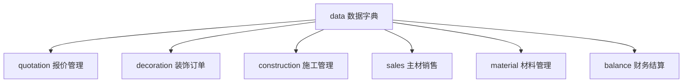

# data - 数据字典模块

[根目录](../../../../CLAUDE.md) > [src](../../../) > [com.fanglin](../../) > **data**

> 最后更新：2025-12-01 15:43:46

---

## 变更记录 (Changelog)

### 2025-12-01 15:43:46
- 初始化 data 模块 AI 上下文文档
- 识别三个子模块：quotation、material、common
- 完成基础数据架构分析

---

## 模块职责

data 模块是系统的**数据字典与基础规范库**，存储装饰行业的标准化数据和业务规则。它不是独立的业务模块，而是一个**数据容器**，包含三个子模块：

### 1. data.quotation - 报价数据字典

**职责**：装饰工程报价的标准化数据

- **功能区定义**：客厅、卧室、厨房、卫生间等空间的标准配置
- **工艺规范**：施工工艺、材料定额、计量规则
- **报价模板**：标准报价项、报价版本、报价格式
- **预算定价**：人工费、材料费、施工成本的基准价格

### 2. data.material - 材料数据字典

**职责**：建材主材的基础数据

- **商品库**：瓷砖、地板、卫浴、五金等材料信息
- **品牌品类**：品牌列表、品类分类、规格型号
- **价格体系**：成本价、销售价、会员价
- **辅料配件**：配件类型、颜色、规格

### 3. data.common - 通用数据字典

**职责**：跨业务的基础配置数据

- **施工数据**：施工节点、施工进度、施工周期
- **合同模板**：合同类型、付款比例、收款类型
- **验收标准**：验收项、验收模板、巡检项
- **财务配置**：银行账户、付款类型、发票类型
- **其他基础**：标签、品牌服务商、装饰属性类型

---

## 模块结构

```
src/com/fanglin/data/
├── quotation/               # 报价数据字典
│   ├── action/             # 20+ Action 类
│   ├── dao/                # 数据访问层
│   ├── service/            # 业务逻辑层
│   ├── po/                 # 持久化对象（缺失，可能在其他位置）
│   └── vo/                 # 值对象（缺失，可能在其他位置）
├── material/                # 材料数据字典
│   ├── action/             # 14 Action 类
│   ├── dao/                # 数据访问层
│   ├── service/            # 业务逻辑层
│   └── vo/                 # 15 值对象
└── common/                  # 通用数据字典
    ├── action/             # 36 Action 类
    ├── dao/                # 数据访问层
    ├── service/            # 业务逻辑层（部分缺失）
    ├── po/                 # 持久化对象（部分缺失）
    └── vo/                 # 值对象（部分缺失）
```

---

## 对外接口（示例）

### data.quotation 主要 Action

| Action 类 | 功能 | 管理的数据 |
|-----------|------|-----------|
| `FunctionAreaAction` | 功能区管理 | 客厅、卧室、厨房等功能空间 |
| `FunctionAreaItemAction` | 功能区项目 | 功能区内的装修项目 |
| `QuotationItemAction` | 报价项管理 | 标准报价项（吊顶、墙面、地面等） |
| `QuotationPriceAction` | 报价定价 | 报价项的价格配置 |
| `QuotationVersionAction` | 报价版本 | 报价模板的版本管理 |
| `NormriceAction` | 工艺定额 | 施工工艺的材料定额 |
| `NormpackAction` | 定额包 | 成套工艺定额组合 |
| `PresignCostAction` | 预算成本 | 预算项的成本配置 |
| `PresignItemAction` | 预算项 | 预算明细项 |

### data.material 主要 Action

| Action 类 | 功能 | 管理的数据 |
|-----------|------|-----------|
| `GoodsAction` | 商品管理 | 材料商品基本信息 |
| `PriceAction` | 价格管理 | 商品价格体系 |
| `FormatAction` | 规格管理 | 商品规格型号 |
| `ColorAction` | 颜色管理 | 商品颜色选项 |
| `MaterialModelAction` | 材料型号 | 材料的详细型号 |
| `GoodsPackageAction` | 商品套餐 | 组合销售的商品包 |
| `AccessoriesTypeAction` | 配件类型 | 辅料配件分类 |

### data.common 主要 Action

| Action 类 | 功能 | 管理的数据 |
|-----------|------|-----------|
| `ConstructionNodeAction` | 施工节点 | 施工阶段节点定义 |
| `ConstructionPaceAction` | 施工进度 | 进度模板配置 |
| `ConstructionPeriodAction` | 施工周期 | 工期配置 |
| `PaymentScaleAction` | 付款比例 | 合同付款比例模板 |
| `PaymentTypeAction` | 付款类型 | 付款方式分类 |
| `ReceiptTypeAction` | 收款类型 | 收款类型与发票配置 |
| `InspectAction` | 验收标准 | 验收项目定义 |
| `ContractAction` | 合同模板 | 合同条款模板 |
| `BankAccountAction` | 银行账户 | 公司收款账户 |
| `SignetAction` | 印章管理 | 电子印章图片 |

---

## 关键依赖与配置

### 依赖的模块

- `core`：继承 `BaseListAction`，使用通用 DAO
- `communion`：部门、品牌、品类等基础数据（跨模块引用）

### 被依赖模块

- `quotation` 模块：使用 data.quotation 的报价模板和工艺定额
- `decoration` 模块：使用 data.common 的合同模板和付款比例
- `construction` 模块：使用 data.common 的施工节点和进度模板
- `sales` / `material` 模块：使用 data.material 的商品库和价格体系

---

## 数据模型

### 核心概念

#### 1. 功能区（FunctionArea）

**定义**：装修空间的功能分区（如客厅、卧室、厨房）。

**包含**：
- 功能区项目（FunctionAreaItem）：该区域的标准配置项
- 功能区选项（FunctionAreaOption）：可选配置
- 功能区标签项（FunctionAreaLabelItem）：分类标签

#### 2. 报价项（QuotationItem）

**定义**：装修工程的计价单元（如墙面乳胶漆、地面找平）。

**包含**：
- 报价价格（QuotationPrice）：不同版本的价格
- 报价版本（QuotationVersion）：价格体系版本
- 报价格式（QuotationFormat）：报价单显示格式

#### 3. 工艺定额（Normrice）

**定义**：单位施工量所需的材料和人工定额。

**示例**：墙面乳胶漆，每平米需要：乳胶漆 0.3kg + 腻子粉 1.5kg + 人工 0.5 工时

#### 4. 商品（Goods）

**定义**：材料库中的商品记录。

**属性**：
- 商品名称、品牌、品类、规格、颜色
- 成本价、销售价、会员价
- 库存信息、供应商

---

## 测试与质量

### 当前测试覆盖

- 无独立单元测试
- 依赖系统测试和数据导入验证

### 建议增强

1. **数据一致性测试**
   - 验证功能区与报价项的关联完整性
   - 验证价格体系的版本一致性

2. **数据迁移测试**
   - 测试老版本数据升级到新版本的兼容性

3. **性能测试**
   - 测试大量商品数据的查询性能
   - 测试报价计算的性能

---

## 常见问题 (FAQ)

### Q1: 功能区与报价项的关系？

**答**：
- 功能区是**空间维度**的划分（客厅、卧室）
- 报价项是**工艺维度**的划分（吊顶、墙面）
- 一个功能区包含多个报价项
- 一个报价项可应用于多个功能区

**示例**：
- 功能区"客厅"包含：吊顶、墙面乳胶漆、地面找平
- 报价项"墙面乳胶漆"可用于：客厅、卧室、餐厅

---

### Q2: 如何管理价格体系版本？

**答**：通过 `QuotationVersion` 管理：

1. 创建新版本（如 V2.0）
2. 复制旧版本的报价项到新版本
3. 修改新版本的价格
4. 激活新版本，旧版本归档

**版本切换**：订单关联的是创建时的版本，不受后续版本变更影响。

---

### Q3: 工艺定额如何使用？

**流程**：

1. **定义工艺定额**（`Normrice`）：
   - 工艺名称："墙面乳胶漆"
   - 材料定额：乳胶漆 0.3kg/㎡ + 腻子粉 1.5kg/㎡
   - 人工定额：0.5 工时/㎡

2. **创建定额包**（`Normpack`）：
   - 定额包名称："标准墙面处理"
   - 包含：墙面找平 + 批腻子 + 乳胶漆

3. **应用到报价项**（`QuotationItem`）：
   - 报价项引用定额包
   - 根据施工面积自动计算材料用量

---

## 相关文件清单

### 核心源码统计

| 子模块 | Action 数 | DAO 数 | Service 数 | VO 数 | 说明 |
|--------|-----------|--------|-----------|-------|------|
| `data.quotation` | 20+ | 20+ | 20+ | ? | 报价数据字典 |
| `data.material` | 14 | 14 | 14 | 15 | 材料数据字典 |
| `data.common` | 36 | 36 | ? | ? | 通用数据字典 |
| **总计** | **70+** | **70+** | **54+** | **15+** | - |

### 主要 Action 文件

#### data.quotation
- `FunctionAreaAction.java` - 功能区管理
- `QuotationItemAction.java` - 报价项管理
- `NormriceAction.java` - 工艺定额管理
- `PresignItemAction.java` - 预算项管理

#### data.material
- `GoodsAction.java` - 商品管理
- `PriceAction.java` - 价格管理
- `FormatAction.java` - 规格管理
- `ColorAction.java` - 颜色管理

#### data.common
- `ConstructionNodeAction.java` - 施工节点
- `PaymentScaleAction.java` - 付款比例
- `InspectAction.java` - 验收标准
- `ContractAction.java` - 合同模板
- `BankAccountAction.java` - 银行账户

---

## 扩展建议

### 1. 数据导入导出

- **Excel 导入**：支持批量导入商品数据、报价项
- **Excel 导出**：支持导出基础数据用于备份或分析
- **数据模板下载**：提供标准的 Excel 模板

### 2. 数据版本管理

- **版本对比**：可视化展示不同版本的差异
- **版本回滚**：支持回滚到历史版本
- **版本审批**：新版本需经审批后才能激活

### 3. 数据审计

- **变更日志**：记录所有数据的增删改操作
- **操作人追溯**：记录每次变更的操作人和时间
- **数据恢复**：支持恢复误删的数据

---

## 与其他模块的关系

### 被依赖关系（核心地位）

data 模块是整个系统的**基础数据源**，被大量业务模块依赖：



### 依赖关系

- `communion`：品牌、品类等跨模块基础数据
- `system`：用户、角色、权限

---

**重要提示**：
1. **数据一致性至关重要**：data 模块的数据质量直接影响业务准确性
2. **变更需谨慎**：修改基础数据可能影响大量在单和历史记录
3. **建议建立审批流程**：重要数据的修改需经审批
4. **定期备份**：定期备份 data 模块的数据表
