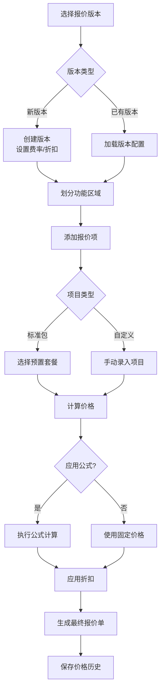

# Quotation - 报价管理模块

[根目录](../../../../../CLAUDE.md) > [src/com/fanglin/data](../../) > **quotation**

---

## 📋 模块职责

报价管理模块负责装饰行业的报价单生成、版本控制、价格计算、功能区域划分、标准包管理等核心功能，是ERP系统中的关键业务模块。

**核心功能：**
- 📝 报价版本管理（支持多版本对比）
- 🧮 报价项目管理（含价格计算公式）
- 💰 报价价格维护（含历史价格追溯）
- 🏗️ 功能区域划分（空间/工种分类）
- 📦 标准包管理（预置报价套餐）
- 🎯 预签成本管理（预算控制）
- 🏷️ 报价标签分类
- 📐 计算规则引擎（公式化定价）

---

## 🏗️ 模块结构

```
quotation/
├── action/          # API 控制器层（21个Action）
│   ├── QuotationVersionAction.java      # 报价版本管理
│   ├── QuotationItemAction.java         # 报价项管理
│   ├── QuotationPriceAction.java        # 价格管理
│   ├── FunctionAreaAction.java          # 功能区域管理
│   ├── NormpackAction.java              # 标准包管理
│   ├── PresignCostAction.java           # 预签成本
│   └── ...（其他15个Action）
├── service/         # 业务逻辑层
│   ├── impl/        # Service 实现类
│   └── ...
├── dao/             # 数据访问层
│   ├── impl/        # DAO 实现类
│   └── ...
└── vo/              # 值对象层（22个VO）
    ├── QuotationVersionVO.java          # 报价版本
    ├── QuotationItemVO.java             # 报价项
    ├── QuotationPriceVO.java            # 价格记录
    ├── FunctionAreaVO.java              # 功能区域
    └── ...（其他18个VO）
```

---

## 🔌 入口 Action 清单

### 核心业务 Action

| Action 类 | 职责描述 | 关键接口数 |
|-----------|---------|----------|
| `QuotationVersionAction` | 报价版本CRUD、默认版本设置 | 7个 |
| `QuotationItemAction` | 报价项CRUD、价格/折扣/公式更新 | 11个 |
| `QuotationPriceAction` | 报价价格历史维护 | 4个 |
| `FunctionAreaAction` | 功能区域管理 | 6个 |
| `QuotationFormatAction` | 报价格式配置 | 未统计 |
| `QuotationLabelAction` | 报价标签管理 | 未统计 |

### 辅助功能 Action

| Action 类 | 职责描述 | 关键接口数 |
|-----------|---------|----------|
| `NormpackAction` | 标准包管理 | 5个 |
| `NormpackItemAction` | 标准包项管理 | 未统计 |
| `PresignCostAction` | 预签成本管理 | 未统计 |
| `PresignItemAction` | 预签项管理 | 未统计 |
| `PresignPriceAction` | 预签价格管理 | 未统计 |
| `SystemDefineItemAction` | 系统预置项管理 | 未统计 |

### 价格计算相关 Action

| Action 类 | 职责描述 |
|-----------|---------|
| `CormriceAction` | 公司材料价格 |
| `NormriceAction` | 标准材料价格 |
| `NormaddAction` | 标准附加费 |
| `NormoodAction` | 标准其他费用 |

### 区域细分 Action

| Action 类 | 职责描述 |
|-----------|---------|
| `FunctionAreaItemAction` | 功能区域项管理 |
| `FunctionAreaOtemAction` | 功能区域其他项 |
| `QuotationCtemAction` | 报价施工项 |
| `QuotationRtemAction` | 报价材料项 |

---

## 📦 数据模型（22个 VO）

### 核心实体

#### 1. QuotationVersionVO - 报价版本

**职责**：存储报价版本信息，支持多版本管理

**关键字段**：
```java
- qvId: Long                        # 版本ID
- no: String                        # 版本编号
- name: String                      # 版本名称
- trafficRate: Integer              # 运费费率
- trafficDiscount: Short            # 运费折扣
- manageRate: Integer               # 管理费率
- manageDiscount: Short             # 管理费折扣
- taxRate: Integer                  # 税率
- taxDiscount: Short                # 税收折扣
- offset: Integer                   # 偏移量
- type: Short                       # 版本类型
- defaultFlag: Short                # 默认版本标识
- status: Short                     # 状态（启用/禁用）
- comment: String                   # 备注
```

**关联关系**：
- 一对多 → `QuotationItem`（报价项）
- 一对多 → `FunctionArea`（功能区域）

---

#### 2. QuotationItemVO - 报价项

**职责**：存储报价单中的单个项目信息（工程项、材料项等）

**关键字段**：
```java
- qiid: Long                        # 报价项ID
- no: String                        # 项目编号
- name: String                      # 项目名称
- alias: String                     # 别名
- qvid: Long                        # 版本ID（外键）
- version: QuotationVersionVO       # 关联版本对象
- category: QuotationTypeVO         # 报价类型分类
- classification: QuotationClassificationVO  # 报价分类
- bigCategory: QuotationBigCategoryVO        # 大类
- smallCategory: QuotationSmallCategoryVO    # 小类
- workType: WorkTypeVO              # 工种类型
- unit: MeasurementUnitVO           # 计量单位
- quotationCtem: QuotationCtemVO    # 施工项关联
- addPrice: Integer                 # 附加价格（单位：分）
- unitPrice: Integer                # 单价（单位：分）
- subPrice: Integer                 # 辅材价格（单位：分）
- cost: Integer                     # 成本价（单位：分）
- achePrice: Integer                # 实际价格（单位：分）
- type: Short                       # 项目类型
- status: Short                     # 状态
- discount: Short                   # 折扣
- formula: String                   # 价格计算公式
- offset: Integer                   # 偏移量
- isRtem: Short                     # 是否材料项
- rtemFlag: String                  # 材料项标识
- comment: String                   # 备注
```

**关联关系**：
- 多对一 → `QuotationVersion`
- 一对多 → `QuotationPrice`（价格历史）
- 多对一 → `QuotationType`, `QuotationClassification`, `WorkType`, `MeasurementUnit`

**业务规则**：
- 价格单位统一为"分"（需前端转换为元）
- 支持公式化定价（`formula` 字段存储计算表达式）
- 折扣以百分比存储（如 80 表示 80%）

---

#### 3. QuotationPriceVO - 报价价格历史

**职责**：记录报价项的价格变更历史

**关键字段**：
```java
- qpid: Long                        # 价格记录ID
- quotationItem: QuotationItemVO    # 关联报价项
- addPrice: Integer                 # 附加价格（单位：分）
- unitPrice: Integer                # 单价（单位：分）
- subPrice: Integer                 # 辅材价格（单位：分）
- createTime: Timestamp             # 创建时间（格式：yyyy-MM-dd）
- updateTime: Timestamp             # 更新时间（格式：yyyy-MM-dd）
- status: Short                     # 状态
```

**关联关系**：
- 多对一 → `QuotationItem`

**业务规则**：
- 每次价格调整都会新增一条记录（审计追溯）
- 时间戳格式化为 `yyyy-MM-dd`（通过 `@JSON` 注解）

---

#### 4. FunctionAreaVO - 功能区域

**职责**：将报价按空间区域（如客厅、卧室）或功能分类（如水电、瓦工）划分

**关键字段**：
```java
- faid: Long                        # 功能区域ID
- no: String                        # 区域编号
- name: String                      # 区域名称
- functionAreaOrder: int            # 排序序号
- functionAreaType: String          # 区域类型（空间/工种）
- version: QuotationVersionVO       # 关联版本
- type: Short                       # 类型
- total: Long                       # 区域合计金额
- status: Short                     # 状态
```

**关联关系**：
- 多对一 → `QuotationVersion`
- 一对多 → `FunctionAreaItem`（区域内的报价项）

---

#### 5. NormpackVO - 标准包

**职责**：预置报价套餐（如"豪华套餐"、"经济套餐"）

**关键字段**：
```java
- npid: long                        # 标准包ID
- name: String                      # 套餐名称
- status: short                     # 状态
```

**关联关系**：
- 一对多 → `NormpackItem`（套餐内的项目）

---

### 辅助实体（简略）

| VO 类 | 职责描述 |
|-------|---------|
| `QuotationCtemVO` | 施工项定义 |
| `QuotationRtemVO` | 材料项定义 |
| `QuotationLabelVO` | 报价标签 |
| `QuotationFormatVO` | 报价格式配置 |
| `PresignCostVO` | 预签成本 |
| `PresignItemVO` | 预签项目 |
| `PresignPriceVO` | 预签价格 |
| `PresignProduceVO` | 预签产品 |
| `CormriceVO` | 公司材料价格 |
| `NormriceVO` | 标准材料价格 |
| `NormaddVO` | 标准附加费 |
| `NormoodVO` | 标准其他费用 |
| `FunctionAreaItemVO` | 功能区域项 |
| `FunctionAreaOtemVO` | 功能区域其他项 |
| `FunctionAreaLabelItemVO` | 功能区域标签项 |
| `FunctionAreaOptionVO` | 功能区域选项 |
| `NormpackItemVO` | 标准包项 |
| `SystemDefineItemVO` | 系统预置项 |

---

## 🔗 API 接口详情

### QuotationVersionAction - 报价版本管理

**基础路径**：`/` （根路径，由 `@Namespace` 指定）

#### 1. 分页查询报价版本
```
POST /pageQuotationVersion
参数：Paging, Filters, Company（通过 BaseListAction 继承）
返回：JSON { success: boolean, rows: QuotationVersion[], total: number }
```

#### 2. 查询所有版本（不分页）
```
POST /queryQuotationVersion
参数：Company（当前公司）
返回：JSON { success: boolean, quotationVersions: QuotationVersion[] }
```

#### 3. 根据ID查询版本详情
```
POST /queryQuotationVersionByVersionId
参数：{ quotationVersion: { qvId: Long } }
返回：JSON { success: boolean, quotationVersion: QuotationVersion }
```

#### 4. 新增报价版本
```
POST /addQuotationVersion
参数：{ quotationVersion: QuotationVersionVO }
返回：JSON { success: boolean }
异常：FLException（业务异常）
```

#### 5. 更新报价版本
```
POST /updateQuotationVersion
参数：{ quotationVersion: QuotationVersionVO }
返回：JSON { success: boolean }
异常：FLException
```

#### 6. 设置默认版本
```
POST /updateQuotationVersionForDefault
参数：{ quotationVersion: { qvId: Long } }
返回：JSON { success: boolean }
异常：FLException
说明：将指定版本设为默认，其他版本的 defaultFlag 将被清除
```

#### 7. 更新版本状态（启用/禁用）
```
POST /updateQuotationVersionForStatus
参数：{ quotationVersion: { qvId: Long, status: Short } }
返回：JSON { success: boolean }
异常：FLException
```

---

### QuotationItemAction - 报价项管理

#### 1. 分页查询报价项
```
POST /pageQuotationItem
参数：Paging, Filters, Company
返回：JSON { success: boolean, rows: QuotationItem[], total: number }
异常：FLException
```

#### 2. 根据版本ID分页查询报价项
```
POST /pageQuotationItemByVersionId
参数：Paging, Filters, { quotationItem: { qvid: Long } }
返回：JSON { success: boolean, rows: QuotationItem[], total: number }
```

#### 3. 查询报价项（用于价格关联）
```
POST /pageQuotationItemForPrice
参数：Paging, Filters, { quotationItem: {...}, quotationPrice: {...} }
返回：JSON { success: boolean, rows: QuotationItem[], total: number }
```

#### 4. 根据项目ID和版本ID查询详情
```
POST /queryQuotationItemByItemIdAVersionId
参数：{ quotationItem: { qiid: Long, qvid: Long } }
返回：JSON { success: boolean, quotationItem: QuotationItem }
异常：FLException
```

#### 5. 根据报价项ID查询详情
```
POST /queryQuotationItemByQiid
参数：{ quotationItem: { qiid: Long } }
返回：JSON { success: boolean, quotationItem: QuotationItem }
异常：FLException
```

#### 6. 新增报价项
```
POST /addQuotationItem
参数：{ quotationItem: QuotationItemVO }
返回：JSON { success: boolean }
异常：FLException
```

#### 7. 更新报价项
```
POST /updateQuotationItem
参数：{ quotationItem: QuotationItemVO }
返回：JSON { success: boolean }
异常：FLException
```

#### 8. 更新报价项状态
```
POST /updateQuotationItemForStatus
参数：{ quotationItem: { qiid: Long, status: Short } }
返回：JSON { success: boolean }
异常：FLException
```

#### 9. 更新报价项折扣
```
POST /updateQuotationItemForDiscount
参数：{ quotationItem: { qiid: Long, discount: Short } }
返回：JSON { success: boolean }
异常：FLException
```

#### 10. 更新报价项计算公式
```
POST /updateQuotationItemForFormula
参数：{ quotationItem: { qiid: Long, formula: String } }
返回：JSON { success: boolean }
异常：FLException
说明：formula 字段存储价格计算表达式（如 "unitPrice * 1.2 + addPrice"）
```

#### 11. 更新报价项成本
```
POST /updateQuotationItemForCost
参数：{ quotationItem: { qiid: Long, cost: Integer } }
返回：JSON { success: boolean }
异常：FLException
```

---

### QuotationPriceAction - 价格管理

#### 1. 分页查询价格历史
```
POST /pageQuotationPrice
参数：Paging, Filters, { quotationPrice: {...} }
返回：JSON { success: boolean, rows: QuotationPrice[], total: number }
异常：FLException
```

#### 2. 新增价格记录
```
POST /addQuotationPrice
参数：{ quotationPrice: QuotationPriceVO }
返回：JSON { success: boolean }
异常：FLException
```

#### 3. 更新价格记录
```
POST /updateQuotationPrice
参数：{ quotationPrice: QuotationPriceVO }
返回：JSON { success: boolean }
异常：FLException, ParseException
```

#### 4. 删除价格记录
```
POST /deleteQuotationPrice
参数：{ quotationPrice: { qpid: Long } }
返回：JSON { success: boolean }
异常：FLException
```

---

### FunctionAreaAction - 功能区域管理

#### 1. 分页查询功能区域
```
POST /pageFunctionArea
参数：Paging, Filters, Company
返回：JSON { success: boolean, rows: FunctionArea[], total: number }
异常：FLException
```

#### 2. 根据ID和版本ID查询功能区域
```
POST /queryFunctionAreaByIdAVersionId
参数：{ functionArea: { faid: Long, version: { qvId: Long } } }
返回：JSON { success: boolean, functionArea: FunctionArea }
异常：FLException
```

#### 3. 根据版本ID查询所有功能区域
```
POST /queryFunctionAreaByVersionId
参数：{ functionArea: { version: { qvId: Long } } }
返回：JSON { success: boolean, functionAreas: FunctionArea[] }
异常：FLException
```

#### 4. 新增功能区域
```
POST /addFunctionArea
参数：{ functionArea: FunctionAreaVO }, Company
返回：JSON { success: boolean }
异常：FLException
```

#### 5. 更新功能区域
```
POST /updateFunctionArea
参数：{ functionArea: FunctionAreaVO }
返回：JSON { success: boolean }
异常：FLException
```

#### 6. 更新功能区域状态
```
POST /updateFunctionAreaForStatus
参数：{ functionArea: { faid: Long, status: Short } }
返回：JSON { success: boolean }
异常：FLException
```

#### 7. 删除功能区域
```
POST /deleteFunctionArea
参数：{ functionArea: { faid: Long } }
返回：JSON { success: boolean }
```

---

### NormpackAction - 标准包管理

#### 1. 分页查询标准包
```
POST /pageNormpack
参数：Paging, Filters, Company
返回：JSON { success: boolean, rows: Normpack[], total: number }
异常：FLException
```

#### 2. 查询标准包列表
```
POST /queryNormpack
参数：{ normpack: NormpackVO }, Company
返回：JSON { success: boolean, normpacks: Normpack[] }
异常：FLException
```

#### 3. 新增标准包
```
POST /addNormpack
参数：{ normpack: NormpackVO }, Company
返回：JSON { success: boolean }
异常：FLException
```

#### 4. 更新标准包状态
```
POST /updateNormpackForStatus
参数：{ normpack: { npid: long, status: short } }
返回：JSON { success: boolean }
异常：FLException
```

#### 5. 删除标准包
```
POST /deleteNormpack
参数：{ normpack: { npid: long } }
返回：JSON { success: boolean }
异常：FLException
```

---

## 📊 业务流程

### 报价单生成流程



### 价格计算逻辑

```
最终价格 = (单价 + 附加价格 + 辅材价格) * 折扣 / 100
         + 运费 * 运费费率 * 运费折扣 / 100
         + 管理费 * 管理费率 * 管理费折扣 / 100
         + 税费 * 税率 * 税收折扣 / 100
```

**特殊说明**：
- 所有价格字段单位为"分"
- 折扣字段为百分比（如 80 表示 80%）
- 支持自定义公式（存储在 `formula` 字段）

---

## 🔗 依赖关系

### 内部依赖（本项目模块）

- **`com.fanglin.communion`** - 公共基础数据模块
  - `MeasurementUnitVO` - 计量单位
  - `QuotationTypeVO` - 报价类型
  - `QuotationClassificationVO` - 报价分类
  - `QuotationBigCategoryVO` - 大类
  - `QuotationSmallCategoryVO` - 小类
  - `WorkTypeVO` - 工种类型

- **`com.fanglin.core`** - 核心基础模块
  - `BaseListAction` - 分页查询基础类
  - `FLException` - 业务异常类

### 外部依赖（第三方库）

- **Spring Framework**
  - `@Autowired` - 依赖注入
  - `@Controller` - 控制器标注

- **Struts2**
  - `@Action` - 接口路由
  - `@Namespace` - 命名空间
  - `@ParentPackage` - 父包配置
  - `@Result` - 返回结果配置

- **JSON 序列化**
  - `@JSON` - 时间格式化（如 `@JSON(format = "yyyy-MM-dd")`）

---

## 📂 关键文件路径

```
src/com/fanglin/data/quotation/
├── action/
│   ├── QuotationVersionAction.java      # 👈 版本管理入口
│   ├── QuotationItemAction.java         # 👈 报价项管理入口
│   ├── QuotationPriceAction.java        # 👈 价格管理入口
│   ├── FunctionAreaAction.java          # 👈 区域管理入口
│   └── NormpackAction.java              # 👈 标准包管理入口
├── service/
│   ├── QuotationVersionService.java     # 版本业务逻辑接口
│   ├── QuotationItemService.java        # 报价项业务逻辑接口
│   └── impl/                            # 业务实现类
├── dao/
│   ├── QuotationVersionDao.java         # 版本数据访问接口
│   ├── QuotationItemDao.java            # 报价项数据访问接口
│   └── impl/                            # DAO 实现类
└── vo/
    ├── QuotationVersionVO.java          # 👈 版本实体
    ├── QuotationItemVO.java             # 👈 报价项实体
    ├── QuotationPriceVO.java            # 👈 价格实体
    └── ...（其他 VO）
```

---

## 🧪 测试建议

### 单元测试覆盖点

1. **价格计算逻辑**
   - 测试公式解析器（`formula` 字段）
   - 测试折扣计算正确性
   - 测试费率叠加计算
   - 边界值测试（负数、零值、超大值）

2. **版本管理**
   - 默认版本唯一性测试
   - 版本切换时数据隔离测试
   - 版本状态变更影响测试

3. **数据完整性**
   - 外键关联测试（版本删除时级联处理）
   - 必填字段验证
   - 数据类型边界测试

### 集成测试场景

1. **完整报价单生成流程**
   - 创建版本 → 添加功能区域 → 添加报价项 → 计算价格 → 生成报价单

2. **价格历史追溯**
   - 修改报价项价格 → 验证新记录生成 → 查询历史记录

3. **标准包应用**
   - 选择标准包 → 批量生成报价项 → 验证价格计算

---

## ❓ FAQ

### Q1: 为什么价格字段是 Integer 类型而不是 BigDecimal？
**A**: 系统采用"分"为单位存储价格，避免浮点数精度问题。前端需要除以 100 转换为"元"显示。

**示例转换**：
```javascript
// 后端返回：unitPrice = 12345（分）
// 前端显示：¥123.45（元）
const priceInYuan = unitPrice / 100;
```

---

### Q2: 报价项的 `formula` 字段支持哪些计算表达式？
**A**: 支持基本四则运算和字段引用。

**示例公式**：
```
# 基础计算
unitPrice * 1.2 + addPrice

# 带条件计算
(unitPrice + subPrice) * (discount / 100)

# 引用其他字段
cost * 1.5 + achePrice
```

**注意**：具体公式解析逻辑在 Service 层实现，需查看 `QuotationItemServiceImpl` 确认支持的函数。

---

### Q3: 如何实现报价版本的复制功能？
**A**: 当前 Action 层未提供直接的版本复制接口，建议：

1. 前端调用 `queryQuotationVersionByVersionId` 获取源版本数据
2. 修改 `qvId` 为 `null`（触发新增）
3. 修改 `no` 和 `name` 避免重复
4. 调用 `addQuotationVersion` 创建新版本
5. 使用 Service 层批量复制关联的报价项和功能区域

---

### Q4: 多个公司如何隔离报价数据？
**A**: 通过 `BaseListAction.queryCompany()` 获取当前登录公司信息，所有查询都会自动过滤公司维度。

**关键点**：
- `queryCompany()` 来自基类，通过 Session 或 Token 识别当前公司
- 新增操作需要显式传递 `Company` 参数
- DAO 层查询需添加 `company_id` 条件

---

### Q5: 报价项的状态字段有哪些取值？
**A**: 需查看数据字典或枚举类确认，常见取值推测：

```
0 - 禁用
1 - 启用
2 - 草稿
3 - 已归档
```

**建议**：在 `com.fanglin.data` 或 `com.fanglin.communion` 包中查找 `QuotationItemStatus` 枚举类。

---

### Q6: 如何调试价格计算不准确的问题？
**A**: 排查步骤：

1. **检查基础价格字段**
   ```sql
   SELECT qiid, unitPrice, addPrice, subPrice, cost, discount
   FROM quotation_item WHERE qiid = ?
   ```

2. **检查版本费率配置**
   ```sql
   SELECT trafficRate, manageRate, taxRate,
          trafficDiscount, manageDiscount, taxDiscount
   FROM quotation_version WHERE qvId = ?
   ```

3. **检查公式字段**
   ```sql
   SELECT formula FROM quotation_item WHERE qiid = ?
   ```

4. **启用 Service 层日志**
   - 在 `QuotationItemServiceImpl` 中添加价格计算日志
   - 记录每一步计算中间值

5. **检查价格历史**
   ```sql
   SELECT * FROM quotation_price
   WHERE quotationItem.qiid = ?
   ORDER BY createTime DESC
   ```

---

## 📝 变更记录（Changelog）

| 日期 | 版本 | 变更内容 | 负责人 |
|------|------|---------|--------|
| 2025-12-01 | 1.0.0 | 初始化模块文档，包含 22 个 VO 和 21 个 Action | AI Assistant |

---

## 📚 扩展阅读

- [根目录 CLAUDE.md](../../../../../CLAUDE.md) - 查看完整项目架构
- [Communion 模块文档](../../communion/CLAUDE.md) - 了解基础数据依赖
- [Decoration 模块文档](../../decoration/CLAUDE.md) - 了解报价如何关联订单

---

**文档生成时间**: 2025-12-01
**模块路径**: `src/com/fanglin/data/quotation/`
**维护状态**: ✅ 已完成基础文档