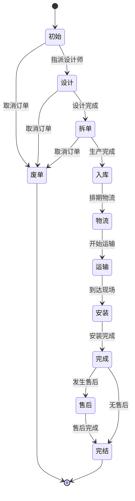

# production - 生产管理模块

[根目录](../../../CLAUDE.md) > [src](../../) > [com/fanglin](..) > **production**

> 最后更新：2025-12-01 18:30:02

---

## 模块职责

production 模块负责**定制产品生产全流程管理**，主要用于橱柜、衣柜、全屋定制等产品的从设计到安装的完整生产周期管理。涵盖生产单管理、工艺流程、生产计划、五金配件、外协加工等功能。

**核心功能**
- 生产单全生命周期管理（设计→拆单→生产→入库→物流→安装→售后→完结）
- 生产工艺流程配置
- 生产计划排期
- 五金配件管理
- 外协加工管理
- 报价管理
- 运输打包管理
- 车间管理

---

## 入口与启动

### 控制器入口
- `ProductionAction` - 生产单核心管理
- `WorkflowAction` - 工艺流程管理
- `ProductionPlanAction` - 生产计划管理
- `HardwareAction` - 五金配件管理
- `OutsourceAction` - 外协加工管理
- `PuotationAction` - 生产报价管理
- `TranpackAction` - 运输打包管理
- `WorkshopAction` - 车间管理

### 前端页面
- `WebContent/views/production/production.html` - 生产单列表
- `WebContent/views/production/production4view.html` - 生产单详情
- `WebContent/views/production/workflow.html` - 工艺流程管理
- `WebContent/views/production/productionPlan.html` - 生产计划
- `WebContent/views/production/hardware.html` - 五金管理
- `WebContent/views/production/outsource.html` - 外协加工

---

## 对外接口

### 生产单管理
```java
// 分页查询生产单
GET/POST /pageProduction.do
Request: Paging + Filters + company
Response: { data: [...], total, pages }

// 新建生产单
POST /addProduction.do
Request: {
  orderId, house, brand, salesman, designer,
  timeLimit, total, ...
}
Response: { pid, pno }

// 更新生产单
POST /updateProduction.do
Request: { pid, ... }
Response: success

// 设计完成
POST /designProduction.do
Request: { pid, designTime }
Response: success

// 拆单
POST /splitProduction.do
Request: { pid, divideTime }
Response: success

// 入库
POST /instoreProduction.do
Request: { pid, storeTime }
Response: success

// 排期物流
POST /planProduction.do
Request: { pid, planTime }
Response: success

// 运输
POST /tranProduction.do
Request: { pid, tranTime }
Response: success

// 安装
POST /mountProduction.do
Request: { pid, mountTime }
Response: success

// 完成
POST /finishProduction.do
Request: { pid, finishTime }
Response: success

// 售后
POST /upholdProduction.do
Request: { pid, ... }
Response: success

// 废单
POST /terminalProduction.do
Request: { pid, ... }
Response: success
```

### 工艺流程管理
```java
// 分页查询工艺流程
GET/POST /pageWorkflow.do
Request: Paging + Filters + company
Response: { workflows: [...] }

// 查询所有工艺流程
GET/POST /queryWorkflow.do
Request: company
Response: { workflows: [...] }

// 新增工艺流程
POST /addWorkflow.do
Request: { name, steps, ... }
Response: success

// 更新工艺流程
POST /updateWorkflow.do
Request: { wid, ... }
Response: success

// 更新流程状态
POST /updateWorkflowForStatus.do
Request: { wid, status }
Response: success
```

### 生产计划
```java
// 分页查询生产计划
GET/POST /pageProductionPlan.do
Request: Paging + Filters
Response: { plans: [...] }

// 新增生产计划
POST /addProductionPlan.do
Request: { pid, planDate, ... }
Response: success
```

### 五金配件
```java
// 分页查询五金
GET/POST /pageHardware.do
Request: Paging + Filters
Response: { hardwares: [...] }

// 新增五金
POST /addHardware.do
Request: { pid, items: [...] }
Response: success
```

### 外协加工
```java
// 分页查询外协
GET/POST /pageOutsource.do
Request: Paging + Filters
Response: { outsources: [...] }

// 新增外协
POST /addOutsource.do
Request: { pid, supplier, items: [...] }
Response: success
```

---

## 关键依赖与配置

### 核心依赖
- `com.fanglin.decoration` - 装修订单关联
- `com.fanglin.sales` - 主材销售关联
- `com.fanglin.communion` - 品牌、房产基础数据
- `com.fanglin.personel` - 设计师、销售员、拆单员
- `com.fanglin.material` - 材料库存

### 导航配置
- `ds/production.json` - 生产管理菜单配置
  - 生产单管理
  - 工艺流程
  - 生产计划
  - 五金配件
  - 外协加工
  - 车间管理

---

## 数据模型

### 核心实体（PO）

#### ProductionPO - 生产单
```java
@Entity
@Table(name = "production", catalog = "production")
- pid: long                     // 生产单ID
- spid: String                  // 父级生产单（售后单时使用）
- orderId: String               // 关联装修单号
- pno: String                   // 生产单号
- house: HousePO                // 房产信息
- brand: BrandPO                // 品牌
- creater: UserPO               // 创建人
- salesman: UserPO              // 销售员
- designer: UserPO              // 设计师
- spliter: UserPO               // 拆单员
- createTime: Timestamp         // 创建时间
- designTime: Timestamp         // 设计时间
- divideTime: Timestamp         // 拆单时间
- storeTime: Timestamp          // 入库时间
- planTime: Timestamp           // 物流排期时间
- tranTime: Timestamp           // 运输时间
- mountTime: Timestamp          // 安装时间
- finishTime: Timestamp         // 完成时间
- updateTime: Timestamp         // 更新时间
- timeLimit: int                // 工期（天）
- total: long                   // 总价（分）
- status: short                 // 状态
- type: short                   // 类型（生产单/售后单）
- company: int                  // 公司

状态枚举：
- 0: 初始
- 1: 设计
- 2: 拆单/生产
- 3: 入库
- 4: 物流
- 5: 运输
- 6: 安装
- 7: 完成
- 8: 售后
- 9: 完结
- 10: 废单
```

#### WorkflowPO - 工艺流程
```java
@Entity
- wid: long                     // 流程ID
- name: String                  // 流程名称
- steps: String                 // 工艺步骤（JSON）
- company: int                  // 公司
- status: short                 // 状态（启用/停用）
```

#### ProductionPlanPO - 生产计划
```java
@Entity
- ppid: long                    // 计划ID
- production: ProductionPO      // 生产单
- planDate: Date                // 计划日期
- workshop: WorkshopPO          // 车间
- status: short                 // 状态
```

#### HardwarePO - 五金配件
```java
@Entity
- hid: long                     // 五金单ID
- production: ProductionPO      // 生产单
- total: long                   // 总金额
- createTime: Timestamp         // 创建时间
- status: short                 // 状态
```

#### HardwareItemPO - 五金明细
```java
@Entity
- hiid: long                    // 明细ID
- hardware: HardwarePO          // 五金单
- name: String                  // 配件名称
- specification: String         // 规格
- quantity: int                 // 数量
- price: long                   // 单价
```

#### OutsourcePO - 外协加工单
```java
@Entity
- oid: long                     // 外协单ID
- production: ProductionPO      // 生产单
- supplier: SupplierPO          // 供应商
- total: long                   // 总金额
- createTime: Timestamp         // 创建时间
- status: short                 // 状态
```

#### WorkshopPO - 车间
```java
@Entity
- wsid: long                    // 车间ID
- name: String                  // 车间名称
- capacity: int                 // 产能
- company: int                  // 公司
```

### 值对象（VO）
- `ProductionVO` - 生产单视图对象
- `WorkflowVO` - 工艺流程视图
- `ProductionPlanVO` - 生产计划视图
- `HardwareVO` - 五金视图
- `OutsourceVO` - 外协视图

---

## 生产流程状态机



---

## 测试与质量

### 当前测试覆盖
- 未发现独立的测试文件
- 依赖手工测试与业务验收

### 建议增强
1. 为状态流转逻辑添加单元测试
2. 测试并发场景下的状态更新
3. 验证工艺流程配置的正确性
4. 测试生产计划排期算法

---

## 常见问题 (FAQ)

**Q: 生产单的状态流转规则是什么？**
A: 生产单遵循严格的状态流转顺序：
1. 初始 → 设计（指派设计师）
2. 设计 → 拆单（设计完成）
3. 拆单 → 入库（生产完成）
4. 入库 → 物流 → 运输 → 安装 → 完成
5. 完成后可进入售后，最终完结
6. 各阶段可作废

**Q: 售后单与生产单有什么区别？**
A: 售后单（type=1）是针对已完成生产单的补充：
- 通过 `spid` 字段关联原生产单
- 流程相似但更简化
- 金额可能为零（免费售后）

**Q: 如何配置工艺流程？**
A: 在 WorkflowAction 中：
1. 定义流程名称
2. 配置工艺步骤（JSON 格式）
3. 启用流程
4. 在生产单中引用

**Q: 生产计划如何排期？**
A: 基于以下因素：
- 车间产能
- 订单优先级
- 工期要求
- 当前负载

**Q: 外协加工如何管理？**
A: OutsourceAction 管理外协：
- 关联生产单
- 选择供应商
- 明细项目与金额
- 跟踪外协进度

---

## 相关文件清单

### 核心代码
```
src/com/fanglin/production/
├── action/
│   ├── ProductionAction.java             - 生产单核心管理
│   ├── WorkflowAction.java               - 工艺流程管理
│   ├── ProductionPlanAction.java         - 生产计划
│   ├── HardwareAction.java               - 五金配件
│   ├── OutsourceAction.java              - 外协加工
│   ├── PuotationAction.java              - 生产报价
│   ├── TranpackAction.java               - 运输打包
│   └── WorkshopAction.java               - 车间管理
├── service/
│   ├── ProductionService.java            - 生产单服务
│   ├── WorkflowService.java              - 工艺流程服务
│   ├── ProductionPlanService.java        - 生产计划服务
│   ├── HardwareService.java              - 五金服务
│   └── OutsourceService.java             - 外协服务
├── dao/
│   ├── ProductionDao.java                - 生产单DAO
│   ├── WorkflowDao.java                  - 工艺流程DAO
│   ├── ProductionPlanDao.java            - 生产计划DAO
│   ├── HardwareDao.java                  - 五金DAO
│   └── OutsourceDao.java                 - 外协DAO
├── po/
│   ├── ProductionPO.java                 - 生产单实体
│   ├── WorkflowPO.java                   - 工艺流程实体
│   ├── ProductionPlanPO.java             - 生产计划实体
│   ├── HardwarePO.java                   - 五金实体
│   ├── HardwareItemPO.java               - 五金明细实体
│   ├── OutsourcePO.java                  - 外协实体
│   └── WorkshopPO.java                   - 车间实体
└── vo/
    ├── ProductionVO.java                 - 生产单VO
    ├── WorkflowVO.java                   - 工艺流程VO
    ├── ProductionPlanVO.java             - 生产计划VO
    └── HardwareVO.java                   - 五金VO
```

### 前端页面
```
WebContent/views/production/
├── production.html                       - 生产单列表
├── production4view.html                  - 生产单详情
├── workflow.html                         - 工艺流程管理
├── productionPlan.html                   - 生产计划
├── hardware.html                         - 五金管理
├── outsource.html                        - 外协加工
├── tranpack.html                         - 运输打包
└── workshop.html                         - 车间管理
```

---

## 变更记录 (Changelog)

### 2025-12-01 18:30:02
- 初始化生产管理模块 AI 上下文文档
- 记录生产单全生命周期管理流程
- 梳理工艺流程、生产计划、五金、外协等功能
- 补充状态机图与业务规则说明
