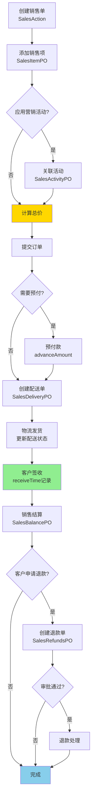

# Sales - 主材销售模块

[根目录](../../../../CLAUDE.md) > [src/com/fanglin](../) > **sales**

---

## 📋 模块职责

主材销售模块负责装饰订单的主材（瓷砖、地板、洁具等）销售管理，涵盖销售单创建、活动促销、配送管理、结算退款等核心业务流程。

**核心功能：**
- 🛒 销售单管理（主材销售订单）
- 🎉 营销活动管理（促销、折扣、满减）
- 📦 配送管理（物流跟踪、签收确认）
- 💰 销售结算（与财务模块集成）
- 🔙 退款退货管理
- 🖼️ 销售凭证管理
- 📋 销售档案与配置
- 💳 支付记录管理
- 📊 其他销售项（非标商品）

---

## 🏗️ 模块结构

```
sales/
├── action/          # API 控制器层（13个Action）
│   ├── SalesAction.java                     # 销售单主控制器
│   ├── SalesBalanceAction.java              # 销售结算管理
│   ├── SalesActivityAction.java             # 营销活动管理
│   ├── SalesActivityItemAction.java         # 活动项管理
│   ├── SalesActivityRecordAction.java       # 活动记录管理
│   ├── SalesDeliveryAction.java             # 配送管理
│   ├── SalesRefundsAction.java              # 退款退货管理
│   ├── SalesPictureAction.java              # 销售凭证图片管理
│   ├── SalesProfileAction.java              # 销售档案管理
│   ├── SalesFunctionAction.java             # 销售功能配置
│   ├── OalesAction.java                     # 其他销售管理
│   └── OalesPayAction.java                  # 其他销售支付
├── service/         # 业务逻辑层
├── dao/             # 数据访问层
├── po/              # 持久化对象层（20个PO + 2个BO/OO）
└── vo/              # 值对象层
```

---

## 🔌 入口 Action 清单

| Action 类 | 职责描述 | 关键接口 | 路径 |
|-----------|---------|---------|------|
| `SalesAction` | 销售单CRUD、预付/结算查询 | pageSales, pageSalesForAdvance, pageSalesForBalance | sales/action/SalesAction.java:22 |
| `SalesBalanceAction` | 销售结算单处理 | 未统计 | - |
| `SalesActivityAction` | 营销活动CRUD | 未统计 | - |
| `SalesActivityItemAction` | 活动项管理（商品/折扣配置） | 未统计 | - |
| `SalesActivityRecordAction` | 活动参与记录 | 未统计 | - |
| `SalesDeliveryAction` | 配送单管理（物流信息） | 未统计 | - |
| `SalesRefundsAction` | 退款退货单处理 | 未统计 | - |
| `SalesPictureAction` | 销售凭证图片上传与查询 | 未统计 | - |
| `SalesProfileAction` | 销售档案配置 | 未统计 | - |
| `SalesFunctionAction` | 销售功能开关配置 | 未统计 | - |
| `OalesAction` | 其他销售项管理（非标商品） | 未统计 | - |
| `OalesPayAction` | 其他销售支付记录 | 未统计 | - |

---

## 📦 数据模型（20个 PO + 2个 BO/OO）

### 核心实体

#### 1. SalesPO - 销售单主表

**职责**：存储主材销售订单的核心信息

**关键字段**（推测）：
```java
- sid: long                         # 销售单ID
- no: String                        # 销售单编号
- decoration: DecorationPO          # 关联装饰订单（多对一）
- customer: CustomerPO              # 客户信息（多对一）
- creater: UserPO                   # 创建人（多对一）
- amount: long                      # 总金额（单位：分）
- advanceAmount: long               # 预付金额（单位：分）
- balanceAmount: long               # 结算金额（单位：分）
- createTime: Timestamp             # 创建时间
- deliveryTime: Timestamp           # 配送时间
- balanceTime: Timestamp            # 结算时间
- status: short                     # 状态（草稿/已提交/已配送/已结算）
- company: int                      # 所属公司
```

**关联关系**：
- 多对一 → `DecorationPO`（装饰订单）
- 一对多 → `SalesItemPO`（销售项明细）
- 一对多 → `SalesBalancePO`（结算记录）
- 一对多 → `SalesDeliveryPO`（配送记录）
- 一对多 → `SalesRefundsPO`（退款记录）

---

#### 2. SalesItemPO - 销售项明细

**职责**：存储销售单中的单个商品信息

**关键字段**（推测）：
```java
- siid: long                        # 销售项ID
- sales: SalesPO                    # 关联销售单（多对一）
- material: MaterialPO              # 关联材料（多对一）
- quantity: int                     # 数量
- unitPrice: long                   # 单价（单位：分）
- totalPrice: long                  # 小计（单位：分）
- discount: short                   # 折扣
- activity: SalesActivityPO         # 关联营销活动（多对一，可选）
```

---

#### 3. SalesActivityPO - 营销活动

**职责**：存储促销活动配置（满减、折扣、赠品等）

**关键字段**（推测）：
```java
- said: long                        # 活动ID
- name: String                      # 活动名称
- startTime: Timestamp              # 开始时间
- endTime: Timestamp                # 结束时间
- type: short                       # 活动类型（满减/折扣/赠品）
- ruleConfig: String                # 活动规则（JSON格式）
- status: short                     # 状态（启用/禁用）
- company: int                      # 所属公司
```

**关联关系**：
- 一对多 → `SalesActivityItemPO`（活动商品）
- 一对多 → `SalesActivityRecordPO`（参与记录）

---

#### 4. SalesDeliveryPO - 配送单

**职责**：存储销售单的物流配送信息

**关键字段**（推测）：
```java
- sdid: long                        # 配送单ID
- sales: SalesPO                    # 关联销售单（多对一）
- deliveryNo: String                # 物流单号
- deliveryCompany: String           # 物流公司
- address: String                   # 配送地址
- receiver: String                  # 收货人
- receiverPhone: String             # 收货人电话
- deliveryTime: Timestamp           # 发货时间
- receiveTime: Timestamp            # 签收时间
- status: short                     # 状态（待发货/已发货/已签收）
```

**关联关系**：
- 多对一 → `SalesPO`
- 一对多 → `SalesDeliveryItemPO`（配送项明细）

---

#### 5. SalesBalancePO - 销售结算单

**职责**：存储销售单的结算记录

**关键字段**（推测）：
```java
- sbid: long                        # 结算单ID
- sales: SalesPO                    # 关联销售单（多对一）
- balanceAmount: long               # 结算金额（单位：分）
- balanceTime: Timestamp            # 结算时间
- balancer: UserPO                  # 结算人（多对一）
- status: short                     # 状态（待结算/已结算）
```

**关联关系**：
- 多对一 → `SalesPO`
- 一对多 → `SalesBalanceItemPO`（结算明细项）

---

#### 6. SalesRefundsPO - 退款退货单

**职责**：存储销售单的退款退货记录

**关键字段**（推测）：
```java
- srid: long                        # 退款单ID
- sales: SalesPO                    # 关联销售单（多对一）
- refundAmount: long                # 退款金额（单位：分）
- reason: String                    # 退款原因
- refundTime: Timestamp             # 退款时间
- approver: UserPO                  # 审批人（多对一）
- status: short                     # 状态（待审批/已退款/已拒绝）
```

**关联关系**：
- 多对一 → `SalesPO`
- 一对多 → `SalesRefundsItemPO`（退款项明细）

---

### 辅助实体（简略）

| PO 类 | 职责描述 | 数据库表名 |
|-------|---------|-----------|
| `SalesActivityItemPO` | 活动商品配置 | sales_activity_item |
| `SalesActivityRecordPO` | 活动参与记录 | sales_activity_record |
| `SalesBalanceItemPO` | 结算明细项 | sales_balance_item |
| `SalesDeliveryItemPO` | 配送项明细 | sales_delivery_item |
| `SalesRefundsItemPO` | 退款项明细 | sales_refunds_item |
| `SalesPicturePO` | 销售凭证图片 | sales_picture |
| `SalesProfilePO` | 销售档案配置 | sales_profile |
| `SalesProfileItemPO` | 销售档案项 | sales_profile_item |
| `SalesProfileOptionPO` | 销售档案选项 | sales_profile_option |
| `SalesFunctionPO` | 销售功能配置 | sales_function |
| `SalesManifestPO` | 销售清单 | sales_manifest |
| `SalesPurchasePO` | 采购记录 | sales_purchase |
| `OalesPO` | 其他销售记录 | oales |
| `OalesPayPO` | 其他销售支付 | oales_pay |

**业务对象（BO/OO）**：
- `OalesBO` - 其他销售业务对象
- `OalesPayOO` - 其他销售支付输出对象

---

## 🔗 API 接口详情

### SalesAction - 销售单管理

**基础路径**：`/`

#### 1. 分页查询销售单
```
POST /pageSales
参数：Paging, Filters, UserId, Company
返回：JSON { success: boolean, rows: Sales[], total: number }
异常：FLException
```

#### 2. 分页查询预付销售单
```
POST /pageSalesForAdvance
参数：Paging, Filters, UserId, Company
返回：JSON { success: boolean, rows: Sales[], total: number }
异常：FLException
说明：查询需要预付款的销售单
```

#### 3. 分页查询待结算销售单
```
POST /pageSalesForBalance
参数：Paging, Filters, UserId, Company
返回：JSON { success: boolean, rows: Sales[], total: number }
异常：FLException
说明：查询待结算的销售单
```

#### 4. 分页查询销售单（按公司）
```
POST /pageSalesForDompany
参数：Paging, Filters, UserId, Company
返回：JSON { success: boolean, rows: Sales[], total: number }
异常：FLException
```

#### 5. 分页查询待结算销售单（按公司）
```
POST /pageSalesForBalanceByDompany
参数：Paging, Filters, UserId, Company
返回：JSON { success: boolean, rows: Sales[], total: number }
异常：FLException
```

---

## 📊 业务流程

### 销售单完整生命周期



### 营销活动应用逻辑

```
if (销售项符合活动条件) {
    if (活动类型 == "满减") {
        折扣金额 = 计算满减优惠();
    } else if (活动类型 == "折扣") {
        折扣金额 = 原价 * (1 - 折扣率);
    } else if (活动类型 == "赠品") {
        添加赠品项到销售单();
    }

    记录活动参与 (SalesActivityRecordPO);
    应用折扣到销售项 (SalesItemPO.discount);
}
```

---

## 🔗 依赖关系

### 内部依赖（本项目模块）

- **`com.fanglin.decoration`** - 装饰订单模块
  - `DecorationPO` - 装饰订单实体（销售单关联的源头）

- **`com.fanglin.customer`** - 客户管理模块
  - `CustomerPO` - 客户实体

- **`com.fanglin.material`** - 材料管理模块
  - `MaterialPO` - 材料实体（销售项关联的商品）

- **`com.fanglin.personel`** - 人事管理模块
  - `UserPO` - 用户实体（创建人、结算人、审批人）

- **`com.fanglin.balance`** - 财务结算模块
  - `BalanceSalesPO` - 销售结算记录（财务视角）

- **`com.fanglin.core`** - 核心基础模块
  - `BaseListAction`, `FLException`

---

## 📂 关键文件路径

```
src/com/fanglin/sales/
├── action/
│   ├── SalesAction.java                     # 👈 销售单主控制器
│   ├── SalesBalanceAction.java              # 销售结算管理
│   ├── SalesActivityAction.java             # 营销活动管理
│   ├── SalesDeliveryAction.java             # 配送管理
│   ├── SalesRefundsAction.java              # 退款退货管理
│   └── ...（其他8个Action）
├── service/
│   ├── SalesService.java                    # 销售业务逻辑接口
│   ├── SalesItemService.java                # 销售项业务逻辑接口
│   └── impl/                                # 业务实现类
├── dao/
│   ├── SalesDao.java                        # 销售数据访问接口
│   └── impl/                                # DAO 实现类
└── po/
    ├── SalesPO.java                         # 👈 销售单主表实体
    ├── SalesItemPO.java                     # 销售项明细实体
    ├── SalesActivityPO.java                 # 营销活动实体
    ├── SalesDeliveryPO.java                 # 配送单实体
    ├── SalesBalancePO.java                  # 销售结算单实体
    ├── SalesRefundsPO.java                  # 退款单实体
    └── ...（其他14个PO + 2个BO/OO）
```

---

## ❓ FAQ

### Q1: 销售单和装饰订单是什么关系？
**A**:
- 一个装饰订单可以关联多个销售单
- 装饰订单是整体合同，销售单是主材采购明细
- 销售单的金额最终会汇总到装饰订单的财务结算中

---

### Q2: 营销活动如何与销售单关联？
**A**:
- 销售项（`SalesItemPO`）通过外键关联活动（`SalesActivityPO`）
- 活动规则存储在 `ruleConfig` 字段（JSON格式）
- 示例规则：`{"type": "discount", "rate": 0.8}` 表示 8 折优惠
- 参与活动时创建记录（`SalesActivityRecordPO`）

---

### Q3: 如何处理部分退款？
**A**:
```
1. 客户申请退款某个销售项
2. 创建退款单 (SalesRefundsPO)
3. 添加退款项 (SalesRefundsItemPO)，指定退款数量
4. 退款金额 = 单价 × 退款数量
5. 审批通过后更新销售单状态和金额
```

---

### Q4: 配送单的状态流转是怎样的？
**A**:
```
待发货 (status=0) → 已发货 (status=1) → 已签收 (status=2)
```

**关键时间点**：
- `deliveryTime` - 物流公司揽收时间
- `receiveTime` - 客户签收时间

---

### Q5: "其他销售"（Oales）和正常销售有什么区别？
**A**:
- **正常销售（Sales）**：标准主材商品（如瓷砖、地板）
- **其他销售（Oales）**：非标商品或定制服务（如设计费、咨询费）
- 两者使用独立的数据表和Action，但结算流程类似

---

### Q6: 如何查询某个客户的所有销售记录？
**A**:
```http
POST /pageSales
Body: {
  "filters": {
    "customer.cid": 12345  # 客户ID
  },
  "paging": {
    "page": 1,
    "size": 20
  },
  "company": 1
}
```

---

## 📝 变更记录（Changelog）

| 日期 | 版本 | 变更内容 | 负责人 |
|------|------|---------|--------|
| 2025-12-01 | 1.0.0 | 初始化模块文档，包含 20 个 PO/BO/OO 和 13 个 Action | AI Assistant |

---

## 📚 扩展阅读

- [根目录 CLAUDE.md](../../../../CLAUDE.md) - 查看完整项目架构
- [Material 模块文档](../material/CLAUDE.md) - 了解材料库管理
- [Balance 模块文档](../balance/CLAUDE.md) - 了解财务结算关联
- [Decoration 模块文档](../decoration/CLAUDE.md) - 了解装饰订单关联

---

**文档生成时间**: 2025-12-01
**模块路径**: `src/com/fanglin/sales/`
**维护状态**: ✅ 已完成基础文档（基于代码推测，部分细节待补充）